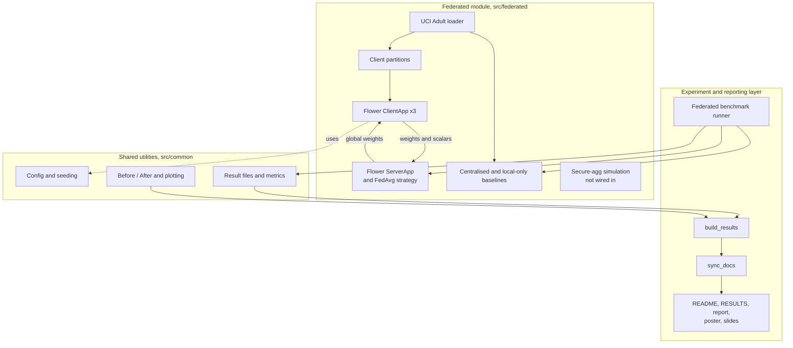
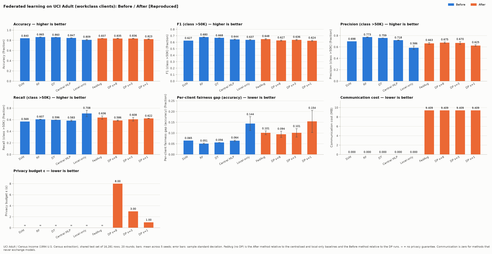

# Federated Learning with Differential Privacy on UCI Adult

`federated-privacy-adult` is a reference implementation for researchers who need to train one
model across data owners that cannot pool their raw data, under an explicit privacy budget. It
provides sample-weighted federated
averaging (FedAvg) built on Flower, with record-level differential privacy from Opacus,
evaluated on the public UCI Adult / Census Income dataset (the 1994 U.S. Census extraction)
with three clients defined by the `workclass` attribute, an IID control that deals the same
rows into three equal clients, centralised and local-only baselines, robust aggregation rules
under attack, a secure-aggregation simulation and a sweep over the privacy budget ε. Every
setting is written down, every quantity that leaves a client is listed
together with whether the privacy guarantee covers it, and the method is compared with the
methods it would replace in a Before / After table measured under documented conditions. Every
number in the documentation carries one source label that says where it comes from:
`[Paper-reported]` (printed in the source paper and shown for reference only), `[Reproduced]`
(obtained by running this repository's code under the documented conditions) or
`[Target / TBD]` (not yet run). The code is aimed first at researchers who want to run,
benchmark and extend federated training under a privacy budget, and second at platform and
infrastructure engineers who want to see what such a pipeline releases and what it costs.

[](https://github.com/fguo10-tech/federated-privacy-adult/actions/workflows/ci.yml)
[](LICENSE)
[](https://www.python.org/)

> Draft reference implementation — values printed in the source paper are shown for reference only; see RESULTS.md for the values this code produces and the conditions under which it produces them.

The file referred to in the banner is [experiments/results/RESULTS.md](experiments/results/RESULTS.md).
The long-form write-up is the [project report](docs/report/PROJECT_REPORT.md); the topic guide
[federated training with differential privacy across client domains](docs/investigations/01-federated-privacy-cross-domain.md)
discusses the method and the results in depth, and the
[deliverables checklist](docs/DELIVERABLES_CHECKLIST.md) lists every document and where each
required item can be found.

## Contents

1. [Why this project exists](#why-this-project-exists)
2. [The Proposed Endeavor](#the-proposed-endeavor)
3. [What is implemented, stubbed and planned](#what-is-implemented-stubbed-and-planned)
4. [Architecture overview](#architecture-overview)
5. [Quickstart](#quickstart)
6. [Repository tour](#repository-tour)
7. [Module guides](#module-guides)
8. [Datasets](#datasets)
9. [Results summary](#results-summary)
10. [Reproducibility](#reproducibility)
11. [Privacy and safety](#privacy-and-safety)
12. [How to collaborate](#how-to-collaborate)
13. [How to cite](#how-to-cite)
14. [Roadmap, limitations, FAQ, licence and acknowledgements](#roadmap-limitations-faq-licence-and-acknowledgements)

## Why this project exists

Separate data owners, such as institutions in different domains, often hold rows that would
train a better model together than apart, but they cannot pool the raw rows in one place. The
problem this repository addresses is how to train one model across such owners, and what that
costs in accuracy under a privacy budget, compared with pooling the data in one place and with
each owner training alone. The method is
federated learning, in which clients train on their own data and send only model parameters to a
server (McMahan et al., 2017), combined with differential privacy, a mathematical bound on how
much any single training record can change what is released (Dwork et al., 2006). The method
follows the federated learning approach with differential privacy described by Zhang et al.
(2025).

The companion project `ddqn-os-scheduling` is a separate repository with its own data, code and
results; the two share the same direction and the same reporting conventions.

This repository adds four things:

- **Reproducibility.** Every setting is written down in YAML, commented and
  tagged `[Assumption — not in paper]`; every result has a raw CSV, the exact config used and a
  metadata file behind it; every `[Reproduced]` value is a mean and sample standard deviation
  over five seeds; and the tables in the documentation are generated from the result files
  rather than typed.
- **Privacy accounting.** The repository states exactly which (ε, δ) guarantee it gives, to whom
  and for what, lists every quantity that leaves a client together with whether the guarantee
  covers it, and labels its secure-aggregation component as a simulation.
- **Baselines and controls.** Federated training is compared with centralised models trained on
  the pooled rows (a small neural network, an SVM, a Random Forest and a Decision Tree), with
  each client training alone, and with the same federated model without differential privacy. An
  IID control separates the effect of how the rows are divided from the effect of which rows are
  used, and a robustness suite measures robust aggregation rules under Byzantine clients.
- **A Before / After comparison.** The method (After) is compared with the methods it would
  replace (Before) under one documented configuration, on the same test set and the same five
  seeds. Regressions are shown in the same table as gains, with a negative Improvement %.

The main design choices of this implementation are listed below; the topic guide explains how
each one shaped the code.

| Design choice | What this implementation does | Why |
|---|---|---|
| Aggregation | Sample-weighted FedAvg: each client's update is weighted by its number of rows. The unweighted mean is kept as an ablation. | So that a client's influence matches its data; the workclass clients differ several-fold in size. |
| Dataset and clients | UCI Adult, three clients defined by `workclass`, plus an IID control that deals the same rows into three equal clients. | Adult is public and tabular and has a natural domain attribute; the IID control separates the effect of client heterogeneity. |
| Privacy mechanism | Record-level DP-SGD through Opacus with the Rényi DP accountant, with ε and δ stated for every run and an ε sweep. | So that the guarantee is explicit. |
| Feature scaling | Fixed, data-independent public constants rather than statistics fitted on client rows. | So that nothing outside the accounted mechanism is released. |
| Local update | One local epoch of minibatch SGD per round, 20 rounds; every value is in `configs/federated_adult.yaml`. | — |
| Baselines | Centralised MLP, SVM, Random Forest and Decision Tree on the pooled training rows, local-only training and a majority-class reference. | The centralised MLP is the upper bound of what federation could reach; local-only training is the no-collaboration control. |
| Metrics | Precision, recall and F1 of the `>50K` class next to accuracy. | The positive class is rare, so accuracy alone rewards predicting the majority class. |
| Protected attributes | Age, race and sex are evaluation-only attributes, never model inputs. | Keeping them out lets them serve for a per-group breakdown. |
| Secure aggregation | A masking simulation behind the `SecureAggregator` interface, labelled as a simulation and not wired into training. | — |

## The Proposed Endeavor

The following paragraph states the endeavour that this codebase is built to support.

> Design and implement advanced machine learning and large language model architectures for secure, reliable system-level optimization in order to enhance the efficiency, reliability, and security of U.S. digital infrastructure and accelerate the deployment of next-generation artificial intelligence (AI) applications.

This repository addresses one part of that endeavour: machine learning with privacy accounting
across data owners, that is, federated training under a stated differential-privacy budget with
every released quantity listed. It contains no large-language-model component, and none is
claimed anywhere in the code or the documentation.

## What is implemented, stubbed and planned

"Implemented" means the code exists, is tested and was exercised by the reference run.
"Stubbed / simulated" means the code exists but is a sketch, a simulation, or was never
exercised end to end. "Planned" means nothing exists yet; any result for it is `[Target / TBD]`.

| Component | Status | Where / notes |
|---|---|---|
| UCI Adult loader with checksum pinning and fixed public scaling | Implemented | `src/federated/datasets/adult.py`, `data/download_adult.py` |
| Workclass split, IID control, size-matched IID, label-skew and quantity-skew partitions | Implemented | `src/federated/partition.py` |
| Synthetic toy domains for tests, smoke runs and the quickstart example | Implemented | `src/federated/datasets/synthetic_domains.py`, `data/synthetic/generate_federated_toy.py`; labels on synthetic numbers, no results reported |
| Flower `ClientApp` / `ServerApp` / strategy on an in-process grid | Implemented | `src/federated/client_app.py`, `server_app.py`, `strategy.py`, `inprocess.py` |
| Flower Ray-based simulation engine | Stubbed (never completed a run) | `federation.engine: ray` is `[Target / TBD]`; needs the `flower-sim` extra; its test is opt-in |
| Weighted FedAvg, unweighted mean (ablation), coordinate-wise median, trimmed mean | Implemented | `src/federated/aggregation.py` |
| Per-client record-level DP-SGD with RDP accounting | Implemented | `src/federated/privacy.py`; Opacus `secure_mode` off |
| Centralised MLP, SVM, Random Forest, Decision Tree, majority class, local-only training | Implemented | `src/federated/baselines.py` |
| Byzantine attacks and robust aggregation suite | Implemented | `src/federated/attacks.py`; the reference run uses the sign-flip attack only |
| Per-group evaluation by sex, race and age band | Implemented | `src/federated/evaluation.py`; descriptive only, not a fairness certification |
| Secure aggregation | Stubbed (masking simulation) | `src/federated/secure_agg.py`; one shared seed, not cryptography, not wired into training |
| `train_fitted` feature scaling | Implemented, not used in the reference run | Would need a release that the DP accounting does not cover |
| FEMNIST / LEAF reader | Stubbed (optional) | `src/federated/datasets/femnist.py`; tested on a synthetic fixture only; nothing is downloaded; no results |
| Before / After tables, charts and documentation sync | Implemented | `src/common/before_after.py`, `experiments/build_results.py`, `experiments/sync_docs.py` |
| Real secure-aggregation backend (homomorphic encryption or secure multi-party computation) | Planned | `[Target / TBD]` behind the `SecureAggregator` interface |
| FEMNIST results | Planned | `[Target / TBD]` |
| Client-level differential privacy | Planned | `[Target / TBD]` |
| Large-language-model architectures of any kind | Planned (not started) | Nothing in this repository |

## Architecture overview

<!-- BEGIN GENERATED: diagram_system_overview -->

<!-- END GENERATED: diagram_system_overview -->

The repository has three layers. The federated package (`src/federated`) holds the dataset
loaders, the client partitions, the Flower client and server apps, the aggregation rules, the
privacy engine, the baselines, the attacks and the secure-aggregation simulation. It depends only
on `src/common`, which holds configuration loading, seeding, result files, metrics, plotting,
provenance labels and the Before / After rules and knows nothing about federated learning. Above
them sits the experiment layer (`experiments/`): the benchmark script, which writes raw CSV
files, a copy of the config and a metadata file into a run folder, and a reporting step that
turns the reference run into tables, charts and the generated blocks embedded in every document.

The data flow inside a round is simple. The Adult loader reads the downloaded files and applies a
fixed, data-independent scaling; the partition step assigns each training row to at most one
client; the server sends the current global weights to every client; each client trains locally,
with or without DP-SGD, and replies with its new weights and a few scalars; the strategy combines
the replies with the configured aggregation rule and evaluates the new global model on the shared
test set. The centralised and local-only baselines read the same loader output but never pass
through Flower.

The diagram does not show a large-language-model component, because none exists. It also does
not show the inside of a round; the federated round with DP-SGD and in-process Flower messaging,
the trust boundary of a client and the experiment flow each have their own diagram and
explanation in [docs/architecture/](docs/architecture/README.md), starting with
[01-system-overview.md](docs/architecture/01-system-overview.md). A reader who wants to know what
leaves a client should go to [03-trust-boundary.md](docs/architecture/03-trust-boundary.md); a
reader who wants to know where a number in the documentation comes from should go to
[04-experiment-flow.md](docs/architecture/04-experiment-flow.md).

## Quickstart

Everything runs on a laptop CPU; no GPU is needed. Python 3.11 or 3.12 is required. Commands are
run from the repository root. The `make` targets call `python`, so activate the virtual
environment first (or pass `PYTHON=.venv/bin/python`). `make help` lists every target.

**1. Clone and install.**

```bash
git clone https://github.com/fguo10-tech/federated-privacy-adult.git
cd federated-privacy-adult
python -m venv .venv
source .venv/bin/activate            # Windows: .venv\Scripts\activate
make install                         # same as: python -m pip install -e ".[all]"
```

Flower, Opacus, PyTorch and scikit-learn are core dependencies, so a plain
`pip install -e .` already installs everything the benchmark needs. The `all` extra adds the
`notebooks` and `dev` extras (the notebook runner, pytest, ruff and black). The `flower-sim`
extra, `pip install -e ".[flower-sim]"`, adds Flower's Ray-based simulation engine, which is
optional and has never completed a run here. The exact package versions this draft was tested
with are pinned in `requirements-lock.txt`; to reproduce that environment exactly, run
`pip install -r requirements-lock.txt && pip install -e . --no-deps` instead of `make install`.

**2. Run the tests.**

```bash
make test                            # python -m pytest; no network
make test-fast                       # leaves out the tests marked slow
```

Tests that need the Adult files are marked `adult` and are skipped until step 4. The
documentation-integrity tests check the documents themselves and fail if a required document is
missing or a generated block is stale. The Ray engine test is marked `flower_sim` and is skipped
unless that engine is installed; tests that need the network are marked `network`.

**3. Smoke run (no download).**

```bash
make smoke
```

which is

```bash
python -m experiments.run_federated_benchmark --config configs/federated_fedavg.yaml \
    --suite all --smoke --out experiments/results/runs/smoke_federated
python -m experiments.plot_federated --run-dir experiments/results/runs/smoke_federated
```

This runs every suite of the benchmark end to end at a tiny scale (one development seed, a few
federated rounds, the synthetic toy domains) and draws its figures. Output goes to
`experiments/results/runs/smoke_federated/`, with `config_used.yaml`, `metadata.json`,
`summary.csv`, the raw CSV files and a `figures/` folder. It finishes in well under a minute.
Smoke numbers check that the pipeline works; they are not results. An even smaller entry point
prints accuracy and F1 after every round straight to the terminal, followed by one run with
DP-SGD and its ε:

```bash
python examples/quickstart_federated.py            # optional: --seed 100
```

**4. Download UCI Adult.**

```bash
make data                            # same as: python data/download_adult.py
```

This contacts only the canonical UCI host, writes `adult.data`, `adult.test` and `adult.names`
into `data/adult/` (git-ignored) and verifies them against the SHA-256 pins in
`data/checksums/adult.sha256`. If the files are already present it does not download again; it
verifies them and prints the row counts (`--force` downloads again). A quick check that the
pipeline runs on the real files, at smoke scale:

```bash
python -m experiments.run_federated_benchmark --config configs/federated_adult.yaml \
    --suite main --smoke --out experiments/results/runs/smoke_adult
```

**5. Run the benchmark.**

```bash
make federated                       # runs `make data` first; WORKERS=8 make federated
```

which is

```bash
python -m experiments.run_federated_benchmark --config configs/federated_adult.yaml \
    --suite main --workers 4 --out experiments/results/runs/federated_adult
python -m experiments.plot_federated --run-dir experiments/results/runs/federated_adult
```

Expected output in `experiments/results/runs/federated_adult/`: `config_used.yaml`,
`metadata.json`, `final.csv` (final-round metrics per method, split and seed), `per_round.csv`,
`per_client.csv`, `per_group.csv`, `partition_stats.csv`, `dp_tradeoff.csv`, `summary.csv`,
`timings.csv` and a `figures/` folder. The `main` suite covers both client splits, every
baseline and the DP sweep. `--suite all` adds the `partitions`, `aggregation` and `robustness`
ablation suites; each of them can also be run on its own with `--suite NAME`. The extended
privacy study is a separate run:

```bash
python -m experiments.run_federated_benchmark --config configs/federated_dp.yaml \
    --suite main --workers 4 --out experiments/results/runs/federated_adult_dp
```

To run every suite on the toy domains instead of Adult, without a download, use
`make federated-toy`; its output goes to `experiments/results/runs/federated_toy/`.

**Run times.** The table below records when the reference run was made, on which seeds and in
which environment, and the measured wall-clock time of each part. The `federated_adult` row is
the benchmark with all four suites; the `federated_adult_dp` row is the extended privacy study.
At the default scale each of these parts finished in under ten minutes on the reference machine,
so `make federated` (which runs only the main suite) is a short job on a recent laptop. To shrink
a run further, use `--smoke` (the `smoke_overrides:` block of the config) or fewer seeds with
`--seeds`, for example `--seeds 100`. `make reference` re-creates both parts and then rebuilds
every table.

<!-- BEGIN GENERATED: reference_run_info -->
| Reference run | Created (UTC) | Seeds | Environment | Wall-clock time |
|---|---|---|---|---|
| federated_adult | 2024-11-20T05:26:24Z | 0, 1, 2, 3, 4 | Python 3.12.14 on macOS-26.6.2-arm64-arm-64bit; flwr 1.44.0, matplotlib 3.11.2, numpy 2.5.5, opacus 1.6.0, pandas 3.1.1, pyyaml 6.0.3, scikit-learn 1.9.1, torch 2.15.0 | 119 s with 8 worker processes |
| federated_adult_dp | 2024-11-20T05:32:59Z | 0, 1, 2, 3, 4 | Python 3.12.14 on macOS-26.6.2-arm64-arm-64bit; flwr 1.44.0, matplotlib 3.11.2, numpy 2.5.5, opacus 1.6.0, pandas 3.1.1, pyyaml 6.0.3, scikit-learn 1.9.1, torch 2.15.0 | 393 s with 8 worker processes |
<!-- END GENERATED: reference_run_info -->

Wall-clock times from one Apple-silicon laptop; they are indicative only and depend on the number
of worker processes. Results themselves do not depend on the worker count.

**6. Rebuild tables and the notebook (optional).**

```bash
python -m experiments.build_results  # tables, Before / After CSVs and charts from reference/
python -m experiments.sync_docs --check
make notebooks                       # executes notebooks/ into notebooks/_executed (git-ignored)
```

`build_results` reads only `experiments/results/reference/`, so running it on an unchanged
checkout reproduces the committed tables (`--no-figures` writes the tables and CSV files only).
`sync_docs` without `--check` rewrites every generated block in the documentation; contributors
should leave that to `make results`.

## Repository tour

**`src/`** is the import package. It is deliberately called `src` (see the FAQ) and is installed
in editable mode. It has two sub-packages. `src/common` holds shared utilities that know nothing
about federated learning. `src/federated` holds the method: the dataset readers in
`src/federated/datasets/` (`adult.py`, the optional `femnist.py` and the toy
`synthetic_domains.py`), the partitions, the model, local training and DP-SGD, the Flower client
and server apps with their in-process grid and message-size accounting, the aggregation rules, the
baselines, the attacks, the evaluation code, the secure-aggregation simulation and the runner
that turns a config into a list of tasks.

**`configs/`** holds every hyperparameter and experimental setting as commented YAML. Each key
carries its meaning, its unit and a provenance tag. `federated_adult.yaml` is the locked
protocol on Adult; `federated_dp.yaml` inherits from it and replaces the `dp` section (the
extended privacy sweep), apart from its own run name, output folder and smoke block;
`federated_fedavg.yaml` runs the toy synthetic domains for smoke tests, CI and the quickstart
example; `before_after.yaml` defines which methods are compared in the reports and how metrics
are named, oriented and rounded; `optional/federated_femnist.yaml` points the optional FEMNIST
reader at a folder you prepare yourself.

**`data/`** contains no dataset. It holds `download_adult.py`, the SHA-256 pins in `checksums/`,
and the generator for the federated toy domains in `synthetic/`. Downloaded files land in
`data/adult/`, which is git-ignored. The dataset card is [data/README.md](data/README.md).

**`experiments/`** contains the command-line entry points: `run_federated_benchmark.py`,
`plot_federated.py`, `describe_adult.py` (partition statistics for the dataset card),
`run_reference.py` (re-creates the reference run), `build_results.py` (tables and charts),
`sync_docs.py` (injects the generated blocks) and `run_notebooks.py`.
`experiments/results/reference/` holds the committed reference run behind every `[Reproduced]`
number, in two parts, `federated_adult/` and `federated_adult_dp/`, plus the Before / After CSV
files and charts in `before_after/` and the generated Markdown blocks in `generated/`;
`experiments/results/templates/` holds header-only CSV schemas; `experiments/results/runs/` is
where your own runs go, and it is git-ignored.
[experiments/results/RESULTS.md](experiments/results/RESULTS.md) collects every result table.

**`examples/`** has one short script, `quickstart_federated.py`, that runs in well under a minute
and shows the public API: a few FedAvg rounds through the real Flower apps on the toy domains,
followed by one DP run with its ε.

**`notebooks/`** contains one notebook,
[01_federated_privacy_tradeoff.ipynb](notebooks/01_federated_privacy_tradeoff.ipynb), which
runs the main suite at notebook scale (the full protocol on two of the five reporting seeds,
written under `experiments/results/runs/notebooks/`) and walks through the privacy–utility
trade-off; its numbers are indicative, and the reference values are in RESULTS.md. It is committed
without outputs; `make notebooks` executes it into a git-ignored folder.

**`tests/`** is the pytest suite: unit tests for the Adult loader and partitions, the Flower
apps, aggregation, privacy, secure aggregation, the configs, the common utilities and the
Before / After rules, command-line smoke tests and the documentation integrity checks. Small
synthetic fixtures (never real data) live in `tests/fixtures/`.

**`docs/`** holds the [project report](docs/report/PROJECT_REPORT.md), the bibliography
`docs/report/references.bib`, the topic guide under `docs/investigations/`, the four
architecture diagrams under [docs/architecture/](docs/architecture/README.md), a
[poster](docs/poster/POSTER.md), a [slide deck](docs/slides/PRESENTATION.md), the
[deliverables checklist](docs/DELIVERABLES_CHECKLIST.md) and the
[replication registry](docs/REPLICATIONS.md).

**`.github/`** holds the CI workflow (lint, tests on Python 3.11 and 3.12, the smoke run and the
documentation check), the pull-request template and the issue forms for bug reports, replication
reports, benchmark submissions and research proposals.

**Top-level files.** `pyproject.toml` declares the package, its core dependencies (including
Flower, Opacus and scikit-learn), its optional extras (`flower-sim`, `notebooks`, `dev`, `all`)
and the lint and test settings. `requirements.txt` gives the supported ranges and
`requirements-lock.txt` the tested versions. The `Makefile` wraps the common tasks; `make help`
lists them. `LICENSE` is Apache-2.0. `CITATION.cff` is the machine-readable citation.
[CONTRIBUTING.md](CONTRIBUTING.md), [SECURITY.md](SECURITY.md) and
[CODE_OF_CONDUCT.md](CODE_OF_CONDUCT.md) describe how to take part.

## Module guides

### Federated learning (`src/federated`)

**Concepts.** A *client* holds a disjoint set of training rows and never sends them anywhere. In
each *round* the server sends the current global weights; each client trains locally for one
pass and returns its weights and its row count; the server combines the replies with an
*aggregation rule* and evaluates the new global model on the shared test set. *Weighted FedAvg*
weights each client by its share of the rows. *Local-only* training is the no-collaboration
control: each client trains alone for the same number of passes. The *centralised MLP* is the
same network trained on pooled rows, the upper bound of what federation could reach. The
classical baselines (SVM, Random Forest, Decision Tree) are trained centrally on the pooled
rows. *DP-SGD* clips each example's gradient, adds Gaussian noise to the sum and samples
batches at random, so that the sequence of updates a client sends satisfies (ε, δ)-differential
privacy with respect to any one of its rows; smaller ε means stronger privacy. A *suite* is a
named group of runs of the benchmark script: `main` (both splits, all baselines, the DP sweep),
`partitions`, `aggregation` and `robustness`.

**Config files and their main sections.** `configs/federated_adult.yaml` has `experiment`
(seeds, output folder), `dataset` (paths, checksums, the fixed public scaling, age bands),
`evaluation`, `model`, `training`, `federation` (aggregation rule, trimmed-mean fraction,
client-side evaluation, engine), `dp` (δ, accountant, sweep), `partitions`, `baselines`,
`robustness`, `aggregation_suite`, `runtime` and `smoke_overrides`.
`configs/federated_dp.yaml` names it as `base_config` and replaces `dp` (plus its run name,
output folder and smoke block). `configs/federated_fedavg.yaml` has the same schema, with the
toy synthetic domains in place of Adult. Configs are loaded by `load_federated_config` in
`src/federated/config.py`, which builds frozen dataclasses (`FederatedConfig` and one class per
section) and rejects a missing or unknown key, so a typo cannot be ignored silently.

**Changing a hyperparameter.** Edit the YAML, or override any key on the command line with a
dotted path; `--set` may be repeated and values are parsed with YAML rules:

```bash
python -m experiments.run_federated_benchmark --config configs/federated_adult.yaml \
    --suite main --seeds 100 --set training.rounds=5 --set 'model.hidden_sizes=[64,32]' \
    --out experiments/results/runs/federated_dev
```

Use development seeds (100 and above) for anything exploratory. The 20-round, five-seed protocol
and the ε sweep are locked for reporting; change them for your own studies and say so when you
report. The merged config a run actually used is always written to `config_used.yaml` in its
output folder, so a result can be traced back to its settings even when they came from `--set`.

**Recipe: add a partition.**

1. Write a pure function of (row pool, settings, seed) in `src/federated/partition.py` that
   returns one index array per client, and add a branch for its name in `make_partition`.
2. If it has settings, add them to `PartitionConfig` in `src/federated/config.py` and to the
   `partitions:` section of `configs/federated_adult.yaml` (and `federated_fedavg.yaml`, which
   uses the same schema), each with a commented provenance tag.
3. List the name under `partitions.ablations` (or `partitions.splits` for the main suite) and run
   `--suite partitions`.
4. Add its display row to `partition_entries`, the partition ablation table in
   `experiments/build_results.py`.
5. Test that the clients are disjoint, that together they cover the client row pool exactly
   once, and that the partition is deterministic for a fixed seed (see
   `tests/test_federated_adult.py`, which uses the committed synthetic fixture).

**Recipe: add a client.** The three workclass clients are defined by `WORKCLASS_DOMAINS` in
`src/federated/datasets/adult.py`, a mapping from client name to the workclass values it holds;
rows with workclass `?`, `Without-pay` or `Never-worked` belong to no client. Changing it changes
the dataset split, so CONTRIBUTING.md requires an accepted research proposal first. Keep δ below
one over the smallest client's row count, and update the tests in
`tests/test_federated_adult.py`. To vary the *number* of clients without changing the domains,
use an IID-style partition, as the robustness suite does with `robustness.num_clients`.

**Recipe: add an aggregation rule.**

1. Write a NumPy function in `src/federated/aggregation.py` with the signature
   `(updates, num_examples, client_ids=None)` that returns one array per layer; reuse `_sorted`
   so the result does not depend on reply order.
2. Register it in the `AGGREGATORS` dictionary. If it takes an extra parameter (as
   `trimmed_mean` takes `beta`), add a branch to `aggregate` and a config key.
3. Add its name to the `AggregationRule` `Literal` in `src/federated/config.py` and to the
   comment of `federation.aggregation_rule` in the YAML files.
4. Select it with `federation.aggregation_rule`, or list it under
   `robustness.aggregation_rules` to compare it under attack (`--suite robustness`); for a
   readable row in the robustness table of `experiments/build_results.py`, add its label to the
   `names` mapping and its name to the tuple of rules that the table loop matches.
5. Add tests to `tests/test_federated_aggregation.py`: it reduces to plain weighted averaging
   where it should (for example identical updates), sample weighting if it uses weights, an
   empty or zero-weight client, and, for a robust rule, a known outlier.

**Recipe: add an attack.** Update attacks live in `src/federated/attacks.py`. Write a function
that takes the client's new weights and the global weights and returns the poisoned weights, add
its name to `UPDATE_ATTACKS` and a branch to `apply_update_attack`, and add the name to the
`AttackKind` `Literal` in `src/federated/config.py` and to the comment of
`robustness.attack.kind` in the YAML files. Select it with `robustness.attack.kind` and run
`--suite robustness`. The reference run uses the sign-flip attack only; the others are
implemented and tested but have no reported results.

**Recipe: add a centralised baseline.** Decorate a builder
`builder(config, dataset, seed) -> (predictions, train_loss, train_rows)` with
`@register_baseline("name")` in `src/federated/baselines.py`, list the name in
`baselines.methods`, add a settings block and dataclass if it has settings, and a label in
`configs/before_after.yaml`.

**Running an ablation suite.** The `partitions`, `aggregation` and `robustness` suites read
their settings from the sections of the same names in the config (`partitions.ablations`,
`aggregation_suite`, `robustness`). Change a setting there or with `--set`, and run the suite
with `--suite NAME` into your own output folder. The reference ablations and their tables are in
the ablations section of [RESULTS.md](experiments/results/RESULTS.md).

### Shared utilities (`src/common`)

`config.py` loads YAML, resolves `base_config` inheritance, merges `smoke_overrides` when
`--smoke` is given, applies `--set key.sub=value` overrides and builds frozen dataclasses with
`from_dict`, which rejects missing and unknown keys. `seeding.py` provides `derive_seed`, a hash
of a parent seed and a label: every consumer of randomness (a client, a round, a partition) gets
its own child seed, so adding a new consumer never shifts an existing stream. DP noise streams
are child seeds of each client's own secret, not of the run seed the server sends (see "Privacy
and safety"). `io.py` writes CSV and JSON and provides `save_run_metadata`, which records seeds,
the command line and package versions. `metrics.py` implements `summarise_by_seed` (average
within a seed, then mean and sample standard deviation across seeds) and the classification
metrics. `labels.py` defines the three source labels and the assumption tag. `paper_values.py`
holds the reference values shown in RESULTS.md. `before_after.py`
implements the Before / After rules: Delta is After minus Before in the metric's unit;
Improvement % is signed so that a positive value always means better after; no percentage is
computed when Before is zero or near zero or the two sides were not measured under the same
conditions; an unrun side is `TBD`. `plotting.py` gives every chart the same colour roles: blue
for Before, orange for After, grey for references.

### From a run to a table in the documentation

Every `[Reproduced]` number in the documentation travels the same path, which
[04-experiment-flow.md](docs/architecture/04-experiment-flow.md) draws. The benchmark script
writes raw per-seed CSV files and a `summary.csv` into a run folder. `make reference` writes the
two reference parts into `experiments/results/reference/`. `experiments/build_results.py` reads
only that folder, applies the Before / After definitions in `configs/before_after.yaml`, and
writes the Before / After CSV files and charts into `before_after/` and one Markdown block per
table into `generated/`. `experiments/sync_docs.py` copies each block between its
begin and end markers (HTML comments that name the block id) in every document that includes
it. Because no reproduced number is ever typed by hand, a document cannot drift from the
results; `make docs-check` fails CI if one has. To add a new table, add a function to
`build_results.py` that writes a new block, run `make results`, and include the block by its id.

## Datasets

The full dataset card is [data/README.md](data/README.md).

**Primary dataset: UCI Adult / Census Income.** Adult, also known as Census Income, was extracted
by Barry Becker from the 1994 U.S. Census database and donated to the UCI Machine Learning
Repository on 1996-04-30 (Becker and Kohavi, 1996). It is published under the Creative Commons
Attribution 4.0 International licence (CC BY 4.0). It has 48,842 rows with 14 attributes: 32,561
training rows in `adult.data` and 16,281 test rows in `adult.test`. The task is to predict whether
a person's income exceeds $50,000 a year (target `>50K` versus `<=50K`); about 24% of rows are
positive. Canonical source:
[http://archive.ics.uci.edu/ml/datasets/Adult](http://archive.ics.uci.edu/ml/datasets/Adult).
The files are downloaded by script, verified against pinned checksums and never committed.

The choice of Adult is `[Assumption — not in paper]`, as are the clients. The primary split has
three clients defined by the `workclass` attribute: *Private*, *Government* (federal, state and local government) and *Self-employed* (incorporated and not
incorporated). They differ several-fold in size and in positive rate, which makes the split
naturally non-IID. Rows with a missing, `Without-pay` or `Never-worked` workclass belong to no
client; they are used only by the centralised baselines trained on all rows. The *IID control*
deals the same client rows, shuffled, into three equal clients, so that any difference between
the two splits is due to how the rows are divided, not which rows are used. Age, race and sex
are never model inputs; they are kept as evaluation-only attributes for a per-group breakdown.
`fnlwgt` and `education` are excluded as well (`education-num` carries the same information).
Every method, federated or centralised, is evaluated on the same 16,281-row test set.

<!-- BEGIN GENERATED: adult_partition_stats -->
Computed from the downloaded `adult.data` (training rows only); source CSV `experiments/results/reference/federated_adult/partition_stats.csv`. [Reproduced]

| Split | Client | Training rows | Positives (>50K) | Positive rate | Share of client rows | Workclass composition |
|---|---|---|---|---|---|---|
| Workclass split (primary, non-IID) | Private | 22,696 | 4,963 | 0.2187 | 0.7392 | Private 22696 |
| Workclass split (primary, non-IID) | Government | 4,351 | 1,341 | 0.3082 | 0.1417 | Federal-gov 960, Local-gov 2093, State-gov 1298 |
| Workclass split (primary, non-IID) | Self-employed | 3,657 | 1,346 | 0.3681 | 0.1191 | Self-emp-inc 1116, Self-emp-not-inc 2541 |
| IID control, seed 0 | iid_0 | 10,235 | 2,619 | 0.2559 | 0.3333 | Federal-gov 338, Local-gov 735, Private 7525, Self-emp-inc 377, Self-emp-not-inc 855, State-gov 405 |
| IID control, seed 0 | iid_1 | 10,235 | 2,500 | 0.2443 | 0.3333 | Federal-gov 322, Local-gov 678, Private 7582, Self-emp-inc 369, Self-emp-not-inc 842, State-gov 442 |
| IID control, seed 0 | iid_2 | 10,234 | 2,531 | 0.2473 | 0.3333 | Federal-gov 300, Local-gov 680, Private 7589, Self-emp-inc 370, Self-emp-not-inc 844, State-gov 451 |

Excluded from every client split: 1,857 training rows (? 1836, Never-worked 7, Without-pay 14; positive rate 0.1029). The workclass split is the same for every seed; the IID control is reshuffled with each run seed, so its per-client positive rates vary slightly between seeds while its client sizes stay fixed.
<!-- END GENERATED: adult_partition_stats -->

The table is computed from the downloaded training file. It shows client sizes and positive
rates for the two partitions of the main benchmark: the workclass split and the three-client
IID control (for the first reporting seed). It does not show the test set, which is shared by
all methods, the ablation partitions, or anything about how well a model does. To recompute it
from your own download, run `python -m experiments.describe_adult`, which writes into
`experiments/results/runs/adult_description/` by default.

**Optional secondary benchmark: FEMNIST / LEAF.** A reader for LEAF-format FEMNIST shards
(Caldas et al., 2018) exists for researchers who want an image benchmark with natural per-writer
clients. It is optional and was not run: nothing is downloaded, the reader is tested only on a
synthetic fixture, and every FEMNIST result is `[Target / TBD]`. Its config,
`configs/optional/federated_femnist.yaml`, points at a folder you prepare yourself.

**Synthetic toy domains.** `configs/federated_fedavg.yaml` describes three small synthetic
domains, generated from seeds, that the tests, the smoke run, `make federated-toy` and the
quickstart example use. Their names are labels on synthetic numbers, not data about anyone, and
no result on them is reported. `python data/synthetic/generate_federated_toy.py --seed 0 --out
data/synthetic` writes them to CSV if you want to inspect them.

No real medical, financial or personal data is in the repository.

## Results summary

Dataset: UCI Adult / Census Income (1994 U.S. Census extraction; 48,842 rows; workclass clients Private / Government / Self-employed plus IID control)

This section shows the Before / After comparison and the privacy–utility trade-off. Before is a
centralised baseline, the clients' own local-only models, or weighted FedAvg without
differential privacy; After is weighted FedAvg without differential privacy or with it at ε = 8,
3 and 1. Every value in these tables carries the label `[Reproduced]`: it was obtained by running
this repository's code under the documented conditions (the config, seeds, dataset and client
split named in each table). In every table a positive Improvement % always means
better after, and a regression shows as a negative Improvement %.

Every other table is in [RESULTS.md](experiments/results/RESULTS.md): the full Before / After table with all seven metrics
on both client splits, all methods and all metrics, the extended privacy study, the per-group
breakdown, the partition statistics, the released quantities under DP and the ablations. The
prose here states in words what the tables show; the topic guide discusses them in depth.

### Before / After on the workclass clients

Each row compares an After method with one Before method on the workclass clients: weighted
FedAvg without differential privacy against each centralised baseline and against local-only
training, and weighted FedAvg with differential privacy at each ε against the same model without
it.

<!-- BEGIN GENERATED: before_after_summary -->
Dataset: UCI Adult / Census Income (1994 U.S. Census extraction; 48,842 rows; workclass clients Private / Government / Self-employed plus IID control)

Source label: [Reproduced]. Clients: workclass clients. Protocol for every Before and After value: 20 communication rounds, 5 seeds, mean ± sample standard deviation, shared Adult test set (16,281 rows). The full table (all seven metrics, both client splits) is in `experiments/results/RESULTS.md`.

| Metric | Unit | Direction | Before Method | Before Value | After Method | After Value | Delta (absolute) | Improvement % | Source Label |
|---|---|---|---|---|---|---|---|---|---|
| Accuracy | fraction | Higher is better | SVM (centralised) | 0.8401 ± 0.0000 | Weighted FedAvg (no DP) | 0.8372 ± 0.0018 | -0.0028 | -0.3% | [Reproduced] |
| Accuracy | fraction | Higher is better | Random Forest (centralised) | 0.8650 ± 0.0003 | Weighted FedAvg (no DP) | 0.8372 ± 0.0018 | -0.0277 | -3.2% | [Reproduced] |
| Accuracy | fraction | Higher is better | Decision Tree (centralised) | 0.8598 ± 0.0001 | Weighted FedAvg (no DP) | 0.8372 ± 0.0018 | -0.0226 | -2.6% | [Reproduced] |
| Accuracy | fraction | Higher is better | Centralised MLP (upper bound) | 0.8475 ± 0.0012 | Weighted FedAvg (no DP) | 0.8372 ± 0.0018 | -0.0102 | -1.2% | [Reproduced] |
| Accuracy | fraction | Higher is better | Local-only (mean of 3 client models) | 0.8094 ± 0.0117 | Weighted FedAvg (no DP) | 0.8372 ± 0.0018 | +0.0278 | +3.4% | [Reproduced] |
| Accuracy | fraction | Higher is better | Weighted FedAvg (no DP) | 0.8372 ± 0.0018 | Weighted FedAvg + DP (ε = 8) | 0.8355 ± 0.0041 | -0.0018 | -0.2% | [Reproduced] |
| Accuracy | fraction | Higher is better | Weighted FedAvg (no DP) | 0.8372 ± 0.0018 | Weighted FedAvg + DP (ε = 3) | 0.8360 ± 0.0054 | -0.0013 | -0.1% | [Reproduced] |
| Accuracy | fraction | Higher is better | Weighted FedAvg (no DP) | 0.8372 ± 0.0018 | Weighted FedAvg + DP (ε = 1) | 0.8225 ± 0.0056 | -0.0147 | -1.8% | [Reproduced] |
| F1 (class >50K) | fraction | Higher is better | SVM (centralised) | 0.6268 ± 0.0000 | Weighted FedAvg (no DP) | 0.6485 ± 0.0089 | +0.0216 | +3.5% | [Reproduced] |
| F1 (class >50K) | fraction | Higher is better | Random Forest (centralised) | 0.6800 ± 0.0014 | Weighted FedAvg (no DP) | 0.6485 ± 0.0089 | -0.0315 | -4.6% | [Reproduced] |
| F1 (class >50K) | fraction | Higher is better | Decision Tree (centralised) | 0.6678 ± 0.0004 | Weighted FedAvg (no DP) | 0.6485 ± 0.0089 | -0.0193 | -2.9% | [Reproduced] |
| F1 (class >50K) | fraction | Higher is better | Centralised MLP (upper bound) | 0.6437 ± 0.0060 | Weighted FedAvg (no DP) | 0.6485 ± 0.0089 | +0.0048 | +0.7% | [Reproduced] |
| F1 (class >50K) | fraction | Higher is better | Local-only (mean of 3 client models) | 0.6369 ± 0.0072 | Weighted FedAvg (no DP) | 0.6485 ± 0.0089 | +0.0116 | +1.8% | [Reproduced] |
| F1 (class >50K) | fraction | Higher is better | Weighted FedAvg (no DP) | 0.6485 ± 0.0089 | Weighted FedAvg + DP (ε = 8) | 0.6272 ± 0.0079 | -0.0213 | -3.3% | [Reproduced] |
| F1 (class >50K) | fraction | Higher is better | Weighted FedAvg (no DP) | 0.6485 ± 0.0089 | Weighted FedAvg + DP (ε = 3) | 0.6364 ± 0.0090 | -0.0121 | -1.9% | [Reproduced] |
| F1 (class >50K) | fraction | Higher is better | Weighted FedAvg (no DP) | 0.6485 ± 0.0089 | Weighted FedAvg + DP (ε = 1) | 0.6236 ± 0.0082 | -0.0248 | -3.8% | [Reproduced] |

Improvement % convention: a positive value always means better after. For higher-is-better metrics, Improvement % = (After − Before) / |Before| × 100; for lower-is-better metrics, Improvement % = (Before − After) / |Before| × 100. Delta = After − Before in the metric's own unit. Both are computed from unrounded means measured under the same config, dataset, workload and seeds; a regression shows as a negative Improvement %.
<!-- END GENERATED: before_after_summary -->



*Figure: Before / After on the workclass clients, accuracy and F1 of the >50K class, mean and
sample standard deviation over five seeds, 20 rounds. It shows one public dataset split into
three simulated clients in one process; it does not show real institutions, client-level
privacy or wall-clock cost. The IID control is in
[federated_iid.png](experiments/results/reference/before_after/federated_iid.png).*

### Privacy budget ε versus accuracy and F1

The table below gives, for each target ε of the locked sweep and for both client splits, the ε
actually spent, accuracy, F1, precision and recall of the >50K class, and the change in accuracy
relative to the same model without noise.

<!-- BEGIN GENERATED: epsilon_tradeoff -->
Dataset: UCI Adult / Census Income (1994 U.S. Census extraction; 48,842 rows; workclass clients Private / Government / Self-employed plus IID control)

Source label: [Reproduced]. Weighted FedAvg, 20 rounds, 5 seeds; ε is the record-level budget each client spends over all rounds (largest value over the three clients), at the δ set in `configs/federated_adult.yaml`. The ∞ row is the run with no noise, that is, with no differential privacy at all.

| Clients | Target ε | Achieved ε (max over clients) | Accuracy | F1 (class >50K) | Precision | Recall | Accuracy change vs no noise |
|---|---|---|---|---|---|---|---|
| workclass clients | 1 | 0.997 ± 0.000 | 0.8225 ± 0.0056 | 0.6236 ± 0.0082 | 0.6252 ± 0.0140 | 0.6222 ± 0.0034 | -0.0147 |
| workclass clients | 3 | 2.996 ± 0.000 | 0.8360 ± 0.0054 | 0.6364 ± 0.0090 | 0.6696 ± 0.0247 | 0.6081 ± 0.0326 | -0.0013 |
| workclass clients | 8 | 7.999 ± 0.000 | 0.8355 ± 0.0041 | 0.6272 ± 0.0079 | 0.6751 ± 0.0129 | 0.5857 ± 0.0092 | -0.0018 |
| workclass clients | ∞ | ∞ | 0.8372 ± 0.0018 | 0.6485 ± 0.0089 | 0.6626 ± 0.0154 | 0.6361 ± 0.0300 | reference |
| IID control | 1 | 0.992 ± 0.000 | 0.8376 ± 0.0030 | 0.6271 ± 0.0083 | 0.6865 ± 0.0224 | 0.5785 ± 0.0284 | -0.0082 |
| IID control | 3 | 2.991 ± 0.000 | 0.8406 ± 0.0017 | 0.6314 ± 0.0051 | 0.6960 ± 0.0113 | 0.5781 ± 0.0144 | -0.0053 |
| IID control | 8 | 7.995 ± 0.000 | 0.8414 ± 0.0010 | 0.6337 ± 0.0029 | 0.6973 ± 0.0069 | 0.5809 ± 0.0088 | -0.0045 |
| IID control | ∞ | ∞ | 0.8459 ± 0.0012 | 0.6402 ± 0.0114 | 0.7140 ± 0.0150 | 0.5812 ± 0.0278 | reference |
<!-- END GENERATED: epsilon_tradeoff -->


*Figure: the locked ε sweep (1, 3, 8 and no noise) on both splits. ε is the record-level budget
each client spends over all 20 rounds, the largest over the three clients. It does not show
client-level privacy, the cost of releasing several runs on the same rows, or any attack.*

### How to read the result, and when to use federated training

On the workclass clients, weighted FedAvg is more accurate than the clients' own local-only
models and less accurate than the centralised Random Forest and Decision Tree; it is also
slightly less accurate than the centralised SVM and the centralised MLP. With differential
privacy, accuracy changes little at ε = 8 and ε = 3 and drops more at ε = 1, and F1 of the >50K
class is lower at all three budgets. The tables give the values.

As selection guidance, this means that when the rows can be pooled in one place, a centralised
tree model gives higher accuracy and F1 on this task than federated training; when they cannot be
pooled, federated training is ahead of each client training alone; and a user who needs
differential privacy should expect a lower F1 at every budget of the locked sweep and a larger accuracy
cost at ε = 1 than at ε = 3 or ε = 8. A majority-class predictor already reaches a high accuracy
with an F1 of zero, so accuracy is always read next to F1.

Each ε in the sweep and in the extended privacy study applies to its own run alone; the runs
together are not covered by any single guarantee. The extended study, with a finer ε grid,
several clipping norms and fixed noise multipliers, the per-group breakdown and the ablations of
the aggregation rule, the client partition and robustness under attack are all in
[RESULTS.md](experiments/results/RESULTS.md).

**What these tables do not show.** They do not show that federated learning beats centralised
training, that the result carries over to other datasets, models or numbers of clients, that the
clients would behave like real institutions, or that the privacy guarantee extends beyond the one
run, the one threat model and the one public dataset it was measured on.

## Reproducibility

**Seeds.** Seeds 0–4 are the reporting seeds and are used once, for the reference run (the
notebook re-runs two of them at notebook scale and selects nothing on them). All
tuning and development use seeds 100 and above; settings were chosen on seeds 100–101 with a
validation split carved from the training rows, never on the test set. Child seeds are derived
with `derive_seed`, so every client, round and partition has its own reproducible random stream;
each DP noise stream is derived from that client's own secret seed, which the harness sets
reproducibly and which is never sent in any message.

**Configs.** Every run writes the merged config it actually used as `config_used.yaml`, and the
reference run's copies are committed under `experiments/results/reference/federated_adult/` and
`experiments/results/reference/federated_adult_dp/`. To re-run a reference result, point the
benchmark at that file or at the config in `configs/` with the same overrides.

**Paired evaluation.** Every method is evaluated on the same 16,281-row test set, with the same
preprocessing and the same five seeds. The final round is reported, never the best round, and no
setting was chosen on the test set. The workclass split is the same for every seed; the IID
control is reshuffled with each run seed.

**Statistics.** "mean ± std" means: average a metric within each seed, then take the mean and the
sample standard deviation (ddof = 1) of the per-seed values across five seeds. The standard
deviation describes run-to-run variation; it is not a confidence interval, and with five seeds
small differences between methods may be chance.

**Determinism and hardware.** Results are byte-identical for different worker counts, and the
reference run was made on a CPU-only laptop. PyTorch is limited to one thread per worker process
(`runtime.torch_threads`) so that floating-point results do not depend on the worker count.
Different CPUs, operating systems or library versions may change results in the last digits;
`metadata.json` records the versions used. Expected run times are in the reference-run table in
the [Quickstart](#quickstart).

**The reference run.** `experiments/results/reference/` holds the run behind every `[Reproduced]`
number: raw CSV files, summaries, configs, metadata, figures, the Before / After CSVs and charts,
and the generated Markdown blocks. Only `make reference` (which calls
`python -m experiments.run_reference`) writes there; contributors do not commit to it.
`python -m experiments.run_reference --skip-ablations` re-creates only the main suite.
`make results` rebuilds the tables and charts from the reference run and syncs them into the
documents, and `make docs-check` fails CI if any document is out of date.

**Replicating independently.** Clone a tagged commit, install the locked versions, run
`make data`, then run the benchmark and the extended privacy study as in the Quickstart into your
own output folder (never into `reference/`). Compare your `summary.csv` with the reference one,
method by method and split by split, and report what you find through the "Replication report"
issue form, attaching the summary CSV, `config_used.yaml`, `metadata.json`, the exact command with
every `--set` override, the seeds, the commit and your hardware. A replication that does not
match is as useful as one that does, and it is recorded the same way in
[docs/REPLICATIONS.md](docs/REPLICATIONS.md).

## Privacy and safety

> **Warning.** Do not use this code with real sensitive data (medical, financial or personal
> records) without an independent privacy and security review. It is draft research code: the
> privacy component is a research simulation with harness-fixed randomness, and the
> secure-aggregation component is not cryptography.

**Threat model.** Clients are honest and hold disjoint rows. The server is honest-but-curious: it
follows the protocol but may inspect everything it receives, as may anyone who sees the updates
or the aggregated models. Byzantine clients are studied separately in the robustness suite, where
differential privacy is not the defence. Raw rows never enter a Flower message; every message is
serialised to protobuf and parsed back, as it would be on the wire, and carries only weights,
configuration and scalar metrics. The [trust-boundary diagram](docs/architecture/03-trust-boundary.md)
shows every artefact that crosses the client boundary.

**What the (ε, δ) guarantee covers.** In the words of the `src/federated/privacy.py` docstring, it
is *record-level* (ε, δ)-differential privacy for each client's training rows with respect to the
sequence of model updates that client sends (and post-processing of them, such as the update
norm), against an honest-but-curious server, for that run alone. Because clients hold disjoint
rows, the same bound holds for any single row in the federation. The mechanism is DP-SGD through
Opacus (Abadi et al., 2016): per-example clipping, Gaussian noise and Poisson sampling, with the
Rényi DP accountant (Mironov, 2017) composing every step of every round. In the target-ε runs the
noise multiplier is calibrated per client so that each client spends at most the target ε over the
20 rounds (in the fixed-noise runs of the extended study ε is whatever results), and the reported
ε is the largest over the clients.

**What it does not cover.** It is not client-level (user-level) privacy, which would hide whether
a whole client took part. It does not cover hyperparameter tuning. It does not cover the row count
`num-examples` that each client sends in the clear for weighted averaging, nor the quantities
derived from that count (sampling rate, step count, noise multiplier, ε), nor the scaling
statistics in the unused `train_fitted` mode. It does not cover the joint release of several DP
runs on the same rows: the ε = 8, 3 and 1 runs of one seed, or both splits, each have their own
budget, and released together their budgets add up. The benchmark publishes many such runs, which
is acceptable for a public dataset and would not be for private data.

<!-- BEGIN GENERATED: privacy_released_quantities -->
| Quantity leaving a DP client | Covered by the (epsilon, delta) guarantee | Note |
|---|---|---|
| `model weights` | covered | the output of DP-SGD; the quantity the (epsilon, delta) bound is about |
| `update-norm` | covered | post-processing of the sent weights and the public global weights |
| `num-examples` | NOT covered | exact count of the client's training rows, sent in the clear for weighted FedAvg |
| `partition-id` | not data-dependent | client index assigned by the simulation; says nothing about any row |
| `epsilon` | NOT covered | computed from the sample rate and step count, so it reveals ceil(n / batch_size) |
| `delta` | not data-dependent | a public setting from YAML |
| `noise-multiplier` | NOT covered | in target_epsilon mode calibrated from the client's sample rate (depends on n) |
| `sample-rate` | NOT covered | 1 / ceil(n / batch_size): depends on the row count n |
| `steps` | NOT covered | local_epochs * ceil(n / batch_size): depends on the row count n |
<!-- END GENERATED: privacy_released_quantities -->

The table lists every quantity that leaves a DP client and whether the guarantee covers it. It
does not describe what an attacker could infer from the uncovered quantities.

**Where the noise comes from.** Each client derives its DP randomness (Poisson sampling and noise)
from a client-held secret seed that is kept in the client's own node configuration and never
appears in any message. The benchmark harness sets that secret deterministically in each
client's node configuration, outside any message, so that runs are reproducible; that is
acceptable for research on public data and must not be done in a deployment, where each client
must draw its own secret (the client falls back to operating-system entropy when none is set).
Opacus `secure_mode` is off, so floating-point attacks on the Gaussian sampler are not mitigated.
Client-side evaluation is off and DP clients send no training loss and no empty-batch count,
because those would be un-noised statistics of private rows.

**Privacy defects found and fixed in this code.** Four privacy defects were found and fixed
before publication: a separate internal review pass found three (noise shared across ε settings
of a seed, un-noised statistics sent by DP clients, and skipped empty batches), and drawing the
trust-boundary diagram exposed a fourth (the DP randomness had been derived from the run seed in
the server's train message, so the server could have regenerated a client's noise). All four are
described in the [topic guide](docs/investigations/01-federated-privacy-cross-domain.md). These
were internal review passes made while the draft was written; no outside party has reviewed the
code.

**Secure aggregation is a simulation.** `src/federated/secure_agg.py` shows the arithmetic of
pairwise additive masking (Bonawitz et al., 2017), but every mask comes from one seed known to
the whole process: there is no key agreement, no dropout recovery, no authenticated channel and
no finite-field arithmetic. Anyone holding the seed can unmask any update. It gives no
confidentiality and is not wired into the training loop.

**Robustness is a separate question.** The robustness suite replaces a few of the IID clients
with Byzantine clients that send poisoned updates and compares weighted FedAvg with the
coordinate-wise median and the trimmed mean. It runs without differential privacy, because
differential privacy bounds what an update reveals about a row; it does not limit what a
malicious client can send. The robust rules are tested mechanisms, measured under one attack in
the reference run, not a general defence.

**Data protection.** No real medical, financial or personal data is in the repository. Adult is a
public, de-identified extract that is downloaded by script and never committed, and the toy
domains are synthetic numbers. Security problems, including privacy-accounting errors, are
reported privately as described in [SECURITY.md](SECURITY.md), never in a public issue.

## How to collaborate

Contributions, replications and criticism are welcome. [CONTRIBUTING.md](CONTRIBUTING.md) is the
authoritative guide; this is a summary.

**Good first issues** listed there include a Krum aggregation rule, a comparison of the RDP and
PRV privacy accountants, per-group fairness plots, a second Adult client split (for example by
`native-country`), CI on macOS runners, a hierarchical or
asynchronous federated variant, and a schema check that every YAML key carries a provenance tag.

**Research proposals (RFCs).** Open a "Research proposal" issue before writing code that changes
metric definitions, the dataset or client split, privacy accounting, or a public interface such
as the config schema or the CSV columns. The form asks for the
question, hypothesis, design, the evidence that would change the conclusion, data sources and
compute. A maintainer accepts it in the issue, and the pull request links to it.

**Pull-request checklist.** One logical change per pull request, on a topic branch from `main`.
Before pushing: `make format`, `make lint`, `make test`, `make smoke`. Every new setting lives in
YAML with a comment and a provenance tag; every number carries one source label; reproduced
numbers use at least five seeds and have a raw CSV, `config_used.yaml` and `metadata.json` behind
them; nothing is tuned on seeds 0–4 or on test data; no real sensitive data or secrets are
committed; regressions are reported as they are; nothing between generated markers is edited by
hand. The template in `.github/PULL_REQUEST_TEMPLATE.md` lists every item.

**Benchmark submissions.** Use the "Benchmark submission" issue form. Run your method on the
standard protocol (at least five seeds, 20 rounds, and ε in {1, 3, 8} where DP is involved) and
attach the summary and raw per-seed CSVs, `config_used.yaml`, `metadata.json`, the exact command,
the seeds and the hardware. Submitted numbers are listed as external submissions and become
`[Reproduced]` only after a maintainer has re-run them from your config.

**Replication reports and credit.** Use the "Replication report" form whether or not your numbers
matched. Accepted reports are recorded in [docs/REPLICATIONS.md](docs/REPLICATIONS.md) and in the
release notes of the next release. Names and affiliations are recorded only with explicit
consent; otherwise the entry is anonymous. Replicators are credited as replicators, not as
authors, and a replication is never presented as an endorsement.

**Who the project hopes to hear from.** Researchers in federated-learning security who could add
attacks and defences; federated-systems and edge researchers interested in hierarchical or
asynchronous variants; researchers in privacy-preserving computing who could put a real
secure-aggregation backend behind the existing interface; industry privacy scientists interested
in accounting comparisons; and distributed-optimisation researchers interested in
communication-efficient updates under the same privacy budgets. Chapter 12 of the
[project report](docs/report/PROJECT_REPORT.md) describes these study shapes in more detail. No
one has been contacted, and the project has no collaborators, endorsers or users to report.

The [Code of Conduct](CODE_OF_CONDUCT.md) applies to every space of the project.

## How to cite

`CITATION.cff` holds the machine-readable citation of this repository, of the source paper and of
the Adult dataset; GitHub shows it as "Cite this repository". If you use the code, please cite
the source paper (Zhang et al., 2025) as well as the repository.

```bibtex
@inproceedings{zhang2025federated,
  author    = {Zhang, Yiwei and Liu, Jie and Wang, Jiawei and Dai, Lu and Guo, Fan and Cai, Guohui},
  title     = {Federated Learning for Cross-Domain Data Privacy: A Distributed Approach to Secure Collaboration},
  booktitle = {2025 8th International Symposium on Big Data and Applied Statistics (ISBDAS)},
  pages     = {824--828},
  year      = {2025},
  publisher = {IEEE},
  doi       = {10.1109/ISBDAS64762.2025.11116917},
  eprint    = {2504.00282},
  archivePrefix = {arXiv},
  url       = {https://ieeexplore.ieee.org/document/11116917/}
}

@misc{federated_privacy_adult_2025,
  author       = {Fan Guo},
  title        = {federated-privacy-adult: sample-weighted federated averaging with differential privacy on {UCI} {Adult}},
  year         = {2025},
  version      = {0.1.0.dev0},
  howpublished = {\url{https://github.com/fguo10-tech/federated-privacy-adult}},
  note         = {Draft reference implementation; values printed in the source paper are shown for reference only}
}
```

If you use the Adult dataset, cite it as UCI asks: Becker, B. and Kohavi, R. (1996), Adult
[Dataset], UCI Machine Learning Repository, https://doi.org/10.24432/C5XW20.

## Roadmap, limitations, FAQ, licence and acknowledgements

### Roadmap

Every item below is `[Target / TBD]`; nothing here has been run.

- A real secure-aggregation backend (homomorphic encryption or secure multi-party computation)
  behind the `SecureAggregator` interface, with measured byte and wall-clock overhead.
- FEMNIST results through the existing reader, as an image benchmark with natural per-writer
  clients.
- Client-level differential privacy, and a comparison of privacy accountants.
- A hierarchical or asynchronous federated variant, and communication-efficient updates under a
  fixed ε.
- A completed run on Flower's Ray-based simulation engine.
- A first exploration of the large-language-model part of the Proposed Endeavor, which this
  draft does not touch.

### Limitations

- **Simulated clients.** The three clients are domains of one public dataset, simulated in one
  process on one machine. Nothing here measures network cost, stragglers, dropouts or the
  behaviour of real institutions.
- **One small model, one tabular dataset.** The federated model is a small MLP, and tree
  ensembles are stronger on this task.
- **Adult is dated and has known problems.** It reflects the 1994 census, its income threshold is
  not adjusted for inflation, and its suitability as a fairness benchmark has been questioned
  (Ding et al., 2021). `relationship` and `marital-status` remain inputs and act as proxies for
  sex; the per-group table is descriptive, not a fairness certification.
- **Privacy scope.** Record-level, per-run, honest-but-curious, harness-fixed randomness, no
  `secure_mode`, uncovered row counts. Secure aggregation is a simulation.
- **Five seeds.** Differences between methods that are smaller than the seed-to-seed spread may
  be chance; the standard deviation is not a confidence interval.
- **Untested paths.** The Ray engine has never completed a run, and the FEMNIST reader has been
  run only on its synthetic fixture.

### FAQ

**Why is the import package called `src`?**
So that renaming the project never requires touching imports. Install in editable mode from a
checkout (`make install`); the package is not meant to be installed from an index, and it should
have its own virtual environment, because another project that also installs a package called
`src` would collide with it.

**Why UCI Adult?**
Adult is public, well documented, licensed CC BY 4.0, small enough for
a laptop, and has an attribute (workclass) that splits it into natural, unequal domains, which is
what a cross-domain federated study needs. Its known limitations are listed above.

**Why are age, race and sex not model inputs?**
Using protected attributes as inputs of an income predictor is questionable, and keeping them out
lets them serve as evaluation-only attributes for a per-group breakdown. This does not make the
model fair: `relationship` and `marital-status` are proxies for sex and remain inputs.

**Why weighted FedAvg rather than the unweighted mean?**
The workclass clients differ several-fold in size, so the two rules give different models.
Weighting each client by its number of rows makes a client's influence match its data. The
unweighted mean is kept as the `unweighted` aggregation rule, an ablation compared in the
aggregation suite.

**What does ε cover?**
Record-level privacy of each client's training rows with respect to the updates that client sends
in one run, against an honest-but-curious server. Not client-level privacy, not the row counts
sent in the clear, not hyperparameter tuning, and not several runs released together.

**Is secure aggregation real?**
No. It is an arithmetic masking simulation with one shared seed; it is not cryptography, gives no
confidentiality and is not wired into training. A real backend is on the roadmap.

**What are the reference values in RESULTS.md?**
Values printed in the source paper, obtained in a different setup and shown for reference only;
they are not compared with values from this code.

**Federated training is below the Random Forest. When is it still the right choice?**
When the rows cannot be pooled in one place. A small MLP trained across three clients is not
expected to match a tree ensemble trained on all rows at once, and in this implementation it does
not. The question federated training answers is whether collaborating beats training alone and
what privacy costs. On accuracy the tables answer the first: federated training is ahead of
every client training alone, clearly on the workclass clients and narrowly on the IID control.
The answer to the second depends on the split and on ε.

**Why is accuracy reported next to F1?**
About 24% of the rows are positive, so a model that always predicts `<=50K` already has a high
accuracy with an F1 of zero. Precision, recall and F1 of the `>50K` class show whether a model
finds the positive class at all.

**Why does the benchmark run in one process instead of on Flower's Ray engine?**
The in-process grid runs the real Flower `ClientApp` and `ServerApp` and serialises every message
as it would be on the wire, without starting extra services. The Ray-based engine is wired up
behind `federation.engine: ray` and the `flower-sim` extra, but it has never completed a run on
the development machine, so it is `[Target / TBD]`.

**Can I use this with hospital data?**
Not as it is. Do not use it with real sensitive data without an independent privacy and security
review. The DP randomness is fixed by the harness, `secure_mode` is off, secure aggregation is
simulated, row counts are released, and the benchmark releases many runs on the same rows.

**How do I report a failed replication?**
Open a "Replication report" issue with your summary CSV, `config_used.yaml`, `metadata.json`,
exact command, seeds, commit and hardware. It is recorded in `docs/REPLICATIONS.md` exactly like a
successful one.

**Where is the LLM part?**
There is none. The Proposed Endeavor mentions large language model architectures; this draft
implements federated learning with differential privacy only. LLM work is listed under "planned"
and has not started.

**Can I run it without a GPU?**
Yes. Everything was developed and run on a CPU-only laptop.

### Licence

Apache-2.0; see [LICENSE](LICENSE). The UCI Adult dataset, which is downloaded rather than
redistributed, is licensed CC BY 4.0 by its creators.

### Acknowledgements

This code builds on the open-source libraries
PyTorch, Flower, Opacus, scikit-learn, NumPy, pandas and Matplotlib and their maintainers; and on
the UCI Machine Learning Repository, which hosts the Adult dataset. The project has received no
funding and claims no affiliation.

### References

- Abadi, M., Chu, A., Goodfellow, I., McMahan, H. B., Mironov, I., Talwar, K. and Zhang, L.
  (2016). Deep Learning with Differential Privacy. ACM CCS 2016, 308–318.
- Becker, B. and Kohavi, R. (1996). Adult [Dataset]. UCI Machine Learning Repository.
  https://doi.org/10.24432/C5XW20.
- Bonawitz, K., Ivanov, V., Kreuter, B., Marcedone, A., McMahan, H. B., Patel, S., Ramage, D.,
  Segal, A. and Seth, K. (2017). Practical Secure Aggregation for Privacy-Preserving Machine
  Learning. ACM CCS 2017, 1175–1191.
- Caldas, S., Duddu, S. M. K., Wu, P., Li, T., Konečný, J., McMahan, H. B., Smith, V. and
  Talwalkar, A. (2018). LEAF: A Benchmark for Federated Settings. arXiv:1812.01097.
- Ding, F., Hardt, M., Miller, J. and Schmidt, L. (2021). Retiring Adult: New Datasets for Fair
  Machine Learning. NeurIPS 34.
- Dwork, C., McSherry, F., Nissim, K. and Smith, A. (2006). Calibrating Noise to Sensitivity in
  Private Data Analysis. TCC 2006, 265–284.
- McMahan, H. B., Moore, E., Ramage, D., Hampson, S. and Agüera y Arcas, B. (2017).
  Communication-Efficient Learning of Deep Networks from Decentralized Data. AISTATS 2017.
- Mironov, I. (2017). Rényi Differential Privacy. IEEE CSF 2017, 263–275.
- Zhang, Y., Liu, J., Wang, J., Dai, L., Guo, F. and Cai, G. (2025). Federated Learning for
  Cross-Domain Data Privacy: A Distributed Approach to Secure Collaboration. ISBDAS 2025,
  824–828. https://doi.org/10.1109/ISBDAS64762.2025.11116917.
