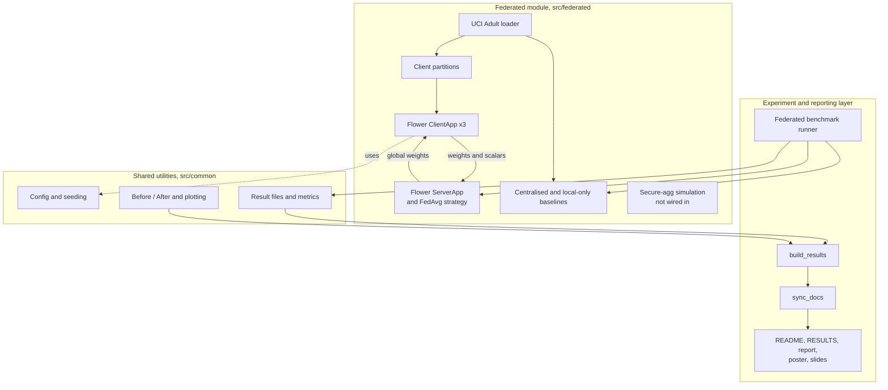

# System overview

## Explanation

The repository has one research topic, Flower-based federated learning with differential
privacy on UCI Adult, organised in three layers: the federated module, a small shared utility
package and the experiment and reporting layer. Apart from the exchange of weights between the
clients and the server, data flows in one direction in the diagram, from the dataset through the
clients and the server to result files, and from result files to the documents. There is no large-language-model component and no integrated demo; both are planned,
not implemented.

**Federated module (`src/federated/`).**

- *UCI Adult loader* (`datasets/adult.py`) reads the 1994 Census extraction from local files
  downloaded by `data/download_adult.py`, verifies checksums and builds the feature matrix.
  The optional FEMNIST reader (`datasets/femnist.py`) and the synthetic toy domains used by
  tests and smoke runs (`datasets/synthetic_domains.py`) sit beside it and are not drawn.
- *Client partitions* (`partition.py`) split the training rows into the three workclass clients
  (Private, Government, Self-employed) or the IID control.
- *Flower ClientApp* (`client_app.py`, local training in `client.py`, DP-SGD in `privacy.py`)
  and *Flower ServerApp with the FedAvg strategy* (`server_app.py`, `strategy.py`,
  `aggregation.py`). The two edges between them are the only messages of a round: global
  weights go out, updated weights and a few scalars come back. By default both run in one
  process through `InProcessGrid` (`inprocess.py`); see
  [02-federated-detail.md](02-federated-detail.md), and for what crosses the client boundary,
  [03-trust-boundary.md](03-trust-boundary.md).
- *Centralised and local-only baselines* (`baselines.py`, orchestrated by `runner.py`) are
  trained without federation for comparison. The edge from the loader shows that they read the
  same feature matrix as the clients.
- *Secure-aggregation simulation* (`secure_agg.py`) is an arithmetic masking simulation with
  one shared seed. It is not cryptography and is not called by the training loop, which is
  why it has no edge.

**Shared utilities (`src/common/`).** Configuration loading and overrides (`config.py`),
seed derivation (`seeding.py`), logging set-up (`logging_utils.py`), result files and run
metadata (`io.py`), summary statistics (`metrics.py`), the Before / After rules
(`before_after.py`), plotting (`plotting.py`), source labels (`labels.py`) and the
`[Paper-reported]` reference values (`paper_values.py`). The package docstring states the dependency rule:
nothing in `src/common` knows about federated learning; `src.federated` and the experiment
scripts depend on it, never the other way round. The dotted edge from the clients to the
configuration and seeding box stands for every use of these helpers inside the module.

**Experiment and reporting layer (`experiments/`).** `run_federated_benchmark.py` runs the
benchmark and writes CSV files through `src/common/io.py`; `build_results.py` turns the
reference run into tables, Before / After CSV files, charts and Markdown blocks;
`sync_docs.py` injects those blocks into the documents. The detail is in
[04-experiment-flow.md](04-experiment-flow.md).

## Assumptions

- The benchmark is a reference implementation of federated learning with differential
  privacy; every setting is chosen here, written into a YAML file under `configs/` and marked
  `[Assumption — not in paper]` there.
- The whole benchmark is a simulation on one machine: three simulated clients derived from one
  public dataset, plus an IID control, trained in one process by default.
- The shared utilities are generic: they handle configuration, seeds, result files and the
  Before / After rules, and contain nothing specific to federated learning.

## Design alternatives considered

1. **A separate deployment of clients and server** (one process or machine per client, talking
   over a network). Not chosen for the reference run because the clients are simulated from one
   public dataset, and an in-process grid makes runs deterministic and fast enough for five
   seeds. The config value `engine: ray` (Flower's simulation engine, through the optional
   `flower-sim` extra) exists but is `[Target / TBD]`: it has never completed a run.
2. **Putting configuration, seeding and reporting code inside `src/federated`.** Not chosen
   because these helpers have nothing to do with federated learning, and keeping them in a
   small package of their own makes the dependency rule easy to check. The package is kept
   identical in form to the one in the companion project `ddqn-os-scheduling`, a separate
   repository with its own data, code and results that shares the same direction and the same
   reporting conventions.
3. **Hand-written result tables in each document.** Not chosen because the same number would
   then be typed in several places and could drift; every reproduced number instead comes from
   one generated block (see diagram 4).

## What this diagram does not show

- The internal loop of a federated round (diagram 2) and the trust boundary (diagram 3).
- Configuration files, the notebook, the tests and the continuous-integration workflow.
- The optional FEMNIST reader and the synthetic toy domains.
- The robust aggregation rules and the poisoning attacks of the robustness suite
  (`aggregation.py`, `attacks.py`), which run inside the server and client boxes.
- Any large-language-model component, because none exists in this draft.
- Any real deployment across organisations: there is none.
