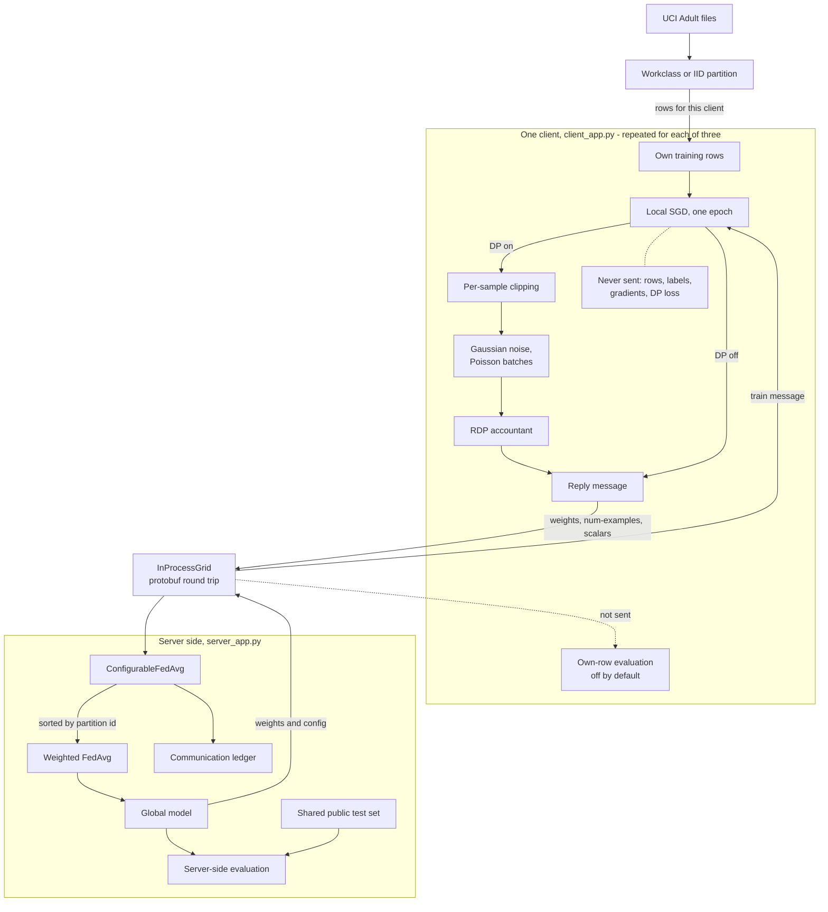

# Federated detail: clients, DP-SGD and weighted aggregation

## Explanation

The diagram shows one communication round of the Flower federation as it runs by default:
in one process, through real Flower apps, for 20 rounds.

- **UCI Adult files and partition** (`src/federated/datasets/adult.py`,
  `src/federated/partition.py`). The 1994 Census extraction is read from local files, encoded
  with a fixed vocabulary and data-independent scaling, and the training rows are split into
  the three workclass clients (Private, Government, Self-employed) or the IID control. Age,
  race and sex are not model inputs. In this simulation each client derives its own rows from
  the same public files and the run seed (`ClientDataSource` in `src/federated/client_app.py`);
  in a real deployment each client would simply hold its rows.
- **Client** (`src/federated/client_app.py`, `src/federated/client.py`). The `@app.train()`
  handler reads its partition id from the node configuration, rebuilds the model from the
  received global weights and trains locally with SGD; the optimiser, including momentum, is
  rebuilt every round, so clients are stateless and deterministic. Under differential privacy
  local training is DP-SGD through Opacus (`src/federated/privacy.py`): per-sample gradient
  clipping, Gaussian noise added to the sum of clipped gradients, and Poisson-sampled batches,
  with an empty batch still taking a noise-only step. The noise and the Poisson sample are
  drawn from a client-held secret seed in the client's node configuration, never from the run
  seed in the server's message (diagram 3). The RDP accountant composes all steps of
  all rounds; in `target_epsilon` mode the noise multiplier is calibrated per client so that
  each client spends at most the target ε over the whole run.
- **Reply message**. Exactly one array record (the updated weights) and one metric record of
  scalars. Without DP the scalars are `partition-id`, `num-examples`, `train-loss`, `steps`,
  `sample-rate`, `noise-multiplier`, `epsilon`, `delta`, `update-norm` and `empty-batches`.
  Under DP `train-loss` and `empty-batches` are removed, because they are un-noised statistics
  of private rows. The node "Never sent" lists what stays inside the client: rows, features,
  labels, per-sample gradients and, under DP, the training loss. Diagram 3 draws this boundary
  in full.
- **Own-row evaluation**. The `@app.evaluate()` handler exists but is never called, because
  `federation.fraction_evaluate` is 0 for every condition: evaluating the global model on a
  client's own training rows would release an un-noised statistic of those rows.
- **InProcessGrid** (`src/federated/inprocess.py`) is a real subclass of Flower's `Grid`. It
  delivers each message synchronously to the `ClientApp` in the same process and serialises
  every message to protobuf bytes and back in both directions, so the client never holds a
  reference to a server object. Flower's own `Strategy.start` loop runs unmodified. The
  optional Ray simulation engine (`run_with_ray`) has never completed a run and is
  `[Target / TBD]`.
- **ConfigurableFedAvg** (`src/federated/strategy.py`) derives from Flower's message-API
  `FedAvg`. It keeps Flower's sampling and message construction, sorts replies by partition id
  so the result does not depend on arrival order, fails loudly if any client errors, and counts
  the bytes of every message that carries model weights in the communication ledger
  (`src/federated/communication.py`).
- **Weighted FedAvg** (`src/federated/aggregation.py`) averages the parameter arrays with
  weights `n_k / Σ n`, where `n_k` is the client's reported `num-examples`. The unweighted
  mean (kept as an ablation), the coordinate-wise median and the trimmed mean are selectable
  rules used in ablation and robustness suites.
- **Global model and server-side evaluation** (`src/federated/server_app.py`,
  `src/federated/runner.py`). After every round the experimenter's harness evaluates the
  global model on the shared public test set (or on validation rows when tuning). These
  numbers are logged for curves; the final round is reported, never the best round.

## Assumptions

- The dataset, the client construction, the IID control, the 20-round and 5-seed protocol,
  the model and every DP setting are `[Assumption — not in paper]`. They are fixed in `configs/federated_adult.yaml`.
- The three clients are simulated domains of one public census dataset, not real
  organisations.
- All clients take part in every round (`fraction_train` is 1).
- The server is honest but curious; Byzantine clients appear only in the separate robustness
  suite (`src/federated/attacks.py`).

## Design alternatives considered

1. **The unweighted mean as the default.** Not chosen because the sample-weighted mean makes a
   client's influence match its data. The two differ whenever client sizes differ, as they do
   for the workclass split. The unweighted mean is kept as the ablation rule `unweighted`.
2. **Flower's Ray simulation engine as the default.** Not chosen because Ray workers failed to
   register on the development machine and the path never completed a run. The in-process grid
   keeps Flower's server loop and message format, is deterministic, and gives identical CSV
   files for any number of worker processes.
3. **Stateful clients that keep their optimiser between rounds.** Not chosen because a stateless
   client makes every reply a pure function of the global weights, the configuration and the
   partition, which is what makes runs reproducible and independent of the execution engine.
4. **Client-side evaluation on each client's own rows.** Not chosen because the result is an
   un-noised statistic of private rows; all reported metrics come from the server-side
   evaluation on the public test set instead.
5. **Scaling fitted on pooled training rows (`train_fitted`).** Kept as an option, not the
   default, because in a real federation it would need an extra aggregate release that the DP
   accounting does not cover; the default `fixed_public` transform fits nothing.

## What this diagram does not show

- The two other clients, which run the same pipeline on their own rows.
- The centralised and local-only baselines (`src/federated/baselines.py`, `runner.py`), which
  are trained outside the federation.
- The secure-aggregation simulation (`src/federated/secure_agg.py`): it is not wired into
  training, so updates reach the strategy unmasked.
- The partitions, aggregation and robustness suites, the extended privacy study and the
  optional FEMNIST reader.
- Any accuracy, F1 or privacy result; those are only in the generated blocks.
