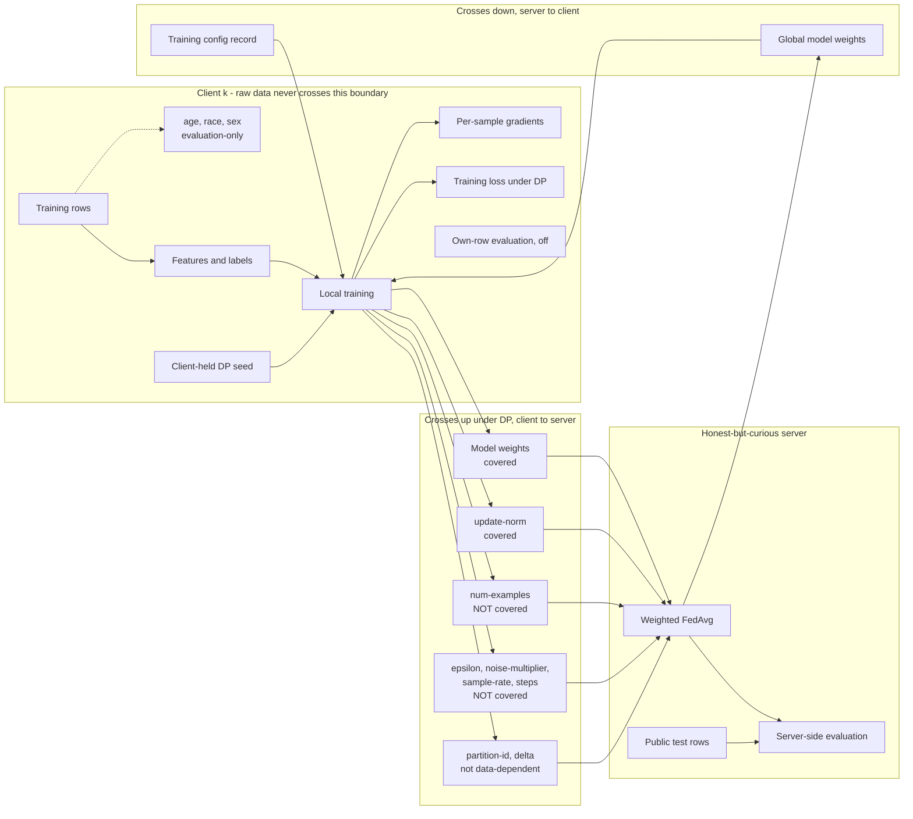

# Trust boundary: what crosses the client boundary

## Explanation

The boundary is the `CLIENT` subgraph. Only Flower messages cross it, and in the default
in-process execution each message is serialised to protobuf bytes and parsed back
(`src/federated/inprocess.py`), so nothing crosses by Python reference. A test in
`tests/test_federated_flower.py` inspects a reply to check that it carries no rows, features
or labels.

**Stays inside the client** (`src/federated/client_app.py`, `src/federated/client.py`,
`src/federated/privacy.py`):

- the client's training rows, its feature matrix and its labels;
- the evaluation-only attributes age, race and sex, which are never model inputs for any
  method (`src/federated/datasets/adult.py`); `relationship` and `marital-status` remain inputs
  and are proxies for sex;
- per-sample gradients, which Opacus computes, clips and sums before adding noise;
- the client-held secret seed (`client-secret-seed` in the client's node configuration) from
  which the DP noise and the Poisson sampling are derived; it never appears in any message;
- under DP, the training loss and the count of empty Poisson batches, which are removed from
  the reply because they are un-noised statistics of private rows;
- the result of evaluating the global model on the client's own rows: the handler exists but
  never runs, because `federation.fraction_evaluate` is 0.

**Crosses down, server to client.** The global model weights (one array record) and a
training configuration record built by `spec_to_config` in `src/federated/client.py`: local
epochs, batch size, learning rate, momentum, model shape, DP mode and settings, the run seed
and a run label. The run seed drives only non-private randomness (the minibatch order of
training without DP); the DP noise and the Poisson sample do not depend on it. Nothing derived
from any client's rows travels down except through the aggregated weights.

**Crosses up under DP, client to server.** Each item is one row of `RELEASED_QUANTITIES` in
`src/federated/privacy.py`; the generated block `privacy_released_quantities` renders the same
list as a table.

| Quantity | Covered by the (ε, δ) guarantee | Why |
|---|---|---|
| model weights | covered | the output of DP-SGD; the quantity the bound is about |
| `update-norm` | covered | post-processing of the sent weights and the public global weights |
| `num-examples` | NOT covered | exact row count, sent in the clear for weighted FedAvg |
| `epsilon` | NOT covered | computed from sample rate and step count, so it reveals `ceil(n / batch_size)` |
| `noise-multiplier` | NOT covered | calibrated from the client's sample rate, which depends on `n` |
| `sample-rate` | NOT covered | `1 / ceil(n / batch_size)` |
| `steps` | NOT covered | `local_epochs * ceil(n / batch_size)` |
| `partition-id` | not data-dependent | client index assigned by the simulation |
| `delta` | not data-dependent | a public setting from YAML |

Every NOT-covered item reveals the client's row count or a coarsening of it, never a value of
any row. Without DP the reply additionally carries `train-loss` and `empty-batches`; those
conditions make no privacy claim.

**The guarantee.** In the words of `GUARANTEE` in `src/federated/privacy.py`: record-level
(ε, δ)-DP of each client's training rows with respect to the sequence of model updates it
sends, against an honest-but-curious server, for that run alone. It is not client-level
privacy, it does not cover hyperparameter tuning, `num-examples` or the quantities derived from
it, or the `train_fitted` scaling statistics, and the budgets of several DP runs released on
the same rows add up.

**Server side.** The strategy (`src/federated/strategy.py`) aggregates the replies with
weighted FedAvg (`src/federated/aggregation.py`) and broadcasts the new global weights. The
server-side evaluation is the experimenter's measurement harness: it evaluates the global model
on the public test rows, which belong to no client.

## Assumptions

- The server is honest but curious: it follows the protocol and may inspect everything it
  receives.
- This is a simulation in one process. The runner process can read the public dataset files;
  the boundary is enforced at the level of the messages, which is the boundary a real
  deployment would have.
- The guarantee assumes that the server cannot predict a client's noise. DP noise and Poisson
  sampling are derived from a client-held secret seed, the run label and the round; the secret
  sits in the client's node configuration and is never transmitted. In the benchmark the
  harness sets that secret deterministically from the run seed so that runs are reproducible,
  which is acceptable for research on public data and must not be done in a deployment; a
  client with no configured secret draws one from operating-system entropy. Opacus
  `secure_mode` is off, so the generator is an ordinary pseudo-random one.
- The test rows used for server-side evaluation are public and are not part of any client.

## Design alternatives considered

1. **Secure aggregation to hide individual updates and row counts.** A pairwise-masking
   simulation exists (`src/federated/secure_agg.py`), including masked `n_k` for the weighted
   case, but it derives every mask from one shared seed, has no key agreement, no dropout
   recovery and no authenticated channels, and is not wired into training. Wiring it in would
   have suggested a protection the code does not provide; individual updates and `num-examples`
   therefore reach the server in the clear, and the diagram says so.
2. **Unweighted aggregation, which would not need `num-examples`.** Not chosen because it is a
   different estimator and it differs
   from FedAvg when client sizes differ. The release of the row count is documented as not
   covered instead of being hidden.
3. **One DP noise stream per seed, shared across the ε settings and splits.** Simpler to seed,
   but two published runs of the same seed would then contain the same noise vector scaled by
   different multipliers, and anyone holding both updates could cancel it. The noise and the
   Poisson sample are therefore derived from a run label that includes the suite, the split and
   the condition (`src/federated/client.py`); the model initialisation stays shared on purpose,
   because that pairing reveals nothing.
4. **Sending the training loss and client-side evaluation metrics under DP.** An earlier
   version did; a separate internal review pass flagged them as un-noised statistics of private rows, and
   both were removed before any reporting-seed run.
5. **Deriving the DP noise from the run seed in the server's message.** An earlier version
   did, which made runs reproducible with no extra state but meant that a server knowing the
   derivation could regenerate a client's noise and subtract it. Drawing this diagram exposed
   it. DP randomness now comes from a client-held secret that crosses the boundary in neither
   direction.

## What this diagram does not show

- The non-DP conditions in detail; they release the same items plus `train-loss` and
  `empty-batches` and carry no privacy guarantee.
- The ε accounting itself and the per-round message timing (diagram 2).
- The centralised baselines, which train on pooled rows by design and are outside any
  federation.
- Client-level (user-level) privacy, which is not provided: the guarantee is record-level only.
- Attacks on the boundary beyond an honest-but-curious server: a malicious server, membership
  inference and floating-point attacks on the Gaussian sampler are not analysed or mitigated.
- Any privacy or utility result; those are in the generated blocks.
