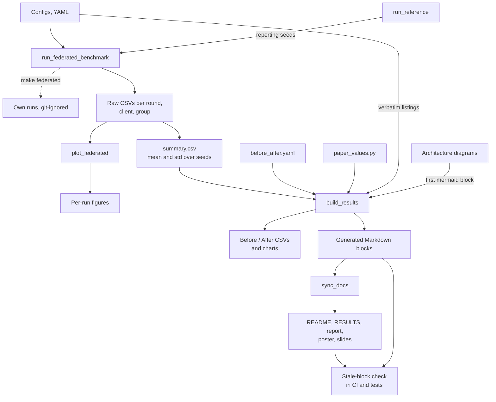

# Experiment flow: from configuration to documents



## Explanation

Every reproduced number in the documentation travels this path, and only this path.

- **Configs** (`configs/federated_adult.yaml` for the Adult protocol, `configs/federated_dp.yaml`
  for the extended privacy study, `configs/federated_fedavg.yaml` for the synthetic toy
  domains and smoke runs, and `configs/optional/federated_femnist.yaml`, which has never been
  run) hold every setting, each tagged with its provenance. Command-line overrides
  (`--set key.sub=value`, `--smoke`, `--seeds`) are merged by `src/common/config.py`, and the
  merged configuration is written next to the results as `config_used.yaml`.
- **run_reference** (`experiments/run_reference.py`, `make reference`) runs the benchmark on
  the reporting seeds 0–4 with every suite (main, partitions, aggregation, robustness) into
  `experiments/results/reference/federated_adult/`, and the extended privacy study into
  `experiments/results/reference/federated_adult_dp/`, by calling the benchmark runner below
  with `--out` pointing into the reference folder. `--skip-ablations` runs the main suite only.
  It is the only command meant to overwrite the raw results there; `build_results` adds the
  derived tables and charts under `generated/` and `before_after/` in the same folder.
- **The benchmark runner** (`experiments/run_federated_benchmark.py`) executes each federated
  condition, the local-only training and the centralised baselines as independent tasks, on
  the workclass split and the IID control. It writes raw CSV files (`per_round.csv`,
  `per_client.csv`, `final.csv`, `per_group.csv`, `partition_stats.csv`, `dp_tradeoff.csv` and
  `timings.csv`), a `summary.csv` with the mean and standard deviation over seeds
  (`summarise_by_seed` in `src/common/metrics.py`), and `metadata.json`. Results do not depend
  on the number of worker processes. Runs started with `make federated`, `make federated-toy`
  or `make smoke` go to `experiments/results/runs/`, which is git-ignored and never read by the
  reporting step.
- **Plotting** (`experiments/plot_federated.py`) draws the per-run figures (accuracy per round,
  communication cost, the DP trade-off, the partition distribution and per-client accuracy)
  into each run's `figures/` folder.
- **build_results** (`experiments/build_results.py`, first half of `make results`) reads only the
  reference run's summary and raw files, `configs/before_after.yaml` (which methods are
  compared and how each metric is oriented and rounded) and `src/common/paper_values.py` (the
  only source of the `[Paper-reported]` reference values). It applies the Before / After rules of
  `src/common/before_after.py` and writes the Before / After CSV files and charts
  (`federated.csv`, `federated_workclass.png`, `federated_iid.png`, `epsilon_tradeoff.csv`,
  `epsilon_tradeoff.png`, `epsilon_extended.png`) under `reference/before_after/` and one
  Markdown file per block under `reference/generated/`. It also turns every config file into a
  verbatim listing and extracts the first Mermaid block of each file in `docs/architecture/`
  into a `diagram_*` block, which is why these file names are fixed. If a CSV is missing, the
  dependent values are rendered as `TBD`; nothing is invented or copied by hand.
- **sync_docs** (`experiments/sync_docs.py`, second half of `make results`) replaces the text
  between every `BEGIN GENERATED` and `END GENERATED` marker pair with the current block. The
  same block file feeds README, RESULTS, the project report, the poster and the slides, so a
  value cannot differ between placements.
- **The check** (`make docs-check`, run in `.github/workflows/ci.yml`, and
  `tests/test_docs_integrity.py`) fails if any block in any document differs from its generated
  file.

The commands, in the order a reader would use them:

```bash
make smoke        # synthetic toy data, no download, under a minute
make data         # download UCI Adult into data/adult and verify checksums
make federated    # own run of the Adult protocol into experiments/results/runs/
make docs-check   # check that every generated block matches its source
```

`make reference` followed by `make results` re-creates the reference run and everything derived
from it; both overwrite committed files and are meant for maintainers.

## Assumptions

- The reporting seeds 0–4 are used once, for the reference run; development and tuning use
  seeds 100 and above.
- The final round of a federated run is reported, never the best round, and no choice is made
  on the test set.
- Wall-clock time is recorded separately from result rows, so result files are identical for
  any number of workers.

## Design alternatives considered

1. **Typing result tables into each document.** Not chosen because the same value would appear
   in five documents and could drift, and because a hand-typed table cannot be checked
   mechanically. Generated blocks with a CI check make drift a test failure.
2. **Reporting from whichever run was made last.** Not chosen because a development run or a
   smoke run could then silently replace the numbers the documents cite. Own runs go to a
   git-ignored folder; only `run_reference` writes the reference folder, and `build_results`
   reads only that folder.
3. **Placeholder numbers for parts that have not been run.** Not chosen because a plausible
   placeholder is indistinguishable from a result. Missing inputs become `TBD` with the
   `[Target / TBD]` label.
4. **Selecting the best round or best configuration on the test set.** Not chosen because it
   would be tuning on the test set; the final round and the configuration fixed on development
   seeds are reported, and ablations are reported as sensitivity.

## What this diagram does not show

- The notebook (`experiments/run_notebooks.py`), the dataset download (`make data`) and the
  dataset description script (`experiments/describe_adult.py`).
- The internal task scheduling of the runner: worker processes and the federated suites.
- The extended privacy study folder `federated_adult_dp/`, which follows the same path as the
  main run.
- Any result value.
