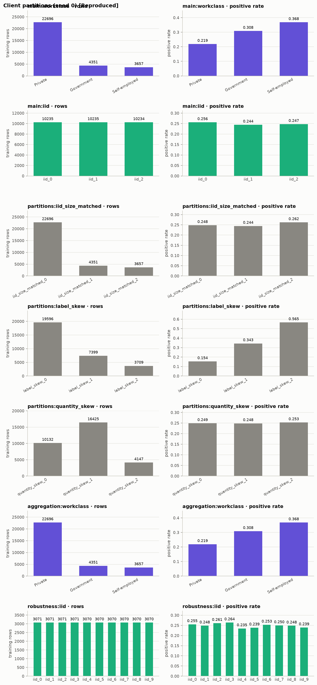
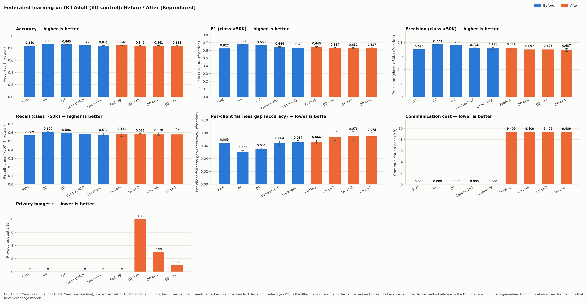
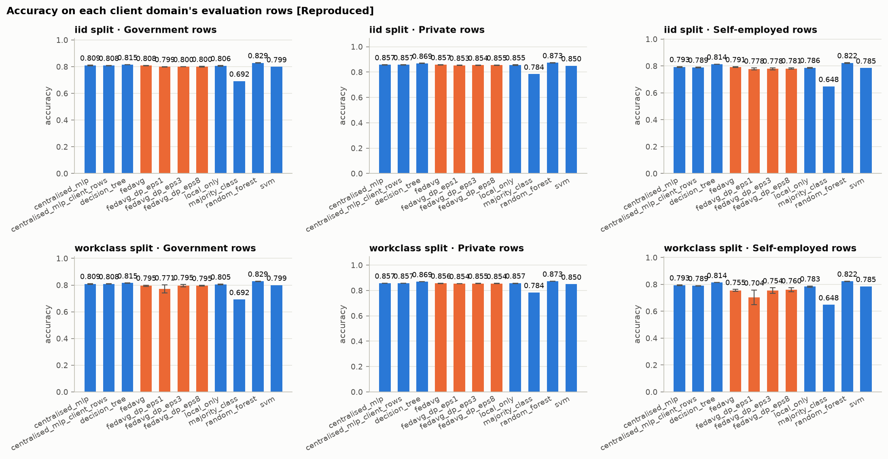
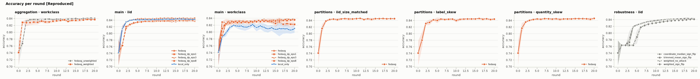
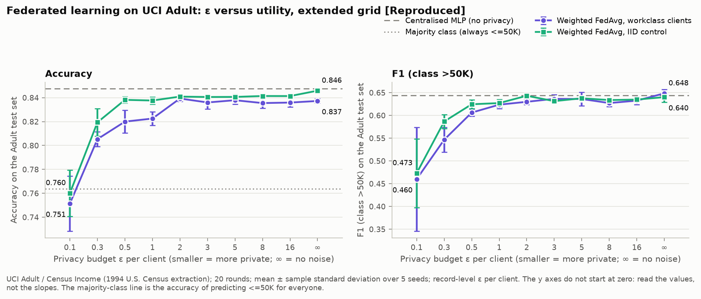

# Topic guide — Federated training with differential privacy across client domains

**In brief.** This topic guide describes what the reference implementation of federated training
with differential privacy does on UCI Adult, what was measured and under which conditions, when to
use it, and what to try next. On the workclass clients, weighted FedAvg is more accurate than the
clients' own local-only models and less accurate than the centralised Random Forest and Decision
Tree. With differential privacy, accuracy changes little at ε = 8 and ε = 3 and drops more at
ε = 1, and F1 is lower at all three budgets. The clients are simulated domains of one public
dataset, the DP secret is fixed by the benchmark harness for reproducibility, secure aggregation
is a simulation, the Ray-based engine and FEMNIST were not run, and four privacy defects found in
this code were fixed before the reference run (F13). The tables in section 3 give the values; no
measured value is typed in the prose of this guide.

The whole Adult design — three clients built from the `workclass` attribute, an IID control,
20 rounds, 5 seeds, and ε ∈ {1, 3, 8} plus a run with no noise — is
`[Assumption — not in paper]`. It is the concrete example this implementation provides, chosen
and written down by this repository.

The method follows the federated learning approach with differential privacy described by Zhang et
al. (2025), arXiv 2504.00282. Everything this guide says about results comes from the generated
tables of the reference run, which are inserted between marker lines and are never typed by hand.

The companion project `ddqn-os-scheduling` is a separate repository with its own code, data and
results; the two share the same direction and the same reporting conventions, and nothing in this
guide depends on it.

Two terms are used throughout. **Federated averaging (FedAvg)** is the procedure in which a
server sends a global model to several clients, each client trains it on its own rows, and the
server replaces the global model by an average of the returned models (McMahan et al., 2017).
**Differential privacy (DP)** is a guarantee about a randomised algorithm: changing one record of
the input changes the probability of any output by at most a factor `e^ε`, plus a small slack
`δ` in the (ε, δ) form (Dwork et al., 2006; Dwork and Roth, 2014). Smaller ε means stronger
privacy.

## 1. Scope and question

**What does federated training cost and gain on a public tabular dataset split into client
domains, and what does a record-level privacy budget cost?**

The question is asked from the side of a user who has to choose a training setup. Three
comparisons answer it, and each has its own reading.

The first comparison is federated training against the clients' alternatives. If the rows cannot
be pooled, each client could train alone; if they can be pooled, a centralised model is possible.
A user wants to know whether sample-weighted federated averaging is ahead of training alone, and
how far it is behind pooling, on a named public dataset with fixed seeds.

The second comparison is federated training with and without differential privacy. A user wants
to know which metrics move, and by how much relative to the seed-to-seed spread, when each client
spends a stated record-level budget ε over all rounds, and which quantities that leave a client
the guarantee covers.

The third comparison is between design choices inside the federated method: the aggregation rule,
the way the rows are dealt to clients, and robust aggregation under a configured attack. These tell
a user which switches matter on this data.

A difference that is inside the seed-to-seed spread is reported as such and is not treated as an
observation in either direction.

The scope is set by the example. UCI Adult, three workclass clients, an IID control, a small
multilayer perceptron, 20 rounds, 5 seeds and the ε sweep are all `[Assumption — not in paper]`.
Every observation in this guide holds under these documented conditions and no others.

## 2. Setup

### 2.1 Design choices

The table lists the main design choices of this implementation and the engineering reason for
each. Every chosen value is `[Assumption — not in paper]`; the exact settings follow in §2.2 and in
the configuration listing.

| Design choice | What this implementation does | Why |
|---|---|---|
| Dataset | UCI Adult (1994 extraction), its published training and test files, and the binary income label. | It is public, licensed and tabular, and it has a natural domain attribute (`workclass`), so anyone can rerun the benchmark and check the mechanics of DP. |
| Clients | Three clients built from the `workclass` attribute, plus a three-client IID control; ten IID clients in the robustness suite. | The workclass split is a natural non-IID split; the IID control separates the effect of client heterogeneity; with three clients the trimmed mean removes nothing (F14), so robustness needs more clients. |
| Aggregation | Sample-weighted FedAvg: client updates are averaged with weights proportional to each client's row count. The unweighted mean is kept as an ablation. | A client's influence matches its data, and every row counts equally regardless of which client holds it (F10). |
| Model | A two-hidden-layer MLP trained with SGD and momentum, one local epoch per round, no batch normalisation. | Opacus needs per-sample gradients. |
| Privacy | DP-SGD through Opacus with Gaussian noise and Poisson sampling, the Rényi DP accountant, a fixed δ and clipping norm, and ε ∈ {1, 3, 8} plus no noise, with an extended grid. | Record-level differential privacy with a stated ε and δ makes the guarantee explicit (F12). |
| Input scaling | Continuous inputs are scaled with fixed public constants from the config. | Nothing is fitted on client rows or on the test set, so nothing outside the accounted mechanism is released. |
| Baselines | A majority-class reference; a centralised MLP; the same MLP on the client rows only; local-only training; SVM, random forest and decision tree trained centrally with scikit-learn, with the same preprocessing and test set as every other method. | The local-only models answer "is federating worth it when the rows cannot be pooled"; the centralised models answer "what does not pooling cost". |
| Metrics | Precision, recall and F1 of the positive (>50K) class, next to accuracy and the majority-class reference. | One class is rare, so accuracy alone is hard to interpret. |
| Statistics | Five reporting seeds (0–4), mean ± sample standard deviation, the final-round model, differences described against the seed-to-seed spread. | A difference inside the seed-to-seed spread is not read as an observation. |
| Secure aggregation | A pairwise-masking *simulation* behind a `SecureAggregator` interface, not wired into training (F15). | It provides the interface and the masking arithmetic; it is not a security component. |

The aggregation default and its ablation differ only when clients hold different numbers of rows.
`federation.aggregation_rule: unweighted` switches to the unweighted mean; observations F8 and F10
describe what each rule does on Adult.

### 2.2 The concrete example this implementation provides

Every element below is `[Assumption — not in paper]`. The settings live in
`configs/federated_adult.yaml`, where every key carries that tag.

- **Dataset.** UCI Adult, also known as Census Income, extracted by Barry Becker from the 1994
  U.S. Census database and donated to the UCI Machine Learning Repository on 1996-04-30 (Becker
  and Kohavi, 1996; Kohavi, 1996); canonical page
  [http://archive.ics.uci.edu/ml/datasets/Adult](http://archive.ics.uci.edu/ml/datasets/Adult).
  It has 48,842 rows: 32,561 training rows and 16,281 test rows. The task is to predict whether
  a person's income exceeds $50,000 a year; about 24% of rows are positive. The files are
  downloaded by `data/download_adult.py`, checked against pinned checksums and never committed.
- **Clients.** Three simulated domains built from the training rows only, by the `workclass`
  attribute: Private, Government (federal, state and local government) and Self-employed
  (incorporated and not incorporated). Rows with an unknown, never-worked or without-pay
  workclass belong to no client. These are simulated domains of one public census file, not real
  employers or institutions. The split is strongly unequal in size and in positive rate, which is
  the point: it is a natural non-IID (non-independent and identically distributed) split.
- **IID control.** The same client rows, shuffled with the run seed and dealt into three equal
  clients. It isolates what the non-IID split costs.
- **Model.** A small multilayer perceptron (MLP) with two hidden layers, no batch
  normalisation (Opacus needs per-sample gradients).
- **Inputs.** Age, race and sex are never model inputs for any method; they are kept only as
  evaluation groups. `fnlwgt` (a census sampling weight) and `education` (redundant with
  `education-num`) are dropped. Continuous inputs are scaled with fixed constants from the
  config, so nothing is fitted on data and nothing can leak across clients or from the test set.
- **Protocol.** Sample-weighted FedAvg, 20 communication rounds, one local epoch per round, 5
  reporting seeds (0–4), evaluation of the final-round model (never the best round) on the shared
  16,281-row test set, mean ± sample standard deviation across seeds.
- **Privacy.** DP-SGD inside each client through Opacus (Abadi et al., 2016; Yousefpour et al.,
  2021) with a locked sweep of ε in {1, 3, 8, no noise}, and an extended study in
  `configs/federated_dp.yaml` with a finer ε grid, other clipping norms and fixed noise
  multipliers.
- **Baselines.** A majority-class predictor; a centralised MLP of the same architecture on all
  training rows (the upper bound for "what does not pooling cost"); the same MLP on the client
  rows only; local-only training, in which each client trains alone for the same number of local
  passes; and three classical baselines, SVM, random forest and decision tree,
  trained centrally with scikit-learn (Pedregosa et al., 2011).
- **Ablations.** Weighted versus unweighted aggregation; four further partitions of the same
  rows; a robustness suite with Byzantine clients.

This implementation always reports the majority-class baseline and the precision, recall and F1
of the positive class next to accuracy. On Adult the majority-class predictor (always `<=50K`)
already reaches a high accuracy with an F1 of zero (§3.3 and the `findings` block); a model
whose accuracy is close to that rate may have learned nothing about the minority class that
matters. Accuracy without a trivial reference and without per-class metrics is hard to interpret on
an imbalanced task, so a user extending this code should keep both.

The attribute roles are listed in full below.

<!-- BEGIN GENERATED: adult_attribute_roles -->
| Attribute | Type | Role | Encoding in the default mode (`fixed_public`) | Reason |
|---|---|---|---|---|
| `age` | integer (years) | evaluation-only | not a feature; grouped into the YAML age bands for fairness reports | protected attribute; used only for per-age-band fairness |
| `workclass` | categorical | model input | one-hot over the 8 published values + `Unknown` for `?` (9 columns) | one-hot, published vocabulary + Unknown; also defines the three client domains |
| `fnlwgt` | integer (sampling weight) | excluded | dropped before preprocessing | census sampling weight, not a property of the person |
| `education` | categorical | excluded | dropped before preprocessing | redundant with education-num (its ordinal encoding) |
| `education-num` | integer (ordinal 1-16) | model input | fixed_public: value / divisor from YAML (no fitted statistic) | continuous, scaled |
| `marital-status` | categorical | model input | one-hot over the 7 published values + `Unknown` for `?` (8 columns) | one-hot, published vocabulary + Unknown; proxy for sex (Married-civ-spouse) |
| `occupation` | categorical | model input | one-hot over the 14 published values + `Unknown` for `?` (15 columns) | one-hot, published vocabulary + Unknown |
| `relationship` | categorical | model input | one-hot over the 6 published values + `Unknown` for `?` (7 columns) | one-hot, published vocabulary + Unknown; proxy for sex (Husband / Wife) |
| `race` | categorical | evaluation-only | not a feature; kept as a group label for fairness reports | protected attribute; used only for per-group fairness |
| `sex` | categorical | evaluation-only | not a feature; kept as a group label for fairness reports | protected attribute; used only for per-group fairness |
| `capital-gain` | integer (US dollars) | model input | fixed_public: log1p, then / divisor from YAML (no fitted statistic) | continuous, scaled (log1p in fixed_public mode) |
| `capital-loss` | integer (US dollars) | model input | fixed_public: log1p, then / divisor from YAML (no fitted statistic) | continuous, scaled (log1p in fixed_public mode) |
| `hours-per-week` | integer (hours) | model input | fixed_public: value / divisor from YAML (no fitted statistic) | continuous, scaled |
| `native-country` | categorical | model input | one-hot over the 41 published values + `Unknown` for `?` (42 columns) | one-hot, published vocabulary + Unknown |
| `income` | binary label | target | `>50K` -> 1 (positive class), `<=50K` -> 0; trailing period of adult.test removed | binary income label (>50K is about 24% of rows) |
<!-- END GENERATED: adult_attribute_roles -->

*Table: the 14 Adult attributes and the label, with their role in every method. It shows which
attributes reach a model; it does not show how predictive each one is. `relationship` and
`marital-status` stay inputs and are proxies for sex.*

The federated apps are genuine Flower apps (Beutel et al., 2020) on Flower's current Message API:
a `ClientApp`, a `ServerApp`, and a strategy derived from Flower's `FedAvg`. By default they run
in one process through `InProcessGrid`, a subclass of Flower's `Grid` in
[`src/federated/inprocess.py`](../../src/federated/inprocess.py); Flower's own strategy loop runs
unmodified and every message goes through a real protobuf round trip. Flower's optional Ray-based
simulation engine has never completed a run on the development machine; that path is
`[Target / TBD]`. The architecture is drawn in
[`docs/architecture/02-federated-detail.md`](../architecture/02-federated-detail.md) and the trust
boundary in [`docs/architecture/03-trust-boundary.md`](../architecture/03-trust-boundary.md).

The verbatim configuration of the primary protocol:

<!-- BEGIN GENERATED: config_federated_adult -->
`configs/federated_adult.yaml` (verbatim; comments carry the provenance tag of every key):

```yaml
# PRIMARY federated protocol: UCI Adult / Census Income with three workclass-based clients
# and an IID control.
#
# Dataset: Adult (Census Income), UCI Machine Learning Repository, extracted by Barry Becker
# from the 1994 U.S. Census database; donated 1996-04-30. Becker, B. & Kohavi, R. (1996).
# Adult [Dataset]. https://doi.org/10.24432/C5XW20. Licence CC BY 4.0.
# Canonical page: http://archive.ics.uci.edu/ml/datasets/Adult
# Download with `python data/download_adult.py` (files are git-ignored).
#
# Provenance: every value below is [Assumption — not in paper]: it is chosen by this
# repository.
# Hyperparameters were chosen on a validation split of the training rows with development
# seeds >= 100 (evaluation.eval_on: validation); never on the test set or on seeds 0-4.

experiment:                           # run identity: name, seeds, output folder. [Assumption — not in paper]
  name: federated_adult               # run name written to metadata. [Assumption — not in paper]
  seeds: [0, 1, 2, 3, 4]              # REPORTING seeds of the reference benchmark (run once, not for tuning; develop with --seeds 100 101). [Assumption — not in paper]
  output_dir: experiments/results/runs/federated_adult   # default --out folder (relative to the repo root). [Assumption — not in paper]

dataset:                              # which dataset and how it is read and preprocessed. [Assumption — not in paper]
  kind: adult                         # which block below is used: adult | synthetic | femnist. [Assumption — not in paper]
  adult:                              # UCI Adult settings. [Assumption — not in paper]
    data_dir: data/adult              # folder holding adult.data / adult.test / adult.names (relative to the repo root). [Assumption — not in paper]
    checksum_file: data/checksums/adult.sha256   # trust-on-first-use SHA-256 pins of the three files. [Assumption — not in paper]
    verify_checksums: true            # refuse to load files whose SHA-256 differs from the pin. [Assumption — not in paper]
    expect_full_size: true            # assert exactly 32,561 training and 16,281 test rows. [Assumption — not in paper]
    scaling: fixed_public             # fixed_public (data-independent constants below; nothing fitted, nothing leaks) | train_fitted (mean/std of pooled training rows; needs an extra release NOT covered by the DP accounting). [Assumption — not in paper]
    fixed_public:                     # fixed_public transform per continuous input: optional log1p, then divide by divisor. [Assumption — not in paper]
      education-num: {log1p: false, divisor: 16.0}    # years-of-education code 1..16 -> (0, 1]. [Assumption — not in paper]
      capital-gain: {log1p: true, divisor: 12.0}      # log1p(US dollars) / 12 (log1p of the schema's 99,999 cap is 11.5). [Assumption — not in paper]
      capital-loss: {log1p: true, divisor: 12.0}      # log1p(US dollars) / 12. [Assumption — not in paper]
      hours-per-week: {log1p: false, divisor: 100.0}  # hours per week / 100. [Assumption — not in paper]
    age_bands: [[17, 24], [25, 34], [35, 44], [45, 54], [55, 64], [65, 90]]   # inclusive age bands (years) of the evaluation-only age attribute. [Assumption — not in paper]
  synthetic: null                     # unused. [Assumption — not in paper]
  femnist: null                       # unused. [Assumption — not in paper]

evaluation:                           # shared evaluation set and fairness breakdown. [Assumption — not in paper]
  eval_on: test                       # test = all 16,281 test rows (benchmark) | validation = stratified split of the training rows (tuning; the test file is not read). [Assumption — not in paper]
  validation_fraction: 0.2            # fraction of each client's (and the excluded group's) training rows held out when eval_on is validation. [Assumption — not in paper]
  group_attributes: [sex, race, age_band]   # evaluation-only protected attributes for the per-group breakdown (never model inputs). [Assumption — not in paper]

model:                                # network architecture. [Assumption — not in paper]
  hidden_sizes: [128, 64]             # MLP hidden layer widths (units); ReLU, no BatchNorm (Opacus needs per-sample gradients). Chosen from {[64,32],[128,64]} on validation, seeds 100-101. [Assumption — not in paper]

training:                             # local and centralised SGD settings. [Assumption — not in paper]
  rounds: 20                          # communication rounds (locked protocol). [Assumption — not in paper]
  local_epochs: 1                     # local passes over a client's rows per round. [Assumption — not in paper]
  batch_size: 64                      # minibatch size (rows); with DP the expected Poisson batch size. Chosen from {64, 256} on validation, seeds 100-101. [Assumption — not in paper]
  learning_rate: 0.01                 # SGD learning rate. Chosen from {0.005, 0.01, 0.03, 0.1} by mean validation F1 of centralised_mlp + fedavg (both splits), seeds 100-101; differences were < 0.01. [Assumption — not in paper]
  momentum: 0.9                       # SGD momentum (rebuilt every round: clients are stateless). [Assumption — not in paper]
  weight_decay: 0.0                   # L2 penalty coefficient. [Assumption — not in paper]
  centralised_epochs: 20              # epochs of the centralised MLP baselines (= rounds x local_epochs, equal number of passes). The centralised MLP keeps its SGD momentum across all its epochs (one optimiser), while federated and local-only clients rebuild the optimiser every round. [Assumption — not in paper]

federation:                           # server-side settings. [Assumption — not in paper]
  aggregation_rule: weighted          # weighted (sample-weighted FedAvg, n_k / sum n; the default) | unweighted (the unweighted mean (1/N) sum theta_i, kept as an ablation) | coordinate_median | trimmed_mean. [Assumption — not in paper]
  trimmed_mean_beta: 0.2             # fraction trimmed at each end by trimmed_mean (0 <= beta < 0.5); = num_byzantine / num_clients of the robustness suite (2 / 10): set by principle so trimmed_mean can drop every attacker per side, NOT tuned; a smaller value triggers a warning. [Assumption — not in paper]
  fraction_evaluate: 0.0              # client-side evaluation OFF for every condition: evaluating the global model on a client's own training rows releases an un-noised statistic of those private rows. All reported metrics come from the server-side evaluation on the public test set (or the validation rows when tuning). With 0, communication cost counts training traffic only. [Assumption — not in paper]
  engine: inprocess                   # inprocess (this repo's Flower Grid, no Ray; the default and the only tested engine). The value ray (flwr.simulation, needs flwr[simulation]) is [Target / TBD]: it has never completed a run; Ray workers failed to register on the development machine. [Assumption — not in paper]

dp:                                   # differential-privacy settings (DP-SGD via Opacus). [Assumption — not in paper]
  delta: 1.0e-5                       # DP delta per client; below 1 / smallest client size (Self-employed, about 3,657 rows). [Assumption — not in paper]
  accountant: rdp                     # Opacus RDP accountant for noise calibration and epsilon reporting. [Assumption — not in paper]
  epsilon_tolerance: 0.01             # precision of Opacus's noise-multiplier binary search (epsilon units). [Assumption — not in paper]
  sweep:                              # DP conditions of the main suite: weighted FedAvg + per-client record-level DP-SGD. [Assumption — not in paper]
    - name: fedavg_dp_eps8            # condition name. [Assumption — not in paper]
      mode: target_epsilon            # calibrate each client's noise so it spends at most target_epsilon over all 20 rounds. [Assumption — not in paper]
      target_epsilon: 8.0             # per-client epsilon after the last round. [Assumption — not in paper]
      noise_multiplier: null          # unused in target_epsilon mode. [Assumption — not in paper]
      max_grad_norm: 2.0              # per-sample gradient clipping norm (L2); chosen from {0.5, 1, 2, 4} on validation F1 at eps 3 and 1, seeds 100-101. [Assumption — not in paper]
    - name: fedavg_dp_eps3            # condition name. [Assumption — not in paper]
      mode: target_epsilon            # see above. [Assumption — not in paper]
      target_epsilon: 3.0             # per-client epsilon after the last round. [Assumption — not in paper]
      noise_multiplier: null          # unused in target_epsilon mode. [Assumption — not in paper]
      max_grad_norm: 2.0              # per-sample gradient clipping norm (L2); chosen from {0.5, 1, 2, 4} on validation F1 at eps 3 and 1, seeds 100-101. [Assumption — not in paper]
    - name: fedavg_dp_eps1            # condition name. [Assumption — not in paper]
      mode: target_epsilon            # see above. [Assumption — not in paper]
      target_epsilon: 1.0             # per-client epsilon after the last round. [Assumption — not in paper]
      noise_multiplier: null          # unused in target_epsilon mode. [Assumption — not in paper]
      max_grad_norm: 2.0              # per-sample gradient clipping norm (L2); chosen from {0.5, 1, 2, 4} on validation F1 at eps 3 and 1, seeds 100-101. [Assumption — not in paper]

partitions:                           # client splits. [Assumption — not in paper]
  splits: [workclass, iid]            # main-suite splits: workclass (Private / Government / Self-employed, natural non-IID) and the IID control (same rows, 3 equal shuffled clients). Rows with workclass ?, Without-pay or Never-worked (1,857 training rows) belong to NO client; they are used only by the centralised baselines trained on all rows (centralised_mlp, svm, random_forest, decision_tree, majority_class) and, on the test side, in the shared test set. [Assumption — not in paper]
  ablations: [iid_size_matched, label_skew, quantity_skew]   # partitions suite (same client rows). [Assumption — not in paper]
  label_skew_alpha: 0.5               # Dirichlet concentration over the two labels (smaller = more skew). [Assumption — not in paper]
  quantity_skew:                      # client-size distribution of the quantity_skew partition. [Assumption — not in paper]
    kind: dirichlet                   # dirichlet | power_law client sizes. [Assumption — not in paper]
    alpha: 1.0                        # Dirichlet concentration of client sizes. [Assumption — not in paper]
    exponent: 1.5                     # power-law exponent (used when kind is power_law). [Assumption — not in paper]
  min_client_rows: 500                # every skewed client must hold at least this many rows (redraw otherwise). [Assumption — not in paper]
  max_resample_attempts: 100          # maximum redraws before giving up. [Assumption — not in paper]

baselines:                            # centralised baselines. [Assumption — not in paper]
  methods: [centralised_mlp, centralised_mlp_client_rows, svm, random_forest, decision_tree, majority_class]   # all trained centrally with the same preprocessing and evaluated on the same test set. [Assumption — not in paper]
  svm:                                # scikit-learn SVC settings. [Assumption — not in paper]
    kernel: rbf                       # scikit-learn SVC kernel (RBF; dominates the baseline run time). [Assumption — not in paper]
    C: 1.0                            # SVC regularisation strength. [Assumption — not in paper]
    gamma: scale                      # RBF width rule of scikit-learn (1 / (n_features * Var(X))). [Assumption — not in paper]
    cache_size_mb: 1000.0             # SVC kernel cache in MB (speed only). [Assumption — not in paper]
  random_forest:                      # scikit-learn RandomForestClassifier settings. [Assumption — not in paper]
    n_estimators: 200                 # number of trees. [Assumption — not in paper]
    max_depth: null                   # maximum tree depth (null = unlimited). [Assumption — not in paper]
    min_samples_leaf: 2               # minimum rows per leaf. [Assumption — not in paper]
  decision_tree:                      # scikit-learn DecisionTreeClassifier settings. [Assumption — not in paper]
    max_depth: 10                     # maximum depth. [Assumption — not in paper]
    min_samples_leaf: 5               # minimum rows per leaf. [Assumption — not in paper]

robustness:                           # robustness suite: IID clients, some Byzantine. [Assumption — not in paper]
  num_clients: 10                     # IID clients of the robustness suite (union of the client rows). [Assumption — not in paper]
  num_byzantine: 2                    # how many of them attack (the last client ids). [Assumption — not in paper]
  attack:                             # behaviour of the Byzantine clients. [Assumption — not in paper]
    kind: sign_flip                   # none | sign_flip | scale | gaussian_noise | label_flip. [Assumption — not in paper]
    scale_factor: 10.0                # update multiplier of the scale attack. [Assumption — not in paper]
    noise_std: 1.0                    # per-coordinate std of the gaussian_noise attack. [Assumption — not in paper]
  aggregation_rules: [weighted, coordinate_median, trimmed_mean]   # rules compared under attack. [Assumption — not in paper]

aggregation_suite:                    # aggregation suite: sample-weighted FedAvg vs the unweighted mean. [Assumption — not in paper]
  split: workclass                    # split on which weighted and unweighted FedAvg are compared (sizes differ, so they differ). [Assumption — not in paper]
  rules: [weighted, unweighted]       # weighted = sample-weighted FedAvg (default); unweighted = the unweighted mean, kept as an ablation. [Assumption — not in paper]

runtime:                              # process-level settings (not model hyperparameters). [Assumption — not in paper]
  workers: 8                          # default number of worker processes (--workers overrides); results do not depend on it. [Assumption — not in paper]
  torch_threads: 1                    # torch intra-op threads per process (1 keeps results identical across worker counts). [Assumption — not in paper]

smoke_overrides:                      # merged with --smoke: a quick end-to-end check on the real files (still needs data/adult). [Assumption — not in paper]
  experiment:                         # run identity: name, seeds, output folder. [Assumption — not in paper]
    seeds: [100]                      # one development seed. [Assumption — not in paper]
  training:                           # local and centralised SGD settings. [Assumption — not in paper]
    rounds: 2                         # two rounds only. [Assumption — not in paper]
    centralised_epochs: 2             # = rounds x local_epochs. [Assumption — not in paper]
  baselines:                          # centralised baselines. [Assumption — not in paper]
    methods: [centralised_mlp, decision_tree, majority_class]   # skip the slow RBF SVM and the forest in smoke runs. [Assumption — not in paper]
  runtime:                            # process-level settings (not model hyperparameters). [Assumption — not in paper]
    workers: 4                        # four worker processes. [Assumption — not in paper]
```
<!-- END GENERATED: config_federated_adult -->

### 2.3 Commands

The reference run behind every `[Reproduced]` value was produced with these two commands
(recorded in the run metadata; `python -m experiments.run_reference --workers 8` issues exactly
these and then draws the per-run figures), followed by the table and chart build with
`make results`. `make reference` does the same with the Makefile's default of four worker
processes; results do not depend on the number of workers. Both overwrite the committed reference
folder, so use them only to re-create it:

```bash
python -m experiments.run_federated_benchmark --config configs/federated_adult.yaml \
    --suite all --workers 8 --out experiments/results/reference/federated_adult
python -m experiments.run_federated_benchmark --config configs/federated_dp.yaml \
    --suite main --workers 8 --out experiments/results/reference/federated_adult_dp
```

To reproduce it into your own (git-ignored) folder, use the Makefile targets:

```bash
make data        # download UCI Adult and verify checksums
make federated   # main suite: workclass clients + IID control, 20 rounds x 5 seeds, DP sweep
```

For development work, use development seeds and the validation split, never seeds 0–4 or the
test set:

```bash
python -m experiments.run_federated_benchmark --config configs/federated_adult.yaml \
    --suite main --seeds 100 101 --set evaluation.eval_on=validation \
    --out experiments/results/runs/federated_dev
```

The notebook [`notebooks/01_federated_privacy_tradeoff.ipynb`](../../notebooks/01_federated_privacy_tradeoff.ipynb)
runs the main suite at notebook scale (the full protocol on two of the five reporting seeds) and
walks through the client partition, the baselines, the ε sweep, per-client accuracy,
communication cost and the Before / After table, writing its outputs under
`experiments/results/runs/notebooks/`. Its numbers are indicative only; the reference values are
the generated tables in this guide. To execute it top to bottom into `notebooks/_executed/`:

```bash
make notebooks
```

The unit tests named in this guide run with:

```bash
python -m pytest tests/test_federated_aggregation.py tests/test_federated_privacy.py \
    tests/test_federated_secure_agg.py tests/test_common_metrics.py -q
```

<!-- BEGIN GENERATED: reference_run_info -->
| Reference run | Created (UTC) | Seeds | Environment | Wall-clock time |
|---|---|---|---|---|
| federated_adult | 2024-11-20T05:26:24Z | 0, 1, 2, 3, 4 | Python 3.12.14 on macOS-26.6.2-arm64-arm-64bit; flwr 1.44.0, matplotlib 3.11.2, numpy 2.5.5, opacus 1.6.0, pandas 3.1.1, pyyaml 6.0.3, scikit-learn 1.9.1, torch 2.15.0 | 119 s with 8 worker processes |
| federated_adult_dp | 2024-11-20T05:32:59Z | 0, 1, 2, 3, 4 | Python 3.12.14 on macOS-26.6.2-arm64-arm-64bit; flwr 1.44.0, matplotlib 3.11.2, numpy 2.5.5, opacus 1.6.0, pandas 3.1.1, pyyaml 6.0.3, scikit-learn 1.9.1, torch 2.15.0 | 393 s with 8 worker processes |
<!-- END GENERATED: reference_run_info -->

### 2.4 How settings were chosen

Learning rate, batch size and hidden-layer sizes were chosen from a small grid, and the clipping
norm from four values, on a validation split carved from the training rows with development seeds
100–101 only. The differences inside the learning-rate grid were within noise, so a better MLP
probably exists. Momentum, local epochs, δ, the tree and SVM settings, the robustness suite and
the trimmed-mean fraction were not tuned; the trimmed-mean fraction was set by principle to at
least the share of Byzantine clients. Nothing was selected on the test set or on seeds 0–4.

### 2.5 Statistics convention

Every reproduced cell is the mean ± sample standard deviation (ddof = 1) over the five reporting
seeds. With five seeds, a difference smaller than about one standard deviation of either side is
treated in this guide as "within the seed-to-seed spread", not as an observation. No significance
test is reported; this guide says "larger than the spread" or "within the spread" in words.

Three source labels mark where a value comes from. `[Reproduced]` means the value was obtained by
running this repository's code under the documented conditions (the config, seeds and dataset
named next to it); the label says where a number comes from and does not say that a number
printed in a paper was reproduced. `[Paper-reported]` means printed in the source paper and shown
for reference only; such a value is not a target for this code and is never compared numerically
with a value from this code. `[Target / TBD]` marks something specified but not yet run.

## 3. Results

### 3.1 Client partition

Dataset: UCI Adult / Census Income (1994 U.S. Census extraction; 48,842 rows; workclass clients Private / Government / Self-employed plus IID control)

<!-- BEGIN GENERATED: adult_partition_stats -->
Computed from the downloaded `adult.data` (training rows only); source CSV `experiments/results/reference/federated_adult/partition_stats.csv`. [Reproduced]

| Split | Client | Training rows | Positives (>50K) | Positive rate | Share of client rows | Workclass composition |
|---|---|---|---|---|---|---|
| Workclass split (primary, non-IID) | Private | 22,696 | 4,963 | 0.2187 | 0.7392 | Private 22696 |
| Workclass split (primary, non-IID) | Government | 4,351 | 1,341 | 0.3082 | 0.1417 | Federal-gov 960, Local-gov 2093, State-gov 1298 |
| Workclass split (primary, non-IID) | Self-employed | 3,657 | 1,346 | 0.3681 | 0.1191 | Self-emp-inc 1116, Self-emp-not-inc 2541 |
| IID control, seed 0 | iid_0 | 10,235 | 2,619 | 0.2559 | 0.3333 | Federal-gov 338, Local-gov 735, Private 7525, Self-emp-inc 377, Self-emp-not-inc 855, State-gov 405 |
| IID control, seed 0 | iid_1 | 10,235 | 2,500 | 0.2443 | 0.3333 | Federal-gov 322, Local-gov 678, Private 7582, Self-emp-inc 369, Self-emp-not-inc 842, State-gov 442 |
| IID control, seed 0 | iid_2 | 10,234 | 2,531 | 0.2473 | 0.3333 | Federal-gov 300, Local-gov 680, Private 7589, Self-emp-inc 370, Self-emp-not-inc 844, State-gov 451 |

Excluded from every client split: 1,857 training rows (? 1836, Never-worked 7, Without-pay 14; positive rate 0.1029). The workclass split is the same for every seed; the IID control is reshuffled with each run seed, so its per-client positive rates vary slightly between seeds while its client sizes stay fixed.
<!-- END GENERATED: adult_partition_stats -->

*Table: row counts and positive rates of every client, for the workclass split and the
three-client IID control. It shows how unequal the workclass clients are in size and in base rate; it does not
show the feature distributions of the clients, and the IID rows are those of seed 0 only.*



*Figure: client sizes and label balance of each partition. It shows one dataset split into
simulated clients; it does not represent any real organisation's data.*

### 3.2 Before / After: federated averaging against every reference method

Dataset: UCI Adult / Census Income (1994 U.S. Census extraction; 48,842 rows; workclass clients Private / Government / Self-employed plus IID control)

<!-- BEGIN GENERATED: before_after_full -->
Dataset: UCI Adult / Census Income (1994 U.S. Census extraction; 48,842 rows; workclass clients Private / Government / Self-employed plus IID control)

Source label: [Reproduced]. Protocol for every Before and After value: 20 communication rounds, 5 seeds, mean ± sample standard deviation, shared Adult test set (16,281 rows). Values are mean ± sample standard deviation over 5 seeds. Underlying CSV: `experiments/results/reference/before_after/federated.csv`.

**Clients: workclass clients**

| Metric | Unit | Direction | Before Method | Before Value | After Method | After Value | Delta (absolute) | Improvement % | Source Label |
|---|---|---|---|---|---|---|---|---|---|
| Accuracy | fraction | Higher is better | SVM (centralised) | 0.8401 ± 0.0000 | Weighted FedAvg (no DP) | 0.8372 ± 0.0018 | -0.0028 | -0.3% | [Reproduced] |
| Accuracy | fraction | Higher is better | Random Forest (centralised) | 0.8650 ± 0.0003 | Weighted FedAvg (no DP) | 0.8372 ± 0.0018 | -0.0277 | -3.2% | [Reproduced] |
| Accuracy | fraction | Higher is better | Decision Tree (centralised) | 0.8598 ± 0.0001 | Weighted FedAvg (no DP) | 0.8372 ± 0.0018 | -0.0226 | -2.6% | [Reproduced] |
| Accuracy | fraction | Higher is better | Centralised MLP (upper bound) | 0.8475 ± 0.0012 | Weighted FedAvg (no DP) | 0.8372 ± 0.0018 | -0.0102 | -1.2% | [Reproduced] |
| Accuracy | fraction | Higher is better | Local-only (mean of 3 client models) | 0.8094 ± 0.0117 | Weighted FedAvg (no DP) | 0.8372 ± 0.0018 | +0.0278 | +3.4% | [Reproduced] |
| Accuracy | fraction | Higher is better | Weighted FedAvg (no DP) | 0.8372 ± 0.0018 | Weighted FedAvg + DP (ε = 8) | 0.8355 ± 0.0041 | -0.0018 | -0.2% | [Reproduced] |
| Accuracy | fraction | Higher is better | Weighted FedAvg (no DP) | 0.8372 ± 0.0018 | Weighted FedAvg + DP (ε = 3) | 0.8360 ± 0.0054 | -0.0013 | -0.1% | [Reproduced] |
| Accuracy | fraction | Higher is better | Weighted FedAvg (no DP) | 0.8372 ± 0.0018 | Weighted FedAvg + DP (ε = 1) | 0.8225 ± 0.0056 | -0.0147 | -1.8% | [Reproduced] |
| F1 (class >50K) | fraction | Higher is better | SVM (centralised) | 0.6268 ± 0.0000 | Weighted FedAvg (no DP) | 0.6485 ± 0.0089 | +0.0216 | +3.5% | [Reproduced] |
| F1 (class >50K) | fraction | Higher is better | Random Forest (centralised) | 0.6800 ± 0.0014 | Weighted FedAvg (no DP) | 0.6485 ± 0.0089 | -0.0315 | -4.6% | [Reproduced] |
| F1 (class >50K) | fraction | Higher is better | Decision Tree (centralised) | 0.6678 ± 0.0004 | Weighted FedAvg (no DP) | 0.6485 ± 0.0089 | -0.0193 | -2.9% | [Reproduced] |
| F1 (class >50K) | fraction | Higher is better | Centralised MLP (upper bound) | 0.6437 ± 0.0060 | Weighted FedAvg (no DP) | 0.6485 ± 0.0089 | +0.0048 | +0.7% | [Reproduced] |
| F1 (class >50K) | fraction | Higher is better | Local-only (mean of 3 client models) | 0.6369 ± 0.0072 | Weighted FedAvg (no DP) | 0.6485 ± 0.0089 | +0.0116 | +1.8% | [Reproduced] |
| F1 (class >50K) | fraction | Higher is better | Weighted FedAvg (no DP) | 0.6485 ± 0.0089 | Weighted FedAvg + DP (ε = 8) | 0.6272 ± 0.0079 | -0.0213 | -3.3% | [Reproduced] |
| F1 (class >50K) | fraction | Higher is better | Weighted FedAvg (no DP) | 0.6485 ± 0.0089 | Weighted FedAvg + DP (ε = 3) | 0.6364 ± 0.0090 | -0.0121 | -1.9% | [Reproduced] |
| F1 (class >50K) | fraction | Higher is better | Weighted FedAvg (no DP) | 0.6485 ± 0.0089 | Weighted FedAvg + DP (ε = 1) | 0.6236 ± 0.0082 | -0.0248 | -3.8% | [Reproduced] |
| Precision (class >50K) | fraction | Higher is better | SVM (centralised) | 0.6983 ± 0.0000 | Weighted FedAvg (no DP) | 0.6626 ± 0.0154 | -0.0357 | -5.1% | [Reproduced] |
| Precision (class >50K) | fraction | Higher is better | Random Forest (centralised) | 0.7726 ± 0.0020 | Weighted FedAvg (no DP) | 0.6626 ± 0.0154 | -0.1099 | -14.2% | [Reproduced] |
| Precision (class >50K) | fraction | Higher is better | Decision Tree (centralised) | 0.7587 ± 0.0003 | Weighted FedAvg (no DP) | 0.6626 ± 0.0154 | -0.0961 | -12.7% | [Reproduced] |
| Precision (class >50K) | fraction | Higher is better | Centralised MLP (upper bound) | 0.7182 ± 0.0036 | Weighted FedAvg (no DP) | 0.6626 ± 0.0154 | -0.0556 | -7.7% | [Reproduced] |
| Precision (class >50K) | fraction | Higher is better | Local-only (mean of 3 client models) | 0.5859 ± 0.0323 | Weighted FedAvg (no DP) | 0.6626 ± 0.0154 | +0.0767 | +13.1% | [Reproduced] |
| Precision (class >50K) | fraction | Higher is better | Weighted FedAvg (no DP) | 0.6626 ± 0.0154 | Weighted FedAvg + DP (ε = 8) | 0.6751 ± 0.0129 | +0.0125 | +1.9% | [Reproduced] |
| Precision (class >50K) | fraction | Higher is better | Weighted FedAvg (no DP) | 0.6626 ± 0.0154 | Weighted FedAvg + DP (ε = 3) | 0.6696 ± 0.0247 | +0.0070 | +1.1% | [Reproduced] |
| Precision (class >50K) | fraction | Higher is better | Weighted FedAvg (no DP) | 0.6626 ± 0.0154 | Weighted FedAvg + DP (ε = 1) | 0.6252 ± 0.0140 | -0.0375 | -5.7% | [Reproduced] |
| Recall (class >50K) | fraction | Higher is better | SVM (centralised) | 0.5686 ± 0.0000 | Weighted FedAvg (no DP) | 0.6361 ± 0.0300 | +0.0675 | +11.9% | [Reproduced] |
| Recall (class >50K) | fraction | Higher is better | Random Forest (centralised) | 0.6072 ± 0.0032 | Weighted FedAvg (no DP) | 0.6361 ± 0.0300 | +0.0289 | +4.8% | [Reproduced] |
| Recall (class >50K) | fraction | Higher is better | Decision Tree (centralised) | 0.5964 ± 0.0005 | Weighted FedAvg (no DP) | 0.6361 ± 0.0300 | +0.0398 | +6.7% | [Reproduced] |
| Recall (class >50K) | fraction | Higher is better | Centralised MLP (upper bound) | 0.5834 ± 0.0113 | Weighted FedAvg (no DP) | 0.6361 ± 0.0300 | +0.0528 | +9.0% | [Reproduced] |
| Recall (class >50K) | fraction | Higher is better | Local-only (mean of 3 client models) | 0.7075 ± 0.0539 | Weighted FedAvg (no DP) | 0.6361 ± 0.0300 | -0.0714 | -10.1% | [Reproduced] |
| Recall (class >50K) | fraction | Higher is better | Weighted FedAvg (no DP) | 0.6361 ± 0.0300 | Weighted FedAvg + DP (ε = 8) | 0.5857 ± 0.0092 | -0.0504 | -7.9% | [Reproduced] |
| Recall (class >50K) | fraction | Higher is better | Weighted FedAvg (no DP) | 0.6361 ± 0.0300 | Weighted FedAvg + DP (ε = 3) | 0.6081 ± 0.0326 | -0.0281 | -4.4% | [Reproduced] |
| Recall (class >50K) | fraction | Higher is better | Weighted FedAvg (no DP) | 0.6361 ± 0.0300 | Weighted FedAvg + DP (ε = 1) | 0.6222 ± 0.0034 | -0.0139 | -2.2% | [Reproduced] |
| Per-client fairness gap (accuracy) | fraction | Lower is better | SVM (centralised) | 0.0650 ± 0.0000 | Weighted FedAvg (no DP) | 0.1011 ± 0.0088 | +0.0361 | -55.5% | [Reproduced] |
| Per-client fairness gap (accuracy) | fraction | Lower is better | Random Forest (centralised) | 0.0509 ± 0.0021 | Weighted FedAvg (no DP) | 0.1011 ± 0.0088 | +0.0503 | -98.8% | [Reproduced] |
| Per-client fairness gap (accuracy) | fraction | Lower is better | Decision Tree (centralised) | 0.0557 ± 0.0005 | Weighted FedAvg (no DP) | 0.1011 ± 0.0088 | +0.0454 | -81.5% | [Reproduced] |
| Per-client fairness gap (accuracy) | fraction | Lower is better | Centralised MLP (upper bound) | 0.0640 ± 0.0032 | Weighted FedAvg (no DP) | 0.1011 ± 0.0088 | +0.0371 | -57.9% | [Reproduced] |
| Per-client fairness gap (accuracy) | fraction | Lower is better | Local-only (mean of 3 client models) | 0.1442 ± 0.0319 | Weighted FedAvg (no DP) | 0.1011 ± 0.0088 | -0.0430 | +29.9% | [Reproduced] |
| Per-client fairness gap (accuracy) | fraction | Lower is better | Weighted FedAvg (no DP) | 0.1011 ± 0.0088 | Weighted FedAvg + DP (ε = 8) | 0.0941 ± 0.0142 | -0.0070 | +6.9% | [Reproduced] |
| Per-client fairness gap (accuracy) | fraction | Lower is better | Weighted FedAvg (no DP) | 0.1011 ± 0.0088 | Weighted FedAvg + DP (ε = 3) | 0.1010 ± 0.0195 | -0.0001 | +0.1% | [Reproduced] |
| Per-client fairness gap (accuracy) | fraction | Lower is better | Weighted FedAvg (no DP) | 0.1011 ± 0.0088 | Weighted FedAvg + DP (ε = 1) | 0.1541 ± 0.0515 | +0.0530 | -52.4% | [Reproduced] |
| Communication cost | MB | Lower is better | SVM (centralised) | 0.000 ± 0.000 | Weighted FedAvg (no DP) | 9.409 ± 0.000 | +9.409 | N/A — baseline zero / not comparable | [Reproduced] |
| Communication cost | MB | Lower is better | Random Forest (centralised) | 0.000 ± 0.000 | Weighted FedAvg (no DP) | 9.409 ± 0.000 | +9.409 | N/A — baseline zero / not comparable | [Reproduced] |
| Communication cost | MB | Lower is better | Decision Tree (centralised) | 0.000 ± 0.000 | Weighted FedAvg (no DP) | 9.409 ± 0.000 | +9.409 | N/A — baseline zero / not comparable | [Reproduced] |
| Communication cost | MB | Lower is better | Centralised MLP (upper bound) | 0.000 ± 0.000 | Weighted FedAvg (no DP) | 9.409 ± 0.000 | +9.409 | N/A — baseline zero / not comparable | [Reproduced] |
| Communication cost | MB | Lower is better | Local-only (mean of 3 client models) | 0.000 ± 0.000 | Weighted FedAvg (no DP) | 9.409 ± 0.000 | +9.409 | N/A — baseline zero / not comparable | [Reproduced] |
| Communication cost | MB | Lower is better | Weighted FedAvg (no DP) | 9.409 ± 0.000 | Weighted FedAvg + DP (ε = 8) | 9.409 ± 0.000 | +0.000 | +0.0% | [Reproduced] |
| Communication cost | MB | Lower is better | Weighted FedAvg (no DP) | 9.409 ± 0.000 | Weighted FedAvg + DP (ε = 3) | 9.409 ± 0.000 | +0.000 | +0.0% | [Reproduced] |
| Communication cost | MB | Lower is better | Weighted FedAvg (no DP) | 9.409 ± 0.000 | Weighted FedAvg + DP (ε = 1) | 9.409 ± 0.000 | +0.000 | +0.0% | [Reproduced] |
| Privacy budget ε | ε | Lower is better | SVM (centralised) | ∞ | Weighted FedAvg (no DP) | ∞ | N/A — baseline zero / not comparable | N/A — baseline zero / not comparable | [Reproduced] |
| Privacy budget ε | ε | Lower is better | Random Forest (centralised) | ∞ | Weighted FedAvg (no DP) | ∞ | N/A — baseline zero / not comparable | N/A — baseline zero / not comparable | [Reproduced] |
| Privacy budget ε | ε | Lower is better | Decision Tree (centralised) | ∞ | Weighted FedAvg (no DP) | ∞ | N/A — baseline zero / not comparable | N/A — baseline zero / not comparable | [Reproduced] |
| Privacy budget ε | ε | Lower is better | Centralised MLP (upper bound) | ∞ | Weighted FedAvg (no DP) | ∞ | N/A — baseline zero / not comparable | N/A — baseline zero / not comparable | [Reproduced] |
| Privacy budget ε | ε | Lower is better | Local-only (mean of 3 client models) | ∞ | Weighted FedAvg (no DP) | ∞ | N/A — baseline zero / not comparable | N/A — baseline zero / not comparable | [Reproduced] |
| Privacy budget ε | ε | Lower is better | Weighted FedAvg (no DP) | ∞ | Weighted FedAvg + DP (ε = 8) | 8.00 ± 0.00 | N/A — baseline zero / not comparable | N/A — baseline zero / not comparable | [Reproduced] |
| Privacy budget ε | ε | Lower is better | Weighted FedAvg (no DP) | ∞ | Weighted FedAvg + DP (ε = 3) | 3.00 ± 0.00 | N/A — baseline zero / not comparable | N/A — baseline zero / not comparable | [Reproduced] |
| Privacy budget ε | ε | Lower is better | Weighted FedAvg (no DP) | ∞ | Weighted FedAvg + DP (ε = 1) | 1.00 ± 0.00 | N/A — baseline zero / not comparable | N/A — baseline zero / not comparable | [Reproduced] |

- Communication cost, SVM (centralised) → Weighted FedAvg (no DP): Before is zero or near zero (|Before| <= 1e-06 MB), so a percentage would be meaningless.
- Communication cost, Random Forest (centralised) → Weighted FedAvg (no DP): Before is zero or near zero (|Before| <= 1e-06 MB), so a percentage would be meaningless.
- Communication cost, Decision Tree (centralised) → Weighted FedAvg (no DP): Before is zero or near zero (|Before| <= 1e-06 MB), so a percentage would be meaningless.
- Communication cost, Centralised MLP (upper bound) → Weighted FedAvg (no DP): Before is zero or near zero (|Before| <= 1e-06 MB), so a percentage would be meaningless.
- Communication cost, Local-only (mean of 3 client models) → Weighted FedAvg (no DP): Before is zero or near zero (|Before| <= 1e-06 MB), so a percentage would be meaningless.
- Privacy budget ε, SVM (centralised) → Weighted FedAvg (no DP): One side is infinite, so a difference or ratio is not meaningful.
- Privacy budget ε, Random Forest (centralised) → Weighted FedAvg (no DP): One side is infinite, so a difference or ratio is not meaningful.
- Privacy budget ε, Decision Tree (centralised) → Weighted FedAvg (no DP): One side is infinite, so a difference or ratio is not meaningful.
- Privacy budget ε, Centralised MLP (upper bound) → Weighted FedAvg (no DP): One side is infinite, so a difference or ratio is not meaningful.
- Privacy budget ε, Local-only (mean of 3 client models) → Weighted FedAvg (no DP): One side is infinite, so a difference or ratio is not meaningful.
- Privacy budget ε, Weighted FedAvg (no DP) → Weighted FedAvg + DP (ε = 8): One side is infinite, so a difference or ratio is not meaningful.
- Privacy budget ε, Weighted FedAvg (no DP) → Weighted FedAvg + DP (ε = 3): One side is infinite, so a difference or ratio is not meaningful.
- Privacy budget ε, Weighted FedAvg (no DP) → Weighted FedAvg + DP (ε = 1): One side is infinite, so a difference or ratio is not meaningful.

**Clients: IID control**

| Metric | Unit | Direction | Before Method | Before Value | After Method | After Value | Delta (absolute) | Improvement % | Source Label |
|---|---|---|---|---|---|---|---|---|---|
| Accuracy | fraction | Higher is better | SVM (centralised) | 0.8401 ± 0.0000 | Weighted FedAvg (no DP) | 0.8459 ± 0.0012 | +0.0058 | +0.7% | [Reproduced] |
| Accuracy | fraction | Higher is better | Random Forest (centralised) | 0.8650 ± 0.0003 | Weighted FedAvg (no DP) | 0.8459 ± 0.0012 | -0.0191 | -2.2% | [Reproduced] |
| Accuracy | fraction | Higher is better | Decision Tree (centralised) | 0.8598 ± 0.0001 | Weighted FedAvg (no DP) | 0.8459 ± 0.0012 | -0.0140 | -1.6% | [Reproduced] |
| Accuracy | fraction | Higher is better | Centralised MLP (upper bound) | 0.8475 ± 0.0012 | Weighted FedAvg (no DP) | 0.8459 ± 0.0012 | -0.0016 | -0.2% | [Reproduced] |
| Accuracy | fraction | Higher is better | Local-only (mean of 3 client models) | 0.8422 ± 0.0027 | Weighted FedAvg (no DP) | 0.8459 ± 0.0012 | +0.0036 | +0.4% | [Reproduced] |
| Accuracy | fraction | Higher is better | Weighted FedAvg (no DP) | 0.8459 ± 0.0012 | Weighted FedAvg + DP (ε = 8) | 0.8414 ± 0.0010 | -0.0045 | -0.5% | [Reproduced] |
| Accuracy | fraction | Higher is better | Weighted FedAvg (no DP) | 0.8459 ± 0.0012 | Weighted FedAvg + DP (ε = 3) | 0.8406 ± 0.0017 | -0.0053 | -0.6% | [Reproduced] |
| Accuracy | fraction | Higher is better | Weighted FedAvg (no DP) | 0.8459 ± 0.0012 | Weighted FedAvg + DP (ε = 1) | 0.8376 ± 0.0030 | -0.0082 | -1.0% | [Reproduced] |
| F1 (class >50K) | fraction | Higher is better | SVM (centralised) | 0.6268 ± 0.0000 | Weighted FedAvg (no DP) | 0.6402 ± 0.0114 | +0.0134 | +2.1% | [Reproduced] |
| F1 (class >50K) | fraction | Higher is better | Random Forest (centralised) | 0.6800 ± 0.0014 | Weighted FedAvg (no DP) | 0.6402 ± 0.0114 | -0.0398 | -5.8% | [Reproduced] |
| F1 (class >50K) | fraction | Higher is better | Decision Tree (centralised) | 0.6678 ± 0.0004 | Weighted FedAvg (no DP) | 0.6402 ± 0.0114 | -0.0276 | -4.1% | [Reproduced] |
| F1 (class >50K) | fraction | Higher is better | Centralised MLP (upper bound) | 0.6437 ± 0.0060 | Weighted FedAvg (no DP) | 0.6402 ± 0.0114 | -0.0035 | -0.5% | [Reproduced] |
| F1 (class >50K) | fraction | Higher is better | Local-only (mean of 3 client models) | 0.6285 ± 0.0144 | Weighted FedAvg (no DP) | 0.6402 ± 0.0114 | +0.0117 | +1.9% | [Reproduced] |
| F1 (class >50K) | fraction | Higher is better | Weighted FedAvg (no DP) | 0.6402 ± 0.0114 | Weighted FedAvg + DP (ε = 8) | 0.6337 ± 0.0029 | -0.0065 | -1.0% | [Reproduced] |
| F1 (class >50K) | fraction | Higher is better | Weighted FedAvg (no DP) | 0.6402 ± 0.0114 | Weighted FedAvg + DP (ε = 3) | 0.6314 ± 0.0051 | -0.0089 | -1.4% | [Reproduced] |
| F1 (class >50K) | fraction | Higher is better | Weighted FedAvg (no DP) | 0.6402 ± 0.0114 | Weighted FedAvg + DP (ε = 1) | 0.6271 ± 0.0083 | -0.0131 | -2.0% | [Reproduced] |
| Precision (class >50K) | fraction | Higher is better | SVM (centralised) | 0.6983 ± 0.0000 | Weighted FedAvg (no DP) | 0.7140 ± 0.0150 | +0.0157 | +2.2% | [Reproduced] |
| Precision (class >50K) | fraction | Higher is better | Random Forest (centralised) | 0.7726 ± 0.0020 | Weighted FedAvg (no DP) | 0.7140 ± 0.0150 | -0.0586 | -7.6% | [Reproduced] |
| Precision (class >50K) | fraction | Higher is better | Decision Tree (centralised) | 0.7587 ± 0.0003 | Weighted FedAvg (no DP) | 0.7140 ± 0.0150 | -0.0447 | -5.9% | [Reproduced] |
| Precision (class >50K) | fraction | Higher is better | Centralised MLP (upper bound) | 0.7182 ± 0.0036 | Weighted FedAvg (no DP) | 0.7140 ± 0.0150 | -0.0042 | -0.6% | [Reproduced] |
| Precision (class >50K) | fraction | Higher is better | Local-only (mean of 3 client models) | 0.7113 ± 0.0160 | Weighted FedAvg (no DP) | 0.7140 ± 0.0150 | +0.0027 | +0.4% | [Reproduced] |
| Precision (class >50K) | fraction | Higher is better | Weighted FedAvg (no DP) | 0.7140 ± 0.0150 | Weighted FedAvg + DP (ε = 8) | 0.6973 ± 0.0069 | -0.0167 | -2.3% | [Reproduced] |
| Precision (class >50K) | fraction | Higher is better | Weighted FedAvg (no DP) | 0.7140 ± 0.0150 | Weighted FedAvg + DP (ε = 3) | 0.6960 ± 0.0113 | -0.0180 | -2.5% | [Reproduced] |
| Precision (class >50K) | fraction | Higher is better | Weighted FedAvg (no DP) | 0.7140 ± 0.0150 | Weighted FedAvg + DP (ε = 1) | 0.6865 ± 0.0224 | -0.0274 | -3.8% | [Reproduced] |
| Recall (class >50K) | fraction | Higher is better | SVM (centralised) | 0.5686 ± 0.0000 | Weighted FedAvg (no DP) | 0.5812 ± 0.0278 | +0.0126 | +2.2% | [Reproduced] |
| Recall (class >50K) | fraction | Higher is better | Random Forest (centralised) | 0.6072 ± 0.0032 | Weighted FedAvg (no DP) | 0.5812 ± 0.0278 | -0.0260 | -4.3% | [Reproduced] |
| Recall (class >50K) | fraction | Higher is better | Decision Tree (centralised) | 0.5964 ± 0.0005 | Weighted FedAvg (no DP) | 0.5812 ± 0.0278 | -0.0151 | -2.5% | [Reproduced] |
| Recall (class >50K) | fraction | Higher is better | Centralised MLP (upper bound) | 0.5834 ± 0.0113 | Weighted FedAvg (no DP) | 0.5812 ± 0.0278 | -0.0021 | -0.4% | [Reproduced] |
| Recall (class >50K) | fraction | Higher is better | Local-only (mean of 3 client models) | 0.5716 ± 0.0254 | Weighted FedAvg (no DP) | 0.5812 ± 0.0278 | +0.0097 | +1.7% | [Reproduced] |
| Recall (class >50K) | fraction | Higher is better | Weighted FedAvg (no DP) | 0.5812 ± 0.0278 | Weighted FedAvg + DP (ε = 8) | 0.5809 ± 0.0088 | -0.0003 | -0.1% | [Reproduced] |
| Recall (class >50K) | fraction | Higher is better | Weighted FedAvg (no DP) | 0.5812 ± 0.0278 | Weighted FedAvg + DP (ε = 3) | 0.5781 ± 0.0144 | -0.0032 | -0.5% | [Reproduced] |
| Recall (class >50K) | fraction | Higher is better | Weighted FedAvg (no DP) | 0.5812 ± 0.0278 | Weighted FedAvg + DP (ε = 1) | 0.5785 ± 0.0284 | -0.0027 | -0.5% | [Reproduced] |
| Per-client fairness gap (accuracy) | fraction | Lower is better | SVM (centralised) | 0.0650 ± 0.0000 | Weighted FedAvg (no DP) | 0.0660 ± 0.0033 | +0.0010 | -1.5% | [Reproduced] |
| Per-client fairness gap (accuracy) | fraction | Lower is better | Random Forest (centralised) | 0.0509 ± 0.0021 | Weighted FedAvg (no DP) | 0.0660 ± 0.0033 | +0.0152 | -29.8% | [Reproduced] |
| Per-client fairness gap (accuracy) | fraction | Lower is better | Decision Tree (centralised) | 0.0557 ± 0.0005 | Weighted FedAvg (no DP) | 0.0660 ± 0.0033 | +0.0103 | -18.5% | [Reproduced] |
| Per-client fairness gap (accuracy) | fraction | Lower is better | Centralised MLP (upper bound) | 0.0640 ± 0.0032 | Weighted FedAvg (no DP) | 0.0660 ± 0.0033 | +0.0020 | -3.1% | [Reproduced] |
| Per-client fairness gap (accuracy) | fraction | Lower is better | Local-only (mean of 3 client models) | 0.0666 ± 0.0015 | Weighted FedAvg (no DP) | 0.0660 ± 0.0033 | -0.0006 | +0.9% | [Reproduced] |
| Per-client fairness gap (accuracy) | fraction | Lower is better | Weighted FedAvg (no DP) | 0.0660 ± 0.0033 | Weighted FedAvg + DP (ε = 8) | 0.0734 ± 0.0051 | +0.0074 | -11.1% | [Reproduced] |
| Per-client fairness gap (accuracy) | fraction | Lower is better | Weighted FedAvg (no DP) | 0.0660 ± 0.0033 | Weighted FedAvg + DP (ε = 3) | 0.0758 ± 0.0063 | +0.0098 | -14.8% | [Reproduced] |
| Per-client fairness gap (accuracy) | fraction | Lower is better | Weighted FedAvg (no DP) | 0.0660 ± 0.0033 | Weighted FedAvg + DP (ε = 1) | 0.0746 ± 0.0057 | +0.0086 | -13.1% | [Reproduced] |
| Communication cost | MB | Lower is better | SVM (centralised) | 0.000 ± 0.000 | Weighted FedAvg (no DP) | 9.409 ± 0.000 | +9.409 | N/A — baseline zero / not comparable | [Reproduced] |
| Communication cost | MB | Lower is better | Random Forest (centralised) | 0.000 ± 0.000 | Weighted FedAvg (no DP) | 9.409 ± 0.000 | +9.409 | N/A — baseline zero / not comparable | [Reproduced] |
| Communication cost | MB | Lower is better | Decision Tree (centralised) | 0.000 ± 0.000 | Weighted FedAvg (no DP) | 9.409 ± 0.000 | +9.409 | N/A — baseline zero / not comparable | [Reproduced] |
| Communication cost | MB | Lower is better | Centralised MLP (upper bound) | 0.000 ± 0.000 | Weighted FedAvg (no DP) | 9.409 ± 0.000 | +9.409 | N/A — baseline zero / not comparable | [Reproduced] |
| Communication cost | MB | Lower is better | Local-only (mean of 3 client models) | 0.000 ± 0.000 | Weighted FedAvg (no DP) | 9.409 ± 0.000 | +9.409 | N/A — baseline zero / not comparable | [Reproduced] |
| Communication cost | MB | Lower is better | Weighted FedAvg (no DP) | 9.409 ± 0.000 | Weighted FedAvg + DP (ε = 8) | 9.409 ± 0.000 | +0.000 | +0.0% | [Reproduced] |
| Communication cost | MB | Lower is better | Weighted FedAvg (no DP) | 9.409 ± 0.000 | Weighted FedAvg + DP (ε = 3) | 9.409 ± 0.000 | +0.000 | +0.0% | [Reproduced] |
| Communication cost | MB | Lower is better | Weighted FedAvg (no DP) | 9.409 ± 0.000 | Weighted FedAvg + DP (ε = 1) | 9.409 ± 0.000 | +0.000 | +0.0% | [Reproduced] |
| Privacy budget ε | ε | Lower is better | SVM (centralised) | ∞ | Weighted FedAvg (no DP) | ∞ | N/A — baseline zero / not comparable | N/A — baseline zero / not comparable | [Reproduced] |
| Privacy budget ε | ε | Lower is better | Random Forest (centralised) | ∞ | Weighted FedAvg (no DP) | ∞ | N/A — baseline zero / not comparable | N/A — baseline zero / not comparable | [Reproduced] |
| Privacy budget ε | ε | Lower is better | Decision Tree (centralised) | ∞ | Weighted FedAvg (no DP) | ∞ | N/A — baseline zero / not comparable | N/A — baseline zero / not comparable | [Reproduced] |
| Privacy budget ε | ε | Lower is better | Centralised MLP (upper bound) | ∞ | Weighted FedAvg (no DP) | ∞ | N/A — baseline zero / not comparable | N/A — baseline zero / not comparable | [Reproduced] |
| Privacy budget ε | ε | Lower is better | Local-only (mean of 3 client models) | ∞ | Weighted FedAvg (no DP) | ∞ | N/A — baseline zero / not comparable | N/A — baseline zero / not comparable | [Reproduced] |
| Privacy budget ε | ε | Lower is better | Weighted FedAvg (no DP) | ∞ | Weighted FedAvg + DP (ε = 8) | 8.00 ± 0.00 | N/A — baseline zero / not comparable | N/A — baseline zero / not comparable | [Reproduced] |
| Privacy budget ε | ε | Lower is better | Weighted FedAvg (no DP) | ∞ | Weighted FedAvg + DP (ε = 3) | 2.99 ± 0.00 | N/A — baseline zero / not comparable | N/A — baseline zero / not comparable | [Reproduced] |
| Privacy budget ε | ε | Lower is better | Weighted FedAvg (no DP) | ∞ | Weighted FedAvg + DP (ε = 1) | 0.99 ± 0.00 | N/A — baseline zero / not comparable | N/A — baseline zero / not comparable | [Reproduced] |

- Communication cost, SVM (centralised) → Weighted FedAvg (no DP): Before is zero or near zero (|Before| <= 1e-06 MB), so a percentage would be meaningless.
- Communication cost, Random Forest (centralised) → Weighted FedAvg (no DP): Before is zero or near zero (|Before| <= 1e-06 MB), so a percentage would be meaningless.
- Communication cost, Decision Tree (centralised) → Weighted FedAvg (no DP): Before is zero or near zero (|Before| <= 1e-06 MB), so a percentage would be meaningless.
- Communication cost, Centralised MLP (upper bound) → Weighted FedAvg (no DP): Before is zero or near zero (|Before| <= 1e-06 MB), so a percentage would be meaningless.
- Communication cost, Local-only (mean of 3 client models) → Weighted FedAvg (no DP): Before is zero or near zero (|Before| <= 1e-06 MB), so a percentage would be meaningless.
- Privacy budget ε, SVM (centralised) → Weighted FedAvg (no DP): One side is infinite, so a difference or ratio is not meaningful.
- Privacy budget ε, Random Forest (centralised) → Weighted FedAvg (no DP): One side is infinite, so a difference or ratio is not meaningful.
- Privacy budget ε, Decision Tree (centralised) → Weighted FedAvg (no DP): One side is infinite, so a difference or ratio is not meaningful.
- Privacy budget ε, Centralised MLP (upper bound) → Weighted FedAvg (no DP): One side is infinite, so a difference or ratio is not meaningful.
- Privacy budget ε, Local-only (mean of 3 client models) → Weighted FedAvg (no DP): One side is infinite, so a difference or ratio is not meaningful.
- Privacy budget ε, Weighted FedAvg (no DP) → Weighted FedAvg + DP (ε = 8): One side is infinite, so a difference or ratio is not meaningful.
- Privacy budget ε, Weighted FedAvg (no DP) → Weighted FedAvg + DP (ε = 3): One side is infinite, so a difference or ratio is not meaningful.
- Privacy budget ε, Weighted FedAvg (no DP) → Weighted FedAvg + DP (ε = 1): One side is infinite, so a difference or ratio is not meaningful.

Improvement % convention: a positive value always means better after. For higher-is-better metrics, Improvement % = (After − Before) / |Before| × 100; for lower-is-better metrics, Improvement % = (Before − After) / |Before| × 100. Delta = After − Before in the metric's own unit. Both are computed from unrounded means measured under the same config, dataset, workload and seeds; a regression shows as a negative Improvement %.
<!-- END GENERATED: before_after_full -->

*Table: every Before / After pair for seven metrics on both client splits. It shows how weighted
FedAvg, with and without DP, compares with each reference method on Adult. It is one dataset with
three simulated clients and says nothing about other datasets or client structures. The
sign convention is stated at the end of the generated block: a positive Improvement % always means
better after.*


*Figure: grouped bars of the Before / After comparison on the workclass clients (the primary,
non-IID split). It shows accuracy and positive-class F1 with seed spread; it does not show the
privacy cost of each bar except where the bar is labelled with an ε, and its y axis should be read
by value, not by bar height.*



*Figure: the same comparison on the IID control. It shows what changes when the same rows are
dealt out at random; it does not represent any natural federation.*

The short version, for accuracy and F1 on the workclass clients only:

<!-- BEGIN GENERATED: before_after_summary -->
Dataset: UCI Adult / Census Income (1994 U.S. Census extraction; 48,842 rows; workclass clients Private / Government / Self-employed plus IID control)

Source label: [Reproduced]. Clients: workclass clients. Protocol for every Before and After value: 20 communication rounds, 5 seeds, mean ± sample standard deviation, shared Adult test set (16,281 rows). The full table (all seven metrics, both client splits) is in `experiments/results/RESULTS.md`.

| Metric | Unit | Direction | Before Method | Before Value | After Method | After Value | Delta (absolute) | Improvement % | Source Label |
|---|---|---|---|---|---|---|---|---|---|
| Accuracy | fraction | Higher is better | SVM (centralised) | 0.8401 ± 0.0000 | Weighted FedAvg (no DP) | 0.8372 ± 0.0018 | -0.0028 | -0.3% | [Reproduced] |
| Accuracy | fraction | Higher is better | Random Forest (centralised) | 0.8650 ± 0.0003 | Weighted FedAvg (no DP) | 0.8372 ± 0.0018 | -0.0277 | -3.2% | [Reproduced] |
| Accuracy | fraction | Higher is better | Decision Tree (centralised) | 0.8598 ± 0.0001 | Weighted FedAvg (no DP) | 0.8372 ± 0.0018 | -0.0226 | -2.6% | [Reproduced] |
| Accuracy | fraction | Higher is better | Centralised MLP (upper bound) | 0.8475 ± 0.0012 | Weighted FedAvg (no DP) | 0.8372 ± 0.0018 | -0.0102 | -1.2% | [Reproduced] |
| Accuracy | fraction | Higher is better | Local-only (mean of 3 client models) | 0.8094 ± 0.0117 | Weighted FedAvg (no DP) | 0.8372 ± 0.0018 | +0.0278 | +3.4% | [Reproduced] |
| Accuracy | fraction | Higher is better | Weighted FedAvg (no DP) | 0.8372 ± 0.0018 | Weighted FedAvg + DP (ε = 8) | 0.8355 ± 0.0041 | -0.0018 | -0.2% | [Reproduced] |
| Accuracy | fraction | Higher is better | Weighted FedAvg (no DP) | 0.8372 ± 0.0018 | Weighted FedAvg + DP (ε = 3) | 0.8360 ± 0.0054 | -0.0013 | -0.1% | [Reproduced] |
| Accuracy | fraction | Higher is better | Weighted FedAvg (no DP) | 0.8372 ± 0.0018 | Weighted FedAvg + DP (ε = 1) | 0.8225 ± 0.0056 | -0.0147 | -1.8% | [Reproduced] |
| F1 (class >50K) | fraction | Higher is better | SVM (centralised) | 0.6268 ± 0.0000 | Weighted FedAvg (no DP) | 0.6485 ± 0.0089 | +0.0216 | +3.5% | [Reproduced] |
| F1 (class >50K) | fraction | Higher is better | Random Forest (centralised) | 0.6800 ± 0.0014 | Weighted FedAvg (no DP) | 0.6485 ± 0.0089 | -0.0315 | -4.6% | [Reproduced] |
| F1 (class >50K) | fraction | Higher is better | Decision Tree (centralised) | 0.6678 ± 0.0004 | Weighted FedAvg (no DP) | 0.6485 ± 0.0089 | -0.0193 | -2.9% | [Reproduced] |
| F1 (class >50K) | fraction | Higher is better | Centralised MLP (upper bound) | 0.6437 ± 0.0060 | Weighted FedAvg (no DP) | 0.6485 ± 0.0089 | +0.0048 | +0.7% | [Reproduced] |
| F1 (class >50K) | fraction | Higher is better | Local-only (mean of 3 client models) | 0.6369 ± 0.0072 | Weighted FedAvg (no DP) | 0.6485 ± 0.0089 | +0.0116 | +1.8% | [Reproduced] |
| F1 (class >50K) | fraction | Higher is better | Weighted FedAvg (no DP) | 0.6485 ± 0.0089 | Weighted FedAvg + DP (ε = 8) | 0.6272 ± 0.0079 | -0.0213 | -3.3% | [Reproduced] |
| F1 (class >50K) | fraction | Higher is better | Weighted FedAvg (no DP) | 0.6485 ± 0.0089 | Weighted FedAvg + DP (ε = 3) | 0.6364 ± 0.0090 | -0.0121 | -1.9% | [Reproduced] |
| F1 (class >50K) | fraction | Higher is better | Weighted FedAvg (no DP) | 0.6485 ± 0.0089 | Weighted FedAvg + DP (ε = 1) | 0.6236 ± 0.0082 | -0.0248 | -3.8% | [Reproduced] |

Improvement % convention: a positive value always means better after. For higher-is-better metrics, Improvement % = (After − Before) / |Before| × 100; for lower-is-better metrics, Improvement % = (Before − After) / |Before| × 100. Delta = After − Before in the metric's own unit. Both are computed from unrounded means measured under the same config, dataset, workload and seeds; a regression shows as a negative Improvement %.
<!-- END GENERATED: before_after_summary -->

### 3.3 Every method on both splits

Dataset: UCI Adult / Census Income (1994 U.S. Census extraction; 48,842 rows; workclass clients Private / Government / Self-employed plus IID control)

<!-- BEGIN GENERATED: all_methods -->
Dataset: UCI Adult / Census Income (1994 U.S. Census extraction; 48,842 rows; workclass clients Private / Government / Self-employed plus IID control)

Source label: [Reproduced]. Every cell is mean ± sample standard deviation across seeds on the shared Adult test set (16,281 rows).

| Clients | Method | Accuracy (fraction) | F1 (class >50K) (fraction) | Precision (class >50K) (fraction) | Recall (class >50K) (fraction) | F1 (macro) (fraction) | Per-client fairness gap (accuracy) (fraction) | Communication cost (MB) | Privacy budget ε (ε) |
|---|---|---|---|---|---|---|---|---|---|
| workclass clients | SVM (centralised) | 0.8401 ± 0.0000 | 0.6268 ± 0.0000 | 0.6983 ± 0.0000 | 0.5686 ± 0.0000 | 0.7625 ± 0.0000 | 0.0650 ± 0.0000 | 0.000 ± 0.000 | ∞ |
| workclass clients | Random Forest (centralised) | 0.8650 ± 0.0003 | 0.6800 ± 0.0014 | 0.7726 ± 0.0020 | 0.6072 ± 0.0032 | 0.7972 ± 0.0007 | 0.0509 ± 0.0021 | 0.000 ± 0.000 | ∞ |
| workclass clients | Decision Tree (centralised) | 0.8598 ± 0.0001 | 0.6678 ± 0.0004 | 0.7587 ± 0.0003 | 0.5964 ± 0.0005 | 0.7895 ± 0.0002 | 0.0557 ± 0.0005 | 0.000 ± 0.000 | ∞ |
| workclass clients | Centralised MLP (upper bound) | 0.8475 ± 0.0012 | 0.6437 ± 0.0060 | 0.7182 ± 0.0036 | 0.5834 ± 0.0113 | 0.7733 ± 0.0032 | 0.0640 ± 0.0032 | 0.000 ± 0.000 | ∞ |
| workclass clients | Centralised MLP (client rows only) | 0.8445 ± 0.0015 | 0.6512 ± 0.0194 | 0.6941 ± 0.0287 | 0.6170 ± 0.0514 | 0.7755 ± 0.0088 | 0.0679 ± 0.0017 | 0.000 ± 0.000 | ∞ |
| workclass clients | Majority class | 0.7638 ± 0.0000 | 0.0000 ± 0.0000 | 0.0000 ± 0.0000 | 0.0000 ± 0.0000 | 0.4330 ± 0.0000 | 0.1359 ± 0.0000 | 0.000 ± 0.000 | ∞ |
| workclass clients | Local-only (mean of 3 client models) | 0.8094 ± 0.0117 | 0.6369 ± 0.0072 | 0.5859 ± 0.0323 | 0.7075 ± 0.0539 | 0.7536 ± 0.0055 | 0.1442 ± 0.0319 | 0.000 ± 0.000 | ∞ |
| workclass clients | Weighted FedAvg (no DP) | 0.8372 ± 0.0018 | 0.6485 ± 0.0089 | 0.6626 ± 0.0154 | 0.6361 ± 0.0300 | 0.7713 ± 0.0036 | 0.1011 ± 0.0088 | 9.409 ± 0.000 | ∞ |
| workclass clients | Weighted FedAvg + DP (ε = 8) | 0.8355 ± 0.0041 | 0.6272 ± 0.0079 | 0.6751 ± 0.0129 | 0.5857 ± 0.0092 | 0.7608 ± 0.0052 | 0.0941 ± 0.0142 | 9.409 ± 0.000 | 8.00 ± 0.00 |
| workclass clients | Weighted FedAvg + DP (ε = 3) | 0.8360 ± 0.0054 | 0.6364 ± 0.0090 | 0.6696 ± 0.0247 | 0.6081 ± 0.0326 | 0.7652 ± 0.0046 | 0.1010 ± 0.0195 | 9.409 ± 0.000 | 3.00 ± 0.00 |
| workclass clients | Weighted FedAvg + DP (ε = 1) | 0.8225 ± 0.0056 | 0.6236 ± 0.0082 | 0.6252 ± 0.0140 | 0.6222 ± 0.0034 | 0.7538 ± 0.0061 | 0.1541 ± 0.0515 | 9.409 ± 0.000 | 1.00 ± 0.00 |
| workclass clients | Local-only model of client Government | 0.8160 ± 0.0164 | 0.6468 ± 0.0062 | 0.5979 ± 0.0458 | 0.7139 ± 0.0700 | 0.7610 ± 0.0073 | 0.1107 ± 0.0490 | 0.000 ± 0.000 | ∞ |
| workclass clients | Local-only model of client Private | 0.7990 ± 0.0079 | 0.6285 ± 0.0087 | 0.5583 ± 0.0154 | 0.7195 ± 0.0178 | 0.7454 ± 0.0071 | 0.2550 ± 0.0285 | 0.000 ± 0.000 | ∞ |
| workclass clients | Local-only model of client Self-employed | 0.8132 ± 0.0255 | 0.6353 ± 0.0146 | 0.6016 ± 0.0628 | 0.6891 ± 0.0908 | 0.7545 ± 0.0148 | 0.0667 ± 0.0245 | 0.000 ± 0.000 | ∞ |
| IID control | SVM (centralised) | 0.8401 ± 0.0000 | 0.6268 ± 0.0000 | 0.6983 ± 0.0000 | 0.5686 ± 0.0000 | 0.7625 ± 0.0000 | 0.0650 ± 0.0000 | 0.000 ± 0.000 | ∞ |
| IID control | Random Forest (centralised) | 0.8650 ± 0.0003 | 0.6800 ± 0.0014 | 0.7726 ± 0.0020 | 0.6072 ± 0.0032 | 0.7972 ± 0.0007 | 0.0509 ± 0.0021 | 0.000 ± 0.000 | ∞ |
| IID control | Decision Tree (centralised) | 0.8598 ± 0.0001 | 0.6678 ± 0.0004 | 0.7587 ± 0.0003 | 0.5964 ± 0.0005 | 0.7895 ± 0.0002 | 0.0557 ± 0.0005 | 0.000 ± 0.000 | ∞ |
| IID control | Centralised MLP (upper bound) | 0.8475 ± 0.0012 | 0.6437 ± 0.0060 | 0.7182 ± 0.0036 | 0.5834 ± 0.0113 | 0.7733 ± 0.0032 | 0.0640 ± 0.0032 | 0.000 ± 0.000 | ∞ |
| IID control | Centralised MLP (client rows only) | 0.8445 ± 0.0015 | 0.6512 ± 0.0194 | 0.6941 ± 0.0287 | 0.6170 ± 0.0514 | 0.7755 ± 0.0088 | 0.0679 ± 0.0017 | 0.000 ± 0.000 | ∞ |
| IID control | Majority class | 0.7638 ± 0.0000 | 0.0000 ± 0.0000 | 0.0000 ± 0.0000 | 0.0000 ± 0.0000 | 0.4330 ± 0.0000 | 0.1359 ± 0.0000 | 0.000 ± 0.000 | ∞ |
| IID control | Local-only (mean of 3 client models) | 0.8422 ± 0.0027 | 0.6285 ± 0.0144 | 0.7113 ± 0.0160 | 0.5716 ± 0.0254 | 0.7640 ± 0.0075 | 0.0666 ± 0.0015 | 0.000 ± 0.000 | ∞ |
| IID control | Weighted FedAvg (no DP) | 0.8459 ± 0.0012 | 0.6402 ± 0.0114 | 0.7140 ± 0.0150 | 0.5812 ± 0.0278 | 0.7711 ± 0.0054 | 0.0660 ± 0.0033 | 9.409 ± 0.000 | ∞ |
| IID control | Weighted FedAvg + DP (ε = 8) | 0.8414 ± 0.0010 | 0.6337 ± 0.0029 | 0.6973 ± 0.0069 | 0.5809 ± 0.0088 | 0.7663 ± 0.0013 | 0.0734 ± 0.0051 | 9.409 ± 0.000 | 8.00 ± 0.00 |
| IID control | Weighted FedAvg + DP (ε = 3) | 0.8406 ± 0.0017 | 0.6314 ± 0.0051 | 0.6960 ± 0.0113 | 0.5781 ± 0.0144 | 0.7648 ± 0.0024 | 0.0758 ± 0.0063 | 9.409 ± 0.000 | 2.99 ± 0.00 |
| IID control | Weighted FedAvg + DP (ε = 1) | 0.8376 ± 0.0030 | 0.6271 ± 0.0083 | 0.6865 ± 0.0224 | 0.5785 ± 0.0284 | 0.7616 ± 0.0032 | 0.0746 ± 0.0057 | 9.409 ± 0.000 | 0.99 ± 0.00 |
| IID control | Local-only model of client iid_0 | 0.8434 ± 0.0022 | 0.6283 ± 0.0330 | 0.7186 ± 0.0430 | 0.5659 ± 0.0776 | 0.7644 ± 0.0155 | 0.0662 ± 0.0040 | 0.000 ± 0.000 | ∞ |
| IID control | Local-only model of client iid_1 | 0.8428 ± 0.0028 | 0.6563 ± 0.0101 | 0.6794 ± 0.0158 | 0.6359 ± 0.0303 | 0.7772 ± 0.0049 | 0.0667 ± 0.0041 | 0.000 ± 0.000 | ∞ |
| IID control | Local-only model of client iid_2 | 0.8405 ± 0.0041 | 0.6008 ± 0.0394 | 0.7359 ± 0.0321 | 0.5128 ± 0.0686 | 0.7505 ± 0.0200 | 0.0669 ± 0.0021 | 0.000 ± 0.000 | ∞ |
<!-- END GENERATED: all_methods -->

*Table: reproduced values only, every method by split and metric, including each local-only
client model, the per-client fairness gap, communication cost and ε. It shows the full picture
behind the Before / After pairs and covers one dataset.*



*Figure: accuracy of every method on the Private, Government and Self-employed rows of the shared
test set. It shows where the per-client fairness gap comes from; the two smaller domains have only
a few thousand test rows each, so their bars are noisier than the Private bar.*



*Figure: test accuracy after each round for every suite. It is shown to make the training curves
visible (for example, local-only training on the workclass split drifting downward in later
rounds); every reported number is the final round, never the best round.*

### 3.4 Privacy trade-off

Dataset: UCI Adult / Census Income (1994 U.S. Census extraction; 48,842 rows; workclass clients Private / Government / Self-employed plus IID control)

<!-- BEGIN GENERATED: epsilon_tradeoff -->
Dataset: UCI Adult / Census Income (1994 U.S. Census extraction; 48,842 rows; workclass clients Private / Government / Self-employed plus IID control)

Source label: [Reproduced]. Weighted FedAvg, 20 rounds, 5 seeds; ε is the record-level budget each client spends over all rounds (largest value over the three clients), at the δ set in `configs/federated_adult.yaml`. The ∞ row is the run with no noise, that is, with no differential privacy at all.

| Clients | Target ε | Achieved ε (max over clients) | Accuracy | F1 (class >50K) | Precision | Recall | Accuracy change vs no noise |
|---|---|---|---|---|---|---|---|
| workclass clients | 1 | 0.997 ± 0.000 | 0.8225 ± 0.0056 | 0.6236 ± 0.0082 | 0.6252 ± 0.0140 | 0.6222 ± 0.0034 | -0.0147 |
| workclass clients | 3 | 2.996 ± 0.000 | 0.8360 ± 0.0054 | 0.6364 ± 0.0090 | 0.6696 ± 0.0247 | 0.6081 ± 0.0326 | -0.0013 |
| workclass clients | 8 | 7.999 ± 0.000 | 0.8355 ± 0.0041 | 0.6272 ± 0.0079 | 0.6751 ± 0.0129 | 0.5857 ± 0.0092 | -0.0018 |
| workclass clients | ∞ | ∞ | 0.8372 ± 0.0018 | 0.6485 ± 0.0089 | 0.6626 ± 0.0154 | 0.6361 ± 0.0300 | reference |
| IID control | 1 | 0.992 ± 0.000 | 0.8376 ± 0.0030 | 0.6271 ± 0.0083 | 0.6865 ± 0.0224 | 0.5785 ± 0.0284 | -0.0082 |
| IID control | 3 | 2.991 ± 0.000 | 0.8406 ± 0.0017 | 0.6314 ± 0.0051 | 0.6960 ± 0.0113 | 0.5781 ± 0.0144 | -0.0053 |
| IID control | 8 | 7.995 ± 0.000 | 0.8414 ± 0.0010 | 0.6337 ± 0.0029 | 0.6973 ± 0.0069 | 0.5809 ± 0.0088 | -0.0045 |
| IID control | ∞ | ∞ | 0.8459 ± 0.0012 | 0.6402 ± 0.0114 | 0.7140 ± 0.0150 | 0.5812 ± 0.0278 | reference |
<!-- END GENERATED: epsilon_tradeoff -->


*Figure: the locked ε sweep. It shows record-level ε per client for each run separately; it does
not show the combined privacy cost of publishing several runs on the same rows, and it says
nothing about client-level privacy.*

<!-- BEGIN GENERATED: dp_extended -->
Dataset: UCI Adult / Census Income (1994 U.S. Census extraction; 48,842 rows; workclass clients Private / Government / Self-employed plus IID control)

Source label: [Reproduced]. Extended privacy study from `configs/federated_dp.yaml` (it inherits the locked Adult protocol and adds settings); mean ± sample standard deviation across seeds on the shared test set; source `experiments/results/reference/federated_adult_dp/summary.csv`. The locked sweep ε in {1, 3, 8, no noise}} is reported separately; this table shows where utility actually starts to fall.

**Target ε grid**

| Clients | Setting | Achieved ε (max over clients) | Accuracy | F1 (class >50K) | Precision | Recall |
|---|---|---|---|---|---|---|
| workclass clients | target ε = 0.1 | 0.094 ± 0.000 | 0.7514 ± 0.0229 | 0.4600 ± 0.1138 | 0.4674 ± 0.0595 | 0.4746 ± 0.1968 |
| workclass clients | target ε = 0.3 | 0.298 ± 0.000 | 0.8053 ± 0.0062 | 0.5466 ± 0.0272 | 0.6103 ± 0.0280 | 0.5000 ± 0.0658 |
| workclass clients | target ε = 0.5 | 0.496 ± 0.000 | 0.8200 ± 0.0094 | 0.6062 ± 0.0077 | 0.6296 ± 0.0328 | 0.5863 ± 0.0248 |
| workclass clients | target ε = 1 | 0.997 ± 0.000 | 0.8225 ± 0.0056 | 0.6236 ± 0.0082 | 0.6252 ± 0.0140 | 0.6222 ± 0.0034 |
| workclass clients | target ε = 2 | 1.999 ± 0.000 | 0.8393 ± 0.0023 | 0.6299 ± 0.0063 | 0.6908 ± 0.0069 | 0.5789 ± 0.0098 |
| workclass clients | target ε = 3 | 2.996 ± 0.000 | 0.8360 ± 0.0054 | 0.6364 ± 0.0090 | 0.6696 ± 0.0247 | 0.6081 ± 0.0326 |
| workclass clients | target ε = 5 | 5.000 ± 0.000 | 0.8379 ± 0.0034 | 0.6361 ± 0.0147 | 0.6769 ± 0.0025 | 0.6003 ± 0.0251 |
| workclass clients | target ε = 8 | 7.999 ± 0.000 | 0.8355 ± 0.0041 | 0.6272 ± 0.0079 | 0.6751 ± 0.0129 | 0.5857 ± 0.0092 |
| workclass clients | target ε = 16 | 16.000 ± 0.000 | 0.8359 ± 0.0038 | 0.6325 ± 0.0086 | 0.6723 ± 0.0185 | 0.5981 ± 0.0238 |
| workclass clients | no noise (ε = ∞) | ∞ | 0.8372 ± 0.0018 | 0.6485 ± 0.0089 | 0.6626 ± 0.0154 | 0.6361 ± 0.0300 |
| IID control | target ε = 0.1 | 0.096 ± 0.000 | 0.7602 ± 0.0194 | 0.4731 ± 0.0755 | 0.4973 ± 0.0524 | 0.4713 ± 0.1482 |
| IID control | target ε = 0.3 | 0.293 ± 0.000 | 0.8194 ± 0.0116 | 0.5867 ± 0.0151 | 0.6416 ± 0.0383 | 0.5425 ± 0.0299 |
| IID control | target ε = 0.5 | 0.496 ± 0.000 | 0.8382 ± 0.0026 | 0.6245 ± 0.0098 | 0.6910 ± 0.0058 | 0.5698 ± 0.0159 |
| IID control | target ε = 1 | 0.992 ± 0.000 | 0.8376 ± 0.0030 | 0.6271 ± 0.0083 | 0.6865 ± 0.0224 | 0.5785 ± 0.0284 |
| IID control | target ε = 2 | 1.994 ± 0.000 | 0.8409 ± 0.0015 | 0.6432 ± 0.0045 | 0.6842 ± 0.0093 | 0.6070 ± 0.0140 |
| IID control | target ε = 3 | 2.991 ± 0.000 | 0.8406 ± 0.0017 | 0.6314 ± 0.0051 | 0.6960 ± 0.0113 | 0.5781 ± 0.0144 |
| IID control | target ε = 5 | 4.992 ± 0.000 | 0.8406 ± 0.0021 | 0.6377 ± 0.0015 | 0.6890 ± 0.0091 | 0.5936 ± 0.0055 |
| IID control | target ε = 8 | 7.995 ± 0.000 | 0.8414 ± 0.0010 | 0.6337 ± 0.0029 | 0.6973 ± 0.0069 | 0.5809 ± 0.0088 |
| IID control | target ε = 16 | 15.998 ± 0.000 | 0.8413 ± 0.0016 | 0.6348 ± 0.0036 | 0.6958 ± 0.0082 | 0.5838 ± 0.0094 |
| IID control | no noise (ε = ∞) | ∞ | 0.8459 ± 0.0012 | 0.6402 ± 0.0114 | 0.7140 ± 0.0150 | 0.5812 ± 0.0278 |

**Clipping norm at a fixed target ε** (the default clipping norm is in the config)

| Clients | Setting | Achieved ε (max over clients) | Accuracy | F1 (class >50K) | Precision | Recall |
|---|---|---|---|---|---|---|
| workclass clients | target ε = 3, clipping norm 0.5 | 2.996 ± 0.000 | 0.8330 ± 0.0014 | 0.6136 ± 0.0045 | 0.6765 ± 0.0087 | 0.5617 ± 0.0120 |
| workclass clients | target ε = 3, clipping norm 1 | 2.996 ± 0.000 | 0.8338 ± 0.0018 | 0.6245 ± 0.0049 | 0.6697 ± 0.0076 | 0.5852 ± 0.0112 |
| workclass clients | target ε = 3, clipping norm 4 | 2.996 ± 0.000 | 0.8337 ± 0.0067 | 0.6284 ± 0.0074 | 0.6670 ± 0.0285 | 0.5954 ± 0.0234 |
| IID control | target ε = 3, clipping norm 0.5 | 2.991 ± 0.000 | 0.8338 ± 0.0015 | 0.5974 ± 0.0089 | 0.6982 ± 0.0062 | 0.5223 ± 0.0157 |
| IID control | target ε = 3, clipping norm 1 | 2.991 ± 0.000 | 0.8370 ± 0.0007 | 0.6268 ± 0.0056 | 0.6827 ± 0.0045 | 0.5796 ± 0.0122 |
| IID control | target ε = 3, clipping norm 4 | 2.991 ± 0.000 | 0.8401 ± 0.0042 | 0.6391 ± 0.0109 | 0.6858 ± 0.0245 | 0.6003 ± 0.0357 |

**Fixed noise multiplier** (ε is whatever results)

| Clients | Setting | Achieved ε (max over clients) | Accuracy | F1 (class >50K) | Precision | Recall |
|---|---|---|---|---|---|---|
| workclass clients | noise multiplier 0.5 | 25.753 ± 0.000 | 0.8357 ± 0.0030 | 0.6251 ± 0.0094 | 0.6790 ± 0.0201 | 0.5803 ± 0.0290 |
| workclass clients | noise multiplier 1 | 3.959 ± 0.000 | 0.8339 ± 0.0046 | 0.6276 ± 0.0111 | 0.6696 ± 0.0308 | 0.5934 ± 0.0410 |
| workclass clients | noise multiplier 2 | 1.341 ± 0.000 | 0.8122 ± 0.0133 | 0.5914 ± 0.0280 | 0.6104 ± 0.0368 | 0.5762 ± 0.0465 |
| IID control | noise multiplier 0.5 | 16.819 ± 0.000 | 0.8412 ± 0.0014 | 0.6369 ± 0.0046 | 0.6929 ± 0.0092 | 0.5894 ± 0.0131 |
| IID control | noise multiplier 1 | 2.179 ± 0.000 | 0.8390 ± 0.0019 | 0.6311 ± 0.0015 | 0.6880 ± 0.0107 | 0.5831 ± 0.0097 |
| IID control | noise multiplier 2 | 0.761 ± 0.000 | 0.8367 ± 0.0043 | 0.6301 ± 0.0042 | 0.6785 ± 0.0175 | 0.5887 ± 0.0121 |
<!-- END GENERATED: dp_extended -->



*Figure: the extended ε grid, with the centralised MLP and the majority-class rate as reference
lines. It shows where utility starts to fall; its y axes do not start at zero. It shows one model
size and one dataset, and ε is again per run and record-level.*

<!-- BEGIN GENERATED: privacy_released_quantities -->
| Quantity leaving a DP client | Covered by the (epsilon, delta) guarantee | Note |
|---|---|---|
| `model weights` | covered | the output of DP-SGD; the quantity the (epsilon, delta) bound is about |
| `update-norm` | covered | post-processing of the sent weights and the public global weights |
| `num-examples` | NOT covered | exact count of the client's training rows, sent in the clear for weighted FedAvg |
| `partition-id` | not data-dependent | client index assigned by the simulation; says nothing about any row |
| `epsilon` | NOT covered | computed from the sample rate and step count, so it reveals ceil(n / batch_size) |
| `delta` | not data-dependent | a public setting from YAML |
| `noise-multiplier` | NOT covered | in target_epsilon mode calibrated from the client's sample rate (depends on n) |
| `sample-rate` | NOT covered | 1 / ceil(n / batch_size): depends on the row count n |
| `steps` | NOT covered | local_epochs * ceil(n / batch_size): depends on the row count n |
<!-- END GENERATED: privacy_released_quantities -->

*Table: every quantity a DP client sends to the server and whether the (ε, δ) guarantee covers
it. It shows the scope of the guarantee; it does not quantify how much the uncovered quantities
reveal (they reveal the client's row count, `num-examples` exactly and the derived quantities a
coarsening of it, never a value of any row).*

### 3.5 Ablations: aggregation rule, partitions, robustness

Dataset: UCI Adult / Census Income (1994 U.S. Census extraction; 48,842 rows; workclass clients Private / Government / Self-employed plus IID control)

<!-- BEGIN GENERATED: ablations -->
Dataset: UCI Adult / Census Income (1994 U.S. Census extraction; 48,842 rows; workclass clients Private / Government / Self-employed plus IID control)

**Aggregation rule** — source label: [Reproduced]. Sample-weighted FedAvg (weights n_k / Σ n, the default) against the unweighted mean (1/N) Σ θ_k, on the workclass clients, whose sizes differ by a factor of about six; no DP, 20 rounds.

| Variant | Accuracy (fraction) | F1 (class >50K) (fraction) | Precision (class >50K) (fraction) | Recall (class >50K) (fraction) | Per-client fairness gap (accuracy) (fraction) |
|---|---|---|---|---|---|
| Weighted FedAvg (default) | 0.8372 ± 0.0018 | 0.6485 ± 0.0089 | 0.6626 ± 0.0154 | 0.6361 ± 0.0300 | 0.1011 ± 0.0088 |
| Unweighted mean (ablation) | 0.8404 ± 0.0017 | 0.6223 ± 0.0268 | 0.7069 ± 0.0272 | 0.5597 ± 0.0580 | 0.0726 ± 0.0105 |

Unweighted relative to weighted — Accuracy: Delta +0.0031 (+0.4%); F1 (class >50K): Delta -0.0262 (-4.0%). A negative value means the unweighted mean is lower. [Reproduced]

**Client partition** — source label: [Reproduced]. Weighted FedAvg without DP on five partitions of the same client rows; partition parameters are in `configs/federated_adult.yaml`.

| Variant | Accuracy (fraction) | F1 (class >50K) (fraction) | Precision (class >50K) (fraction) | Recall (class >50K) (fraction) | Per-client fairness gap (accuracy) (fraction) |
|---|---|---|---|---|---|
| Workclass clients (primary) | 0.8372 ± 0.0018 | 0.6485 ± 0.0089 | 0.6626 ± 0.0154 | 0.6361 ± 0.0300 | 0.1011 ± 0.0088 |
| IID control, equal sizes | 0.8459 ± 0.0012 | 0.6402 ± 0.0114 | 0.7140 ± 0.0150 | 0.5812 ± 0.0278 | 0.0660 ± 0.0033 |
| IID, sizes matched to the workclass clients | 0.8454 ± 0.0028 | 0.6553 ± 0.0077 | 0.6928 ± 0.0182 | 0.6228 ± 0.0263 | 0.0673 ± 0.0019 |
| Label skew (Dirichlet) | 0.8442 ± 0.0023 | 0.6286 ± 0.0230 | 0.7208 ± 0.0245 | 0.5605 ± 0.0528 | 0.0692 ± 0.0015 |
| Quantity skew | 0.8464 ± 0.0014 | 0.6515 ± 0.0134 | 0.7023 ± 0.0152 | 0.6089 ± 0.0334 | 0.0649 ± 0.0030 |

**Robustness to Byzantine clients** — source label: [Reproduced]. IID partition of the client rows into 10 clients of which 2 send poisoned updates; no DP. Differential privacy is not a defence against poisoning.

| Variant | Accuracy (fraction) | F1 (class >50K) (fraction) | Precision (class >50K) (fraction) | Recall (class >50K) (fraction) | Per-client fairness gap (accuracy) (fraction) |
|---|---|---|---|---|---|
| Weighted FedAvg, no attacker | 0.8443 ± 0.0019 | 0.6455 ± 0.0080 | 0.6985 ± 0.0081 | 0.6003 ± 0.0169 | 0.0745 ± 0.0041 |
| Weighted FedAvg under attack (sign flip) | 0.8412 ± 0.0007 | 0.6370 ± 0.0061 | 0.6927 ± 0.0084 | 0.5900 ± 0.0162 | 0.0768 ± 0.0031 |
| Coordinate-wise median under attack (sign flip) | 0.8432 ± 0.0014 | 0.6446 ± 0.0083 | 0.6938 ± 0.0094 | 0.6023 ± 0.0201 | 0.0758 ± 0.0027 |
| Trimmed mean under attack (sign flip) | 0.8430 ± 0.0013 | 0.6441 ± 0.0076 | 0.6935 ± 0.0092 | 0.6017 ± 0.0187 | 0.0747 ± 0.0042 |
<!-- END GENERATED: ablations -->

*Table: three ablation suites. The aggregation suite compares the sample-weighted rule used here
with the unweighted mean, kept as an ablation, on the workclass clients; the partition suite compares five ways of
dealing out the same client rows; the robustness suite uses ten IID clients, two of which attack.
It does not show stronger attacks than the configured one, and no ablation uses DP.*

### 3.6 Per-group breakdown

Dataset: UCI Adult / Census Income (1994 U.S. Census extraction; 48,842 rows; workclass clients Private / Government / Self-employed plus IID control)

<!-- BEGIN GENERATED: per_group -->
Dataset: UCI Adult / Census Income (1994 U.S. Census extraction; 48,842 rows; workclass clients Private / Government / Self-employed plus IID control)

Source label: [Reproduced]. Sex, race and age are evaluation-only attributes: they are never model inputs for any method. Rows are groups of the shared test set; the federated columns use the workclass clients. Mean ± sample standard deviation across seeds. Small groups (a few hundred rows) are noisy. A gap row is the largest minus the smallest group value. Differences between groups reflect, among other things, different base rates of the >50K label in the 1994 data; they are descriptive and are not a fairness certification.

| Attribute | Group | Test rows | Accuracy — Centralised MLP (upper bound) | Predicted >50K rate — Centralised MLP (upper bound) | Accuracy — Weighted FedAvg (no DP) | Predicted >50K rate — Weighted FedAvg (no DP) | Accuracy — Weighted FedAvg + DP (ε = 3) | Predicted >50K rate — Weighted FedAvg + DP (ε = 3) |
|---|---|---|---|---|---|---|---|---|
| sex | Female | 5,421 | 0.9229 ± 0.0012 | 0.0791 ± 0.0077 | 0.9161 ± 0.0016 | 0.0975 ± 0.0067 | 0.9171 ± 0.0046 | 0.0818 ± 0.0150 |
| sex | Male | 10,860 | 0.8098 ± 0.0017 | 0.2482 ± 0.0041 | 0.7979 ± 0.0021 | 0.2918 ± 0.0202 | 0.7955 ± 0.0062 | 0.2816 ± 0.0224 |
| race | Amer-Indian-Eskimo | 159 | 0.9069 ± 0.0103 | 0.0943 ± 0.0160 | 0.8730 ± 0.0136 | 0.1308 ± 0.0233 | 0.8906 ± 0.0084 | 0.1182 ± 0.0157 |
| race | Asian-Pac-Islander | 480 | 0.8404 ± 0.0038 | 0.2375 ± 0.0061 | 0.8183 ± 0.0040 | 0.2821 ± 0.0222 | 0.8108 ± 0.0076 | 0.2787 ± 0.0318 |
| race | Black | 1,561 | 0.9093 ± 0.0015 | 0.0832 ± 0.0027 | 0.8994 ± 0.0024 | 0.1092 ± 0.0087 | 0.9022 ± 0.0045 | 0.0997 ± 0.0129 |
| race | Other | 135 | 0.8800 ± 0.0062 | 0.0978 ± 0.0062 | 0.9052 ± 0.0097 | 0.1348 ± 0.0097 | 0.8844 ± 0.0213 | 0.1170 ± 0.0253 |
| race | White | 13,946 | 0.8398 ± 0.0013 | 0.2045 ± 0.0049 | 0.8299 ± 0.0018 | 0.2404 ± 0.0163 | 0.8284 ± 0.0061 | 0.2278 ± 0.0202 |
| age_band | 17-24 | 2,862 | 0.9815 ± 0.0003 | 0.0153 ± 0.0012 | 0.9796 ± 0.0028 | 0.0175 ± 0.0039 | 0.9811 ± 0.0033 | 0.0150 ± 0.0041 |
| age_band | 25-34 | 4,098 | 0.8664 ± 0.0019 | 0.1495 ± 0.0041 | 0.8574 ± 0.0021 | 0.1711 ± 0.0121 | 0.8571 ± 0.0050 | 0.1573 ± 0.0150 |
| age_band | 35-44 | 4,042 | 0.7997 ± 0.0031 | 0.2749 ± 0.0076 | 0.7868 ± 0.0043 | 0.3148 ± 0.0218 | 0.7869 ± 0.0044 | 0.2962 ± 0.0221 |
| age_band | 45-54 | 2,918 | 0.7863 ± 0.0023 | 0.2959 ± 0.0051 | 0.7761 ± 0.0019 | 0.3491 ± 0.0172 | 0.7733 ± 0.0053 | 0.3273 ± 0.0241 |
| age_band | 55-64 | 1,610 | 0.8007 ± 0.0021 | 0.2345 ± 0.0066 | 0.7872 ± 0.0057 | 0.2968 ± 0.0250 | 0.7842 ± 0.0124 | 0.2925 ± 0.0327 |
| age_band | 65-90 | 751 | 0.8293 ± 0.0033 | 0.1539 ± 0.0040 | 0.8013 ± 0.0105 | 0.2352 ± 0.0264 | 0.7864 ± 0.0279 | 0.2538 ± 0.0496 |
| sex | max − min gap |  | 0.1131 ± 0.0021 | 0.1690 ± 0.0072 | 0.1182 ± 0.0015 | 0.1943 ± 0.0139 | 0.1216 ± 0.0035 | 0.1998 ± 0.0114 |
| race | max − min gap |  | 0.0739 ± 0.0020 | 0.1563 ± 0.0037 | 0.0886 ± 0.0051 | 0.1729 ± 0.0156 | 0.0929 ± 0.0069 | 0.1808 ± 0.0190 |
| age_band | max − min gap |  | 0.1952 ± 0.0023 | 0.2806 ± 0.0047 | 0.2035 ± 0.0022 | 0.3317 ± 0.0143 | 0.2145 ± 0.0135 | 0.3123 ± 0.0201 |
<!-- END GENERATED: per_group -->

*Table: accuracy and predicted-positive rate by sex, race and age band, which are never model
inputs. It describes the 1994 data and three models; it is not a fairness certification, small
groups are noisy, and group differences partly reflect different base rates in the data.*

## 4. Observations

Dataset: UCI Adult / Census Income (1994 U.S. Census extraction; 48,842 rows; workclass clients Private / Government / Self-employed plus IID control)

<!-- BEGIN GENERATED: findings -->
Dataset: UCI Adult / Census Income (1994 U.S. Census extraction; 48,842 rows; workclass clients Private / Government / Self-employed plus IID control)

- Weighted FedAvg without DP on the workclass clients: accuracy 0.8372 ± 0.0018, F1 0.6485 ± 0.0089. [Reproduced]
- Accuracy: Centralised MLP (upper bound) 0.8475 ± 0.0012 → Weighted FedAvg (no DP) 0.8372 ± 0.0018 (Delta -0.0102, Improvement -1.2%); F1 (class >50K): Centralised MLP (upper bound) 0.6437 ± 0.0060 → Weighted FedAvg (no DP) 0.6485 ± 0.0089 (Delta +0.0048, Improvement +0.7%). [Reproduced]
- Accuracy: Local-only (mean of 3 client models) 0.8094 ± 0.0117 → Weighted FedAvg (no DP) 0.8372 ± 0.0018 (Delta +0.0278, Improvement +3.4%); F1 (class >50K): Local-only (mean of 3 client models) 0.6369 ± 0.0072 → Weighted FedAvg (no DP) 0.6485 ± 0.0089 (Delta +0.0116, Improvement +1.8%). [Reproduced]
- Accuracy: SVM (centralised) 0.8401 ± 0.0000 → Weighted FedAvg (no DP) 0.8372 ± 0.0018 (Delta -0.0028, Improvement -0.3%); F1 (class >50K): SVM (centralised) 0.6268 ± 0.0000 → Weighted FedAvg (no DP) 0.6485 ± 0.0089 (Delta +0.0216, Improvement +3.5%). [Reproduced]
- Accuracy: Random Forest (centralised) 0.8650 ± 0.0003 → Weighted FedAvg (no DP) 0.8372 ± 0.0018 (Delta -0.0277, Improvement -3.2%); F1 (class >50K): Random Forest (centralised) 0.6800 ± 0.0014 → Weighted FedAvg (no DP) 0.6485 ± 0.0089 (Delta -0.0315, Improvement -4.6%). [Reproduced]
- Accuracy: Decision Tree (centralised) 0.8598 ± 0.0001 → Weighted FedAvg (no DP) 0.8372 ± 0.0018 (Delta -0.0226, Improvement -2.6%); F1 (class >50K): Decision Tree (centralised) 0.6678 ± 0.0004 → Weighted FedAvg (no DP) 0.6485 ± 0.0089 (Delta -0.0193, Improvement -2.9%). [Reproduced]
- Privacy cost — Accuracy: Weighted FedAvg (no DP) 0.8372 ± 0.0018 → Weighted FedAvg + DP (ε = 8) 0.8355 ± 0.0041 (Delta -0.0018, Improvement -0.2%); F1 (class >50K): Weighted FedAvg (no DP) 0.6485 ± 0.0089 → Weighted FedAvg + DP (ε = 8) 0.6272 ± 0.0079 (Delta -0.0213, Improvement -3.3%); achieved ε 8.00 ± 0.00. [Reproduced]
- Privacy cost — Accuracy: Weighted FedAvg (no DP) 0.8372 ± 0.0018 → Weighted FedAvg + DP (ε = 3) 0.8360 ± 0.0054 (Delta -0.0013, Improvement -0.1%); F1 (class >50K): Weighted FedAvg (no DP) 0.6485 ± 0.0089 → Weighted FedAvg + DP (ε = 3) 0.6364 ± 0.0090 (Delta -0.0121, Improvement -1.9%); achieved ε 3.00 ± 0.00. [Reproduced]
- Privacy cost — Accuracy: Weighted FedAvg (no DP) 0.8372 ± 0.0018 → Weighted FedAvg + DP (ε = 1) 0.8225 ± 0.0056 (Delta -0.0147, Improvement -1.8%); F1 (class >50K): Weighted FedAvg (no DP) 0.6485 ± 0.0089 → Weighted FedAvg + DP (ε = 1) 0.6236 ± 0.0082 (Delta -0.0248, Improvement -3.8%); achieved ε 1.00 ± 0.00. [Reproduced]
- Non-IID effect — weighted FedAvg without DP: accuracy 0.8372 ± 0.0018 on the workclass clients versus 0.8459 ± 0.0012 on the IID control (difference -0.0086). [Reproduced]
- Majority-class reference: accuracy 0.7638 ± 0.0000, F1 0.0000 ± 0.0000 — the floor any accuracy figure must be read against. [Reproduced]
- Per-client fairness gap (accuracy, max − min over the three workclass domains): centralised MLP 0.0640 ± 0.0032, weighted FedAvg 0.1011 ± 0.0088, FedAvg + DP (ε = 3) 0.1010 ± 0.0195. [Reproduced]
<!-- END GENERATED: findings -->

Each observation below is a measured or derived statement about this implementation, tied to the
results above and labelled with its source. The identifiers F1 to F15 are stable labels that other
documents refer to. "Measured here" means the observation rests on the reference run; "derived from
the code" means it rests on arithmetic or on what the code does, not on a benchmark number. The
whole Adult design is `[Assumption — not in paper]`.

### Measured here `[Reproduced]`

**F1. Federated training is ahead of training alone on the workclass split.** On the workclass
split, weighted FedAvg without DP is better than the mean of the three local-only models in
accuracy and in positive-class F1 (§3.2; `findings`), and the local-only models vary much
more from seed to seed in accuracy. The local-only models trade precision for recall: they predict the positive
class far more often. On the IID control the advantage over local-only training is small, which is
what one expects when every client already holds a representative sample. This is the comparison
that tells a user whether federating is worthwhile when the rows cannot be pooled; in this
implementation, on the workclass split, federated training is ahead.

**F2. Not pooling the data costs accuracy.** Weighted FedAvg is below the centralised MLP of the
same architecture in accuracy on the workclass split (§3.2), a regression larger than the spread of
either. Its positive-class F1 is slightly above the centralised MLP's, but that difference is
inside the seed-to-seed spread and is not read as a gain. Part of the centralised MLP's
advantage could come from the rows that belong to no client, but the control trained on the client
rows only stays above FedAvg in accuracy too (§3.3). The centralised MLP also keeps optimiser
momentum across its epochs while federated clients rebuild their optimiser every round, so this
comparison bundles "not pooling" with "stateless clients".

**F3. Federated averaging is below the centralised tree baselines.** The centralised random
forest and decision tree are better than weighted FedAvg in both accuracy and positive-class F1
(§3.2, §3.3); these are regressions and are reported as such. Against the centralised SVM, FedAvg
is slightly worse in accuracy and better in F1. Tree ensembles are strong on Adult, the federated
model is a small MLP, and the trees see all rows centrally. In this implementation, federation
buys the clients something relative to working alone; it is not more accurate than a good
centralised classifier.

**F4. The non-IID split costs accuracy.** Weighted FedAvg on the workclass clients is below the
same method on the IID control in accuracy (`findings`), and every other partition in
the partition suite — equal sizes, sizes matched to the workclass clients, label skew and quantity
skew — reaches a higher accuracy than the workclass split (§3.5). The size-matched IID partition is
close to the equal-size IID control, so in this example the cost comes from *what* the clients
hold (heterogeneous feature and label distributions), not from *how much* they hold. That matches
the general observation that non-IID data hurts federated averaging (Zhao et al., 2018; Hsu et al.,
2019), on one dataset. On positive-class F1 the picture is mixed and largely inside the spread.

**F5. The per-client fairness gap is wider under federation.** The gap between the best and worst
accuracy over the Private, Government and Self-employed test rows is larger for weighted FedAvg
than for the centralised MLP (`findings`); the per-domain figure shows that the
Self-employed and Government rows lose most. Local-only training has an even larger and much
noisier gap, so federation narrows the gap relative to working alone but does not reach the
centralised model. Under DP, on the workclass split, the gap at ε = 8 and ε = 3 is within the
spread of the run without DP, while at ε = 1 it is larger, with a much wider spread; on the IID
control the gap is slightly larger under DP at all three ε but stays far below the workclass gap
(§3.3). With five seeds this guide does not state a general direction beyond that. The two small domains have far fewer
test rows than the Private domain, so the gap itself is a noisy statistic.

**F6. Per-group description.** Accuracy and predicted-positive rate differ strongly by sex, race
and age band for every model (§3.6). The federated model without DP predicts the positive class somewhat more
often than the centralised MLP in every group listed. These are descriptions of three models trained on
1994 data with sex-correlated inputs (`relationship`, `marital-status`); they are not a fairness
certification, and no fairness intervention was applied or evaluated.

**F7. DP costs F1 at every ε of the locked sweep; accuracy holds down to about ε = 2 on the
workclass clients and falls below that.** On the workclass clients, accuracy at ε = 8 and ε = 3
is within the seed-to-seed spread of the run without DP, and at ε = 1 it is clearly lower (by
more than the spread); positive-class F1 is lower than without DP at all three ε. On the IID
control, accuracy is slightly lower than without DP at all three ε, and F1 is slightly lower
too, by about the seed-to-seed spread (§3.4). The extended grid shows that on the workclass
clients accuracy is flat down to about ε = 2, lower at ε = 1 and ε = 0.5, clearly lower at
ε = 0.3, and at ε = 0.1 below the majority-class rate, with a large spread. On the IID control it
is flat down to ε = 0.5, clearly lower at ε = 0.3, and at ε = 0.1 at about the majority-class
rate. So the non-IID split starts to lose accuracy at a larger ε than the IID control. A
comparison between two neighbouring ε values on the flat part of the curve is inside the noise and
is not an observation. Because the DP rows were regenerated after the privacy-protocol fix in this
code described in F13, only the patterns described here — not the ordering of near-equal values —
are stated.

**F8. The unweighted mean and the sample-weighted rule make different trade-offs.** On the
workclass split, where client sizes differ strongly, the unweighted mean, kept as an ablation, is
compared with the sample-weighted rule used here (§3.5). The table shows: the unweighted mean has
slightly *higher* accuracy, clearly *higher* precision and a *smaller* per-client fairness gap;
the weighted rule has *higher* positive-class F1 and clearly *higher* recall. The two rules make
different trade-offs: the weighted model predicts the positive class more often. The raw
per-domain file of the final round (`experiments/results/reference/federated_adult/per_client.csv`)
shows where the unweighted rule's smaller fairness gap comes from: its accuracy is higher on the
two smaller domains, which it weights more heavily, on every seed, most of all on Self-employed,
the lowest-accuracy domain, while its accuracy on Private is about the same or slightly lower. Why the weighted rule, which gives the low-base-rate
Private client most of the weight, ends up with *higher* recall is not established by this run; it
is listed as an open question.

**F9. The configured poisoning attack is weak.** In the robustness suite (ten IID clients, two
of which send sign-flipped updates, no DP) the attack lowers weighted FedAvg only slightly, and the
coordinate-wise median and trimmed mean end closer to the no-attack row, although every difference
in that table is small, of the order of the seed-to-seed spread (§3.5). The per-round
figure shows the attack mainly slows convergence. Because there was little damage, the suite
demonstrates that the robust rules run and do not hurt, not that they defend against a serious
attack. A two-round smoke run of a scaling attack on a development seed (not a reference result,
and too short to be meaningful) shows that stronger attacks are configurable; see §7.

### The aggregation default and the accuracy floor

**F10. Why sample-weighted averaging is the default, for a reason that does not depend on F8.**
This observation is derived from the code. The sample-weighted rule and the unweighted mean
`θ^{t+1} = (1/N) Σ_{i=1}^{N} θ_i^{t+1}` agree only when every client holds the same number of
rows. Sample-weighted averaging with
weights `n_k / Σ_j n_j` is the weighting of federated averaging as introduced by McMahan et al.
(2017): it makes one round of FedAvg with a single local gradient step equal to one step of
gradient descent on the pooled objective, so every *row* counts equally regardless of which client
holds it. The unweighted mean instead counts every *client* equally, which changes the objective
to one in which a row on the smallest client weighs several times more than a row on the largest.
That is a legitimate design choice — F8 shows it narrows the per-client gap here — but it is a
different objective. This implementation uses the sample-weighted form as the default because it
matches federated averaging as introduced by McMahan et al. (2017), not because it wins every
metric; on this
benchmark it does not, and the unweighted mean stays available as an ablation for a user who wants
equal client influence.

The implementation is
[`src/federated/aggregation.py`](../../src/federated/aggregation.py): `weighted_average` is the
default, `unweighted_average` is kept only as the ablation `federation.aggregation_rule:
unweighted`, inputs are sorted by client id so the result does not depend on reply order, and sums
are taken in float64. The tests in
[`tests/test_federated_aggregation.py`](../../tests/test_federated_aggregation.py) check the
weighted mean against hand-computed values for two and three clients, check that the unweighted
rule is the plain mean of the client models and differs from the weighted rule when sizes differ, check that the
two agree for equal sizes, check order independence, and check that the strategy's weighted rule
equals Flower's built-in `FedAvg` aggregation while the unweighted rule does not.

**F11. Every trained method is above the majority-class reference, which is the floor for reading
accuracy `[Reproduced]`.** On the shared test set the majority-class reference reaches a high
accuracy with a positive-class F1 of zero (`findings`, §3.3). Every method in the Before / After
table, including local-only training and federated training at ε = 1, is above it in accuracy and
has a non-zero F1. Only at the smallest ε of the extended grid does federated accuracy fall to or
below it (F7). An accuracy figure on Adult is therefore read as a distance above that floor, never
on its own.

### Privacy guarantee: what it covers, and four defects found in this code before publication

**F12. ε has a narrow, precise meaning.** The mechanism is DP-SGD inside each client: per-sample
gradient clipping, Gaussian noise and Poisson sampling, through Opacus. Accounting uses the Rényi DP
accountant (Mironov, 2017) over all steps of all 20 rounds. The noise multiplier is calibrated per
client from that client's sampling rate and total step count, so each client spends the target ε
over the 20 rounds, and the reported ε is the maximum over clients. In the words of `GUARANTEE` in
[`src/federated/privacy.py`](../../src/federated/privacy.py), the guarantee is

> record-level (epsilon, delta)-DP of each client's training rows w.r.t. the sequence of model updates it sends (and post-processing of them, e.g. update-norm), against an honest-but-curious server, for this run alone (several DP runs on the same rows add up); NOT client-level, NOT covering hyperparameter tuning, the reported num-examples or the quantities derived from it (sample-rate, steps, noise-multiplier, epsilon), or train_fitted scaling stats; assumes the client's noise is secret: DP randomness comes from a client-held seed never transmitted (fixed by the benchmark harness for reproducibility, not for deployment; Opacus secure_mode off)

It is **not** client-level privacy: it does not hide whether a whole client participated
(McMahan et al., 2018; Geyer et al., 2017). It does not cover the row count `num-examples` that
each client sends in the clear so the server can weight the average, nor the quantities derived
from it (§3.4). It does not cover the hyperparameter choices made on validation data. And each
run's ε is for that run alone: the benchmark publishes several DP runs on the same rows (three ε
settings, two splits, the extended grid), and their budgets add up. That is acceptable for a public
census extract and would not be acceptable for private data.

The effect of client size on the noise follows from the calibration. For a fixed ε, a fixed batch
size and a fixed number of local passes, a smaller client has a higher sampling rate and fewer
steps, and the calibration gives it a larger noise multiplier (each client's multiplier is in
`per_client.csv` of the reference run); with the same expected batch size, the relative noise in
each of its steps is therefore larger. The Self-employed and Government clients therefore pay more in utility for the same ε than
the Private client. The per-domain figure in §3.3 is where this would show; with five seeds and
small domain test sets, this guide treats the effect as an argument, not a measurement. δ is set below one over the smallest client's row count.

**F13. Four privacy defects were found in this code and fixed before the reference run.** Using a
DP library does not by itself give a guarantee; the guarantee depends on how the code around it
handles randomness and what it releases. Before any reporting-seed run, a separate internal review
pass over this code (not a review by an outside party) found three privacy defects, all fixed:

1. **Shared noise across ε settings.** The DP noise and Poisson sample were derived from the same
   seed for every ε setting of a run seed. Two published runs of the same seed would then contain
   the same noise vector at different scales, which could be combined to cancel the noise. Every
   run now has independent randomness (`test_dp_noise_is_independent_across_conditions`).
2. **Un-noised statistics leaving the client.** DP clients sent an un-noised training loss and an
   accuracy on their own training rows. Neither is covered by DP-SGD's guarantee. Client-side
   evaluation is now off for every condition (`federation.fraction_evaluate: 0.0`), and no
   training loss or empty-batch count is sent under DP.
3. **Skipped empty batches.** An empty Poisson batch was skipped instead of taking a noise-only
   step. The DP-SGD analysis assumes every scheduled step is taken; a skipped step reveals, through
   the model trajectory, that the batch was empty. Empty batches now take a noise-only step, and
   the number of executed steps equals the number charged to the accountant
   (`test_empty_poisson_batches_take_a_noise_only_step`,
   `test_executed_steps_equal_accounted_steps_with_empty_batches`).

A **fourth defect** was found while drawing the trust-boundary diagram
([`docs/architecture/03-trust-boundary.md`](../architecture/03-trust-boundary.md)) and fixed before
publication. A client's DP randomness (Poisson sampling and noise) was derived from the run seed,
which travels in the server's train message. A server that knew the derivation could have
regenerated a client's noise and subtracted it, which would void the guarantee against exactly the
honest-but-curious server it is stated for. In the current design the DP randomness is derived
from a client-held secret seed in the client's node configuration that is never transmitted. The
benchmark harness sets that secret deterministically so that runs are reproducible — a deployment
must not do this — and a client without one draws from operating-system entropy. Opacus
`secure_mode` remains off, so the Gaussian sampler is not hardened against floating-point attacks:
this is a research simulation, not a deployment-grade implementation. Because the noise draws
changed, every DP number in this guide's generated tables comes from the current code.

All four defects were found by internal review passes over this repository; no outside party has
reviewed the code. The lesson of the fourth defect is methodological: drawing exactly what crosses
the trust boundary in each direction exposed something two rounds of code review had not. The
general lesson of all four is that a privacy guarantee has to name its mechanism, its parameters,
its accountant, its threat model and every quantity that leaves the client, and then be reviewed
against all of them. This implementation writes each of them down in `configs/federated_adult.yaml`, in the `GUARANTEE` string of
`src/federated/privacy.py` and in the released-quantities table of §3.4, so that a user can review
them.

### Poisoning, Byzantine clients and encryption

**F14. Median and trimmed mean are limited with three clients, and DP is not a defence.** The
coordinate-wise median (Yin et al., 2018) and the trimmed mean ignore the reported row counts, as
robust rules must: a sample-count weight would let an attacker claim a huge row count. With three
clients, the coordinate-wise median can tolerate at most one attacker, and then only in the sense
that each coordinate stays between the two honest values; with heterogeneous honest clients such
as the workclass domains, the "honest range" is itself wide, so the median also discards
legitimate information from the client that differs most. The trimmed mean with the configured
fraction trims `floor(β·N)` values from each end; with three clients that is zero, so it reduces to
the plain unweighted mean and offers no robustness at all. This is why the robustness suite uses
ten IID clients rather than the three workclass clients. Robust aggregation in general also has
known limits against attacks designed for it (Blanchard et al., 2017), which this repository does
not test.

Differential privacy does not defend against poisoning. DP bounds what an observer learns about one
honest client's rows from that client's updates; it constrains the *honest* clients' mechanism.
A malicious client simply does not run it, or runs it on poisoned data, and its update is accepted
as before. Clipping inside DP-SGD bounds per-sample gradients on the client, not the update the
server receives from an attacker. The robustness suite therefore runs without DP, and its table
states this.

**F15. Secure aggregation and encryption are not evaluated here.** No homomorphic encryption or
secure multi-party computation is implemented. This repository provides a `SecureAggregator` interface and a pairwise additive masking
*simulation* in [`src/federated/secure_agg.py`](../../src/federated/secure_agg.py), after the
arithmetic of Bonawitz et al. (2017): pairs of clients add masks that cancel in the sum, and the
sample-weighted case is handled by masking `n_k · θ_k` and `n_k`. Every mask comes from one seed
known to the whole process; there is no key agreement, no dropout recovery, no authenticated
channel, no finite-field arithmetic and no homomorphic encryption. Anyone holding the seed can
unmask any update. It is not cryptography, it is not wired into the training loop, and no result in
this guide depends on it. Its tests check that the masks cancel and that the module is labelled as
a simulation.

## 5. Applicability conditions

The observations above hold under specific conditions. Each condition below names what was
measured or built, and what it means for a user deciding whether this implementation fits their
setting.

**Simulated clients from one public census dataset.** Every measured observation is about one
public dataset split three ways by one attribute, plus an IID control. The partition suite varies
the split but not the dataset; the robustness suite varies the client count but not the attack
strength. The observations describe the method on this example. They do not carry over by
themselves to hospitals, banks or social-media platforms. A user whose clients are real institutions should treat the Adult results as a worked example of
the mechanics and rerun the suites on their own client structure.

**Equal client influence versus equal row influence.** F8 shows that the unweighted mean, kept as
an ablation, has real advantages on the workclass split (accuracy, precision, per-client gap),
while the sample-weighted default has higher positive-class F1 and recall. The default makes every
row count equally (F10). A user who wants every client to count equally, for example to protect a
small client's accuracy, should select `federation.aggregation_rule: unweighted` and compare both
on their own data.

**Record-level versus client-level privacy.** When clients are institutions, an institution's
participation itself may be sensitive, and the right guarantee is client-level. The guarantee in
this implementation is record-level (F12). Client-level DP with three clients is nearly
meaningless (noise would have to hide one of three contributions), which is why it was not
attempted; it becomes meaningful only with many clients. A user who needs to hide participation
should plan for many clients and a client-level mechanism, which this code does not provide.

**Honest-but-curious server.** The guarantee is stated against a server that follows the protocol
but tries to learn from what it receives. The server still sees each client's row count in the
clear, and the derived quantities listed in §3.4. The client's DP randomness comes from a
client-held secret that the benchmark harness fixes for reproducibility; a deployment must not do
this, and Opacus `secure_mode` is off. A user facing a stronger adversary, or one for whom row
counts are sensitive, needs a real secure-aggregation backend and a hardened noise sampler.

**Public data, published runs.** No row of Adult is secret, and the repository publishes many DP
runs on the same rows, which would exhaust a real privacy budget. Adult is used because it is
public, licensed (CC BY 4.0) and reproducible, so that the *mechanics* of DP — calibration,
accounting, the trade-off curve, what leaves the client — can be checked by anyone. The privacy
numbers demonstrate the method; they do not protect anyone. A user with private data should release
one ε per dataset and account for every release.

**Small MLP versus tree models.** F3 shows that the centralised tree baselines are better than
every MLP here. A larger network, gradient-boosted trees in a federated form, or a better-tuned MLP
could change the absolute ranking. The comparisons that hold the model fixed — federated versus
local-only, federated versus centralised of the same architecture, DP versus no DP — are less
affected by this choice. A user who can pool the rows and needs the best accuracy on a tabular task
like Adult should start from a tree model, not from this federated MLP.

**Poisoning is not defended by DP.** F14 explains why: DP constrains the honest clients'
mechanism and does nothing about a client that does not run it. The configured sign-flip attack is
weak (F9), so the robustness suite shows that the robust rules run, not that they defend. A user who
expects malicious clients needs a robust aggregation rule tested against an attack that actually
hurts, which is the first next experiment in §7.

**Five seeds.** For the small differences in this guide (DP on the flat part of the curve, weighted
versus unweighted accuracy, F1 differences between federated and centralised) five seeds cannot
separate signal from noise, and the guide says so where it matters. The larger effects — federation
versus local-only on the workclass split, the tree baselines over the MLP, the utility loss at the
smallest ε — are well outside the spread. A user who needs to act on a small difference should add
seeds first.

**Adult is dated.** Ding et al. (2021) argue that Adult is dated (1994), that its income threshold
produces an artificially simple task, and that conclusions about fairness interventions drawn on it
may not transfer to modern census data. That applies directly to F5 and F6, and partly to the
non-IID observation: the workclass split reflects 1994 labour-market categories. The per-group
table is therefore descriptive only.

## 6. Open questions

- Why does the sample-weighted rule, which gives most weight to the client with the lowest
  positive rate, end up with higher recall than the unweighted rule on the workclass split? The
  interaction of one-local-epoch training, rebuilt momentum and client drift has not been analysed.
- Does the per-client fairness gap under federation shrink with more local regularisation, a
  proximal term, or per-client fine-tuning, and at what cost in overall accuracy?
- How much does the uncovered release of `num-examples` matter in practice? For institutions, the
  row count itself may be sensitive; secure aggregation of `n_k` (simulated here, not implemented)
  would hide it.
- How large is the joint privacy cost of the published runs if they are viewed together, and what
  would a single-release protocol (one ε per seed, one split) look like?
- Does a stronger attack (scaling, label flipping, more attackers) separate the robust rules from
  weighted FedAvg on this data, and do the robust rules then hurt the heterogeneous workclass
  clients?
- Does the Ray-based Flower simulation engine give the same results as the in-process engine? It
  has never completed a run on the development machine and remains `[Target / TBD]`.
- Does any of this transfer to a dataset with a natural client structure (for example FEMNIST,
  whose reader exists but is tested only on a synthetic fixture)? Every FEMNIST result is
  `[Target / TBD]`.

## 7. Suggested use and next experiments

### 7.1 Suggested use

Each suggestion below sits next to the measured fact or the code property it rests on. All
measured facts are from the Adult example with three simulated workclass clients and five seeds.

- **Use federated training when the rows cannot be pooled and the alternative is training alone.**
  On the workclass split, weighted FedAvg is more accurate than the clients' own local-only models,
  is better in positive-class F1, and varies much less from seed to seed in accuracy (F1). On the IID control
  the advantage is small, so the benefit is largest when clients hold different kinds of rows.
- **Use a pooled tree model when the rows can be pooled.** The centralised Random Forest and
  Decision Tree are more accurate than weighted FedAvg and better in positive-class F1 (F3), and the
  centralised MLP of the same architecture is also more accurate (F2). Federation in this
  implementation is a choice for when pooling is not allowed, not a way to gain accuracy.
- **Choosing ε.** With differential privacy, accuracy changes little at ε = 8 and ε = 3 and drops
  more at ε = 1, and F1 is lower at all three budgets (F7, §3.4). On the workclass clients the
  extended grid shows accuracy flat down to about ε = 2 and lower below it; on the IID control it
  stays flat to a smaller ε. A user who reports accuracy can start at ε = 3 or ε = 8; a user who
  cares about the positive class should expect an F1 cost at every ε and measure it. Smaller
  clients pay more for the same ε (F12), so the budget should be checked against the smallest
  client, not the average one.
- **What the guarantee covers.** ε is record-level, per client, for one run, against an
  honest-but-curious server (F12, the `GUARANTEE` string). It does not hide whether a client took
  part, does not cover `num-examples` or the quantities derived from it (the released-quantities
  table in §3.4), does not cover hyperparameter tuning, and adds up across runs on the same rows.
  The harness fixes each client's secret seed and Opacus `secure_mode` is off, so the code is a
  research implementation, not a deployment.
- **Aggregation rule.** Keep the sample-weighted default when every row should count equally;
  switch to `federation.aggregation_rule: unweighted` when small clients' accuracy matters more,
  accepting lower positive-class F1 and recall (F8, F10).
- **Poisoning.** Do not rely on DP for robustness (F14). The coordinate-wise median and trimmed
  mean run but were not stressed by the configured attack (F9), and with three clients the trimmed
  mean reduces to the plain mean (F14).
- **Reporting.** Keep the majority-class baseline and positive-class precision, recall and F1 next
  to every accuracy figure (§2.2); on Adult the majority-class predictor already reaches a high
  accuracy with an F1 of zero.
- **Secure aggregation.** Treat `src/federated/secure_agg.py` as an interface and a simulation of
  the masking arithmetic, not as a security component (F15).

### 7.2 Next experiments

**1. A stronger-attack robustness study on the existing harness `[Target / TBD]`.** The current
robustness suite shows little because its sign-flip attack barely hurts weighted FedAvg (F9). This
experiment makes the attack strong enough that there is something to defend against, and then
measures which aggregation rule recovers.

- **Config changes.** Keep `configs/federated_adult.yaml` and the robustness suite (ten IID
  clients, no DP). Run three attacks with existing keys: `robustness.attack.kind=scale` (the
  configured `scale_factor` of 10), `robustness.attack.kind=gaussian_noise`, and
  `robustness.attack.kind=label_flip`. Then repeat the scaling attack with
  `robustness.num_byzantine=3` and `federation.trimmed_mean_beta=0.3`, so that the trimmed mean can
  still drop every attacker per side. Develop on seeds 100–101 with the validation split, then run
  the reporting seeds once.
- **Command (one attack shown).**

```bash
python -m experiments.run_federated_benchmark --config configs/federated_adult.yaml \
    --suite robustness --set robustness.attack.kind=scale \
    --workers 8 --out experiments/results/runs/robustness_scale
```

  The `--set robustness.attack.kind=scale` override was checked with a two-round `--smoke` run on
  development seed 100; that smoke output is not a result and is not reported.
- **Cost.** The robustness suite is a small part of the reference run, whose wall-clock time is in
  the `reference_run_info` table of §2.3; four attack settings at five seeds should take minutes,
  not hours, on the same machine, and no GPU is needed.
- **What it would tell a user.** If weighted FedAvg degrades under the scaling or label-flip attack
  and the median or trimmed mean stays close to the no-attack row, a user facing such attacks has a
  measured reason to switch rules. If all rules degrade together, the statement that robust
  aggregation alone is not a defence on this data becomes a measurement rather than an argument.

**2. Robust rules on heterogeneous honest clients `[Target / TBD]`.** Repeat the study on the
workclass clients, where the honest clients themselves disagree. It would tell a user what price
the median and trimmed mean impose on honest but different clients, which F14 argues but does not
measure.

**3. A real secure-aggregation backend `[Target / TBD]`.** Replace the masking simulation with a
backend that hides `num-examples` and the individual updates from the server. It would tell a user
what hiding the row count costs in communication and run time, and would close the largest gap in
the released-quantities table.

**4. A second dataset with a natural client structure `[Target / TBD]`.** Repeat the main suite on
a dataset whose clients are real partitions, for example FEMNIST, whose reader exists but is tested
only on a synthetic fixture. It would tell a user whether federation's advantage over local-only
training and the non-IID cost carry over beyond one census file.

**5. The Ray-based engine `[Target / TBD]`.** Complete a run with Flower's Ray simulation engine and
compare it with the in-process engine on the same seeds. It would tell a user whether the in-process
results depend on the engine.

**6. More seeds and a single-release privacy protocol `[Target / TBD]`.** Add seeds to resolve the
within-spread differences (DP on the flat part of the curve, weighted versus unweighted accuracy),
and run one ε per seed on one split to show what a privacy budget looks like when it is spent once.
It would tell a user which small differences are real and what a deployable accounting looks like.

**7. Why the weighted rule raises recall `[Target / TBD]`.** Analyse the first open question by
varying local epochs and momentum handling on the workclass split. It would tell a user which
training setting drives the precision–recall trade-off between the two aggregation rules.

## References

- Abadi, M., Chu, A., Goodfellow, I., McMahan, H. B., Mironov, I., Talwar, K. and Zhang, L. (2016).
  Deep Learning with Differential Privacy. ACM CCS 2016, pp. 308–318.
  https://doi.org/10.1145/2976749.2978318
- Becker, B. and Kohavi, R. (1996). Adult [Dataset]. UCI Machine Learning Repository.
  https://doi.org/10.24432/C5XW20
- Beutel, D. J. et al. (2020). Flower: A Friendly Federated Learning Research Framework.
  arXiv:2007.14390.
- Blanchard, P., El Mhamdi, E. M., Guerraoui, R. and Stainer, J. (2017). Machine Learning with
  Adversaries: Byzantine Tolerant Gradient Descent. NIPS 30.
- Bonawitz, K., Ivanov, V., Kreuter, B., Marcedone, A., McMahan, H. B., Patel, S., Ramage, D.,
  Segal, A. and Seth, K. (2017). Practical Secure Aggregation for Privacy-Preserving Machine
  Learning. ACM CCS 2017, pp. 1175–1191.
- Ding, F., Hardt, M., Miller, J. and Schmidt, L. (2021). Retiring Adult: New Datasets for Fair
  Machine Learning. NeurIPS 34.
- Dwork, C., McSherry, F., Nissim, K. and Smith, A. (2006). Calibrating Noise to Sensitivity in
  Private Data Analysis. TCC 2006, pp. 265–284. https://doi.org/10.1007/11681878_14
- Dwork, C. and Roth, A. (2014). The Algorithmic Foundations of Differential Privacy. Foundations
  and Trends in Theoretical Computer Science 9(3–4), pp. 211–487.
  https://doi.org/10.1561/0400000042
- Geyer, R. C., Klein, T. and Nabi, M. (2017). Differentially Private Federated Learning: A Client
  Level Perspective. arXiv:1712.07557.
- Hsu, T.-M. H., Qi, H. and Brown, M. (2019). Measuring the Effects of Non-Identical Data
  Distribution for Federated Visual Classification. arXiv:1909.06335.
- Kohavi, R. (1996). Scaling Up the Accuracy of Naive-Bayes Classifiers: a Decision-Tree Hybrid.
  KDD 1996, pp. 202–207.
- McMahan, H. B., Moore, E., Ramage, D., Hampson, S. and Agüera y Arcas, B. (2017).
  Communication-Efficient Learning of Deep Networks from Decentralized Data. AISTATS 2017, PMLR 54.
  arXiv:1602.05629.
- McMahan, H. B., Ramage, D., Talwar, K. and Zhang, L. (2018). Learning Differentially Private
  Recurrent Language Models. ICLR 2018. arXiv:1710.06963.
- Mironov, I. (2017). Rényi Differential Privacy. IEEE CSF 2017, pp. 263–275.
  https://doi.org/10.1109/CSF.2017.11
- Pedregosa, F. et al. (2011). Scikit-learn: Machine Learning in Python. Journal of Machine
  Learning Research 12, pp. 2825–2830.
- Yin, D., Chen, Y., Ramchandran, K. and Bartlett, P. (2018). Byzantine-Robust Distributed
  Learning: Towards Optimal Statistical Rates. ICML 2018, PMLR 80, pp. 5650–5659.
- Yousefpour, A. et al. (2021). Opacus: User-Friendly Differential Privacy Library in PyTorch.
  arXiv:2109.12298.
- Zhang, Y., Liu, J., Wang, J., Dai, L., Guo, F. and Cai, G. (2025). Federated Learning for
  Cross-Domain Data Privacy: A Distributed Approach to Secure Collaboration. 2025 8th International
  Symposium on Big Data and Applied Statistics (ISBDAS), pp. 824–828.
  https://doi.org/10.1109/ISBDAS64762.2025.11116917 ; arXiv:2504.00282.
- Zhao, Y., Li, M., Lai, L., Suda, N., Civin, D. and Chandra, V. (2018). Federated Learning with
  Non-IID Data. arXiv:1806.00582.
