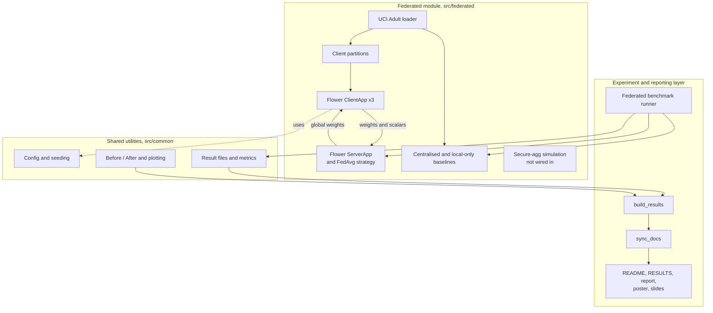

# Poster — Private federated learning on UCI Adult: a reference implementation with a Before / After comparison

This file is the exact poster copy, ready to typeset, followed by the layout specification.
Everything between the section headings below is printed on the poster unless a paragraph is
marked *(not printed)*. Every reproduced number on the poster comes from a generated block; the
prose around the blocks states in words what the tables show.

---

## 1. Title block

**Title:** Private Federated Learning on UCI Adult: A Reference Implementation with a
Before / After Comparison

**Subtitle:** A complete, runnable, reproducible open-source implementation of sample-weighted
federated averaging with differential privacy on UCI Adult, for researchers who want to try,
benchmark and extend the method

**Author:** Fan Guo

**Status:** Draft reference implementation — values printed in the source paper are shown for reference only; see RESULTS.md for the values this code produces and the conditions under which it produces them.

---

## 2. Problem

Several data owners want to train one model together, but they cannot pool their raw rows, and
each of them needs an explicit, stated privacy budget for its own records. This repository is a
complete, runnable reference implementation of sample-weighted federated averaging with
record-level differential privacy for that problem, with centralised and local-only baselines,
privacy accounting, and a Before / After comparison measured under one documented protocol: 20
rounds, five reporting seeds and a shared public test set. The method follows the federated
learning approach with differential privacy described by Zhang et al. (2025).

*(not printed)* The companion project `ddqn-os-scheduling` is a separate repository with its own
code, data and results; it shares the same direction and the same reporting conventions.

---

## 3. Method in one diagram

**What to draw.** One diagram in three regions, matching
[docs/architecture/01-system-overview.md](../architecture/01-system-overview.md):

- **Main region, "Federated module (UCI Adult)".** "UCI Adult loader" → "Client partitions" →
  three client boxes ("Private", "Government", "Self-employed"), each containing a small inner
  box "DP-SGD (Opacus)". Between the clients and a box "Flower ServerApp, weighted FedAvg" draw
  two arrows: down, "global weights"; up, "weights and scalars". Draw a heavy dashed line
  around each client labelled "rows never leave". A box "Centralised and local-only baselines"
  receives an arrow from the loader. A greyed box "Secure-aggregation simulation — not wired
  in" has no arrow.
- **Bottom band, "Shared: src/common".** Boxes "Config and seeding", "Result files and
  metrics", "Before / After and plotting".
- **Right-hand strip, "Reporting".** "Federated benchmark runner" → "build_results" →
  "sync_docs" → "README, RESULTS, report, poster, slides".
- Print under the diagram: "Three simulated clients from one public dataset, in one process.
  There is no integrated demo and no large-language-model component in this draft."

The same diagram as rendered Mermaid source (for the digital version of the poster):

<!-- BEGIN GENERATED: diagram_system_overview -->

<!-- END GENERATED: diagram_system_overview -->

**Caption.** System overview of the repository. It shows modules and data flow; it does not
show a deployment, real institutions or real private data, because none exists.

---

## 4. Results panel 1 — Before / After

Dataset: UCI Adult / Census Income (1994 U.S. Census extraction; 48,842 rows; workclass clients Private / Government / Self-employed plus IID control)

**Panel dataset line (print directly under the panel heading, large):** UCI Adult / Census
Income (1994 U.S. Census, workclass clients, ε ∈ {1, 3, 8} and no noise)

**Panel source label (print in the panel's top-right corner):** [Reproduced] — three simulated
clients built from one public dataset, 20 rounds, 5 reporting seeds (0–4), shared test set of
16,281 rows, mean ± sample standard deviation. [Reproduced] means obtained by running this
repository's code under these documented conditions; it does not mean that a number printed in
a paper was reproduced.

**Before** = a comparison method (centralised SVM, Random Forest, Decision Tree, centralised
MLP of the same architecture, local-only training). **After** = weighted FedAvg without DP. In
the rows whose After Method names an ε, the Before method is weighted FedAvg without DP and the
After method is weighted FedAvg with DP at that ε.

<!-- BEGIN GENERATED: before_after_compact -->
Dataset: UCI Adult / Census Income (1994 U.S. Census extraction; 48,842 rows; workclass clients Private / Government / Self-employed plus IID control)

Source label: [Reproduced]. Clients: workclass clients; ε in {1, 3, 8, no noise}.

| Metric | Before Method | Before Value | After Method | After Value | Delta (absolute) | Improvement % | Source Label |
|---|---|---|---|---|---|---|---|
| Accuracy | SVM (centralised) | 0.8401 ± 0.0000 | Weighted FedAvg (no DP) | 0.8372 ± 0.0018 | -0.0028 | -0.3% | [Reproduced] |
| Accuracy | Random Forest (centralised) | 0.8650 ± 0.0003 | Weighted FedAvg (no DP) | 0.8372 ± 0.0018 | -0.0277 | -3.2% | [Reproduced] |
| Accuracy | Decision Tree (centralised) | 0.8598 ± 0.0001 | Weighted FedAvg (no DP) | 0.8372 ± 0.0018 | -0.0226 | -2.6% | [Reproduced] |
| Accuracy | Centralised MLP (upper bound) | 0.8475 ± 0.0012 | Weighted FedAvg (no DP) | 0.8372 ± 0.0018 | -0.0102 | -1.2% | [Reproduced] |
| Accuracy | Local-only (mean of 3 client models) | 0.8094 ± 0.0117 | Weighted FedAvg (no DP) | 0.8372 ± 0.0018 | +0.0278 | +3.4% | [Reproduced] |
| Accuracy | Weighted FedAvg (no DP) | 0.8372 ± 0.0018 | Weighted FedAvg + DP (ε = 8) | 0.8355 ± 0.0041 | -0.0018 | -0.2% | [Reproduced] |
| Accuracy | Weighted FedAvg (no DP) | 0.8372 ± 0.0018 | Weighted FedAvg + DP (ε = 3) | 0.8360 ± 0.0054 | -0.0013 | -0.1% | [Reproduced] |
| Accuracy | Weighted FedAvg (no DP) | 0.8372 ± 0.0018 | Weighted FedAvg + DP (ε = 1) | 0.8225 ± 0.0056 | -0.0147 | -1.8% | [Reproduced] |
| F1 (class >50K) | SVM (centralised) | 0.6268 ± 0.0000 | Weighted FedAvg (no DP) | 0.6485 ± 0.0089 | +0.0216 | +3.5% | [Reproduced] |
| F1 (class >50K) | Random Forest (centralised) | 0.6800 ± 0.0014 | Weighted FedAvg (no DP) | 0.6485 ± 0.0089 | -0.0315 | -4.6% | [Reproduced] |
| F1 (class >50K) | Decision Tree (centralised) | 0.6678 ± 0.0004 | Weighted FedAvg (no DP) | 0.6485 ± 0.0089 | -0.0193 | -2.9% | [Reproduced] |
| F1 (class >50K) | Centralised MLP (upper bound) | 0.6437 ± 0.0060 | Weighted FedAvg (no DP) | 0.6485 ± 0.0089 | +0.0048 | +0.7% | [Reproduced] |
| F1 (class >50K) | Local-only (mean of 3 client models) | 0.6369 ± 0.0072 | Weighted FedAvg (no DP) | 0.6485 ± 0.0089 | +0.0116 | +1.8% | [Reproduced] |
| F1 (class >50K) | Weighted FedAvg (no DP) | 0.6485 ± 0.0089 | Weighted FedAvg + DP (ε = 8) | 0.6272 ± 0.0079 | -0.0213 | -3.3% | [Reproduced] |
| F1 (class >50K) | Weighted FedAvg (no DP) | 0.6485 ± 0.0089 | Weighted FedAvg + DP (ε = 3) | 0.6364 ± 0.0090 | -0.0121 | -1.9% | [Reproduced] |
| F1 (class >50K) | Weighted FedAvg (no DP) | 0.6485 ± 0.0089 | Weighted FedAvg + DP (ε = 1) | 0.6236 ± 0.0082 | -0.0248 | -3.8% | [Reproduced] |

A positive Improvement % always means better after; a negative value is a regression.
<!-- END GENERATED: before_after_compact -->

A positive Improvement % always means better after; a negative value is a regression.

**Chart caption.** Seven metrics on the workclass clients; blue = Before (comparison) methods,
orange = federated methods. FedAvg without DP is drawn orange because it is the After method
against the centralised and local-only baselines; it is also the Before reference for the
three DP bars. One public dataset, three simulated clients, one machine; it does not show
real institutions, real private data or a real network. The same chart for the IID control is
`federated_iid.png` in the same folder.

**Interpretation (print as is).** On the workclass clients, weighted FedAvg is more accurate
than the clients' own local-only models, and better on F1 too, so collaborating helps the
clients; it is less accurate than the centralised Random Forest and Decision Tree, which are
also better on F1, and the centralised MLP of the same architecture is better on accuracy.
Every negative Improvement % in the table is a regression of the After method and is printed
as it is. Federation is the option to try when rows cannot be pooled; where they can, a
centralised tree model gave the higher scores here.

---

## 5. Results panel 2 — Privacy budget ε versus accuracy

Dataset: UCI Adult / Census Income (1994 U.S. Census extraction; 48,842 rows; workclass clients Private / Government / Self-employed plus IID control)

**Panel dataset line (print directly under the panel heading, large):** UCI Adult / Census
Income (1994 U.S. Census, workclass clients and IID control, ε ∈ {1, 3, 8} and no noise)

**Panel source label (top-right corner):** [Reproduced] — weighted FedAvg, 20 rounds, 5
reporting seeds, record-level ε spent by each client over the whole run.

<!-- BEGIN GENERATED: epsilon_tradeoff -->
Dataset: UCI Adult / Census Income (1994 U.S. Census extraction; 48,842 rows; workclass clients Private / Government / Self-employed plus IID control)

Source label: [Reproduced]. Weighted FedAvg, 20 rounds, 5 seeds; ε is the record-level budget each client spends over all rounds (largest value over the three clients), at the δ set in `configs/federated_adult.yaml`. The ∞ row is the run with no noise, that is, with no differential privacy at all.

| Clients | Target ε | Achieved ε (max over clients) | Accuracy | F1 (class >50K) | Precision | Recall | Accuracy change vs no noise |
|---|---|---|---|---|---|---|---|
| workclass clients | 1 | 0.997 ± 0.000 | 0.8225 ± 0.0056 | 0.6236 ± 0.0082 | 0.6252 ± 0.0140 | 0.6222 ± 0.0034 | -0.0147 |
| workclass clients | 3 | 2.996 ± 0.000 | 0.8360 ± 0.0054 | 0.6364 ± 0.0090 | 0.6696 ± 0.0247 | 0.6081 ± 0.0326 | -0.0013 |
| workclass clients | 8 | 7.999 ± 0.000 | 0.8355 ± 0.0041 | 0.6272 ± 0.0079 | 0.6751 ± 0.0129 | 0.5857 ± 0.0092 | -0.0018 |
| workclass clients | ∞ | ∞ | 0.8372 ± 0.0018 | 0.6485 ± 0.0089 | 0.6626 ± 0.0154 | 0.6361 ± 0.0300 | reference |
| IID control | 1 | 0.992 ± 0.000 | 0.8376 ± 0.0030 | 0.6271 ± 0.0083 | 0.6865 ± 0.0224 | 0.5785 ± 0.0284 | -0.0082 |
| IID control | 3 | 2.991 ± 0.000 | 0.8406 ± 0.0017 | 0.6314 ± 0.0051 | 0.6960 ± 0.0113 | 0.5781 ± 0.0144 | -0.0053 |
| IID control | 8 | 7.995 ± 0.000 | 0.8414 ± 0.0010 | 0.6337 ± 0.0029 | 0.6973 ± 0.0069 | 0.5809 ± 0.0088 | -0.0045 |
| IID control | ∞ | ∞ | 0.8459 ± 0.0012 | 0.6402 ± 0.0114 | 0.7140 ± 0.0150 | 0.5812 ± 0.0278 | reference |
<!-- END GENERATED: epsilon_tradeoff -->

**Chart caption.** Accuracy and F1 against the record-level ε each client spends over 20
rounds (∞ = no noise); the dashed line is the centralised MLP, the dotted line the
majority-class accuracy. The y axes do not start at zero. This chart is not a Before / After
chart: its two lines are the two client splits, not Before and After. It does not show
client-level privacy, which no run provides.

**Interpretation (print as is).** On the workclass clients, with differential privacy, accuracy
changes little at ε = 8 and ε = 3 (within the seed-to-seed spread) and drops more at ε = 1, and
positive-class F1 is lower than without DP at all three budgets; on the IID control accuracy is
slightly lower at all three budgets. The extended privacy study (finer ε grid, chart
`epsilon_extended.png`, listed in RESULTS.md) shows accuracy on the workclass clients flat down
to about ε = 2, clearly lower at ε = 0.3, and below the majority-class rate at ε = 0.1, where
the IID control is about at that rate. A user who needs
positive-class F1 should expect DP to cost some of it at every budget.

---

## 6. Design choices

**Box heading:** Design choices and why

| Design choice | What this implementation does | Why |
|---|---|---|
| Dataset | UCI Adult, published training and test files | Public and tabular, with a natural domain attribute (`workclass`) |
| Clients | Three workclass clients plus an IID control | The IID control separates the effect of client heterogeneity |
| Aggregation | Sample-weighted FedAvg; the unweighted mean kept as an ablation | A client's influence matches its data |
| Privacy | Record-level DP-SGD per client, stated ε and δ | The guarantee is explicit |
| Scaling | Fixed public constants | Nothing outside the accounted mechanism is released |
| Metrics | Positive-class precision, recall and F1 and a majority-class reference next to accuracy | One class is rare |

**Box text (print as is).** Every setting in this box is [Assumption — not in paper]: chosen and
written down by this repository.

---

## 7. Privacy panel

**Left half — what ε covers.**

- **Guarantee.** Record-level (ε, δ)-differential privacy of each client's training rows with
  respect to the sequence of model updates that client sends, against an honest-but-curious
  server, for one run alone (Abadi et al., 2016; Mironov, 2017). DP-SGD runs inside each
  client through Opacus (Yousefpour et al., 2021); the noise is calibrated per client so each
  client spends the target ε over all 20 rounds.
- **Not covered.** Client-level privacy (whether a whole client took part); the row count
  `num-examples`, sent in the clear for weighted averaging, and everything derived from it
  (sample rate, steps, noise multiplier, ε); hyperparameter tuning; and the joint release of
  several runs on the same rows, whose budgets add up.
- **Never leaves a client.** Rows, features, labels, the evaluation-only attributes age, race
  and sex, per-sample gradients, and under DP the training loss.
- **Randomness.** DP noise comes from a client-held secret that never appears in any message.
  The benchmark fixes that secret for reproducibility; a deployment must not do so. Opacus
  secure mode is off: this is a research simulation, not a deployment-grade implementation.

**Right half — the released quantities.**

<!-- BEGIN GENERATED: privacy_released_quantities -->
| Quantity leaving a DP client | Covered by the (epsilon, delta) guarantee | Note |
|---|---|---|
| `model weights` | covered | the output of DP-SGD; the quantity the (epsilon, delta) bound is about |
| `update-norm` | covered | post-processing of the sent weights and the public global weights |
| `num-examples` | NOT covered | exact count of the client's training rows, sent in the clear for weighted FedAvg |
| `partition-id` | not data-dependent | client index assigned by the simulation; says nothing about any row |
| `epsilon` | NOT covered | computed from the sample rate and step count, so it reveals ceil(n / batch_size) |
| `delta` | not data-dependent | a public setting from YAML |
| `noise-multiplier` | NOT covered | in target_epsilon mode calibrated from the client's sample rate (depends on n) |
| `sample-rate` | NOT covered | 1 / ceil(n / batch_size): depends on the row count n |
| `steps` | NOT covered | local_epochs * ceil(n / batch_size): depends on the row count n |
<!-- END GENERATED: privacy_released_quantities -->

**Caption.** Every quantity that leaves a DP client and whether the (ε, δ) guarantee covers
it. Every item that is not covered reveals the client's row count or a coarsening of it, never
a value of any row. It does not describe a real network or real private data. The full
boundary is drawn in [docs/architecture/03-trust-boundary.md](../architecture/03-trust-boundary.md).

**Print as is.** The secure-aggregation module is an arithmetic masking simulation with one
shared seed. It is not cryptography and is not wired into training, so individual updates and
row counts reach the server in the clear. Four privacy defects were found in this code and
fixed before the reference run: DP noise shared across the ε settings of one seed, un-noised
training statistics in the reply, a skipped noise-only step for an empty batch, and DP noise
derived from the run seed the server sends. The project report lists all four; the
trust-boundary page describes the second and the fourth.

---

## 8. Limitations

- The benchmark uses one public dataset with three simulated clients on one machine; UCI Adult
  has known shortcomings as a benchmark (Ding et al., 2021), and the federated model is a small
  MLP that the centralised tree baselines beat.
- The clients are simulated domains of one census extraction, not real organisations; the
  workclass split, the IID control and the ε sweep are assumptions chosen by this repository.
- The privacy guarantee is record-level only, leaves the row count unprotected, uses
  non-secure pseudo-random noise with a harness-fixed secret, and the secure-aggregation
  component is a masking simulation that is not cryptography and is not wired in.
- Five seeds per condition; differences smaller than the seed-to-seed spread are not treated
  as observations.
- Not run, and therefore [Target / TBD]: the Ray simulation engine, FEMNIST, a real
  secure-aggregation backend, any deployment across real organisations, any integrated demo and
  any large-language-model component.

---

## 9. Repository and references

**Repository:** [fguo10-tech/federated-privacy-adult](https://github.com/fguo10-tech/federated-privacy-adult)

**References**

- Abadi, M., Chu, A., Goodfellow, I., McMahan, H. B., Mironov, I., Talwar, K., & Zhang, L.
  (2016). Deep Learning with Differential Privacy. ACM CCS 2016.
- Becker, B., & Kohavi, R. (1996). Adult [Dataset]. UCI Machine Learning Repository.
  https://doi.org/10.24432/C5XW20 — [http://archive.ics.uci.edu/ml/datasets/Adult](http://archive.ics.uci.edu/ml/datasets/Adult)
- Beutel, D. J., et al. (2020). Flower: A Friendly Federated Learning Research Framework.
  arXiv:2007.14390.
- Ding, F., Hardt, M., Miller, J., & Schmidt, L. (2021). Retiring Adult: New Datasets for Fair
  Machine Learning. NeurIPS 2021.
- McMahan, H. B., Moore, E., Ramage, D., Hampson, S., & Agüera y Arcas, B. (2017).
  Communication-Efficient Learning of Deep Networks from Decentralized Data. AISTATS 2017.
- Mironov, I. (2017). Rényi Differential Privacy. IEEE CSF 2017.
- Yousefpour, A., et al. (2021). Opacus: User-Friendly Differential Privacy Library in
  PyTorch. arXiv:2109.12298.
- Zhang, Y., Liu, J., Wang, J., Dai, L., Guo, F., & Cai, G. (2025). Federated Learning for
  Cross-Domain Data Privacy: A Distributed Approach to Secure Collaboration. ISBDAS 2025,
  pp. 824–828. https://doi.org/10.1109/ISBDAS64762.2025.11116917

---

## 10. Layout specification *(not printed)*

**Size.** A0 portrait, 841 × 1189 mm, with a 25 mm margin on every side and a 20 mm gutter
between columns. For a 48 × 36 inch landscape board (1219 × 914 mm), use the same sections in
four columns instead of three: column 1 holds sections 2, 3 and 6; column 2 holds section 4;
column 3 holds section 5; column 4 holds sections 7, 8 and 9. Keep every font size below.

**Grid (A0 portrait, three columns of about 250 mm, heights approximate).**

| Row | Height | Column 1 | Column 2 | Column 3 |
|---|---|---|---|---|
| A | 130 mm | Section 1, title block, spanning all three columns | | |
| B | 300 mm | Section 2, Problem (110 mm) and Section 6, Design choices (190 mm) | Section 3, Method in one diagram, spanning columns 2 and 3 | |
| C | 420 mm | Section 4, Results panel 1, spanning columns 1 and 2: dataset line, table, grouped bar chart, interpretation | | Section 5, Results panel 2: dataset line, ε table, ε chart, interpretation |
| D | 210 mm | Section 7, Privacy panel, spanning columns 1 and 2 (left half: what ε covers; right half: released quantities) | | Section 5 continued (interpretation), then Section 8, Limitations |
| E | 130 mm | Section 8, Limitations, continued if needed, spanning columns 1 and 2 | | Section 9, QR code and references |

The two results panels are the largest areas on the poster and sit side by side in row C, so
that a reader sees the Before / After table and the ε trade-off at the same height.

**Reading order.** Title → Problem → Method diagram → Results panel 1 (Before / After) →
Results panel 2 (ε versus accuracy) → Design choices → Privacy panel → Limitations →
QR code and references. Number the section headings 1–9 on the poster so the order is visible,
because the Design choices box sits physically before the results panels in column 1.

**Minimum font sizes (A0; scale by the same factor for other sizes).**

| Element | Minimum |
|---|---|
| Title | 90 pt |
| Section headings | 48 pt |
| Body text and interpretation | 28 pt |
| Captions, source labels and dataset lines | 22 pt |
| Table text, including generated tables | 20 pt |
| References | 18 pt |

If a generated table does not fit at 20 pt, print the table at 20 pt across a wider area
rather than shrinking it; never drop rows, and never drop the Delta, Improvement % or Source
Label columns. The source label `[Reproduced]` in the top-right corner of each results panel is
printed at no less than the caption size and must stay visible in every crop or reduced print.

**Colour and accessibility.**

- **Before is always blue `#2a78d6` and After is always orange `#eb6834`**, in the
  Before / After chart, in any table shading and in any legend chip. **Grey `#898781` is
  reserved for references** that are neither Before nor After; the Before / After chart has
  none, and nothing else on the poster may use blue or orange for another meaning.
- **The ε trade-off chart in results panel 2 is the exception and must be captioned as such:**
  its two lines are the two client splits, not Before and After, and it uses two other series
  colours with a printed legend and different marker shapes (circles and squares).
- **Never encode meaning by colour alone.** Every bar carries a printed method name on the
  axis, the chart legend prints the words "Before" and "After", every table has a
  Source Label column, and every regression is marked by the minus sign in the Improvement %
  column, never only by a red or green tint (do not tint table cells red or green). In the
  released-quantities table, "NOT covered" is printed in capitals and is not marked by colour
  alone.
- **Contrast.** Body text is black or near-black on a white or very light background, at least
  7:1. Coloured text is not used for body copy. Bar fills must reach at least 3:1 against the
  background (non-text contrast): against white, `#2a78d6` reaches about 4.4:1, `#eb6834`
  about 3.2:1 and `#898781` about 3.6:1, so keep a white or very light background behind every
  chart. Value labels on bars are printed in black above the bar, not inside it.
- **Colour-vision deficiency.** Blue and orange remain distinguishable under the common red–green
  deficiencies, but they have almost the same lightness, so they are hard to tell apart in
  greyscale and for some viewers with blue–yellow deficiency. Therefore always keep the printed
  method names on the axis, and in a greyscale print add a diagonal hatch to every After bar.
  Check the final file with a colour-vision-deficiency simulator before printing.
