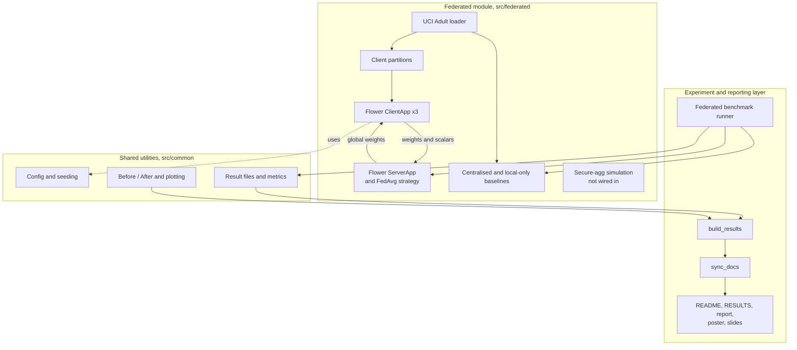
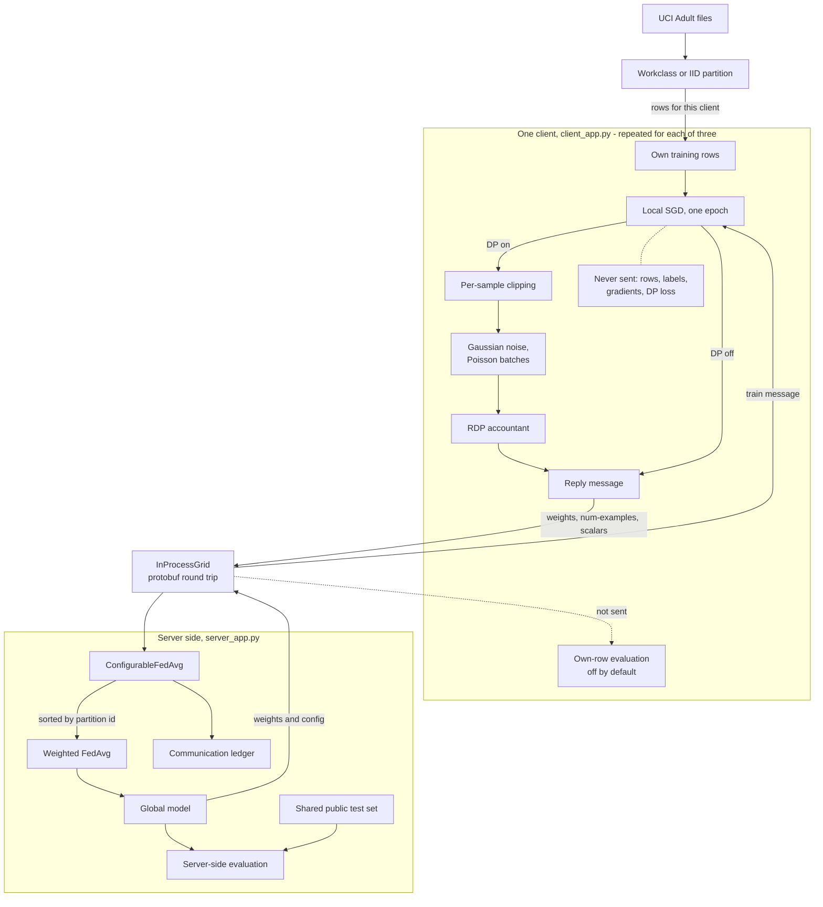
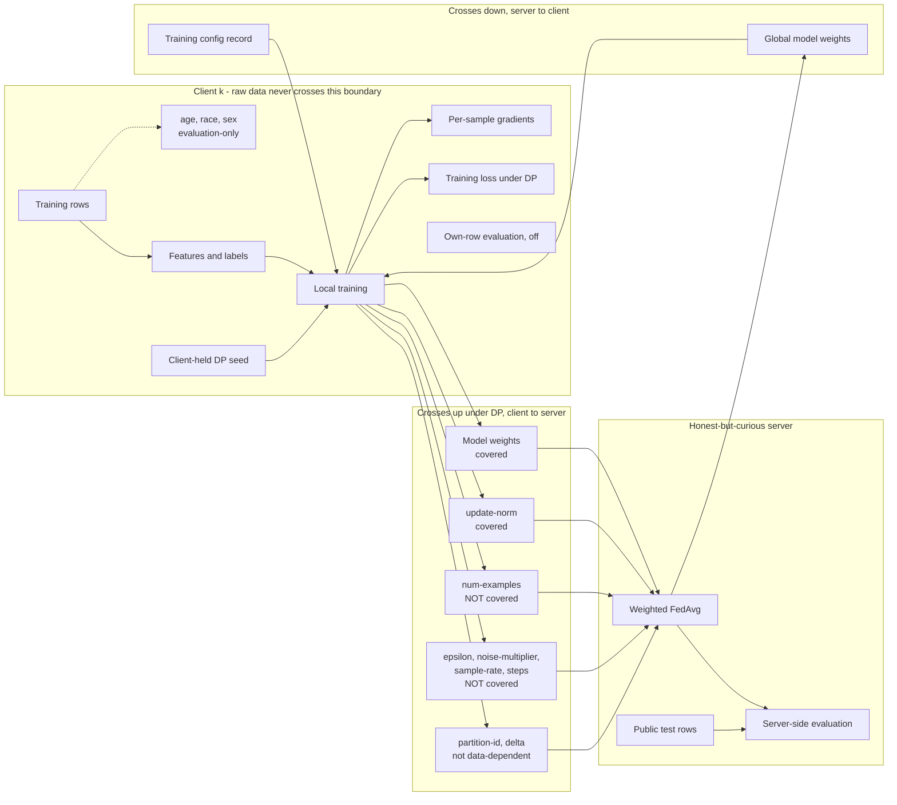
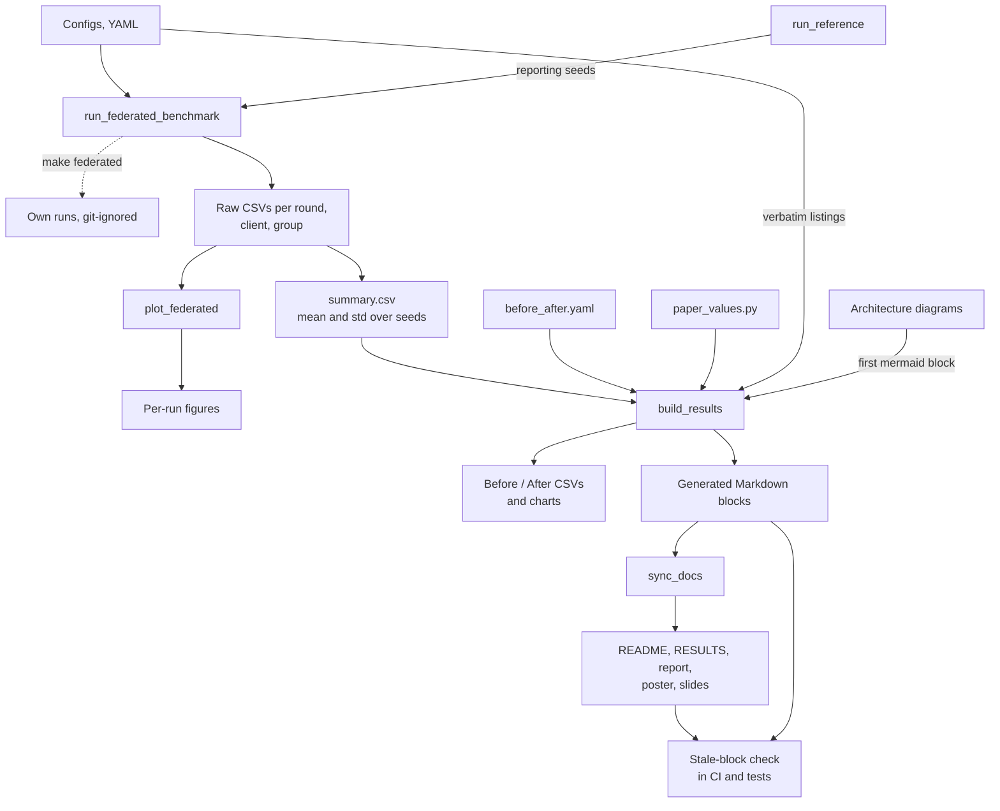
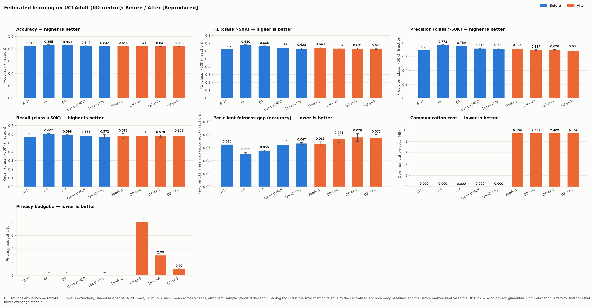
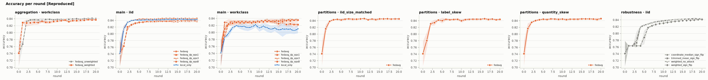
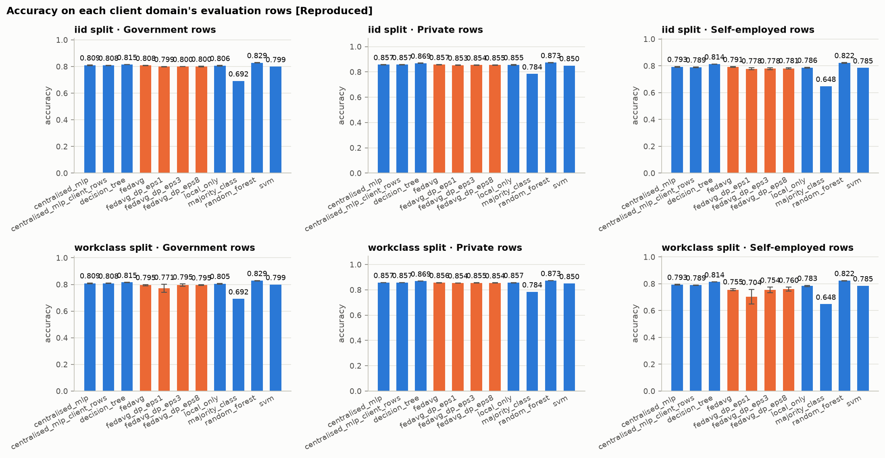
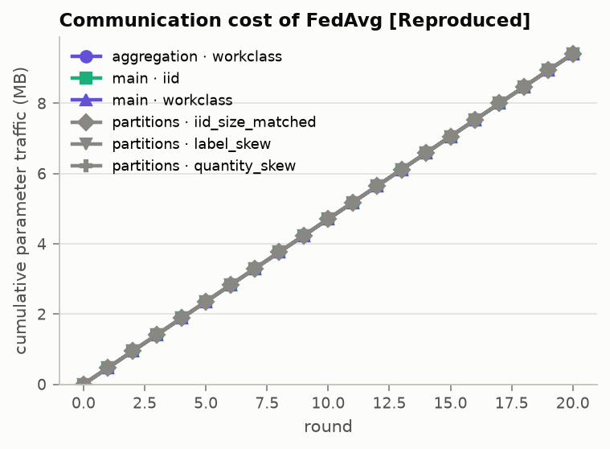
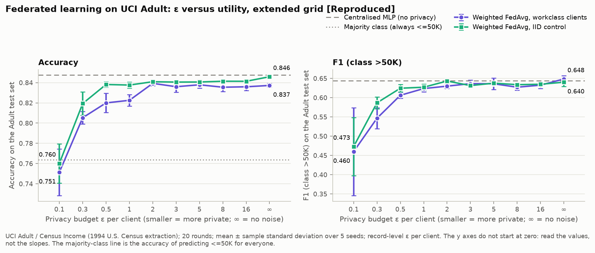

# Federated learning with differential privacy on UCI Adult: a reference implementation with a Before / After comparison

The federated-privacy-adult contributors

Original draft date: 2024-11-19. This updated version removes citations and paper-reported values that were not part of the original draft. Several measured results are regressions against a baseline, and they are shown as such. Repository measurements are labelled `[Reproduced]` or `[Target / TBD]`, and every measured value appears only inside a generated block rebuilt from result files.

## Abstract

This report documents a reference implementation for researchers of one problem: training one model across data owners who cannot pool their raw data, with an explicit privacy budget. The repository provides a complete, runnable version of federated learning with differential privacy, with every setting it needs (the number of clients, the model, the optimiser, the privacy budget and the privacy mechanism) written down as an explicit assumption, a set of baselines, privacy accounting with a written scope, robust aggregation under attack, and a Before / After comparison measured under a multi-seed protocol with documented conditions.

The benchmark runs Flower-based, sample-count-weighted federated averaging with Opacus DP-SGD on the public UCI Adult / Census Income dataset, split into three workclass-based clients plus an IID control. It compares the federated model with centralised and local-only baselines, sweeps the privacy budget ε, extends that sweep to a finer grid and to other clipping norms, compares aggregation rules with and without Byzantine clients, and states explicitly which released quantities the privacy guarantee covers and which it does not. A secure-aggregation interface is provided with a masking simulation that is labelled as a simulation and is not wired into training.

The measured results `[Reproduced]` include gains and regressions, and both are shown. On the workclass clients, weighted FedAvg is more accurate than the clients' own local-only models and less accurate than the centralised Random Forest and Decision Tree. With differential privacy, accuracy changes little at ε = 8 and ε = 3 and drops more at ε = 1, and F1 is lower at all three budgets; the extended privacy study shows accuracy falling clearly at ε = 0.3 and, at ε = 0.1, dropping to about or below the majority-class rate. The repository contains no large-language-model component.

## Executive summary

**What was built.** A single Python package (`src`) with a federated-learning module, a shared utility layer, experiment runners, a reference run over the reporting seeds 0 to 4, and a documentation pipeline in which every measured number is generated from result files and injected into the documents by `python -m experiments.sync_docs`. The detailed raw tables are in [RESULTS.md](../../experiments/results/RESULTS.md); the step-by-step topic guide is [the federated topic guide](../../docs/investigations/01-federated-privacy-cross-domain.md).

**Federated learning on Adult `[Reproduced]`.** The generated observations below summarise the benchmark. On the workclass clients, weighted FedAvg is more accurate than the clients' own local-only models and less accurate than the centralised Random Forest and Decision Tree; its accuracy is slightly lower than that of a centralised network of the same architecture. With differential privacy, accuracy changes little at ε = 8 and ε = 3 (within the seed-to-seed spread) and drops more at ε = 1, and F1 is lower at all three budgets. The per-client fairness gap of the federated model is larger than that of the centralised model. The tables give the values.

<!-- BEGIN GENERATED: findings -->
Dataset: UCI Adult / Census Income (1994 U.S. Census extraction; 48,842 rows; workclass clients Private / Government / Self-employed plus IID control)

- Weighted FedAvg without DP on the workclass clients: accuracy 0.8372 ± 0.0018, F1 0.6485 ± 0.0089. [Reproduced]
- Accuracy: Centralised MLP (upper bound) 0.8475 ± 0.0012 → Weighted FedAvg (no DP) 0.8372 ± 0.0018 (Delta -0.0102, Improvement -1.2%); F1 (class >50K): Centralised MLP (upper bound) 0.6437 ± 0.0060 → Weighted FedAvg (no DP) 0.6485 ± 0.0089 (Delta +0.0048, Improvement +0.7%). [Reproduced]
- Accuracy: Local-only (mean of 3 client models) 0.8094 ± 0.0117 → Weighted FedAvg (no DP) 0.8372 ± 0.0018 (Delta +0.0278, Improvement +3.4%); F1 (class >50K): Local-only (mean of 3 client models) 0.6369 ± 0.0072 → Weighted FedAvg (no DP) 0.6485 ± 0.0089 (Delta +0.0116, Improvement +1.8%). [Reproduced]
- Accuracy: SVM (centralised) 0.8401 ± 0.0000 → Weighted FedAvg (no DP) 0.8372 ± 0.0018 (Delta -0.0028, Improvement -0.3%); F1 (class >50K): SVM (centralised) 0.6268 ± 0.0000 → Weighted FedAvg (no DP) 0.6485 ± 0.0089 (Delta +0.0216, Improvement +3.5%). [Reproduced]
- Accuracy: Random Forest (centralised) 0.8650 ± 0.0003 → Weighted FedAvg (no DP) 0.8372 ± 0.0018 (Delta -0.0277, Improvement -3.2%); F1 (class >50K): Random Forest (centralised) 0.6800 ± 0.0014 → Weighted FedAvg (no DP) 0.6485 ± 0.0089 (Delta -0.0315, Improvement -4.6%). [Reproduced]
- Accuracy: Decision Tree (centralised) 0.8598 ± 0.0001 → Weighted FedAvg (no DP) 0.8372 ± 0.0018 (Delta -0.0226, Improvement -2.6%); F1 (class >50K): Decision Tree (centralised) 0.6678 ± 0.0004 → Weighted FedAvg (no DP) 0.6485 ± 0.0089 (Delta -0.0193, Improvement -2.9%). [Reproduced]
- Privacy cost — Accuracy: Weighted FedAvg (no DP) 0.8372 ± 0.0018 → Weighted FedAvg + DP (ε = 8) 0.8355 ± 0.0041 (Delta -0.0018, Improvement -0.2%); F1 (class >50K): Weighted FedAvg (no DP) 0.6485 ± 0.0089 → Weighted FedAvg + DP (ε = 8) 0.6272 ± 0.0079 (Delta -0.0213, Improvement -3.3%); achieved ε 8.00 ± 0.00. [Reproduced]
- Privacy cost — Accuracy: Weighted FedAvg (no DP) 0.8372 ± 0.0018 → Weighted FedAvg + DP (ε = 3) 0.8360 ± 0.0054 (Delta -0.0013, Improvement -0.1%); F1 (class >50K): Weighted FedAvg (no DP) 0.6485 ± 0.0089 → Weighted FedAvg + DP (ε = 3) 0.6364 ± 0.0090 (Delta -0.0121, Improvement -1.9%); achieved ε 3.00 ± 0.00. [Reproduced]
- Privacy cost — Accuracy: Weighted FedAvg (no DP) 0.8372 ± 0.0018 → Weighted FedAvg + DP (ε = 1) 0.8225 ± 0.0056 (Delta -0.0147, Improvement -1.8%); F1 (class >50K): Weighted FedAvg (no DP) 0.6485 ± 0.0089 → Weighted FedAvg + DP (ε = 1) 0.6236 ± 0.0082 (Delta -0.0248, Improvement -3.8%); achieved ε 1.00 ± 0.00. [Reproduced]
- Non-IID effect — weighted FedAvg without DP: accuracy 0.8372 ± 0.0018 on the workclass clients versus 0.8459 ± 0.0012 on the IID control (difference -0.0086). [Reproduced]
- Majority-class reference: accuracy 0.7638 ± 0.0000, F1 0.0000 ± 0.0000 — the floor any accuracy figure must be read against. [Reproduced]
- Per-client fairness gap (accuracy, max − min over the three workclass domains): centralised MLP 0.0640 ± 0.0032, weighted FedAvg 0.1011 ± 0.0088, FedAvg + DP (ε = 3) 0.1010 ± 0.0195. [Reproduced]
<!-- END GENERATED: findings -->

**What the list means for a user.** Federation is worth its cost here relative to training alone: each of the three clients reaches a better model by taking part than by training on its own rows. It is not a way to beat a centralised tree model on pooled tabular data, and record-level differential privacy has a measurable price in the F1 of the positive class even at the loosest budget of the locked sweep. Chapter 9 turns these observations into applicability conditions, each stated next to the measured fact it rests on.

**Related documents.** The [README](../../README.md) is the entry point; [the architecture documents](../architecture/README.md) explain the four diagrams; [the dataset cards](../../data/README.md) describe Adult, the optional FEMNIST benchmark and the synthetic toy domains; the [poster](../poster/POSTER.md) and the [slides](../slides/PRESENTATION.md) summarise this report; and [the notebook](../../notebooks/01_federated_privacy_tradeoff.ipynb) walks through the privacy trade-off.

**What this does not show.** Nothing here was run on a real federation, across real organisations or on private data. The federated clients are three simulated domains carved from one public 1994 census extract, the privacy guarantee is record-level and not client-level, and the secure-aggregation component is a simulation. Everything not run is `[Target / TBD]`.

## 1. Introduction

Machine learning is increasingly proposed for data that are spread across organisations which cannot or will not pool them: hospitals, banks, public agencies and the operators of user-facing services. Federated learning promises a shared model without moving the data, and differential privacy promises a bound on what that model, or the updates that produced it, reveal about any single record. Both promises carry risks that are easy to understate. A federated model can be worse than one trained on pooled data, and worse for some participants than for others; a privacy guarantee can be stated for one quantity while other quantities leave the client unprotected; and a description of such a system is of little use to others unless every setting needed to run it is written down. A reference implementation is useful to researchers in that situation: an executable definition of the method with every setting written down, baselines run on the same inputs, a stated protocol, a precise statement of what the privacy guarantee covers, and a record of the conditions under which the method does well and the conditions under which it does not.

The project behind this codebase states its long-term aim in the following Proposed Endeavor paragraph, quoted verbatim:

> Design and implement advanced machine learning and large language model architectures for secure, reliable system-level optimization in order to enhance the efficiency, reliability, and security of U.S. digital infrastructure and accelerate the deployment of next-generation artificial intelligence (AI) applications.

This repository addresses one part of that aim: machine learning with privacy accounting across data owners. Its scope is deliberately much narrower than the paragraph. It implements a differentially private federated learning benchmark on one public dataset. It contains **no large-language-model component of any kind**: no language model is trained, fine-tuned, called or evaluated, and large language model architectures are listed only under planned work in Section 13. Nothing in it is production-ready, and nothing has been deployed. The phrase "secure, reliable" in the quotation corresponds, in this draft, to three concrete things: a written statement of exactly which released quantities a differential-privacy guarantee covers, robust aggregation rules measured against clients that send malicious updates, and a refusal to report any result that has not been produced by the code under a stated protocol.

The companion project `ddqn-os-scheduling` is a separate repository with its own code, data and results; the two share the same direction and the same reporting conventions, and nothing in this report depends on it.

This repository is a reference implementation for researchers. Its contributions are the following.

1. **Documented settings.** The repository defines a federated benchmark on UCI Adult with three workclass-based clients and an IID control, a small multilayer perceptron trained with one local epoch of momentum SGD per round, sample-weighted FedAvg over 20 rounds, and record-level DP-SGD with a stated δ, clipping norm and accountant. Every such setting is in a YAML file and tagged `[Assumption — not in paper]`, and the unweighted mean is kept as a switchable ablation next to the sample-weighted default. Chapter 3 lists the design choices and the reason for each.
2. **Baselines and a seeded, like-for-like evaluation.** Local-only models, a centralised MLP of the same architecture (also trained on the client rows only), and centralised SVM, Random Forest, Decision Tree and majority-class baselines. All methods are evaluated on the same shared test rows per seed, reporting seeds are held out from all tuning, the final round is always reported, and results are given as mean and sample standard deviation over five seeds, with per-client and per-group breakdowns.
3. **Privacy accounting with a scope statement.** Per-client DP-SGD through Opacus, Rényi accounting over all steps of all rounds, per-client noise calibration to a target ε, a table of every quantity that leaves a client together with whether the (ε, δ) guarantee covers it, and a record of the privacy defects found and fixed in this code.
4. **Robustness and secure aggregation, each with its limits stated.** A robustness suite with Byzantine clients and three aggregation rules, and a secure-aggregation interface whose only implementation is a pairwise-masking simulation, labelled as such and not wired into training.
5. **Before / After reporting with regressions shown.** A single build step turns result files into Before / After tables and charts, a synchronisation step injects them into every document, and a continuous-integration check fails when any table is stale, so a measured number cannot drift between documents. Every regression of the method under study appears in these tables as a negative Improvement %.

The rest of the report is organised as follows. Section 2 gives background. Section 3 lists the design choices of this implementation and their reasons. Section 4 describes the system. Section 5 describes federated training: clients and partitions, the client model, the aggregation rules, the Flower apps and communication accounting. Section 6 describes privacy and robustness: the DP mechanism and its accounting, what is released, the guarantee and its limits, the secure-aggregation simulation and robust aggregation under attack. Section 7 describes the datasets and the protocol. Section 8 presents the results, Section 9 discusses what they show and when the methods apply, Section 10 lists threats to validity, Section 11 covers ethics, privacy and safety, Section 12 describes how researchers and platform teams could adopt the code, and Section 13 sets out future work. Appendices hold configuration listings, file schemas, a glossary, a replication checklist and the reference list.

## 2. Background and related work

This report studies federated learning with differential privacy: clients train locally, a server averages their model parameters, and noise is added to client gradient updates. The sections below describe the implementation and the background it relies on.

### 2.1 Federated learning and non-IID data

Federated learning trains a shared model on data that remains with its owners (Kairouz et al., 2021; Li et al., 2020). Federated averaging (FedAvg) lets each client run several local optimisation steps and then averages the client models, weighting each by its number of training examples (McMahan et al., 2017). When client data are not identically distributed (non-IID), local models drift towards their own distributions and the average can be worse than a model trained on pooled data (Zhao et al., 2018; Hsu et al., 2019). Two kinds of non-IID data matter in this report. *Covariate and label shift* means that clients hold different kinds of people with different label rates; the workclass split has both, because the three domains differ in occupation, education and income. *Quantity skew* means that clients hold very different numbers of rows; the workclass split has that too, because one client holds most of the rows. The ablation partitions of Section 5.1 separate these two effects.

Flower (Beutel et al., 2020) is a framework for writing federated clients and servers; this repository uses its current message API, in which a server application sends messages to client applications through a `Grid` and receives replies that carry array records (model weights) and metric records (scalars). FEMNIST from the LEAF benchmark (Caldas et al., 2018) is a common federated benchmark with natural per-writer clients; here it is an optional secondary benchmark only.

### 2.2 Differential privacy, DP-SGD and Rényi accounting

A randomised mechanism $\mathcal{M}$ is $(\varepsilon, \delta)$-differentially private if for all neighbouring datasets $D, D'$ that differ in one record and every set of outcomes $O$, $\Pr[\mathcal{M}(D) \in O] \le e^{\varepsilon} \Pr[\mathcal{M}(D') \in O] + \delta$ (Dwork et al., 2006; Dwork and Roth, 2014). Smaller ε means stronger privacy; δ is a small probability with which the bound may fail, conventionally set below one over the number of records. DP-SGD makes stochastic gradient descent private by clipping each example's gradient, adding Gaussian noise to the sum and sampling minibatches at random (Abadi et al., 2016). The privacy loss of many such steps is composed tightly with Rényi differential privacy (Mironov, 2017), which this repository uses through Opacus (Yousefpour et al., 2021) on PyTorch (Paszke et al., 2019).

In federated learning the protected unit can be a single record (record-level privacy) or a whole client (client-level or user-level privacy; McMahan et al., 2018; Geyer et al., 2017). The two answer different questions. Record-level privacy bounds what can be learned about one row of one client from what that client sends; client-level privacy bounds what can be learned about whether a client took part at all. The guarantee implemented here is record-level only, and Section 6.3 states exactly which released quantities it covers.

### 2.3 Secure aggregation and Byzantine robustness

Differential privacy limits what a model reveals about any record; it does not hide an individual client's update from the server. Secure aggregation protocols let the server learn only the sum of the updates, using pairwise masks that cancel and secret sharing to survive dropouts (Bonawitz et al., 2017). Without such protection, gradients or updates can leak training examples (Zhu et al., 2019). A separate threat is a client that sends a malicious update. Byzantine-robust aggregation rules such as the coordinate-wise median and trimmed mean (Yin et al., 2018) or Krum (Blanchard et al., 2017) bound the influence of a minority of such clients. Classical baselines in this repository are built with scikit-learn (Pedregosa et al., 2011).

The three properties are independent. A system can be differentially private and still expose each update to the server; it can use secure aggregation and still be poisoned by one client; and a robust aggregation rule that inspects individual updates is in tension with secure aggregation, which hides them. This repository implements differential privacy and robust aggregation, and simulates only the arithmetic of secure aggregation; it does not resolve the tension, and Section 6 says which component protects against what.

## 3. Design choices and assumptions

The table lists the main design choices of this implementation, what each one does and why it was made. Every setting in it is chosen by this repository and tagged `[Assumption — not in paper]`; the values live in the YAML files listed in Appendix A, and the chapters named in the second column describe each choice in detail.

| Design choice | What this implementation does | Why |
|---|---|---|
| Dataset | UCI Adult / Census Income (1994 extraction), downloaded by a script and never committed (Section 7.1) | It is public and tabular, small enough to run 20 rounds over five seeds on a laptop, and has a natural domain attribute (workclass) that splits it into domains of different size and label rate |
| Clients | Three workclass-based clients (Private, Government, Self-employed) plus an IID control built from the same rows (Sections 5.1 and 7.2) | The workclass split produces distribution shift and size imbalance at once; the IID control removes both, so the effect of client heterogeneity can be separated |
| Aggregation | Sample-weighted FedAvg (McMahan et al., 2017); the unweighted mean is kept as the ablation `aggregation_suite` (Section 5.3) | Weights proportional to each client's number of rows give each client an influence that matches its data |
| Model | An MLP with hidden layers of 128 and 64 ReLU units, without batch normalisation (Section 5.2) | It can be trained federatedly with DP-SGD; Opacus needs per-sample gradients, and batch normalisation mixes samples |
| Local training | One local epoch of minibatch SGD with momentum per round, every client in every round, with the optimiser rebuilt every round (Section 5.2) | Clients carry no state between rounds, so every reply is a pure function of its inputs and runs are identical across execution engines |
| Differential privacy | Record-level DP-SGD through Opacus with (ε, δ) stated explicitly, δ = 10⁻⁵, clipping norm 2, Rényi accounting over all steps of all rounds, and per-client noise calibrated to a target ε in {1, 3, 8, no noise} (Sections 6.1 and 6.2) | The guarantee is explicit, and each client can enforce it on its own without trusting the server to add noise |
| Feature scaling | Continuous attributes are divided by public constants from YAML; categorical attributes are one-hot encoded over the published vocabularies (Section 7.1) | Nothing is fitted on client rows, so nothing is released outside the accounted mechanism and nothing leaks from the test set or across clients |
| Secure aggregation | A `SecureAggregator` interface with a pairwise-masking simulation, labelled as a simulation and not wired into training (Section 6.5) | The simulation fixes the interface that a real cryptographic backend would implement; it provides no protection |
| Robust aggregation | Coordinate-wise median and trimmed mean, compared with weighted FedAvg under Byzantine clients (Section 6.6) | The robust rules ignore the reported row counts, because a sample-count weight would let an attacker claim a huge row count |
| Baselines | Local-only models, a centralised MLP of the same architecture, centralised SVM, Random Forest and Decision Tree, and a majority-class predictor (Section 7.2) | Each Before / After row then says what federation gains or loses against one alternative on the same test rows |
| Metrics | Accuracy, the precision, recall and F1 of the positive class, and the macro F1, with a majority-class reference next to every accuracy figure (Section 5.6) | The positive class is rare, so an accuracy alone can hide a model that rarely predicts it |
| Evaluation protocol | One shared test set, the final round reported, reporting seeds 0 to 4 held out from all tuning, mean and sample standard deviation over five seeds (Sections 5.6 and 7.5) | No test-set selection happens, and every method is compared on the same rows and seeds |

Two choices shape the rest of the report more than the others. Sample-weighted aggregation is the default, and the unweighted mean is kept as an ablation so that both can be measured on the same seeds (Section 8.6); neither gives a uniform gain on this benchmark. The privacy budget, the mechanism and the accountant are all choices of this repository; Chapter 6 states them and states the scope of the resulting guarantee, including the quantities it does not cover.

## 4. System design

### 4.1 Architecture

The repository is one importable package, `src`, with two sub-packages and an experiment layer around them. `src/federated` holds the benchmark: the Adult loader and the optional FEMNIST and synthetic loaders (`datasets/`), partitions (`partition.py`), the model (`model.py`), local training (`client.py`), the Flower client and server apps (`client_app.py`, `server_app.py`), the strategy (`strategy.py`), the aggregation rules (`aggregation.py`), privacy (`privacy.py`), the in-process grid (`inprocess.py`), the baselines (`baselines.py`), evaluation (`evaluation.py`), communication accounting (`communication.py`), attacks (`attacks.py`), the secure-aggregation simulation (`secure_agg.py`) and the run orchestration (`runner.py`). `src/common` holds configuration loading, seed derivation, metric helpers, the Before / After computation, result I/O and plotting. The experiment scripts under `experiments/` run the benchmark, build the generated tables and synchronise them into the documents. The diagram below is the generated system overview; the four architecture documents under [docs/architecture/](../architecture/01-system-overview.md) explain each diagram, list its assumptions and record the alternatives that were considered.

<!-- BEGIN GENERATED: diagram_system_overview -->

<!-- END GENERATED: diagram_system_overview -->

*Figure 1. System overview: the federated module, the shared utilities and the reporting pipeline. It shows module boundaries and data flow; it does not show timing or any result, and the secure-aggregation simulation is drawn but is not wired into training.*

### 4.2 Interfaces

**`ClientApp`.** A Flower client on the message API. It reads its partition identifier from its node configuration, loads only its own rows, trains with `train_local` and replies with exactly one array record (the updated weights) and one metric record (scalars only). It is stateless: it never reads or writes `context.state`, and its reply is a pure function of the global weights, the configuration record and its partition.

**`ServerApp` and the strategy.** The server app builds a `ConfigurableFedAvg` strategy, sends the initial model and the training configuration, and calls Flower's own `Strategy.start` loop. `ConfigurableFedAvg` derives from Flower's `FedAvg` and replaces only the arithmetic of `aggregate_train`: replies are sorted by partition identifier, so the result does not depend on arrival order, and the parameter arrays are combined by the rule named in `federation.aggregation_rule`. With the `weighted` rule the result equals Flower's built-in FedAvg aggregation, which `tests/test_federated_aggregation.py` checks. Server-side evaluation on the shared test rows is the experimenter's measurement harness; the final round is reported, never the best round.

**Aggregation functions.** `weighted_average`, `unweighted_average`, `coordinate_median` and `trimmed_mean` in `src/federated/aggregation.py` are pure NumPy functions over lists of parameter arrays, with float64 sums and validation of shapes and counts.

**The in-process grid.** `InProcessGrid` in `src/federated/inprocess.py` is a real subclass of Flower's `Grid`. It delivers every message synchronously to the real `ClientApp` object in the same process, and every message is serialised to protobuf bytes and parsed back in both directions, as on a wire, so no Python object crosses the client boundary by reference. Flower's optional Ray-based simulation engine is supported by an opt-in path that has never completed a run on the development machine; its result is `[Target / TBD]`.

**Partitions, baselines and attacks.** `make_partition` in `src/federated/partition.py` builds any of the five partitions from a dataset, the partition settings and a seed, and `partition_statistics` computes the per-client table of Section 7.2. Centralised baselines are registered by name with `register_baseline` in `src/federated/baselines.py`, and local-only training runs through `run_local_only`, so a new baseline is one decorated function. The update attacks of the robustness suite (`sign_flip`, `scale`, `gaussian_noise`) and the data attack `label_flip` are plain functions in `src/federated/attacks.py`.

**`SecureAggregator`.** A protocol with two operations, mask one client's update and unmask the sum of the masked updates. Its only implementation, `PairwiseMaskingSimulator` in `src/federated/secure_agg.py`, is described in Section 6.5; it is a simulation, and the training loop does not call it.

### 4.3 Design decisions

The table records the main design decisions, the alternative that was considered for each, and the trade-off accepted.

| Decision | Alternative considered | Trade-off accepted |
|---|---|---|
| `src` as the import package | A named distribution package such as `federated_privacy_adult` | Short imports and no rename during the draft phase; the name is generic and would need changing before any release on a package index |
| In-process Flower execution with a real `Grid` subclass | Flower's Ray simulation engine | Deterministic, fast and testable on one laptop, with messages still serialised; it does not exercise networking, scheduling of client processes or failures |
| Stateless clients that rebuild the optimiser every round | Clients that keep momentum and local state across rounds | Reproducibility and independence from the execution engine; may cost some accuracy compared with stateful clients |
| Replies sorted by partition identifier before aggregation | Aggregating in arrival order | The aggregate is bit-for-bit independent of message timing; nothing is lost, because FedAvg is order-free in exact arithmetic |
| Server-side evaluation on the shared test rows, final round reported | Client-side evaluation on each client's own rows; reporting the best round | No un-noised statistic of a client's rows leaves the client, and no test-set selection happens; the per-round curves are logged for plots only |
| Record-level DP per client, calibrated to a target ε over all rounds | Client-level DP with noise added at the server | A guarantee that each client can enforce on its own, without trusting the server to add noise; it does not hide a client's participation |
| Data-independent scaling of continuous features | Mean and standard deviation fitted on training rows | Nothing is fitted, so nothing leaks from the test set or across clients and DP needs no extra release; possibly slightly worse conditioning than fitted scaling, which is available as `train_fitted` |
| Age, race and sex as evaluation-only attributes | Using all fourteen attributes as inputs | The model never receives these attributes, and per-group reports remain possible; proxies such as `relationship` and `marital-status` remain inputs, so this is not a fairness intervention |
| Generated documentation blocks | Hand-typed result tables | A reproduced number cannot drift between documents and a stale table fails CI; prose must describe results in words, which makes some sentences longer |

## 5. Federated training

Every setting in this chapter is chosen by this repository and is `[Assumption — not in paper]`; the values live in `configs/federated_adult.yaml` and `configs/federated_dp.yaml`, which are listed verbatim in Appendix A.

### 5.1 Clients and partitions

The primary split assigns the Adult training rows to three clients by workclass: *Private*; *Government* (Federal-gov, State-gov and Local-gov); and *Self-employed* (Self-emp-inc and Self-emp-not-inc). Rows with an unknown workclass, Without-pay or Never-worked belong to no client. The IID control uses the same client rows, shuffled with the run seed and dealt into three clients of equal size. Three further partitions are ablations: IID with client sizes matched to the workclass split (to separate the effect of size imbalance from the effect of distribution shift), label skew with Dirichlet-distributed class shares, and quantity skew with Dirichlet-distributed sizes. All clients are simulated domains of one public dataset; none is a real employer, agency or organisation. Every partition is a pure function of the dataset, the partition settings and the seed, and is built from training rows only.

The workclass split was chosen because it produces the two kinds of heterogeneity that matter in practice at once. The Private client is several times larger than either of the others, so a sample-weighted average is dominated by it; and the three clients differ in their label rates and in the mix of occupations and education levels they contain, so a model fitted to one domain does not transfer perfectly to another. The IID control removes both effects while keeping the same rows, and the size-matched IID ablation removes only the second. Section 7.2 gives the generated row counts and label rates of each client.

All methods share one test set: the 16,281 rows of `adult.test`, which belong to no client. The per-client accuracy of a model is its accuracy on the test rows of each workclass domain, and the *per-client fairness gap* is the largest minus the smallest of the three. Test rows with a workclass that belongs to no client are part of the overall test accuracy but of no domain.

### 5.2 Client model and local training

The model is a small multilayer perceptron with two hidden layers of 128 and 64 ReLU units and one logit per class, without batch normalisation (Opacus needs per-sample gradients, and batch normalisation mixes samples). Each round, each client runs one local epoch of minibatch SGD with batch size 64, learning rate 0.01 and momentum 0.9, starting from the global weights, with a cross-entropy loss. The optimiser, including its momentum buffer, is rebuilt every round, so clients carry no state from round to round; this keeps every reply a pure function of its inputs and makes runs identical across execution engines. Training runs for 20 rounds; every client participates in every round.

The input encoding is fixed before any data are read. Categorical attributes are one-hot encoded over the vocabularies published with the dataset, with one extra column for a missing value, and continuous attributes are divided by constants from YAML (after a `log1p` for the two capital columns), so no statistic is fitted on any client's rows. Section 7.1 lists the role and encoding of every attribute. The same encoding and the same network are used by the local-only models and by the centralised MLP, so the differences between these methods come from what data each model sees and how it is trained, not from the model.

### 5.3 Sample-weighted FedAvg and the other aggregation rules

In round $t$ the server sends the global weights $\theta^{t}$ to each of the $N$ clients. Client $k$, holding $n_k$ training rows, trains locally from $\theta^{t}$ and returns $\theta_k^{t+1}$ together with $n_k$. This implementation uses sample-weighted FedAvg, so that a client's influence matches its data, and keeps the unweighted mean as an ablation:

$$
\theta^{t+1} = \frac{1}{N} \sum_{k=1}^{N} \theta_k^{t+1} \qquad \text{(unweighted mean, kept as an ablation)}
$$

$$
\theta^{t+1} = \sum_{k=1}^{N} \frac{n_k}{\sum_{j=1}^{N} n_j}\, \theta_k^{t+1} \qquad \text{(sample-weighted FedAvg, used here; McMahan et al., 2017)}
$$

The two agree only when all clients hold the same number of rows. On the workclass split the client sizes differ by a factor of about six, so the choice matters. The weighted rule is the default; the unweighted rule is the ablation `aggregation_suite`. Both are pure functions that sort replies by client identifier before summing, so the result does not depend on the order in which replies arrive. `tests/test_federated_aggregation.py` checks both against hand-computed examples and checks that they coincide for equal sizes and differ otherwise.

Two further rules exist for the robustness suite of Section 6.6. The *coordinate-wise median* takes, for every parameter separately, the median of the clients' values. The *coordinate-wise trimmed mean* with fraction $\beta$ sorts the clients' values of every parameter, drops the $\lfloor \beta N \rfloor$ smallest and largest, and averages the rest (Yin et al., 2018). Both ignore the reported row counts, for the reason given in Section 6.6. All four rules are selected by the single key `federation.aggregation_rule`, so a new rule is a new pure function and one more accepted value of that key.

### 5.4 The Flower apps and one training round

A round runs through the interfaces of Section 4.2 in a fixed order. The `ServerApp` asks the strategy for the training messages of the round; each message carries the current global weights as an array record and the training configuration as a configuration record. The `InProcessGrid` serialises every message to protobuf bytes, parses it back and hands it to the `ClientApp` of the addressed partition. The client loads its own rows, trains as described in Section 5.2 (with DP-SGD when a privacy condition is active; Section 6.1), and replies with the new weights and a metric record of scalars: its partition identifier, its row count `num-examples`, its step count, sampling rate, noise multiplier, achieved ε, δ and update norm, and, without DP only, its training loss and its count of empty batches (Section 6.3 lists what a DP client sends). The grid serialises the reply in the other direction, the strategy records the bytes of every message in the communication ledger, sorts the replies by partition identifier and aggregates them, and the server evaluates the new global model on the shared test rows.

<!-- BEGIN GENERATED: diagram_federated_detail -->

<!-- END GENERATED: diagram_federated_detail -->

*Figure 2. Federated detail: one client's local training with optional DP, the in-process grid with protobuf round trips, and the server-side strategy, aggregation and evaluation. It shows the code path of one round; it does not show timing or any result.*

Client-side evaluation is switched off (`federation.fraction_evaluate: 0`) for every condition, with and without DP. Evaluating the global model on a client's own training rows would release an un-noised statistic of those rows, and Section 6.4 records that an earlier version did exactly that. A client that replies with an error stops the run (`ClientFailure` in `src/federated/strategy.py`) rather than being silently dropped, because a round with a missing client would no longer be the protocol that the configuration describes.

### 5.5 Communication accounting

The communication ledger in `src/federated/communication.py` counts the serialised size of the parameter payload as Flower carries it, that is, the bytes that `ArrayRecord.count_bytes` reports for every array and its key. Downlink traffic is counted once per receiving client for every message that carries the global model, and uplink traffic is the array record of each training reply. Configuration and metric records, which are a few hundred bytes, are counted separately, so the parameter payload stays comparable with the textbook figure of two transfers per client per round of the full parameter vector. Protocol framing (gRPC, protobuf headers, TLS) is not counted. Because client-side evaluation is off, the reported cost is training traffic only, and with every client training in every round the downlink equals the uplink.

The ledger is cumulative over rounds and is written to the per-round result files, so the generated tables report the total bytes at the final round and the per-run figures plot the cumulative traffic against the round. Every method that never exchanges a model (the local-only models and all centralised baselines) has a communication cost of zero, and DP changes the content of the messages but not their size. The communication column of the generated tables is therefore informative mainly as an absolute cost and as the baseline for any future compression study (Section 13).

### 5.6 Evaluation protocol

For each reporting seed $s \in \{0, 1, 2, 3, 4\}$ every method and every condition (local-only, the centralised baselines, weighted FedAvg on both splits, the three DP budgets and every ablation) is run once, and all of them are evaluated by the same code on the same shared test rows. The workclass split is identical for every seed; the IID control and the stochastic parts of training (initial weights, minibatch order, DP noise) depend on the seed. The global model of a federated run is evaluated by the server after every round, and the final round is reported; the per-round values are logged for the convergence curves only and never drive a choice.

The metrics are accuracy, the precision, recall and F1 of the positive class (`>50K`), the macro F1 over both classes, the per-client accuracy and F1 with the per-client fairness gap, the per-group accuracy, predicted-positive rate and true-positive rate by sex, race and age band, the communication cost and the achieved ε. A majority-class predictor is reported next to every accuracy figure, because about 24% of the rows are positive and an accuracy alone can hide a model that rarely predicts the positive class. Settings were chosen on a validation split carved from the training rows with development seeds 100 and 101, never on the test set or on the reporting seeds. The reported value is the mean and sample standard deviation of the five per-seed values.

## 6. Privacy and robustness

Every setting in this chapter is chosen by this repository and is `[Assumption — not in paper]`. The privacy settings live in the `dp` block of `configs/federated_adult.yaml` and, for the extended study, in `configs/federated_dp.yaml`; the robustness settings live in the `robustness` block (Appendix A).

### 6.1 The differential-privacy mechanism

Inside each client's local training the code runs DP-SGD (Abadi et al., 2016) through Opacus (Yousefpour et al., 2021). Every row joins a batch independently with probability $q$ (Poisson sampling); each per-example gradient $g_i$ is clipped to norm $C$; Gaussian noise is added to the sum; and the result is normalised by the expected batch size before the momentum SGD step:

$$
\bar{g}_i = g_i \cdot \min\!\Big(1, \frac{C}{\lVert g_i \rVert_2}\Big), \qquad
\tilde{g} = \frac{1}{q\, n_k} \Big( \sum_{i \in \mathcal{B}} \bar{g}_i + \mathcal{N}\big(0, \sigma_k^{2} C^{2} I\big) \Big), \qquad
v \leftarrow \mu v + \tilde{g}, \quad \theta \leftarrow \theta - \eta\, v .
$$

The clipping norm is $C = 2$ in the locked sweep, $\delta = 10^{-5}$, and $\sigma_k$ is the client's noise multiplier. A step whose Poisson batch is empty is still executed as a noise-only step, exactly as the analysis assumes, so the number of executed steps always equals the number of steps the accountant is charged for.

The momentum update and the rebuilding of the optimiser every round are post-processing of the noisy gradients and do not change the privacy analysis. The server never adds noise; each client enforces its own guarantee, so the bound holds whatever the server does with the weights it receives, as long as the server only observes them (Section 6.3).

### 6.2 Accounting and calibration

With batch size $B$ and $E$ local epochs, client $k$ uses the sampling rate $q_k = 1 / \lceil n_k / B \rceil$ and takes $E \lceil n_k / B \rceil$ steps per round, so after $R$ rounds it has taken $T_k = R\, E\, \lceil n_k / B \rceil$ steps. Its privacy loss is computed with the Rényi DP accountant (Mironov, 2017) over all $T_k$ steps of all rounds, $\varepsilon_k = \text{RDP}(\sigma_k, q_k, T_k, \delta)$. In the default `target_epsilon` mode, $\sigma_k$ is the smallest noise multiplier, found by binary search, for which $\varepsilon_k$ does not exceed the target after the last round; each client therefore spends the target budget over the 20 rounds. In `fixed_noise` mode, used in the extended study, $\sigma$ is given and the resulting ε is reported. The reported ε of a run is the maximum over clients.

The locked sweep is ε in {1, 3, 8, no noise}. The extended study in `configs/federated_dp.yaml` adds a finer grid (values below 1, between 1 and 8, and above 8), three alternative clipping norms at ε = 3 and three fixed noise multipliers. Because the clients differ in size, they differ in sampling rate and step count, and so a client calibrated to the same target ε receives a different noise multiplier from the others; for the same reason, one fixed noise multiplier gives different ε values on the workclass split and on the IID control. The extended table in Section 8.5 shows both effects.

### 6.3 What is released and what the guarantee covers

In the words of `GUARANTEE` in `src/federated/privacy.py`, the guarantee is record-level (ε, δ)-DP of each client's training rows with respect to the sequence of model updates that client sends (and post-processing of them), against an honest-but-curious server, for that run alone. Because clients hold disjoint rows, the same bound holds for any single row in the federation. It does **not** cover client-level (user-level) privacy, that is, hiding whether a whole client took part; hyperparameter tuning; the row count `num-examples` that each client sends in the clear for weighted averaging and the quantities derived from it (sampling rate, step count, noise multiplier and ε, which all reveal a coarsening of $n_k$); the scaling statistics in the optional `train_fitted` mode; or the joint release of several DP runs on the same rows, whose budgets add up. The benchmark itself publishes many runs on the same rows, which is acceptable for a public dataset and would not be acceptable for private data. The generated table lists every quantity that leaves a DP client:

<!-- BEGIN GENERATED: privacy_released_quantities -->
| Quantity leaving a DP client | Covered by the (epsilon, delta) guarantee | Note |
|---|---|---|
| `model weights` | covered | the output of DP-SGD; the quantity the (epsilon, delta) bound is about |
| `update-norm` | covered | post-processing of the sent weights and the public global weights |
| `num-examples` | NOT covered | exact count of the client's training rows, sent in the clear for weighted FedAvg |
| `partition-id` | not data-dependent | client index assigned by the simulation; says nothing about any row |
| `epsilon` | NOT covered | computed from the sample rate and step count, so it reveals ceil(n / batch_size) |
| `delta` | not data-dependent | a public setting from YAML |
| `noise-multiplier` | NOT covered | in target_epsilon mode calibrated from the client's sample rate (depends on n) |
| `sample-rate` | NOT covered | 1 / ceil(n / batch_size): depends on the row count n |
| `steps` | NOT covered | local_epochs * ceil(n / batch_size): depends on the row count n |
<!-- END GENERATED: privacy_released_quantities -->

*Table. Every quantity a DP client sends and whether the (ε, δ) guarantee covers it. It describes the protocol as implemented; it is not a proof and does not cover attacks beyond an honest-but-curious server.*

The trust-boundary diagram below draws the same information as a picture: what stays inside a client, what crosses from the server to the client, and what crosses from the client to the server under DP, with the coverage of each quantity.

<!-- BEGIN GENERATED: diagram_trust_boundary -->

<!-- END GENERATED: diagram_trust_boundary -->

*Figure 3. Trust boundary: what stays inside a client, what crosses down, and what crosses up under DP with its coverage by the guarantee. It assumes an honest-but-curious server; it does not show a malicious server, membership inference or attacks on the sampler. See [the trust-boundary document](../architecture/03-trust-boundary.md).*

The uncovered quantities are not an oversight that a later version could simply remove. Weighted FedAvg needs each client's row count, and the accountant's inputs follow from it; a deployment that wanted to hide the counts would have to round or noise them, or use the unweighted rule and give up sample weighting. The table is therefore also a checklist: any change to what a client sends should add a row to it.

### 6.4 Randomness and the privacy defects found and fixed

**Randomness.** DP noise and Poisson sampling are drawn from a seeded pseudo-random generator. The seed is derived from a client-held secret in the client's node configuration that never appears in any message, so the server cannot regenerate a client's noise from what it receives. The benchmark harness fixes that secret deterministically so that runs are reproducible, which is acceptable for research on public data and not acceptable for a deployment; without a configured secret the client falls back to operating-system entropy. The randomness is also independent across ε settings and splits of the same seed. Opacus `secure_mode` is off, so floating-point attacks on the Gaussian sampler are not mitigated; this is a research simulation, not a deployment-grade implementation.

**Privacy defects found and fixed before publication.** Four defects in the privacy protocol were found and fixed before any reporting-seed result was published. (1) The DP noise and Poisson sample were shared across the ε settings of one seed, so two published runs could have been combined to cancel the noise; every run now has independent randomness. (2) DP clients released an un-noised training loss and an accuracy on their own training rows; client-side evaluation is now off for every condition, and the loss is not sent under DP. (3) An empty Poisson batch was skipped instead of taking a noise-only step; it now takes the step. (4) The DP randomness was derived from the run seed that travels in the server's training message, so a server that knew the derivation could have regenerated a client's noise; it is now derived from the client-held secret described above. The first three were found by a separate internal review pass and the fourth while the trust-boundary diagram was being drawn; no outside party has reviewed the code. They are listed here as evidence of what a privacy review of federated code has to look for.

During development, a sanity check on validation data showed that an absurdly large noise multiplier collapses accuracy below the majority-class rate, which confirms that the noise is really applied; `tests/test_federated_privacy.py` checks the same effect on a small balanced synthetic task, where such a noise multiplier brings accuracy down to about chance.

### 6.5 Secure aggregation: interface and simulation

The repository provides a `SecureAggregator` interface (mask one update, unmask the sum) and a `PairwiseMaskingSimulator` that shows the arithmetic of pairwise additive masking (Bonawitz et al., 2017): each pair of clients shares a mask that one adds and the other subtracts, so each masked update looks random while the masks cancel in the sum; for the weighted case each client sends a masked $n_k \theta_k$ and a masked $n_k$. Every mask is derived from one shared seed known to the whole process, and there is no key agreement, no dropout recovery, no authenticated channel, no finite-field arithmetic and no homomorphic encryption. **It is not cryptography and it is not wired into the training loop.** In the federated runs individual updates and row counts reach the server in the clear, and the trust-boundary diagram says so. `tests/test_federated_secure_agg.py` checks that the masks cancel in the weighted sum, that an individual masked update is far from the raw one, and that the simulator is labelled as not secure.

The simulation is there to fix the interface, not to provide protection. A real backend would have to replace the shared seed with pairwise key agreement, work in a finite field so that masking is exact, recover from clients that drop out between masking and unmasking, and be measured for its cost in bytes and time. It would also interact with the robust rules of Section 6.6, which need to see individual updates that secure aggregation is designed to hide.

### 6.6 Robust aggregation under attack

The robustness suite partitions the client rows IID into ten clients, two of which are Byzantine. The default attack is a sign flip: the attacker trains honestly and then sends $\theta^{t} - (\theta_k - \theta^{t})$, the negated update. Scaling, Gaussian-noise and label-flip attacks are implemented and configurable. Three aggregation rules are compared under attack: weighted FedAvg, the coordinate-wise median and the coordinate-wise trimmed mean (Yin et al., 2018), whose trimming fraction of 0.2 was set by principle to be at least the fraction of Byzantine clients. The robust rules ignore `num-examples`, because a sample-count weight would let an attacker claim a huge $n_k$. Differential privacy is not a defence against poisoning, and no DP is used in this suite.

The suite is deliberately small and its threat model is narrow. The attackers are fixed clients chosen by index, they do not adapt to the aggregation rule, and they make up a fifth of an IID federation in which every honest client holds a representative sample. Under these conditions a sign flip is a weak attack, and Section 8.6 reports that the benchmark does not separate the robust rules convincingly. The suite is a harness in which stronger attacks can be measured on the same seeds, not evidence that any rule is robust in general.

## 7. Datasets and experimental setup

The dataset cards are in [data/README.md](../../data/README.md); this chapter summarises them and states the protocol.

### 7.1 Primary dataset: UCI Adult / Census Income

The primary dataset of this benchmark is **UCI Adult**, also known as **Census Income**, from the UCI Machine Learning Repository. It was extracted by Barry Becker from the **1994** U.S. Census database and donated to the repository on **1996-04-30** (Becker and Kohavi, 1996; DOI 10.24432/C5XW20). Records were extracted under the conditions `((AAGE>16) && (AGI>100) && (AFNLWGT>1) && (HRSWK>0))`. Its licence is Creative Commons Attribution 4.0 International (**CC BY 4.0**). The canonical source is [http://archive.ics.uci.edu/ml/datasets/Adult](http://archive.ics.uci.edu/ml/datasets/Adult). The dataset has **48,842** rows, split by its publishers into **32,561** training rows (`adult.data`) and **16,281** test rows (`adult.test`). The task, as printed by UCI, is to predict whether a person's income is over $50,000 a year; the target is binary, `>50K` versus `<=50K`, and about 24% of rows are positive. The 14 attributes are age, workclass, fnlwgt, education, education-num, marital-status, occupation, relationship, race, sex, capital-gain, capital-loss, hours-per-week and native-country, and the dataset has missing values (written `?`).

The data are downloaded by `make data` (which runs `data/download_adult.py`) from the canonical UCI host into `data/adult/`, which is git-ignored, and verified against SHA-256 pins recorded on first use because UCI publishes no checksums. The dataset is never committed. The loader asserts the exact row counts, removes the trailing period of the test labels and decodes every column against the published schema; the one-hot vocabularies are constants taken from that schema, not from the data.

Adult was chosen because it is public, small enough to run 20 rounds over five seeds on a laptop, has a natural attribute (workclass) that splits it into domains of different size and label rate, and has a long history as a tabular benchmark (Kohavi, 1996). It is also a dataset with well-known limitations: it is a 1994 extract, it encodes the income distribution and the categories of its time, and it has been criticised as a fairness benchmark (Ding et al., 2021). Section 10 returns to these limitations. The choice of Adult, and everything built on it below, is `[Assumption — not in paper]`.

The role of each attribute:

<!-- BEGIN GENERATED: adult_attribute_roles -->
| Attribute | Type | Role | Encoding in the default mode (`fixed_public`) | Reason |
|---|---|---|---|---|
| `age` | integer (years) | evaluation-only | not a feature; grouped into the YAML age bands for fairness reports | protected attribute; used only for per-age-band fairness |
| `workclass` | categorical | model input | one-hot over the 8 published values + `Unknown` for `?` (9 columns) | one-hot, published vocabulary + Unknown; also defines the three client domains |
| `fnlwgt` | integer (sampling weight) | excluded | dropped before preprocessing | census sampling weight, not a property of the person |
| `education` | categorical | excluded | dropped before preprocessing | redundant with education-num (its ordinal encoding) |
| `education-num` | integer (ordinal 1-16) | model input | fixed_public: value / divisor from YAML (no fitted statistic) | continuous, scaled |
| `marital-status` | categorical | model input | one-hot over the 7 published values + `Unknown` for `?` (8 columns) | one-hot, published vocabulary + Unknown; proxy for sex (Married-civ-spouse) |
| `occupation` | categorical | model input | one-hot over the 14 published values + `Unknown` for `?` (15 columns) | one-hot, published vocabulary + Unknown |
| `relationship` | categorical | model input | one-hot over the 6 published values + `Unknown` for `?` (7 columns) | one-hot, published vocabulary + Unknown; proxy for sex (Husband / Wife) |
| `race` | categorical | evaluation-only | not a feature; kept as a group label for fairness reports | protected attribute; used only for per-group fairness |
| `sex` | categorical | evaluation-only | not a feature; kept as a group label for fairness reports | protected attribute; used only for per-group fairness |
| `capital-gain` | integer (US dollars) | model input | fixed_public: log1p, then / divisor from YAML (no fitted statistic) | continuous, scaled (log1p in fixed_public mode) |
| `capital-loss` | integer (US dollars) | model input | fixed_public: log1p, then / divisor from YAML (no fitted statistic) | continuous, scaled (log1p in fixed_public mode) |
| `hours-per-week` | integer (hours) | model input | fixed_public: value / divisor from YAML (no fitted statistic) | continuous, scaled |
| `native-country` | categorical | model input | one-hot over the 41 published values + `Unknown` for `?` (42 columns) | one-hot, published vocabulary + Unknown |
| `income` | binary label | target | `>50K` -> 1 (positive class), `<=50K` -> 0; trailing period of adult.test removed | binary income label (>50K is about 24% of rows) |
<!-- END GENERATED: adult_attribute_roles -->

*Table. The 14 Adult attributes and the target, their role and their encoding in the default data-independent scaling mode. It shows what reaches the model; it does not show that the remaining inputs are free of proxies, and `relationship` and `marital-status` are proxies for sex.*

### 7.2 The federated example built on Adult

All of the following is `[Assumption — not in paper]`.

- **Clients.** Three workclass-based clients built from the training rows only: Private; Government (Federal-gov, State-gov, Local-gov); Self-employed (Self-emp-inc, Self-emp-not-inc). Training rows with an unknown workclass, Without-pay or Never-worked belong to no client. The workclass split is identical for every seed.
- **IID control.** The same client rows shuffled with the run seed and dealt into three equal clients; it is reshuffled for every seed.
- **Local-only training.** Each client trains alone on its own rows with the same model, the same number of local passes and no communication; the reported value is the mean over the three client models, each evaluated on the full shared test set.
- **Federated training.** Sample-weighted FedAvg for 20 rounds over 5 seeds, all clients in every round.
- **Differential privacy.** The ε sweep {1, 3, 8, no noise} at δ = 10⁻⁵ and clipping norm 2, with per-client calibration.
- **Centralised baselines.** A centralised MLP of the same architecture (an upper bound for what federation can reach with this model), the same MLP trained on the client rows only (`centralised_mlp_client_rows`, because the full centralised baselines also see the rows that belong to no client), an RBF-kernel SVM, a Random Forest, a Decision Tree and a majority-class predictor. The centralised MLP keeps optimiser momentum across its 20 epochs, while clients rebuild the optimiser every round.

The per-client row counts and label rates, computed from the downloaded files:

<!-- BEGIN GENERATED: adult_partition_stats -->
Computed from the downloaded `adult.data` (training rows only); source CSV `experiments/results/reference/federated_adult/partition_stats.csv`. [Reproduced]

| Split | Client | Training rows | Positives (>50K) | Positive rate | Share of client rows | Workclass composition |
|---|---|---|---|---|---|---|
| Workclass split (primary, non-IID) | Private | 22,696 | 4,963 | 0.2187 | 0.7392 | Private 22696 |
| Workclass split (primary, non-IID) | Government | 4,351 | 1,341 | 0.3082 | 0.1417 | Federal-gov 960, Local-gov 2093, State-gov 1298 |
| Workclass split (primary, non-IID) | Self-employed | 3,657 | 1,346 | 0.3681 | 0.1191 | Self-emp-inc 1116, Self-emp-not-inc 2541 |
| IID control, seed 0 | iid_0 | 10,235 | 2,619 | 0.2559 | 0.3333 | Federal-gov 338, Local-gov 735, Private 7525, Self-emp-inc 377, Self-emp-not-inc 855, State-gov 405 |
| IID control, seed 0 | iid_1 | 10,235 | 2,500 | 0.2443 | 0.3333 | Federal-gov 322, Local-gov 678, Private 7582, Self-emp-inc 369, Self-emp-not-inc 842, State-gov 442 |
| IID control, seed 0 | iid_2 | 10,234 | 2,531 | 0.2473 | 0.3333 | Federal-gov 300, Local-gov 680, Private 7589, Self-emp-inc 370, Self-emp-not-inc 844, State-gov 451 |

Excluded from every client split: 1,857 training rows (? 1836, Never-worked 7, Without-pay 14; positive rate 0.1029). The workclass split is the same for every seed; the IID control is reshuffled with each run seed, so its per-client positive rates vary slightly between seeds while its client sizes stay fixed.
<!-- END GENERATED: adult_partition_stats -->

*Table. Per-client training rows, positive counts and rates, for the two partitions of the main benchmark: the workclass split and the three-client IID control. It shows one seed of the IID control; it does not show the ablation partitions or the test rows, which are shared by all methods.*

### 7.3 Optional secondary benchmark: FEMNIST

FEMNIST from LEAF (Caldas et al., 2018) is an optional secondary image benchmark only. According to LEAF it has 805,263 samples from 3,550 writers, 62 classes and 28×28 images, and LEAF is BSD 2-Clause licensed. In this repository a reader for LEAF-format files exists and is tested on a synthetic fixture; nothing is downloaded, no FEMNIST experiment was run, and every FEMNIST result is `[Target / TBD]`.

### 7.4 Synthetic toy domains

The configuration `configs/federated_fedavg.yaml` describes three synthetic toy domains, used for the smoke runs in continuous integration and for quick checks of the aggregation and robustness code without a download. The domains carry the labels "healthcare-like", "finance-like" and "user-behaviour-like", but they are synthetic numbers: a linear classification task with a different feature shift and a different positive rate per domain, unequal sizes on purpose so that weighted and unweighted FedAvg differ, and a small amount of label noise. They run on development seeds only and are never a reporting run. No result of the toy domains appears in this report, and the domain labels say nothing about patients, accounts or users.

### 7.5 Configuration, seeds and statistical reporting

| Item | Setting |
|---|---|
| Configs | `configs/federated_adult.yaml` (locked protocol), `configs/federated_dp.yaml` (extended privacy study), `configs/federated_fedavg.yaml` (synthetic toy domains, smoke runs), `configs/optional/federated_femnist.yaml` (optional, not run), `configs/before_after.yaml` (reporting definitions) |
| Reporting seeds | 0, 1, 2, 3, 4 |
| Development seeds (all tuning) | 100 and 101, plus a validation split carved from training rows |
| Unit of replication | One seed: one run of every method and condition |
| Reported statistic | Mean ± sample standard deviation over five seeds, final round |
| Ablations | Aggregation rule, partitions, robustness, extended DP grid; one setting changed per suite, same seeds |

Every setting was fixed on development seeds before the reference run: learning rate, batch size and hidden sizes from a small grid on validation data (the differences were within noise, so a better MLP probably exists) and the clipping norm from four values; momentum, local epochs, δ, the tree and SVM settings and the robustness suite were not tuned. No test-set selection happens anywhere: the federated runs report the final round, never the best round.

The standard deviation is the sample standard deviation over five seeds. Five seeds are few. A difference smaller than the spread between seeds should be read as no evidence of a difference, and none of the tables carries a significance test. The centralised SVM, Decision Tree and majority-class predictor show a standard deviation of zero or close to zero because, given the same training rows, they are deterministic or nearly so; their spread says nothing about how much they would vary on other data.

### 7.6 How the results were produced

The reference run behind every `[Reproduced]` number was produced by `python -m experiments.run_reference`, which runs the benchmark over the reporting seeds, the ablation suites and the extended privacy study into `experiments/results/reference/` (the folders `federated_adult/` and `federated_adult_dp/`). The build step `python -m experiments.build_results` turns the result CSV files into the generated Markdown blocks and the Before / After charts, and `python -m experiments.sync_docs` injects the blocks into the documents. Your own runs go to `experiments/results/runs/`, which is git-ignored, and never overwrite the reference.

```bash
make install        # editable install with every optional extra
make data           # download UCI Adult from the canonical UCI host and verify checksums
make smoke          # tiny end-to-end run on the synthetic toy domains, no download
make federated      # the benchmark on Adult, both splits, DP sweep, into experiments/results/runs/
make federated-toy  # the benchmark on the synthetic toy domains, no download
make docs-check     # fail if any generated table in the documentation is stale
```

<!-- BEGIN GENERATED: reference_run_info -->
| Reference run | Created (UTC) | Seeds | Environment | Wall-clock time |
|---|---|---|---|---|
| federated_adult | 2024-11-20T05:26:24Z | 0, 1, 2, 3, 4 | Python 3.12.14 on macOS-26.6.2-arm64-arm-64bit; flwr 1.44.0, matplotlib 3.11.2, numpy 2.5.5, opacus 1.6.0, pandas 3.1.1, pyyaml 6.0.3, scikit-learn 1.9.1, torch 2.15.0 | 119 s with 8 worker processes |
| federated_adult_dp | 2024-11-20T05:32:59Z | 0, 1, 2, 3, 4 | Python 3.12.14 on macOS-26.6.2-arm64-arm-64bit; flwr 1.44.0, matplotlib 3.11.2, numpy 2.5.5, opacus 1.6.0, pandas 3.1.1, pyyaml 6.0.3, scikit-learn 1.9.1, torch 2.15.0 | 393 s with 8 worker processes |
<!-- END GENERATED: reference_run_info -->

*Table. When and where the two parts of the reference run were made (the locked protocol with its ablations, and the extended privacy study), their seeds, software versions and wall-clock time. It describes one machine; timings on other hardware will differ.*

<!-- BEGIN GENERATED: diagram_experiment_flow -->

<!-- END GENERATED: diagram_experiment_flow -->

*Figure 4. Experiment and reporting flow from configuration files to the generated blocks in the documents. It shows the pipeline; it does not show any result.*

## 8. Results

Dataset: UCI Adult / Census Income (1994 U.S. Census extraction; 48,842 rows; workclass clients Private / Government / Self-employed plus IID control)

Every value measured by this code in this chapter's tables is generated from the reference run and is `[Reproduced]`. The text describes the tables in words. Raw tables for every method, metric and condition are in [RESULTS.md](../../experiments/results/RESULTS.md).

### 8.1 How to read the Before / After tables

Each Before / After row compares one *Before* method (a baseline) with one *After* method (the method under study) on one metric, under the same configuration, dataset and seeds. The columns are defined as follows.

| Metric | Unit | Direction | Before Method | Before Value | After Method | After Value | Delta (absolute) | Improvement % | Source Label |
|---|---|---|---|---|---|---|---|---|---|
| What is measured | Its unit | Whether higher or lower is better | The baseline | Mean ± sample standard deviation over 5 seeds | The method under study | Mean ± sample standard deviation over 5 seeds | After − Before, in the metric's own unit | Signed relative change, positive when After is better | `[Reproduced]` for every row |

The Improvement % is computed from unrounded means. For a metric where higher is better,

$$
\text{Improvement \%} = \frac{\text{After} - \text{Before}}{\lvert \text{Before} \rvert} \times 100,
$$

and for a metric where lower is better,

$$
\text{Improvement \%} = \frac{\text{Before} - \text{After}}{\lvert \text{Before} \rvert} \times 100 .
$$

A positive Improvement % always means better after, and a negative Improvement % is a regression. The Delta keeps the raw sign, $\text{Delta} = \text{After} - \text{Before}$, so for a lower-is-better metric a negative Delta is an improvement. When the Before value is zero or near zero, or one side is infinite (an ε without DP), no percentage is computed and the row says why. An Improvement % says that the After method did better on this benchmark, under this protocol, by this much on average; it does not say that the difference is larger than the seed-to-seed spread, which the reader has to check against the two standard deviations, and it says nothing about other datasets, other client splits or other models.

Two kinds of row appear in the federated tables, and they answer different questions. In the first kind the After method is weighted FedAvg without DP and the Before method is a baseline (local-only, the centralised MLP, SVM, Random Forest or Decision Tree); these rows say what federation gains or loses against each alternative. In the second kind the Before method is weighted FedAvg without DP and the After method is the same training with DP at one budget; these rows show the privacy cost, so a negative Improvement % is expected there and is the quantity of interest, not a defect. The communication and ε rows are lower-is-better and follow the same sign convention.

### 8.2 Scope of reported results

This report presents measurements produced by this repository under the documented benchmark protocol. It does not compare them with external paper-reported values; results from different datasets, label definitions and experimental setups are not treated as directly comparable.

### 8.3 Full Before / After comparison

<!-- BEGIN GENERATED: before_after_full -->
Dataset: UCI Adult / Census Income (1994 U.S. Census extraction; 48,842 rows; workclass clients Private / Government / Self-employed plus IID control)

Source label: [Reproduced]. Protocol for every Before and After value: 20 communication rounds, 5 seeds, mean ± sample standard deviation, shared Adult test set (16,281 rows). Values are mean ± sample standard deviation over 5 seeds. Underlying CSV: `experiments/results/reference/before_after/federated.csv`.

**Clients: workclass clients**

| Metric | Unit | Direction | Before Method | Before Value | After Method | After Value | Delta (absolute) | Improvement % | Source Label |
|---|---|---|---|---|---|---|---|---|---|
| Accuracy | fraction | Higher is better | SVM (centralised) | 0.8401 ± 0.0000 | Weighted FedAvg (no DP) | 0.8372 ± 0.0018 | -0.0028 | -0.3% | [Reproduced] |
| Accuracy | fraction | Higher is better | Random Forest (centralised) | 0.8650 ± 0.0003 | Weighted FedAvg (no DP) | 0.8372 ± 0.0018 | -0.0277 | -3.2% | [Reproduced] |
| Accuracy | fraction | Higher is better | Decision Tree (centralised) | 0.8598 ± 0.0001 | Weighted FedAvg (no DP) | 0.8372 ± 0.0018 | -0.0226 | -2.6% | [Reproduced] |
| Accuracy | fraction | Higher is better | Centralised MLP (upper bound) | 0.8475 ± 0.0012 | Weighted FedAvg (no DP) | 0.8372 ± 0.0018 | -0.0102 | -1.2% | [Reproduced] |
| Accuracy | fraction | Higher is better | Local-only (mean of 3 client models) | 0.8094 ± 0.0117 | Weighted FedAvg (no DP) | 0.8372 ± 0.0018 | +0.0278 | +3.4% | [Reproduced] |
| Accuracy | fraction | Higher is better | Weighted FedAvg (no DP) | 0.8372 ± 0.0018 | Weighted FedAvg + DP (ε = 8) | 0.8355 ± 0.0041 | -0.0018 | -0.2% | [Reproduced] |
| Accuracy | fraction | Higher is better | Weighted FedAvg (no DP) | 0.8372 ± 0.0018 | Weighted FedAvg + DP (ε = 3) | 0.8360 ± 0.0054 | -0.0013 | -0.1% | [Reproduced] |
| Accuracy | fraction | Higher is better | Weighted FedAvg (no DP) | 0.8372 ± 0.0018 | Weighted FedAvg + DP (ε = 1) | 0.8225 ± 0.0056 | -0.0147 | -1.8% | [Reproduced] |
| F1 (class >50K) | fraction | Higher is better | SVM (centralised) | 0.6268 ± 0.0000 | Weighted FedAvg (no DP) | 0.6485 ± 0.0089 | +0.0216 | +3.5% | [Reproduced] |
| F1 (class >50K) | fraction | Higher is better | Random Forest (centralised) | 0.6800 ± 0.0014 | Weighted FedAvg (no DP) | 0.6485 ± 0.0089 | -0.0315 | -4.6% | [Reproduced] |
| F1 (class >50K) | fraction | Higher is better | Decision Tree (centralised) | 0.6678 ± 0.0004 | Weighted FedAvg (no DP) | 0.6485 ± 0.0089 | -0.0193 | -2.9% | [Reproduced] |
| F1 (class >50K) | fraction | Higher is better | Centralised MLP (upper bound) | 0.6437 ± 0.0060 | Weighted FedAvg (no DP) | 0.6485 ± 0.0089 | +0.0048 | +0.7% | [Reproduced] |
| F1 (class >50K) | fraction | Higher is better | Local-only (mean of 3 client models) | 0.6369 ± 0.0072 | Weighted FedAvg (no DP) | 0.6485 ± 0.0089 | +0.0116 | +1.8% | [Reproduced] |
| F1 (class >50K) | fraction | Higher is better | Weighted FedAvg (no DP) | 0.6485 ± 0.0089 | Weighted FedAvg + DP (ε = 8) | 0.6272 ± 0.0079 | -0.0213 | -3.3% | [Reproduced] |
| F1 (class >50K) | fraction | Higher is better | Weighted FedAvg (no DP) | 0.6485 ± 0.0089 | Weighted FedAvg + DP (ε = 3) | 0.6364 ± 0.0090 | -0.0121 | -1.9% | [Reproduced] |
| F1 (class >50K) | fraction | Higher is better | Weighted FedAvg (no DP) | 0.6485 ± 0.0089 | Weighted FedAvg + DP (ε = 1) | 0.6236 ± 0.0082 | -0.0248 | -3.8% | [Reproduced] |
| Precision (class >50K) | fraction | Higher is better | SVM (centralised) | 0.6983 ± 0.0000 | Weighted FedAvg (no DP) | 0.6626 ± 0.0154 | -0.0357 | -5.1% | [Reproduced] |
| Precision (class >50K) | fraction | Higher is better | Random Forest (centralised) | 0.7726 ± 0.0020 | Weighted FedAvg (no DP) | 0.6626 ± 0.0154 | -0.1099 | -14.2% | [Reproduced] |
| Precision (class >50K) | fraction | Higher is better | Decision Tree (centralised) | 0.7587 ± 0.0003 | Weighted FedAvg (no DP) | 0.6626 ± 0.0154 | -0.0961 | -12.7% | [Reproduced] |
| Precision (class >50K) | fraction | Higher is better | Centralised MLP (upper bound) | 0.7182 ± 0.0036 | Weighted FedAvg (no DP) | 0.6626 ± 0.0154 | -0.0556 | -7.7% | [Reproduced] |
| Precision (class >50K) | fraction | Higher is better | Local-only (mean of 3 client models) | 0.5859 ± 0.0323 | Weighted FedAvg (no DP) | 0.6626 ± 0.0154 | +0.0767 | +13.1% | [Reproduced] |
| Precision (class >50K) | fraction | Higher is better | Weighted FedAvg (no DP) | 0.6626 ± 0.0154 | Weighted FedAvg + DP (ε = 8) | 0.6751 ± 0.0129 | +0.0125 | +1.9% | [Reproduced] |
| Precision (class >50K) | fraction | Higher is better | Weighted FedAvg (no DP) | 0.6626 ± 0.0154 | Weighted FedAvg + DP (ε = 3) | 0.6696 ± 0.0247 | +0.0070 | +1.1% | [Reproduced] |
| Precision (class >50K) | fraction | Higher is better | Weighted FedAvg (no DP) | 0.6626 ± 0.0154 | Weighted FedAvg + DP (ε = 1) | 0.6252 ± 0.0140 | -0.0375 | -5.7% | [Reproduced] |
| Recall (class >50K) | fraction | Higher is better | SVM (centralised) | 0.5686 ± 0.0000 | Weighted FedAvg (no DP) | 0.6361 ± 0.0300 | +0.0675 | +11.9% | [Reproduced] |
| Recall (class >50K) | fraction | Higher is better | Random Forest (centralised) | 0.6072 ± 0.0032 | Weighted FedAvg (no DP) | 0.6361 ± 0.0300 | +0.0289 | +4.8% | [Reproduced] |
| Recall (class >50K) | fraction | Higher is better | Decision Tree (centralised) | 0.5964 ± 0.0005 | Weighted FedAvg (no DP) | 0.6361 ± 0.0300 | +0.0398 | +6.7% | [Reproduced] |
| Recall (class >50K) | fraction | Higher is better | Centralised MLP (upper bound) | 0.5834 ± 0.0113 | Weighted FedAvg (no DP) | 0.6361 ± 0.0300 | +0.0528 | +9.0% | [Reproduced] |
| Recall (class >50K) | fraction | Higher is better | Local-only (mean of 3 client models) | 0.7075 ± 0.0539 | Weighted FedAvg (no DP) | 0.6361 ± 0.0300 | -0.0714 | -10.1% | [Reproduced] |
| Recall (class >50K) | fraction | Higher is better | Weighted FedAvg (no DP) | 0.6361 ± 0.0300 | Weighted FedAvg + DP (ε = 8) | 0.5857 ± 0.0092 | -0.0504 | -7.9% | [Reproduced] |
| Recall (class >50K) | fraction | Higher is better | Weighted FedAvg (no DP) | 0.6361 ± 0.0300 | Weighted FedAvg + DP (ε = 3) | 0.6081 ± 0.0326 | -0.0281 | -4.4% | [Reproduced] |
| Recall (class >50K) | fraction | Higher is better | Weighted FedAvg (no DP) | 0.6361 ± 0.0300 | Weighted FedAvg + DP (ε = 1) | 0.6222 ± 0.0034 | -0.0139 | -2.2% | [Reproduced] |
| Per-client fairness gap (accuracy) | fraction | Lower is better | SVM (centralised) | 0.0650 ± 0.0000 | Weighted FedAvg (no DP) | 0.1011 ± 0.0088 | +0.0361 | -55.5% | [Reproduced] |
| Per-client fairness gap (accuracy) | fraction | Lower is better | Random Forest (centralised) | 0.0509 ± 0.0021 | Weighted FedAvg (no DP) | 0.1011 ± 0.0088 | +0.0503 | -98.8% | [Reproduced] |
| Per-client fairness gap (accuracy) | fraction | Lower is better | Decision Tree (centralised) | 0.0557 ± 0.0005 | Weighted FedAvg (no DP) | 0.1011 ± 0.0088 | +0.0454 | -81.5% | [Reproduced] |
| Per-client fairness gap (accuracy) | fraction | Lower is better | Centralised MLP (upper bound) | 0.0640 ± 0.0032 | Weighted FedAvg (no DP) | 0.1011 ± 0.0088 | +0.0371 | -57.9% | [Reproduced] |
| Per-client fairness gap (accuracy) | fraction | Lower is better | Local-only (mean of 3 client models) | 0.1442 ± 0.0319 | Weighted FedAvg (no DP) | 0.1011 ± 0.0088 | -0.0430 | +29.9% | [Reproduced] |
| Per-client fairness gap (accuracy) | fraction | Lower is better | Weighted FedAvg (no DP) | 0.1011 ± 0.0088 | Weighted FedAvg + DP (ε = 8) | 0.0941 ± 0.0142 | -0.0070 | +6.9% | [Reproduced] |
| Per-client fairness gap (accuracy) | fraction | Lower is better | Weighted FedAvg (no DP) | 0.1011 ± 0.0088 | Weighted FedAvg + DP (ε = 3) | 0.1010 ± 0.0195 | -0.0001 | +0.1% | [Reproduced] |
| Per-client fairness gap (accuracy) | fraction | Lower is better | Weighted FedAvg (no DP) | 0.1011 ± 0.0088 | Weighted FedAvg + DP (ε = 1) | 0.1541 ± 0.0515 | +0.0530 | -52.4% | [Reproduced] |
| Communication cost | MB | Lower is better | SVM (centralised) | 0.000 ± 0.000 | Weighted FedAvg (no DP) | 9.409 ± 0.000 | +9.409 | N/A — baseline zero / not comparable | [Reproduced] |
| Communication cost | MB | Lower is better | Random Forest (centralised) | 0.000 ± 0.000 | Weighted FedAvg (no DP) | 9.409 ± 0.000 | +9.409 | N/A — baseline zero / not comparable | [Reproduced] |
| Communication cost | MB | Lower is better | Decision Tree (centralised) | 0.000 ± 0.000 | Weighted FedAvg (no DP) | 9.409 ± 0.000 | +9.409 | N/A — baseline zero / not comparable | [Reproduced] |
| Communication cost | MB | Lower is better | Centralised MLP (upper bound) | 0.000 ± 0.000 | Weighted FedAvg (no DP) | 9.409 ± 0.000 | +9.409 | N/A — baseline zero / not comparable | [Reproduced] |
| Communication cost | MB | Lower is better | Local-only (mean of 3 client models) | 0.000 ± 0.000 | Weighted FedAvg (no DP) | 9.409 ± 0.000 | +9.409 | N/A — baseline zero / not comparable | [Reproduced] |
| Communication cost | MB | Lower is better | Weighted FedAvg (no DP) | 9.409 ± 0.000 | Weighted FedAvg + DP (ε = 8) | 9.409 ± 0.000 | +0.000 | +0.0% | [Reproduced] |
| Communication cost | MB | Lower is better | Weighted FedAvg (no DP) | 9.409 ± 0.000 | Weighted FedAvg + DP (ε = 3) | 9.409 ± 0.000 | +0.000 | +0.0% | [Reproduced] |
| Communication cost | MB | Lower is better | Weighted FedAvg (no DP) | 9.409 ± 0.000 | Weighted FedAvg + DP (ε = 1) | 9.409 ± 0.000 | +0.000 | +0.0% | [Reproduced] |
| Privacy budget ε | ε | Lower is better | SVM (centralised) | ∞ | Weighted FedAvg (no DP) | ∞ | N/A — baseline zero / not comparable | N/A — baseline zero / not comparable | [Reproduced] |
| Privacy budget ε | ε | Lower is better | Random Forest (centralised) | ∞ | Weighted FedAvg (no DP) | ∞ | N/A — baseline zero / not comparable | N/A — baseline zero / not comparable | [Reproduced] |
| Privacy budget ε | ε | Lower is better | Decision Tree (centralised) | ∞ | Weighted FedAvg (no DP) | ∞ | N/A — baseline zero / not comparable | N/A — baseline zero / not comparable | [Reproduced] |
| Privacy budget ε | ε | Lower is better | Centralised MLP (upper bound) | ∞ | Weighted FedAvg (no DP) | ∞ | N/A — baseline zero / not comparable | N/A — baseline zero / not comparable | [Reproduced] |
| Privacy budget ε | ε | Lower is better | Local-only (mean of 3 client models) | ∞ | Weighted FedAvg (no DP) | ∞ | N/A — baseline zero / not comparable | N/A — baseline zero / not comparable | [Reproduced] |
| Privacy budget ε | ε | Lower is better | Weighted FedAvg (no DP) | ∞ | Weighted FedAvg + DP (ε = 8) | 8.00 ± 0.00 | N/A — baseline zero / not comparable | N/A — baseline zero / not comparable | [Reproduced] |
| Privacy budget ε | ε | Lower is better | Weighted FedAvg (no DP) | ∞ | Weighted FedAvg + DP (ε = 3) | 3.00 ± 0.00 | N/A — baseline zero / not comparable | N/A — baseline zero / not comparable | [Reproduced] |
| Privacy budget ε | ε | Lower is better | Weighted FedAvg (no DP) | ∞ | Weighted FedAvg + DP (ε = 1) | 1.00 ± 0.00 | N/A — baseline zero / not comparable | N/A — baseline zero / not comparable | [Reproduced] |

- Communication cost, SVM (centralised) → Weighted FedAvg (no DP): Before is zero or near zero (|Before| <= 1e-06 MB), so a percentage would be meaningless.
- Communication cost, Random Forest (centralised) → Weighted FedAvg (no DP): Before is zero or near zero (|Before| <= 1e-06 MB), so a percentage would be meaningless.
- Communication cost, Decision Tree (centralised) → Weighted FedAvg (no DP): Before is zero or near zero (|Before| <= 1e-06 MB), so a percentage would be meaningless.
- Communication cost, Centralised MLP (upper bound) → Weighted FedAvg (no DP): Before is zero or near zero (|Before| <= 1e-06 MB), so a percentage would be meaningless.
- Communication cost, Local-only (mean of 3 client models) → Weighted FedAvg (no DP): Before is zero or near zero (|Before| <= 1e-06 MB), so a percentage would be meaningless.
- Privacy budget ε, SVM (centralised) → Weighted FedAvg (no DP): One side is infinite, so a difference or ratio is not meaningful.
- Privacy budget ε, Random Forest (centralised) → Weighted FedAvg (no DP): One side is infinite, so a difference or ratio is not meaningful.
- Privacy budget ε, Decision Tree (centralised) → Weighted FedAvg (no DP): One side is infinite, so a difference or ratio is not meaningful.
- Privacy budget ε, Centralised MLP (upper bound) → Weighted FedAvg (no DP): One side is infinite, so a difference or ratio is not meaningful.
- Privacy budget ε, Local-only (mean of 3 client models) → Weighted FedAvg (no DP): One side is infinite, so a difference or ratio is not meaningful.
- Privacy budget ε, Weighted FedAvg (no DP) → Weighted FedAvg + DP (ε = 8): One side is infinite, so a difference or ratio is not meaningful.
- Privacy budget ε, Weighted FedAvg (no DP) → Weighted FedAvg + DP (ε = 3): One side is infinite, so a difference or ratio is not meaningful.
- Privacy budget ε, Weighted FedAvg (no DP) → Weighted FedAvg + DP (ε = 1): One side is infinite, so a difference or ratio is not meaningful.

**Clients: IID control**

| Metric | Unit | Direction | Before Method | Before Value | After Method | After Value | Delta (absolute) | Improvement % | Source Label |
|---|---|---|---|---|---|---|---|---|---|
| Accuracy | fraction | Higher is better | SVM (centralised) | 0.8401 ± 0.0000 | Weighted FedAvg (no DP) | 0.8459 ± 0.0012 | +0.0058 | +0.7% | [Reproduced] |
| Accuracy | fraction | Higher is better | Random Forest (centralised) | 0.8650 ± 0.0003 | Weighted FedAvg (no DP) | 0.8459 ± 0.0012 | -0.0191 | -2.2% | [Reproduced] |
| Accuracy | fraction | Higher is better | Decision Tree (centralised) | 0.8598 ± 0.0001 | Weighted FedAvg (no DP) | 0.8459 ± 0.0012 | -0.0140 | -1.6% | [Reproduced] |
| Accuracy | fraction | Higher is better | Centralised MLP (upper bound) | 0.8475 ± 0.0012 | Weighted FedAvg (no DP) | 0.8459 ± 0.0012 | -0.0016 | -0.2% | [Reproduced] |
| Accuracy | fraction | Higher is better | Local-only (mean of 3 client models) | 0.8422 ± 0.0027 | Weighted FedAvg (no DP) | 0.8459 ± 0.0012 | +0.0036 | +0.4% | [Reproduced] |
| Accuracy | fraction | Higher is better | Weighted FedAvg (no DP) | 0.8459 ± 0.0012 | Weighted FedAvg + DP (ε = 8) | 0.8414 ± 0.0010 | -0.0045 | -0.5% | [Reproduced] |
| Accuracy | fraction | Higher is better | Weighted FedAvg (no DP) | 0.8459 ± 0.0012 | Weighted FedAvg + DP (ε = 3) | 0.8406 ± 0.0017 | -0.0053 | -0.6% | [Reproduced] |
| Accuracy | fraction | Higher is better | Weighted FedAvg (no DP) | 0.8459 ± 0.0012 | Weighted FedAvg + DP (ε = 1) | 0.8376 ± 0.0030 | -0.0082 | -1.0% | [Reproduced] |
| F1 (class >50K) | fraction | Higher is better | SVM (centralised) | 0.6268 ± 0.0000 | Weighted FedAvg (no DP) | 0.6402 ± 0.0114 | +0.0134 | +2.1% | [Reproduced] |
| F1 (class >50K) | fraction | Higher is better | Random Forest (centralised) | 0.6800 ± 0.0014 | Weighted FedAvg (no DP) | 0.6402 ± 0.0114 | -0.0398 | -5.8% | [Reproduced] |
| F1 (class >50K) | fraction | Higher is better | Decision Tree (centralised) | 0.6678 ± 0.0004 | Weighted FedAvg (no DP) | 0.6402 ± 0.0114 | -0.0276 | -4.1% | [Reproduced] |
| F1 (class >50K) | fraction | Higher is better | Centralised MLP (upper bound) | 0.6437 ± 0.0060 | Weighted FedAvg (no DP) | 0.6402 ± 0.0114 | -0.0035 | -0.5% | [Reproduced] |
| F1 (class >50K) | fraction | Higher is better | Local-only (mean of 3 client models) | 0.6285 ± 0.0144 | Weighted FedAvg (no DP) | 0.6402 ± 0.0114 | +0.0117 | +1.9% | [Reproduced] |
| F1 (class >50K) | fraction | Higher is better | Weighted FedAvg (no DP) | 0.6402 ± 0.0114 | Weighted FedAvg + DP (ε = 8) | 0.6337 ± 0.0029 | -0.0065 | -1.0% | [Reproduced] |
| F1 (class >50K) | fraction | Higher is better | Weighted FedAvg (no DP) | 0.6402 ± 0.0114 | Weighted FedAvg + DP (ε = 3) | 0.6314 ± 0.0051 | -0.0089 | -1.4% | [Reproduced] |
| F1 (class >50K) | fraction | Higher is better | Weighted FedAvg (no DP) | 0.6402 ± 0.0114 | Weighted FedAvg + DP (ε = 1) | 0.6271 ± 0.0083 | -0.0131 | -2.0% | [Reproduced] |
| Precision (class >50K) | fraction | Higher is better | SVM (centralised) | 0.6983 ± 0.0000 | Weighted FedAvg (no DP) | 0.7140 ± 0.0150 | +0.0157 | +2.2% | [Reproduced] |
| Precision (class >50K) | fraction | Higher is better | Random Forest (centralised) | 0.7726 ± 0.0020 | Weighted FedAvg (no DP) | 0.7140 ± 0.0150 | -0.0586 | -7.6% | [Reproduced] |
| Precision (class >50K) | fraction | Higher is better | Decision Tree (centralised) | 0.7587 ± 0.0003 | Weighted FedAvg (no DP) | 0.7140 ± 0.0150 | -0.0447 | -5.9% | [Reproduced] |
| Precision (class >50K) | fraction | Higher is better | Centralised MLP (upper bound) | 0.7182 ± 0.0036 | Weighted FedAvg (no DP) | 0.7140 ± 0.0150 | -0.0042 | -0.6% | [Reproduced] |
| Precision (class >50K) | fraction | Higher is better | Local-only (mean of 3 client models) | 0.7113 ± 0.0160 | Weighted FedAvg (no DP) | 0.7140 ± 0.0150 | +0.0027 | +0.4% | [Reproduced] |
| Precision (class >50K) | fraction | Higher is better | Weighted FedAvg (no DP) | 0.7140 ± 0.0150 | Weighted FedAvg + DP (ε = 8) | 0.6973 ± 0.0069 | -0.0167 | -2.3% | [Reproduced] |
| Precision (class >50K) | fraction | Higher is better | Weighted FedAvg (no DP) | 0.7140 ± 0.0150 | Weighted FedAvg + DP (ε = 3) | 0.6960 ± 0.0113 | -0.0180 | -2.5% | [Reproduced] |
| Precision (class >50K) | fraction | Higher is better | Weighted FedAvg (no DP) | 0.7140 ± 0.0150 | Weighted FedAvg + DP (ε = 1) | 0.6865 ± 0.0224 | -0.0274 | -3.8% | [Reproduced] |
| Recall (class >50K) | fraction | Higher is better | SVM (centralised) | 0.5686 ± 0.0000 | Weighted FedAvg (no DP) | 0.5812 ± 0.0278 | +0.0126 | +2.2% | [Reproduced] |
| Recall (class >50K) | fraction | Higher is better | Random Forest (centralised) | 0.6072 ± 0.0032 | Weighted FedAvg (no DP) | 0.5812 ± 0.0278 | -0.0260 | -4.3% | [Reproduced] |
| Recall (class >50K) | fraction | Higher is better | Decision Tree (centralised) | 0.5964 ± 0.0005 | Weighted FedAvg (no DP) | 0.5812 ± 0.0278 | -0.0151 | -2.5% | [Reproduced] |
| Recall (class >50K) | fraction | Higher is better | Centralised MLP (upper bound) | 0.5834 ± 0.0113 | Weighted FedAvg (no DP) | 0.5812 ± 0.0278 | -0.0021 | -0.4% | [Reproduced] |
| Recall (class >50K) | fraction | Higher is better | Local-only (mean of 3 client models) | 0.5716 ± 0.0254 | Weighted FedAvg (no DP) | 0.5812 ± 0.0278 | +0.0097 | +1.7% | [Reproduced] |
| Recall (class >50K) | fraction | Higher is better | Weighted FedAvg (no DP) | 0.5812 ± 0.0278 | Weighted FedAvg + DP (ε = 8) | 0.5809 ± 0.0088 | -0.0003 | -0.1% | [Reproduced] |
| Recall (class >50K) | fraction | Higher is better | Weighted FedAvg (no DP) | 0.5812 ± 0.0278 | Weighted FedAvg + DP (ε = 3) | 0.5781 ± 0.0144 | -0.0032 | -0.5% | [Reproduced] |
| Recall (class >50K) | fraction | Higher is better | Weighted FedAvg (no DP) | 0.5812 ± 0.0278 | Weighted FedAvg + DP (ε = 1) | 0.5785 ± 0.0284 | -0.0027 | -0.5% | [Reproduced] |
| Per-client fairness gap (accuracy) | fraction | Lower is better | SVM (centralised) | 0.0650 ± 0.0000 | Weighted FedAvg (no DP) | 0.0660 ± 0.0033 | +0.0010 | -1.5% | [Reproduced] |
| Per-client fairness gap (accuracy) | fraction | Lower is better | Random Forest (centralised) | 0.0509 ± 0.0021 | Weighted FedAvg (no DP) | 0.0660 ± 0.0033 | +0.0152 | -29.8% | [Reproduced] |
| Per-client fairness gap (accuracy) | fraction | Lower is better | Decision Tree (centralised) | 0.0557 ± 0.0005 | Weighted FedAvg (no DP) | 0.0660 ± 0.0033 | +0.0103 | -18.5% | [Reproduced] |
| Per-client fairness gap (accuracy) | fraction | Lower is better | Centralised MLP (upper bound) | 0.0640 ± 0.0032 | Weighted FedAvg (no DP) | 0.0660 ± 0.0033 | +0.0020 | -3.1% | [Reproduced] |
| Per-client fairness gap (accuracy) | fraction | Lower is better | Local-only (mean of 3 client models) | 0.0666 ± 0.0015 | Weighted FedAvg (no DP) | 0.0660 ± 0.0033 | -0.0006 | +0.9% | [Reproduced] |
| Per-client fairness gap (accuracy) | fraction | Lower is better | Weighted FedAvg (no DP) | 0.0660 ± 0.0033 | Weighted FedAvg + DP (ε = 8) | 0.0734 ± 0.0051 | +0.0074 | -11.1% | [Reproduced] |
| Per-client fairness gap (accuracy) | fraction | Lower is better | Weighted FedAvg (no DP) | 0.0660 ± 0.0033 | Weighted FedAvg + DP (ε = 3) | 0.0758 ± 0.0063 | +0.0098 | -14.8% | [Reproduced] |
| Per-client fairness gap (accuracy) | fraction | Lower is better | Weighted FedAvg (no DP) | 0.0660 ± 0.0033 | Weighted FedAvg + DP (ε = 1) | 0.0746 ± 0.0057 | +0.0086 | -13.1% | [Reproduced] |
| Communication cost | MB | Lower is better | SVM (centralised) | 0.000 ± 0.000 | Weighted FedAvg (no DP) | 9.409 ± 0.000 | +9.409 | N/A — baseline zero / not comparable | [Reproduced] |
| Communication cost | MB | Lower is better | Random Forest (centralised) | 0.000 ± 0.000 | Weighted FedAvg (no DP) | 9.409 ± 0.000 | +9.409 | N/A — baseline zero / not comparable | [Reproduced] |
| Communication cost | MB | Lower is better | Decision Tree (centralised) | 0.000 ± 0.000 | Weighted FedAvg (no DP) | 9.409 ± 0.000 | +9.409 | N/A — baseline zero / not comparable | [Reproduced] |
| Communication cost | MB | Lower is better | Centralised MLP (upper bound) | 0.000 ± 0.000 | Weighted FedAvg (no DP) | 9.409 ± 0.000 | +9.409 | N/A — baseline zero / not comparable | [Reproduced] |
| Communication cost | MB | Lower is better | Local-only (mean of 3 client models) | 0.000 ± 0.000 | Weighted FedAvg (no DP) | 9.409 ± 0.000 | +9.409 | N/A — baseline zero / not comparable | [Reproduced] |
| Communication cost | MB | Lower is better | Weighted FedAvg (no DP) | 9.409 ± 0.000 | Weighted FedAvg + DP (ε = 8) | 9.409 ± 0.000 | +0.000 | +0.0% | [Reproduced] |
| Communication cost | MB | Lower is better | Weighted FedAvg (no DP) | 9.409 ± 0.000 | Weighted FedAvg + DP (ε = 3) | 9.409 ± 0.000 | +0.000 | +0.0% | [Reproduced] |
| Communication cost | MB | Lower is better | Weighted FedAvg (no DP) | 9.409 ± 0.000 | Weighted FedAvg + DP (ε = 1) | 9.409 ± 0.000 | +0.000 | +0.0% | [Reproduced] |
| Privacy budget ε | ε | Lower is better | SVM (centralised) | ∞ | Weighted FedAvg (no DP) | ∞ | N/A — baseline zero / not comparable | N/A — baseline zero / not comparable | [Reproduced] |
| Privacy budget ε | ε | Lower is better | Random Forest (centralised) | ∞ | Weighted FedAvg (no DP) | ∞ | N/A — baseline zero / not comparable | N/A — baseline zero / not comparable | [Reproduced] |
| Privacy budget ε | ε | Lower is better | Decision Tree (centralised) | ∞ | Weighted FedAvg (no DP) | ∞ | N/A — baseline zero / not comparable | N/A — baseline zero / not comparable | [Reproduced] |
| Privacy budget ε | ε | Lower is better | Centralised MLP (upper bound) | ∞ | Weighted FedAvg (no DP) | ∞ | N/A — baseline zero / not comparable | N/A — baseline zero / not comparable | [Reproduced] |
| Privacy budget ε | ε | Lower is better | Local-only (mean of 3 client models) | ∞ | Weighted FedAvg (no DP) | ∞ | N/A — baseline zero / not comparable | N/A — baseline zero / not comparable | [Reproduced] |
| Privacy budget ε | ε | Lower is better | Weighted FedAvg (no DP) | ∞ | Weighted FedAvg + DP (ε = 8) | 8.00 ± 0.00 | N/A — baseline zero / not comparable | N/A — baseline zero / not comparable | [Reproduced] |
| Privacy budget ε | ε | Lower is better | Weighted FedAvg (no DP) | ∞ | Weighted FedAvg + DP (ε = 3) | 2.99 ± 0.00 | N/A — baseline zero / not comparable | N/A — baseline zero / not comparable | [Reproduced] |
| Privacy budget ε | ε | Lower is better | Weighted FedAvg (no DP) | ∞ | Weighted FedAvg + DP (ε = 1) | 0.99 ± 0.00 | N/A — baseline zero / not comparable | N/A — baseline zero / not comparable | [Reproduced] |

- Communication cost, SVM (centralised) → Weighted FedAvg (no DP): Before is zero or near zero (|Before| <= 1e-06 MB), so a percentage would be meaningless.
- Communication cost, Random Forest (centralised) → Weighted FedAvg (no DP): Before is zero or near zero (|Before| <= 1e-06 MB), so a percentage would be meaningless.
- Communication cost, Decision Tree (centralised) → Weighted FedAvg (no DP): Before is zero or near zero (|Before| <= 1e-06 MB), so a percentage would be meaningless.
- Communication cost, Centralised MLP (upper bound) → Weighted FedAvg (no DP): Before is zero or near zero (|Before| <= 1e-06 MB), so a percentage would be meaningless.
- Communication cost, Local-only (mean of 3 client models) → Weighted FedAvg (no DP): Before is zero or near zero (|Before| <= 1e-06 MB), so a percentage would be meaningless.
- Privacy budget ε, SVM (centralised) → Weighted FedAvg (no DP): One side is infinite, so a difference or ratio is not meaningful.
- Privacy budget ε, Random Forest (centralised) → Weighted FedAvg (no DP): One side is infinite, so a difference or ratio is not meaningful.
- Privacy budget ε, Decision Tree (centralised) → Weighted FedAvg (no DP): One side is infinite, so a difference or ratio is not meaningful.
- Privacy budget ε, Centralised MLP (upper bound) → Weighted FedAvg (no DP): One side is infinite, so a difference or ratio is not meaningful.
- Privacy budget ε, Local-only (mean of 3 client models) → Weighted FedAvg (no DP): One side is infinite, so a difference or ratio is not meaningful.
- Privacy budget ε, Weighted FedAvg (no DP) → Weighted FedAvg + DP (ε = 8): One side is infinite, so a difference or ratio is not meaningful.
- Privacy budget ε, Weighted FedAvg (no DP) → Weighted FedAvg + DP (ε = 3): One side is infinite, so a difference or ratio is not meaningful.
- Privacy budget ε, Weighted FedAvg (no DP) → Weighted FedAvg + DP (ε = 1): One side is infinite, so a difference or ratio is not meaningful.

Improvement % convention: a positive value always means better after. For higher-is-better metrics, Improvement % = (After − Before) / |Before| × 100; for lower-is-better metrics, Improvement % = (Before − After) / |Before| × 100. Delta = After − Before in the metric's own unit. Both are computed from unrounded means measured under the same config, dataset, workload and seeds; a regression shows as a negative Improvement %.
<!-- END GENERATED: before_after_full -->


*Figure 5. Before / After on the workclass clients: centralised and local-only baselines against weighted FedAvg without DP, and weighted FedAvg without DP against the three DP conditions, mean and sample standard deviation over five seeds. It shows one public dataset with three simulated clients; it does not show any real federation, and the bars of different metrics are not on a common scale.*



*Figure 6. The same comparison on the IID control. It shows how much of the workclass result is due to the non-IID split; it does not show any additional dataset.*

The comparisons that matter, in order:

**Federation versus local-only training.** On the workclass clients weighted FedAvg has a clearly higher accuracy and a higher F1 than the mean of the three local-only models, and a smaller per-client fairness gap. This is the comparison that answers whether collaborating helps the clients, and on this benchmark it does. On the IID control the accuracy advantage is much smaller, as expected when each client already holds a representative sample.

**Federation versus the centralised MLP.** Weighted FedAvg has a slightly lower accuracy than the centralised MLP of the same architecture, with a comparable F1, and a larger per-client fairness gap. This is the cost of not pooling the data. Part of the comparison is not like-for-like: the centralised MLP also sees the rows that belong to no client and keeps momentum across epochs, and the client-rows-only control in the all-methods table narrows that difference.

**Federation versus the classical baselines.** Weighted FedAvg does not beat the centralised Random Forest or Decision Tree on accuracy or F1, and it is roughly level with the centralised SVM on accuracy while having a higher F1. Federated averaging is not an accuracy improvement over the classical baselines on Adult, and this report does not present it as one. Tree ensembles are strong on this kind of tabular data, and the MLP was chosen because it can be trained federatedly with DP-SGD, not because it is the best model for Adult.

**DP versus no DP.** On the workclass clients the accuracy of DP FedAvg at ε = 8 and ε = 3 is within the seed-to-seed spread of non-private FedAvg, while at ε = 1 it is clearly lower, by more than the spread; the F1 of the positive class is lower than without DP at all three budgets. On the IID control accuracy is slightly lower than without DP at all three budgets, and F1 is slightly lower too, by about the seed-to-seed spread. The communication cost is identical with and without DP, since DP changes the content of the messages, not their size, and it is zero for every method that never exchanges a model, which is why the table gives no percentage for those rows.

These improvements show that, on this dataset with this model, collaboration helps relative to isolation, that record-level DP at ε = 8 and ε = 3 costs little accuracy, and that ε = 1 and the F1 of the positive class show a measurable cost. They do not show anything about other datasets, about client-level privacy, about real organisational boundaries, or about the accuracy that a better model could reach.

### 8.4 Every method

<!-- BEGIN GENERATED: all_methods -->
Dataset: UCI Adult / Census Income (1994 U.S. Census extraction; 48,842 rows; workclass clients Private / Government / Self-employed plus IID control)

Source label: [Reproduced]. Every cell is mean ± sample standard deviation across seeds on the shared Adult test set (16,281 rows).

| Clients | Method | Accuracy (fraction) | F1 (class >50K) (fraction) | Precision (class >50K) (fraction) | Recall (class >50K) (fraction) | F1 (macro) (fraction) | Per-client fairness gap (accuracy) (fraction) | Communication cost (MB) | Privacy budget ε (ε) |
|---|---|---|---|---|---|---|---|---|---|
| workclass clients | SVM (centralised) | 0.8401 ± 0.0000 | 0.6268 ± 0.0000 | 0.6983 ± 0.0000 | 0.5686 ± 0.0000 | 0.7625 ± 0.0000 | 0.0650 ± 0.0000 | 0.000 ± 0.000 | ∞ |
| workclass clients | Random Forest (centralised) | 0.8650 ± 0.0003 | 0.6800 ± 0.0014 | 0.7726 ± 0.0020 | 0.6072 ± 0.0032 | 0.7972 ± 0.0007 | 0.0509 ± 0.0021 | 0.000 ± 0.000 | ∞ |
| workclass clients | Decision Tree (centralised) | 0.8598 ± 0.0001 | 0.6678 ± 0.0004 | 0.7587 ± 0.0003 | 0.5964 ± 0.0005 | 0.7895 ± 0.0002 | 0.0557 ± 0.0005 | 0.000 ± 0.000 | ∞ |
| workclass clients | Centralised MLP (upper bound) | 0.8475 ± 0.0012 | 0.6437 ± 0.0060 | 0.7182 ± 0.0036 | 0.5834 ± 0.0113 | 0.7733 ± 0.0032 | 0.0640 ± 0.0032 | 0.000 ± 0.000 | ∞ |
| workclass clients | Centralised MLP (client rows only) | 0.8445 ± 0.0015 | 0.6512 ± 0.0194 | 0.6941 ± 0.0287 | 0.6170 ± 0.0514 | 0.7755 ± 0.0088 | 0.0679 ± 0.0017 | 0.000 ± 0.000 | ∞ |
| workclass clients | Majority class | 0.7638 ± 0.0000 | 0.0000 ± 0.0000 | 0.0000 ± 0.0000 | 0.0000 ± 0.0000 | 0.4330 ± 0.0000 | 0.1359 ± 0.0000 | 0.000 ± 0.000 | ∞ |
| workclass clients | Local-only (mean of 3 client models) | 0.8094 ± 0.0117 | 0.6369 ± 0.0072 | 0.5859 ± 0.0323 | 0.7075 ± 0.0539 | 0.7536 ± 0.0055 | 0.1442 ± 0.0319 | 0.000 ± 0.000 | ∞ |
| workclass clients | Weighted FedAvg (no DP) | 0.8372 ± 0.0018 | 0.6485 ± 0.0089 | 0.6626 ± 0.0154 | 0.6361 ± 0.0300 | 0.7713 ± 0.0036 | 0.1011 ± 0.0088 | 9.409 ± 0.000 | ∞ |
| workclass clients | Weighted FedAvg + DP (ε = 8) | 0.8355 ± 0.0041 | 0.6272 ± 0.0079 | 0.6751 ± 0.0129 | 0.5857 ± 0.0092 | 0.7608 ± 0.0052 | 0.0941 ± 0.0142 | 9.409 ± 0.000 | 8.00 ± 0.00 |
| workclass clients | Weighted FedAvg + DP (ε = 3) | 0.8360 ± 0.0054 | 0.6364 ± 0.0090 | 0.6696 ± 0.0247 | 0.6081 ± 0.0326 | 0.7652 ± 0.0046 | 0.1010 ± 0.0195 | 9.409 ± 0.000 | 3.00 ± 0.00 |
| workclass clients | Weighted FedAvg + DP (ε = 1) | 0.8225 ± 0.0056 | 0.6236 ± 0.0082 | 0.6252 ± 0.0140 | 0.6222 ± 0.0034 | 0.7538 ± 0.0061 | 0.1541 ± 0.0515 | 9.409 ± 0.000 | 1.00 ± 0.00 |
| workclass clients | Local-only model of client Government | 0.8160 ± 0.0164 | 0.6468 ± 0.0062 | 0.5979 ± 0.0458 | 0.7139 ± 0.0700 | 0.7610 ± 0.0073 | 0.1107 ± 0.0490 | 0.000 ± 0.000 | ∞ |
| workclass clients | Local-only model of client Private | 0.7990 ± 0.0079 | 0.6285 ± 0.0087 | 0.5583 ± 0.0154 | 0.7195 ± 0.0178 | 0.7454 ± 0.0071 | 0.2550 ± 0.0285 | 0.000 ± 0.000 | ∞ |
| workclass clients | Local-only model of client Self-employed | 0.8132 ± 0.0255 | 0.6353 ± 0.0146 | 0.6016 ± 0.0628 | 0.6891 ± 0.0908 | 0.7545 ± 0.0148 | 0.0667 ± 0.0245 | 0.000 ± 0.000 | ∞ |
| IID control | SVM (centralised) | 0.8401 ± 0.0000 | 0.6268 ± 0.0000 | 0.6983 ± 0.0000 | 0.5686 ± 0.0000 | 0.7625 ± 0.0000 | 0.0650 ± 0.0000 | 0.000 ± 0.000 | ∞ |
| IID control | Random Forest (centralised) | 0.8650 ± 0.0003 | 0.6800 ± 0.0014 | 0.7726 ± 0.0020 | 0.6072 ± 0.0032 | 0.7972 ± 0.0007 | 0.0509 ± 0.0021 | 0.000 ± 0.000 | ∞ |
| IID control | Decision Tree (centralised) | 0.8598 ± 0.0001 | 0.6678 ± 0.0004 | 0.7587 ± 0.0003 | 0.5964 ± 0.0005 | 0.7895 ± 0.0002 | 0.0557 ± 0.0005 | 0.000 ± 0.000 | ∞ |
| IID control | Centralised MLP (upper bound) | 0.8475 ± 0.0012 | 0.6437 ± 0.0060 | 0.7182 ± 0.0036 | 0.5834 ± 0.0113 | 0.7733 ± 0.0032 | 0.0640 ± 0.0032 | 0.000 ± 0.000 | ∞ |
| IID control | Centralised MLP (client rows only) | 0.8445 ± 0.0015 | 0.6512 ± 0.0194 | 0.6941 ± 0.0287 | 0.6170 ± 0.0514 | 0.7755 ± 0.0088 | 0.0679 ± 0.0017 | 0.000 ± 0.000 | ∞ |
| IID control | Majority class | 0.7638 ± 0.0000 | 0.0000 ± 0.0000 | 0.0000 ± 0.0000 | 0.0000 ± 0.0000 | 0.4330 ± 0.0000 | 0.1359 ± 0.0000 | 0.000 ± 0.000 | ∞ |
| IID control | Local-only (mean of 3 client models) | 0.8422 ± 0.0027 | 0.6285 ± 0.0144 | 0.7113 ± 0.0160 | 0.5716 ± 0.0254 | 0.7640 ± 0.0075 | 0.0666 ± 0.0015 | 0.000 ± 0.000 | ∞ |
| IID control | Weighted FedAvg (no DP) | 0.8459 ± 0.0012 | 0.6402 ± 0.0114 | 0.7140 ± 0.0150 | 0.5812 ± 0.0278 | 0.7711 ± 0.0054 | 0.0660 ± 0.0033 | 9.409 ± 0.000 | ∞ |
| IID control | Weighted FedAvg + DP (ε = 8) | 0.8414 ± 0.0010 | 0.6337 ± 0.0029 | 0.6973 ± 0.0069 | 0.5809 ± 0.0088 | 0.7663 ± 0.0013 | 0.0734 ± 0.0051 | 9.409 ± 0.000 | 8.00 ± 0.00 |
| IID control | Weighted FedAvg + DP (ε = 3) | 0.8406 ± 0.0017 | 0.6314 ± 0.0051 | 0.6960 ± 0.0113 | 0.5781 ± 0.0144 | 0.7648 ± 0.0024 | 0.0758 ± 0.0063 | 9.409 ± 0.000 | 2.99 ± 0.00 |
| IID control | Weighted FedAvg + DP (ε = 1) | 0.8376 ± 0.0030 | 0.6271 ± 0.0083 | 0.6865 ± 0.0224 | 0.5785 ± 0.0284 | 0.7616 ± 0.0032 | 0.0746 ± 0.0057 | 9.409 ± 0.000 | 0.99 ± 0.00 |
| IID control | Local-only model of client iid_0 | 0.8434 ± 0.0022 | 0.6283 ± 0.0330 | 0.7186 ± 0.0430 | 0.5659 ± 0.0776 | 0.7644 ± 0.0155 | 0.0662 ± 0.0040 | 0.000 ± 0.000 | ∞ |
| IID control | Local-only model of client iid_1 | 0.8428 ± 0.0028 | 0.6563 ± 0.0101 | 0.6794 ± 0.0158 | 0.6359 ± 0.0303 | 0.7772 ± 0.0049 | 0.0667 ± 0.0041 | 0.000 ± 0.000 | ∞ |
| IID control | Local-only model of client iid_2 | 0.8405 ± 0.0041 | 0.6008 ± 0.0394 | 0.7359 ± 0.0321 | 0.5128 ± 0.0686 | 0.7505 ± 0.0200 | 0.0669 ± 0.0021 | 0.000 ± 0.000 | ∞ |
<!-- END GENERATED: all_methods -->

The individual local-only models show why federation helps: the Private client's model, trained on the largest client, generalises poorly to the other domains and has the largest fairness gap of any method, while the two smaller clients' models are noisier across seeds. The macro F1 column and the majority-class row guard against reading accuracy alone on a dataset with about 24% positives.



*Figure 7. Test accuracy of the global model after every round, for each suite and condition, mean and spread over five seeds. It shows convergence within the 20 rounds; the per-round test numbers are logged for curves only and never drive any choice, and the reported value is always the final round.*



*Figure 8. Accuracy on the test rows of each workclass domain. It shows the per-client fairness gap; the two smaller domains have only about two thousand test rows each, so their accuracies are noisy.*



*Figure 9. Cumulative parameter traffic of weighted FedAvg without DP against the round, for every split of the main, partition and aggregation suites, each with three clients. It shows that the cost grows linearly with the rounds and is the same for every partition plotted, because every client sends and receives the full model in every round; it counts training traffic only, without protocol framing, and it does not show the cost of a real network or of secure aggregation.*

### 8.5 The ε trade-off

<!-- BEGIN GENERATED: epsilon_tradeoff -->
Dataset: UCI Adult / Census Income (1994 U.S. Census extraction; 48,842 rows; workclass clients Private / Government / Self-employed plus IID control)

Source label: [Reproduced]. Weighted FedAvg, 20 rounds, 5 seeds; ε is the record-level budget each client spends over all rounds (largest value over the three clients), at the δ set in `configs/federated_adult.yaml`. The ∞ row is the run with no noise, that is, with no differential privacy at all.

| Clients | Target ε | Achieved ε (max over clients) | Accuracy | F1 (class >50K) | Precision | Recall | Accuracy change vs no noise |
|---|---|---|---|---|---|---|---|
| workclass clients | 1 | 0.997 ± 0.000 | 0.8225 ± 0.0056 | 0.6236 ± 0.0082 | 0.6252 ± 0.0140 | 0.6222 ± 0.0034 | -0.0147 |
| workclass clients | 3 | 2.996 ± 0.000 | 0.8360 ± 0.0054 | 0.6364 ± 0.0090 | 0.6696 ± 0.0247 | 0.6081 ± 0.0326 | -0.0013 |
| workclass clients | 8 | 7.999 ± 0.000 | 0.8355 ± 0.0041 | 0.6272 ± 0.0079 | 0.6751 ± 0.0129 | 0.5857 ± 0.0092 | -0.0018 |
| workclass clients | ∞ | ∞ | 0.8372 ± 0.0018 | 0.6485 ± 0.0089 | 0.6626 ± 0.0154 | 0.6361 ± 0.0300 | reference |
| IID control | 1 | 0.992 ± 0.000 | 0.8376 ± 0.0030 | 0.6271 ± 0.0083 | 0.6865 ± 0.0224 | 0.5785 ± 0.0284 | -0.0082 |
| IID control | 3 | 2.991 ± 0.000 | 0.8406 ± 0.0017 | 0.6314 ± 0.0051 | 0.6960 ± 0.0113 | 0.5781 ± 0.0144 | -0.0053 |
| IID control | 8 | 7.995 ± 0.000 | 0.8414 ± 0.0010 | 0.6337 ± 0.0029 | 0.6973 ± 0.0069 | 0.5809 ± 0.0088 | -0.0045 |
| IID control | ∞ | ∞ | 0.8459 ± 0.0012 | 0.6402 ± 0.0114 | 0.7140 ± 0.0150 | 0.5812 ± 0.0278 | reference |
<!-- END GENERATED: epsilon_tradeoff -->


*Figure 10. Locked ε sweep {1, 3, 8, no noise}: accuracy and F1 of weighted FedAvg on both client splits. The ε is record-level, per client, for one run. It does not show client-level privacy, and the y axes do not start at zero.*

At the locked budgets the achieved ε of every client is at or just below its target. On the workclass clients accuracy at ε = 8 and ε = 3 is within the seed-to-seed spread of the non-private run, while at ε = 1 it is clearly lower, by more than the spread; the F1 of the >50K class is lower than without DP at all three budgets. On the IID control, where the spread is smaller, accuracy is slightly lower than without DP at all three budgets, and F1 is slightly lower by about the spread. The locked sweep shows that a cost appears by ε = 1 on the workclass clients, but it cannot show how quickly utility falls below that, which is why the extended study exists.

<!-- BEGIN GENERATED: dp_extended -->
Dataset: UCI Adult / Census Income (1994 U.S. Census extraction; 48,842 rows; workclass clients Private / Government / Self-employed plus IID control)

Source label: [Reproduced]. Extended privacy study from `configs/federated_dp.yaml` (it inherits the locked Adult protocol and adds settings); mean ± sample standard deviation across seeds on the shared test set; source `experiments/results/reference/federated_adult_dp/summary.csv`. The locked sweep ε in {1, 3, 8, no noise}} is reported separately; this table shows where utility actually starts to fall.

**Target ε grid**

| Clients | Setting | Achieved ε (max over clients) | Accuracy | F1 (class >50K) | Precision | Recall |
|---|---|---|---|---|---|---|
| workclass clients | target ε = 0.1 | 0.094 ± 0.000 | 0.7514 ± 0.0229 | 0.4600 ± 0.1138 | 0.4674 ± 0.0595 | 0.4746 ± 0.1968 |
| workclass clients | target ε = 0.3 | 0.298 ± 0.000 | 0.8053 ± 0.0062 | 0.5466 ± 0.0272 | 0.6103 ± 0.0280 | 0.5000 ± 0.0658 |
| workclass clients | target ε = 0.5 | 0.496 ± 0.000 | 0.8200 ± 0.0094 | 0.6062 ± 0.0077 | 0.6296 ± 0.0328 | 0.5863 ± 0.0248 |
| workclass clients | target ε = 1 | 0.997 ± 0.000 | 0.8225 ± 0.0056 | 0.6236 ± 0.0082 | 0.6252 ± 0.0140 | 0.6222 ± 0.0034 |
| workclass clients | target ε = 2 | 1.999 ± 0.000 | 0.8393 ± 0.0023 | 0.6299 ± 0.0063 | 0.6908 ± 0.0069 | 0.5789 ± 0.0098 |
| workclass clients | target ε = 3 | 2.996 ± 0.000 | 0.8360 ± 0.0054 | 0.6364 ± 0.0090 | 0.6696 ± 0.0247 | 0.6081 ± 0.0326 |
| workclass clients | target ε = 5 | 5.000 ± 0.000 | 0.8379 ± 0.0034 | 0.6361 ± 0.0147 | 0.6769 ± 0.0025 | 0.6003 ± 0.0251 |
| workclass clients | target ε = 8 | 7.999 ± 0.000 | 0.8355 ± 0.0041 | 0.6272 ± 0.0079 | 0.6751 ± 0.0129 | 0.5857 ± 0.0092 |
| workclass clients | target ε = 16 | 16.000 ± 0.000 | 0.8359 ± 0.0038 | 0.6325 ± 0.0086 | 0.6723 ± 0.0185 | 0.5981 ± 0.0238 |
| workclass clients | no noise (ε = ∞) | ∞ | 0.8372 ± 0.0018 | 0.6485 ± 0.0089 | 0.6626 ± 0.0154 | 0.6361 ± 0.0300 |
| IID control | target ε = 0.1 | 0.096 ± 0.000 | 0.7602 ± 0.0194 | 0.4731 ± 0.0755 | 0.4973 ± 0.0524 | 0.4713 ± 0.1482 |
| IID control | target ε = 0.3 | 0.293 ± 0.000 | 0.8194 ± 0.0116 | 0.5867 ± 0.0151 | 0.6416 ± 0.0383 | 0.5425 ± 0.0299 |
| IID control | target ε = 0.5 | 0.496 ± 0.000 | 0.8382 ± 0.0026 | 0.6245 ± 0.0098 | 0.6910 ± 0.0058 | 0.5698 ± 0.0159 |
| IID control | target ε = 1 | 0.992 ± 0.000 | 0.8376 ± 0.0030 | 0.6271 ± 0.0083 | 0.6865 ± 0.0224 | 0.5785 ± 0.0284 |
| IID control | target ε = 2 | 1.994 ± 0.000 | 0.8409 ± 0.0015 | 0.6432 ± 0.0045 | 0.6842 ± 0.0093 | 0.6070 ± 0.0140 |
| IID control | target ε = 3 | 2.991 ± 0.000 | 0.8406 ± 0.0017 | 0.6314 ± 0.0051 | 0.6960 ± 0.0113 | 0.5781 ± 0.0144 |
| IID control | target ε = 5 | 4.992 ± 0.000 | 0.8406 ± 0.0021 | 0.6377 ± 0.0015 | 0.6890 ± 0.0091 | 0.5936 ± 0.0055 |
| IID control | target ε = 8 | 7.995 ± 0.000 | 0.8414 ± 0.0010 | 0.6337 ± 0.0029 | 0.6973 ± 0.0069 | 0.5809 ± 0.0088 |
| IID control | target ε = 16 | 15.998 ± 0.000 | 0.8413 ± 0.0016 | 0.6348 ± 0.0036 | 0.6958 ± 0.0082 | 0.5838 ± 0.0094 |
| IID control | no noise (ε = ∞) | ∞ | 0.8459 ± 0.0012 | 0.6402 ± 0.0114 | 0.7140 ± 0.0150 | 0.5812 ± 0.0278 |

**Clipping norm at a fixed target ε** (the default clipping norm is in the config)

| Clients | Setting | Achieved ε (max over clients) | Accuracy | F1 (class >50K) | Precision | Recall |
|---|---|---|---|---|---|---|
| workclass clients | target ε = 3, clipping norm 0.5 | 2.996 ± 0.000 | 0.8330 ± 0.0014 | 0.6136 ± 0.0045 | 0.6765 ± 0.0087 | 0.5617 ± 0.0120 |
| workclass clients | target ε = 3, clipping norm 1 | 2.996 ± 0.000 | 0.8338 ± 0.0018 | 0.6245 ± 0.0049 | 0.6697 ± 0.0076 | 0.5852 ± 0.0112 |
| workclass clients | target ε = 3, clipping norm 4 | 2.996 ± 0.000 | 0.8337 ± 0.0067 | 0.6284 ± 0.0074 | 0.6670 ± 0.0285 | 0.5954 ± 0.0234 |
| IID control | target ε = 3, clipping norm 0.5 | 2.991 ± 0.000 | 0.8338 ± 0.0015 | 0.5974 ± 0.0089 | 0.6982 ± 0.0062 | 0.5223 ± 0.0157 |
| IID control | target ε = 3, clipping norm 1 | 2.991 ± 0.000 | 0.8370 ± 0.0007 | 0.6268 ± 0.0056 | 0.6827 ± 0.0045 | 0.5796 ± 0.0122 |
| IID control | target ε = 3, clipping norm 4 | 2.991 ± 0.000 | 0.8401 ± 0.0042 | 0.6391 ± 0.0109 | 0.6858 ± 0.0245 | 0.6003 ± 0.0357 |

**Fixed noise multiplier** (ε is whatever results)

| Clients | Setting | Achieved ε (max over clients) | Accuracy | F1 (class >50K) | Precision | Recall |
|---|---|---|---|---|---|---|
| workclass clients | noise multiplier 0.5 | 25.753 ± 0.000 | 0.8357 ± 0.0030 | 0.6251 ± 0.0094 | 0.6790 ± 0.0201 | 0.5803 ± 0.0290 |
| workclass clients | noise multiplier 1 | 3.959 ± 0.000 | 0.8339 ± 0.0046 | 0.6276 ± 0.0111 | 0.6696 ± 0.0308 | 0.5934 ± 0.0410 |
| workclass clients | noise multiplier 2 | 1.341 ± 0.000 | 0.8122 ± 0.0133 | 0.5914 ± 0.0280 | 0.6104 ± 0.0368 | 0.5762 ± 0.0465 |
| IID control | noise multiplier 0.5 | 16.819 ± 0.000 | 0.8412 ± 0.0014 | 0.6369 ± 0.0046 | 0.6929 ± 0.0092 | 0.5894 ± 0.0131 |
| IID control | noise multiplier 1 | 2.179 ± 0.000 | 0.8390 ± 0.0019 | 0.6311 ± 0.0015 | 0.6880 ± 0.0107 | 0.5831 ± 0.0097 |
| IID control | noise multiplier 2 | 0.761 ± 0.000 | 0.8367 ± 0.0043 | 0.6301 ± 0.0042 | 0.6785 ± 0.0175 | 0.5887 ± 0.0121 |
<!-- END GENERATED: dp_extended -->



*Figure 11. Extended privacy study: target ε from 0.1 to 16 and no noise, both splits, with the centralised MLP and the majority class as reference lines. It shows where utility falls; it does not show the clipping-norm and fixed-noise variants, which are in the table.*

The extended study shows where privacy costs utility, and the two splits differ. On the workclass clients accuracy is roughly flat down to about ε = 2, lower at ε = 1 and ε = 0.5, clearly lower at ε = 0.3, and at ε = 0.1 it is below the majority-class rate. On the IID control accuracy is roughly flat down to ε = 0.5, clearly lower at ε = 0.3, and at ε = 0.1 about at the majority-class rate. At ε = 0.1 both splits have a large spread across seeds and an F1 far below the non-private value: at the smallest budget the model is no better than predicting the majority class on accuracy, which is where utility collapses on this benchmark. The clipping-norm variants change accuracy by little, but the smallest clipping norm lowers F1 on both splits; the fixed-noise rows also show how a given noise multiplier translates into different ε values for the two splits, because the client sizes, and hence the sampling rates and step counts, differ.

### 8.6 Ablations

<!-- BEGIN GENERATED: ablations -->
Dataset: UCI Adult / Census Income (1994 U.S. Census extraction; 48,842 rows; workclass clients Private / Government / Self-employed plus IID control)

**Aggregation rule** — source label: [Reproduced]. Sample-weighted FedAvg (weights n_k / Σ n, the default) against the unweighted mean (1/N) Σ θ_k, on the workclass clients, whose sizes differ by a factor of about six; no DP, 20 rounds.

| Variant | Accuracy (fraction) | F1 (class >50K) (fraction) | Precision (class >50K) (fraction) | Recall (class >50K) (fraction) | Per-client fairness gap (accuracy) (fraction) |
|---|---|---|---|---|---|
| Weighted FedAvg (default) | 0.8372 ± 0.0018 | 0.6485 ± 0.0089 | 0.6626 ± 0.0154 | 0.6361 ± 0.0300 | 0.1011 ± 0.0088 |
| Unweighted mean (ablation) | 0.8404 ± 0.0017 | 0.6223 ± 0.0268 | 0.7069 ± 0.0272 | 0.5597 ± 0.0580 | 0.0726 ± 0.0105 |

Unweighted relative to weighted — Accuracy: Delta +0.0031 (+0.4%); F1 (class >50K): Delta -0.0262 (-4.0%). A negative value means the unweighted mean is lower. [Reproduced]

**Client partition** — source label: [Reproduced]. Weighted FedAvg without DP on five partitions of the same client rows; partition parameters are in `configs/federated_adult.yaml`.

| Variant | Accuracy (fraction) | F1 (class >50K) (fraction) | Precision (class >50K) (fraction) | Recall (class >50K) (fraction) | Per-client fairness gap (accuracy) (fraction) |
|---|---|---|---|---|---|
| Workclass clients (primary) | 0.8372 ± 0.0018 | 0.6485 ± 0.0089 | 0.6626 ± 0.0154 | 0.6361 ± 0.0300 | 0.1011 ± 0.0088 |
| IID control, equal sizes | 0.8459 ± 0.0012 | 0.6402 ± 0.0114 | 0.7140 ± 0.0150 | 0.5812 ± 0.0278 | 0.0660 ± 0.0033 |
| IID, sizes matched to the workclass clients | 0.8454 ± 0.0028 | 0.6553 ± 0.0077 | 0.6928 ± 0.0182 | 0.6228 ± 0.0263 | 0.0673 ± 0.0019 |
| Label skew (Dirichlet) | 0.8442 ± 0.0023 | 0.6286 ± 0.0230 | 0.7208 ± 0.0245 | 0.5605 ± 0.0528 | 0.0692 ± 0.0015 |
| Quantity skew | 0.8464 ± 0.0014 | 0.6515 ± 0.0134 | 0.7023 ± 0.0152 | 0.6089 ± 0.0334 | 0.0649 ± 0.0030 |

**Robustness to Byzantine clients** — source label: [Reproduced]. IID partition of the client rows into 10 clients of which 2 send poisoned updates; no DP. Differential privacy is not a defence against poisoning.

| Variant | Accuracy (fraction) | F1 (class >50K) (fraction) | Precision (class >50K) (fraction) | Recall (class >50K) (fraction) | Per-client fairness gap (accuracy) (fraction) |
|---|---|---|---|---|---|
| Weighted FedAvg, no attacker | 0.8443 ± 0.0019 | 0.6455 ± 0.0080 | 0.6985 ± 0.0081 | 0.6003 ± 0.0169 | 0.0745 ± 0.0041 |
| Weighted FedAvg under attack (sign flip) | 0.8412 ± 0.0007 | 0.6370 ± 0.0061 | 0.6927 ± 0.0084 | 0.5900 ± 0.0162 | 0.0768 ± 0.0031 |
| Coordinate-wise median under attack (sign flip) | 0.8432 ± 0.0014 | 0.6446 ± 0.0083 | 0.6938 ± 0.0094 | 0.6023 ± 0.0201 | 0.0758 ± 0.0027 |
| Trimmed mean under attack (sign flip) | 0.8430 ± 0.0013 | 0.6441 ± 0.0076 | 0.6935 ± 0.0092 | 0.6017 ± 0.0187 | 0.0747 ± 0.0042 |
<!-- END GENERATED: ablations -->

**Weighted versus unweighted aggregation.** The weighted rule is the default. It is not uniformly better on this benchmark. The unweighted mean, kept as an ablation, has a slightly higher accuracy and a smaller per-client fairness gap, while the weighted rule has a higher F1 and recall with a much smaller spread across seeds. A plausible explanation is the composition of the clients: the weighted rule gives most of the weight to the large Private client, whose label rate is the lowest, so the global model leans towards that domain; the unweighted rule gives the two smaller clients with higher label rates more influence, which helps on their test rows and shifts precision against recall. The weighted rule is the default because it gives each client an influence that matches its data and is the standard FedAvg estimator, not because it gives a measured accuracy gain on this benchmark.

**Partitions.** All four other partitions have a higher accuracy than the workclass split, while their F1 is similar except under label skew; the IID partition with sizes matched to the workclass clients is about as good as the equal-size IID control, which suggests that the accuracy cost on the workclass split comes from the shift in the distribution between domains rather than from the size imbalance. Label skew lowers F1 and recall and raises their variance.

**Robustness.** With two sign-flipping clients out of ten, weighted FedAvg loses only a little accuracy relative to no attack, and the coordinate-wise median and the trimmed mean recover most of that loss. The differences between the three rules under attack are of the order of the seed-to-seed spread. This attack is weak in this setting, because eight honest clients with IID data outweigh two negated updates, and the benchmark does not separate the robust rules convincingly. A stronger attack (scaling, or more attackers) is configurable and `[Target / TBD]`.

### 8.7 Per-group results

<!-- BEGIN GENERATED: per_group -->
Dataset: UCI Adult / Census Income (1994 U.S. Census extraction; 48,842 rows; workclass clients Private / Government / Self-employed plus IID control)

Source label: [Reproduced]. Sex, race and age are evaluation-only attributes: they are never model inputs for any method. Rows are groups of the shared test set; the federated columns use the workclass clients. Mean ± sample standard deviation across seeds. Small groups (a few hundred rows) are noisy. A gap row is the largest minus the smallest group value. Differences between groups reflect, among other things, different base rates of the >50K label in the 1994 data; they are descriptive and are not a fairness certification.

| Attribute | Group | Test rows | Accuracy — Centralised MLP (upper bound) | Predicted >50K rate — Centralised MLP (upper bound) | Accuracy — Weighted FedAvg (no DP) | Predicted >50K rate — Weighted FedAvg (no DP) | Accuracy — Weighted FedAvg + DP (ε = 3) | Predicted >50K rate — Weighted FedAvg + DP (ε = 3) |
|---|---|---|---|---|---|---|---|---|
| sex | Female | 5,421 | 0.9229 ± 0.0012 | 0.0791 ± 0.0077 | 0.9161 ± 0.0016 | 0.0975 ± 0.0067 | 0.9171 ± 0.0046 | 0.0818 ± 0.0150 |
| sex | Male | 10,860 | 0.8098 ± 0.0017 | 0.2482 ± 0.0041 | 0.7979 ± 0.0021 | 0.2918 ± 0.0202 | 0.7955 ± 0.0062 | 0.2816 ± 0.0224 |
| race | Amer-Indian-Eskimo | 159 | 0.9069 ± 0.0103 | 0.0943 ± 0.0160 | 0.8730 ± 0.0136 | 0.1308 ± 0.0233 | 0.8906 ± 0.0084 | 0.1182 ± 0.0157 |
| race | Asian-Pac-Islander | 480 | 0.8404 ± 0.0038 | 0.2375 ± 0.0061 | 0.8183 ± 0.0040 | 0.2821 ± 0.0222 | 0.8108 ± 0.0076 | 0.2787 ± 0.0318 |
| race | Black | 1,561 | 0.9093 ± 0.0015 | 0.0832 ± 0.0027 | 0.8994 ± 0.0024 | 0.1092 ± 0.0087 | 0.9022 ± 0.0045 | 0.0997 ± 0.0129 |
| race | Other | 135 | 0.8800 ± 0.0062 | 0.0978 ± 0.0062 | 0.9052 ± 0.0097 | 0.1348 ± 0.0097 | 0.8844 ± 0.0213 | 0.1170 ± 0.0253 |
| race | White | 13,946 | 0.8398 ± 0.0013 | 0.2045 ± 0.0049 | 0.8299 ± 0.0018 | 0.2404 ± 0.0163 | 0.8284 ± 0.0061 | 0.2278 ± 0.0202 |
| age_band | 17-24 | 2,862 | 0.9815 ± 0.0003 | 0.0153 ± 0.0012 | 0.9796 ± 0.0028 | 0.0175 ± 0.0039 | 0.9811 ± 0.0033 | 0.0150 ± 0.0041 |
| age_band | 25-34 | 4,098 | 0.8664 ± 0.0019 | 0.1495 ± 0.0041 | 0.8574 ± 0.0021 | 0.1711 ± 0.0121 | 0.8571 ± 0.0050 | 0.1573 ± 0.0150 |
| age_band | 35-44 | 4,042 | 0.7997 ± 0.0031 | 0.2749 ± 0.0076 | 0.7868 ± 0.0043 | 0.3148 ± 0.0218 | 0.7869 ± 0.0044 | 0.2962 ± 0.0221 |
| age_band | 45-54 | 2,918 | 0.7863 ± 0.0023 | 0.2959 ± 0.0051 | 0.7761 ± 0.0019 | 0.3491 ± 0.0172 | 0.7733 ± 0.0053 | 0.3273 ± 0.0241 |
| age_band | 55-64 | 1,610 | 0.8007 ± 0.0021 | 0.2345 ± 0.0066 | 0.7872 ± 0.0057 | 0.2968 ± 0.0250 | 0.7842 ± 0.0124 | 0.2925 ± 0.0327 |
| age_band | 65-90 | 751 | 0.8293 ± 0.0033 | 0.1539 ± 0.0040 | 0.8013 ± 0.0105 | 0.2352 ± 0.0264 | 0.7864 ± 0.0279 | 0.2538 ± 0.0496 |
| sex | max − min gap |  | 0.1131 ± 0.0021 | 0.1690 ± 0.0072 | 0.1182 ± 0.0015 | 0.1943 ± 0.0139 | 0.1216 ± 0.0035 | 0.1998 ± 0.0114 |
| race | max − min gap |  | 0.0739 ± 0.0020 | 0.1563 ± 0.0037 | 0.0886 ± 0.0051 | 0.1729 ± 0.0156 | 0.0929 ± 0.0069 | 0.1808 ± 0.0190 |
| age_band | max − min gap |  | 0.1952 ± 0.0023 | 0.2806 ± 0.0047 | 0.2035 ± 0.0022 | 0.3317 ± 0.0143 | 0.2145 ± 0.0135 | 0.3123 ± 0.0201 |
<!-- END GENERATED: per_group -->

Sex, race and age are never model inputs, but every model's accuracy and predicted-positive rate differ between groups. Differences in predicted-positive rates largely track the different base rates of the `>50K` label in the 1994 data, and accuracy is higher in groups where the label is rarer because predicting the majority class is easier there. Federated FedAvg tends to predict the positive class more often than the centralised MLP across groups, and its gaps between groups are similar to or slightly larger than the centralised model's. The groups of a few hundred rows are noisy. This table is descriptive and is not a fairness certification.

### 8.8 Failure cases and what was not run

| Item | Status |
|---|---|
| Federated MLP versus tree baselines | The tree baselines are better on accuracy and F1 |
| F1 of the positive class under DP | Lower than without DP at every budget of the locked sweep |
| Utility at the smallest ε in the extended grid | Accuracy falls to about (IID control) or below (workclass clients) the majority-class rate |
| Per-client fairness gap of the federated model | Larger than that of the centralised MLP |
| Separation of the robust aggregation rules | Not shown by the sign-flip attack with two of ten clients |
| Stronger attacks (scaling, more attackers, backdoor) | Configurable or planned; not run; `[Target / TBD]` |
| Client-level differential privacy | Not implemented; `[Target / TBD]` |
| Ray simulation engine | Not completed on the development machine; `[Target / TBD]` |
| FEMNIST | Reader only; no run; `[Target / TBD]` |
| Real secure aggregation | Not implemented; simulation only; `[Target / TBD]` |

## 9. Discussion: what the results show and when the methods apply

This chapter turns the measured results into applicability conditions and selection guidance. Each piece of guidance is stated next to the measured fact it rests on, and none of it extends beyond the documented conditions: Adult, three simulated clients, one model family and record-level privacy.

### 9.1 What the results show and when the methods apply

On the workclass clients, weighted FedAvg is more accurate than the clients' own local-only models and less accurate than the centralised Random Forest and Decision Tree. With differential privacy, accuracy changes little at ε = 8 and ε = 3 and drops more at ε = 1, and F1 is lower at all three budgets. The tables in Sections 8.3 and 8.5 give the values. These measurements suggest the following applicability conditions.

- **When the data cannot be pooled.** Federated averaging lets three unequal clients reach a model whose accuracy is clearly higher than any of them reaches alone, and close to a centralised model of the same architecture. A group of data holders who cannot pool their rows gains from federation relative to training alone.
- **When the data can be pooled and accuracy is what matters.** The centralised tree models are more accurate than any MLP here, federated or centralised. A user who can pool Adult-like tabular data and needs the highest accuracy should prefer a centralised Random Forest or Decision Tree; the MLP was chosen because it can be trained federatedly with DP-SGD, not because it is the best model for Adult.
- **Choosing ε.** On the workclass clients, record-level DP-SGD at ε = 8 and ε = 3 per client over 20 rounds leaves accuracy within the seed-to-seed spread, ε = 1 costs clearly more, and budgets well below 1 cost a lot. A user who needs the F1 of the positive class should expect a cost at every budget in the locked sweep, not only at ε = 1.
- **Choosing the aggregation rule.** The weighted rule and the unweighted mean have different trade-offs on this benchmark: the unweighted mean has a slightly higher accuracy and a smaller per-client fairness gap, and the weighted rule has a higher F1 and recall with a smaller spread across seeds. Neither gives a uniform gain, and the choice should follow the user's goal.
- **When some clients may be malicious.** With two sign-flipping clients out of ten IID clients, the median and the trimmed mean recover most of the small accuracy loss of weighted FedAvg, but the differences are of the order of the seed-to-seed spread. A user who expects poisoning should treat the robustness suite as a starting harness and test the attack they actually fear.

These results do not cover privacy beyond the stated record-level guarantee, real cross-organisational federations, or accuracy relative to the best available models. The small accuracy cost of DP at the larger budgets on Adult is partly a property of the dataset (many rows per client, a simple decision boundary, a model with few parameters) and should not be extrapolated to image or text data or to small clients. The locked sweep {1, 3, 8} was only partly informative about where privacy becomes expensive: it shows a cost at ε = 1 on the workclass clients, but not how steeply utility falls below that; the extended grid was needed for that, and it shows the collapse at the smallest budgets.

The per-client fairness gap shows a cost of federation that the overall accuracy hides. The federated model is less even across the three domains than the centralised one, and the weighted rule, by following the largest client, is less even than the unweighted rule. Which is preferable depends on whether the goal is accuracy over the pooled population or service to each participant, and this is a policy decision that a benchmark can inform but not make.
### 9.2 Privacy: what the guarantee means in practice

The privacy result has two parts that are easy to conflate. The first is the utility cost, which the tables measure: how much accuracy and F1 the federated model gives up at each budget. The second is the scope of the guarantee, which no table measures: what the stated ε protects and what it does not. A user who reads "ε = 3" next to an accuracy within the spread of the non-private run might conclude that strong privacy is nearly free on this benchmark. That conclusion would be too broad. The ε of this repository is record-level, per client and per run; it leaves each client's row count and the quantities derived from it unprotected (Section 6.3); it does not hide which clients took part; and it does not account for the many runs the benchmark publishes on the same rows. On private data, every one of these gaps would need a decision before a budget could be quoted to the people whose rows are used.

The defects listed in Section 6.4 make the same point from the other side. None of them would have changed an accuracy number, and all of them would have weakened or voided the guarantee: shared noise across published runs, un-noised statistics sent next to the noisy weights, a skipped noise step, and noise that the server could regenerate. A privacy review of federated code therefore has to look at what leaves the client and where the randomness comes from, not only at the accountant's output.

### 9.3 What the reference implementation adds

This repository turns the method into a runnable reference implementation in which every setting is written down, so that each result is a measurement under a stated protocol, with every assumption visible and every regression reported. The table below collects the selection guidance of this chapter.

| Situation | Measured fact in this implementation | Suggested choice |
|---|---|---|
| Tabular data that cannot be pooled | Weighted FedAvg is more accurate than local-only models | Federated averaging |
| Tabular data that can be pooled, accuracy matters | Centralised Random Forest and Decision Tree are more accurate than weighted FedAvg | A centralised tree model |
| Record-level DP required | Accuracy changes little at ε = 8 and ε = 3, drops more at ε = 1; F1 is lower at all three | ε = 3 or ε = 8 when accuracy matters; expect an F1 cost at every budget |
| Very small budgets (well below ε = 1) | Accuracy falls clearly at ε = 0.3 and to about or below the majority-class rate at ε = 0.1 | Do not use this model at such budgets without a different design |
| Even service to every client matters | The unweighted mean has a smaller per-client fairness gap; the weighted rule follows the largest client | Consider the unweighted rule, and report the per-client gap |
| Some clients may send malicious updates | The robust rules recover most of a small loss under a weak attack; differences are within the spread | Use the robustness suite as a harness and test the attack that matters |

## 10. Limitations and threats to validity

The table summarises the main threats; the paragraphs below explain them.

| Validity | Federated benchmark |
|---|---|
| Internal | Hyperparameters chosen on validation data from a small grid; centralised MLP keeps momentum while clients do not; centralised baselines see rows that belong to no client |
| External | One dataset from 1994; three simulated clients from one source; one model family |
| Construct | Record-level, not client-level, privacy; per-client fairness gap measured on small test domains; per-group analysis descriptive only; communication cost counts training traffic only |
| Statistical | Five seeds; small differences within the spread; no significance tests |

### 10.1 Data, clients and model

**One dataset from 1994.** Adult is a single, old, public census extract. Its categories, its income threshold and its population are those of 1994, and it has known limitations as a benchmark, particularly for fairness (Ding et al., 2021). Results on Adult say little about other tabular data and nothing about image or text data.

**Three simulated clients.** The clients are three domains carved from one dataset by one attribute. They share a feature space, a label definition and a collection process, which real organisations would not. The two smaller domains have only about two thousand test rows each, so the per-client fairness gap is noisy.

**One model family.** Every federated and local result uses the same small MLP. The tree baselines show that this model is not the most accurate on Adult; a different model could change both the gap to the centralised baselines and the cost of DP.

**Hyperparameters on validation data.** Settings were chosen on a validation split carved from training rows with development seeds, never on the test set or the reporting seeds, and the final round is always reported. The grid was small and its differences were within noise, so a better MLP probably exists. Hyperparameter selection is not covered by the privacy accounting.

**Comparison asymmetries.** The centralised baselines train on all training rows, including those that belong to no client, and the centralised MLP keeps momentum across epochs; the client-rows-only control addresses the first. Communication cost counts training traffic only, excluding protocol framing.

### 10.2 Privacy, security and execution

**Record-level, not client-level privacy.** The (ε, δ) guarantee protects individual rows of each client with respect to that client's updates in one run. It does not hide a client's participation, its row count, or anything released outside its model updates, and the budgets of several runs on the same rows add up. The benchmark publishes many runs on the same rows, which would not be acceptable for private data. Opacus secure mode is off, and the DP randomness is derived from a client-held secret that the benchmark fixes for reproducibility; both are acceptable for research on public data and not for a deployment. There is no secure aggregation, so individual updates reach the server in the clear.

**Threat model.** The guarantee assumes an honest-but-curious server. The robustness suite assumes fixed, non-adaptive attackers in an IID federation. Neither covers a malicious server, membership-inference attacks or attacks on the noise sampler.

**Execution engine.** All runs use the in-process grid, which serialises every message but does not exercise networking, separate client processes or failures. The Ray execution path has never completed a run and is untested on the development machine.

### 10.3 Statistics, review and scope

**Statistics.** Five seeds; many differences in the tables are of the order of the seed-to-seed spread, and no significance test is reported. In particular, small differences between DP conditions, between aggregation rules under attack and between partitions should not be over-read.

**Review.** Every result here depends on the assumptions documented in this repository (Chapter 3 and Appendix A). Separate internal review passes, and the drawing of the trust-boundary diagram, found several defects in this code that were fixed before the reference run, including four privacy defects (three found by a review pass, one while the diagram was drawn); other defects may remain, and no outside party has reviewed the code.

**Scope.** The repository contains no large-language-model component, although the Proposed Endeavor names large language model architectures. There is no integrated demonstration with the companion project; it is planned and not implemented (Section 13).

## 11. Ethics, privacy and safety considerations

**Data.** The repository contains no real medical, financial or personal data. UCI Adult is a named public dataset under CC BY 4.0, downloaded by a script from its canonical host and never committed. It contains demographic attributes of real people from 1994, de-identified at release. In this repository age, race and sex are evaluation-only attributes and never model inputs, but `relationship` and `marital-status` remain inputs and are proxies for sex, so excluding the protected attributes is not a fairness intervention. The per-group table is descriptive. Nothing in this repository should be used to make decisions about real people, and income prediction from census attributes is a task with a history of misuse in fairness research.

**Privacy claims.** The privacy guarantee is stated narrowly and exactly, with a table of every quantity that leaves a client and whether it is covered. Four privacy defects were found and fixed before publication; their description in Section 6.4 is meant to help others reviewing similar code. The DP randomness comes from a client-held secret that never appears in a message, but the benchmark fixes that secret for reproducibility, and Opacus secure mode is off; this is a research simulation, not a deployment-grade implementation, and must not be used to protect private data as it stands. The secure-aggregation component is a simulation and is labelled as such everywhere. Publishing many DP runs on the same rows is acceptable only because the rows are public.

**Safety of reuse.** The most likely harm from this code is not an attack on Adult but a reuse that carries its numbers or its guarantee into a setting they do not cover: quoting an ε from this benchmark for a deployment on private data, treating the masking simulation as encryption, or treating the robustness suite as evidence that a rule resists poisoning in general. The documents state each of these limits next to the component it concerns, and the code labels the simulation as not secure, but a reader who copies a component should copy its limits with it.

**Claims and attribution.** The report claims no collaborator, endorsement, funding, affiliation, user or deployment.

## 12. Collaboration and adoption

This chapter describes how the codebase could be picked up, first by researchers and then by platform and infrastructure teams. It contains the only named people in this report, and they are named only as illustrative examples of the kind of researcher the code is aimed at.

### 12.1 What researchers can do with the code alone

A researcher can reproduce the reference run, replace one component behind a stable interface, and compare against the same seeds and the same generated Before / After tables. The natural extension points are: the dataset loaders (a new tabular dataset with its own domain attribute, or the optional FEMNIST reader); the partition functions and the aggregation rules (pure functions selected by a YAML key); the model (`src/federated/model.py`); the privacy accounting and calibration; the attack functions of the robustness suite; the `SecureAggregator` interface; and the communication ledger, which any change to the message content is counted by. The [replication report and benchmark submission templates](../../.github/ISSUE_TEMPLATE/) and [CONTRIBUTING.md](../../CONTRIBUTING.md) describe how to report a replication or submit a benchmark result. Every study proposed in this chapter is `[Target / TBD]`: none has been started.

### 12.2 Illustrative target users and potential contacts (not collaborators)

> **Disclaimer.** The five researchers named below are illustrative target users and potential contacts only. None of them is a collaborator, co-author, endorser or advisor of this project. None of them has been contacted about it, and none of them has seen this repository. The profiles state only facts confirmed on official or first-party pages, and the study shapes describe work that a researcher of each type could pick up from this codebase alone, with no claim that the named person has agreed to it, seen it or been asked about it.

**Minxuan Zhou** — *illustrative profile; not a collaborator, co-author, endorser or advisor; not contacted.* Minxuan Zhou is an Assistant Professor of Computer Science at Illinois Institute of Technology. The researcher's own page names the Emerging Computing Systems (ECS) Lab and lists computer architecture, software-hardware co-design, machine-learning acceleration and privacy-preserving computing as research areas. Minxuan Zhou is a co-author of Rhychee-FL (Nam et al., 2025), which is listed at DATE 2025 on the co-author's publication page. A researcher with this profile would probably run the secure-aggregation tests and the federated smoke run first, to see exactly what the masking simulation does and does not do. They would change the backend behind `SecureAggregator`, which today is a float64 masking simulation with a shared seed. The repository would become worth citing for them if it provided a reproducible harness in which a privacy-preserving aggregation backend can be measured end to end on a fixed federated workload with fixed seeds. *Joint-study shape `[Target / TBD]`:* replace the secure-aggregation masking simulation behind the `SecureAggregator` interface with a real homomorphic-encryption or hardware-accelerated backend and measure the bytes and wall-clock overhead on the Adult workclass split.

**Binghui Wang** — *illustrative profile; not a collaborator, co-author, endorser or advisor; not contacted.* Binghui Wang is an Assistant Professor of Computer Science at Illinois Institute of Technology, with directory research areas of data-driven security and privacy and trustworthy machine learning, and has published on attacks and defences in federated learning (Yang et al., 2024; Arevalo et al., 2024). A researcher with this profile would probably run the robustness suite first and notice that the sign-flip attack with two of ten IID clients barely separates the aggregation rules. They would add stronger attacks and defences behind the existing attack and aggregation functions. The repository would become worth citing for them if it offered a small, deterministic, DP-aware testbed in which attack success can be reported against ε on a non-IID tabular split. *Joint-study shape `[Target / TBD]`:* add an inference or backdoor attack and a new robust aggregation rule to the robustness suite on the Adult workclass split, and report attack success against ε.

**Nathaniel Hudson** — *illustrative profile; not a collaborator, co-author, endorser or advisor; not contacted.* Nathaniel Hudson is an Assistant Professor of Computer Science at Illinois Institute of Technology. The researcher's own page names the DICE Lab and describes the work as systems for serving AI on edge computing infrastructure. Nathaniel Hudson is the first author of Flight, a framework for complex and hierarchical federated learning (Hudson et al., 2024a), and of a paper on QoS-aware edge AI placement and scheduling (Hudson et al., 2024b). A researcher with this profile would probably run the federated benchmark through the in-process grid first and look at the strategy and the communication ledger. They would change the flat topology, for example by aggregating the three government sub-domains before the global round. The repository would become worth citing for them if hierarchical or asynchronous variants could be compared with the flat protocol on identical seeds, with the same accounting of bytes and privacy. *Joint-study shape `[Target / TBD]`:* a hierarchical or asynchronous variant of the federated run (for example, government sub-clients aggregated before the global round), compared with the flat 20-round protocol on the same seeds.

**Weizhao Jin** — *illustrative profile; not a collaborator, co-author, endorser or advisor; not contacted.* Weizhao Jin is an Applied Scientist at Amazon Web Services, as shown on the Amazon Science author page, and has published work on privacy-preserving federated learning, including FedML-HE (Jin et al., 2023). A researcher with this profile would probably read the privacy chapter and the released-quantities table first and check the accounting against an independent accountant. They would change the accountant and add a client-level guarantee alongside the record-level one. The repository would become worth citing for them if it gave a transparent, reproducible comparison of privacy accounting choices on a fixed workload, with every released quantity listed. *Joint-study shape `[Target / TBD]`:* a differential-privacy accounting comparison (RDP versus PRV accountants, record-level versus client-level guarantees) on the fixed ε sweep.

**Shuli Jiang** — *illustrative profile; not a collaborator, co-author, endorser or advisor; not contacted.* Shuli Jiang is an Applied Scientist at AWS AI Labs, as shown on the researcher's Google Scholar profile, and has published work on communication-efficient distributed estimation (Jiang et al., 2023) and on differentially private optimisation (Jiang et al., 2025). A researcher with this profile would probably run the federated benchmark and look at the communication-cost column, which is identical for every federated condition because every update is sent in full. They would change the client update encoding through sparsification or quantisation. The repository would become worth citing for them if it allowed the accuracy, bytes and ε of compressed private updates to be measured together under one protocol. *Joint-study shape `[Target / TBD]`:* communication-efficient updates (sparsification or quantisation of client updates) under the same DP budgets, reporting the accuracy–bytes–ε trade-off.

| Profile (illustrative only) | Research type | Component they would replace | Study shape | Status |
|---|---|---|---|---|
| Minxuan Zhou | Privacy-preserving computing and systems | `SecureAggregator` backend | Real HE or hardware-accelerated aggregation, overhead on the workclass split | [Target / TBD] |
| Binghui Wang | Federated learning security | Attacks and robust aggregation | Inference or backdoor attack, new robust rule, success against ε | [Target / TBD] |
| Nathaniel Hudson | Federated systems and edge scheduling | Strategy and topology | Hierarchical or asynchronous federation versus the flat protocol | [Target / TBD] |
| Weizhao Jin | Industry privacy science | Privacy accountant and guarantee level | RDP versus PRV, record-level versus client-level | [Target / TBD] |
| Shuli Jiang | Industry distributed optimisation | Client update encoding | Sparsified or quantised updates under fixed DP budgets | [Target / TBD] |

None of the people in this table is a collaborator, co-author, endorser or advisor, and none has been contacted.

### 12.3 Platform and infrastructure teams

For platform and infrastructure engineers the relevant artefacts are the Flower apps, the in-process grid and the released-quantities table. A team that writes its own Flower client or server can reuse `InProcessGrid` for deterministic tests: it runs the real apps in one process and serialises every message as on a wire, so a test can assert on exactly what crosses the client boundary, and two runs with the same seed give identical results. The released-quantities table and the trust-boundary diagram can serve as a checklist for a privacy review: every key in a client's reply should appear in the table with a statement of whether the guarantee covers it. The communication ledger gives a byte count per round that can be compared with a network budget before any deployment. Before any real use a team would need a real transport and authentication, a secret for the DP randomness that the harness does not fix, Opacus secure mode, a decision about client-level privacy and about the row counts sent in the clear, and a real secure-aggregation backend if the server must not see individual updates. None of these exists in the repository today.

## 13. Future work and roadmap

The roadmap is ordered by what would most change the conclusions. Every item is `[Target / TBD]`.

1. **Client-level privacy and accountant comparison.** Add a user-level DP mode and compare accountants on the fixed ε sweep, so that the scope of the guarantee can be widened and its accounting checked independently.
2. **Protection of the released row counts.** Measure the cost of rounding or noising `num-examples`, or of the unweighted rule, so that the quantities now marked as not covered can be brought under the guarantee.
3. **Real secure aggregation.** A cryptographic backend behind `SecureAggregator`, wired into training, with measured overhead.
4. **Second dataset and FEMNIST.** Run the optional FEMNIST benchmark and add a more recent tabular dataset, so that conclusions do not rest on one 1994 extract.
5. **Stronger robustness experiments.** Scaling and backdoor attacks, more attackers and non-IID attackers, and attack success against ε.
6. **Communication-efficient updates.** Sparsified or quantised client updates under the same DP budgets, measured with the existing communication ledger.
7. **A model comparison under DP.** Federated training of models other than the MLP, to separate the cost of federation and of privacy from the choice of model.
8. **Fresh-seed confirmation.** Fix any setting suggested by the ablations in advance and evaluate it on new reporting seeds, so that a better default can be adopted without tuning on the test set.
9. **Ray execution path.** Make the Ray simulation engine run and verify that it gives identical results to the in-process grid.
10. **Planned, not implemented: large language model architectures.** The Proposed Endeavor mentions large language model architectures for system-level optimisation. This draft contains none. A future version could study, for example, federated fine-tuning of a language model with the same privacy accounting and the same released-quantities table; nothing of the kind exists in the repository today.
11. **An integrated demonstration.** An integrated demonstration with the companion project `ddqn-os-scheduling` is planned and not implemented; the two repositories are independent today.

## Appendix A. Configuration listings

All values below are `[Assumption — not in paper]` unless their comment says otherwise. They are generated verbatim from the configuration files.

### A.1 Locked Adult protocol

<!-- BEGIN GENERATED: config_federated_adult -->
`configs/federated_adult.yaml` (verbatim; comments carry the provenance tag of every key):

```yaml
# PRIMARY federated protocol: UCI Adult / Census Income with three workclass-based clients
# and an IID control.
#
# Dataset: Adult (Census Income), UCI Machine Learning Repository, extracted by Barry Becker
# from the 1994 U.S. Census database; donated 1996-04-30. Becker, B. & Kohavi, R. (1996).
# Adult [Dataset]. https://doi.org/10.24432/C5XW20. Licence CC BY 4.0.
# Canonical page: http://archive.ics.uci.edu/ml/datasets/Adult
# Download with `python data/download_adult.py` (files are git-ignored).
#
# Provenance: every value below is [Assumption — not in paper]: it is chosen by this
# repository.
# Hyperparameters were chosen on a validation split of the training rows with development
# seeds >= 100 (evaluation.eval_on: validation); never on the test set or on seeds 0-4.

experiment:                           # run identity: name, seeds, output folder. [Assumption — not in paper]
  name: federated_adult               # run name written to metadata. [Assumption — not in paper]
  seeds: [0, 1, 2, 3, 4]              # REPORTING seeds of the reference benchmark (run once, not for tuning; develop with --seeds 100 101). [Assumption — not in paper]
  output_dir: experiments/results/runs/federated_adult   # default --out folder (relative to the repo root). [Assumption — not in paper]

dataset:                              # which dataset and how it is read and preprocessed. [Assumption — not in paper]
  kind: adult                         # which block below is used: adult | synthetic | femnist. [Assumption — not in paper]
  adult:                              # UCI Adult settings. [Assumption — not in paper]
    data_dir: data/adult              # folder holding adult.data / adult.test / adult.names (relative to the repo root). [Assumption — not in paper]
    checksum_file: data/checksums/adult.sha256   # trust-on-first-use SHA-256 pins of the three files. [Assumption — not in paper]
    verify_checksums: true            # refuse to load files whose SHA-256 differs from the pin. [Assumption — not in paper]
    expect_full_size: true            # assert exactly 32,561 training and 16,281 test rows. [Assumption — not in paper]
    scaling: fixed_public             # fixed_public (data-independent constants below; nothing fitted, nothing leaks) | train_fitted (mean/std of pooled training rows; needs an extra release NOT covered by the DP accounting). [Assumption — not in paper]
    fixed_public:                     # fixed_public transform per continuous input: optional log1p, then divide by divisor. [Assumption — not in paper]
      education-num: {log1p: false, divisor: 16.0}    # years-of-education code 1..16 -> (0, 1]. [Assumption — not in paper]
      capital-gain: {log1p: true, divisor: 12.0}      # log1p(US dollars) / 12 (log1p of the schema's 99,999 cap is 11.5). [Assumption — not in paper]
      capital-loss: {log1p: true, divisor: 12.0}      # log1p(US dollars) / 12. [Assumption — not in paper]
      hours-per-week: {log1p: false, divisor: 100.0}  # hours per week / 100. [Assumption — not in paper]
    age_bands: [[17, 24], [25, 34], [35, 44], [45, 54], [55, 64], [65, 90]]   # inclusive age bands (years) of the evaluation-only age attribute. [Assumption — not in paper]
  synthetic: null                     # unused. [Assumption — not in paper]
  femnist: null                       # unused. [Assumption — not in paper]

evaluation:                           # shared evaluation set and fairness breakdown. [Assumption — not in paper]
  eval_on: test                       # test = all 16,281 test rows (benchmark) | validation = stratified split of the training rows (tuning; the test file is not read). [Assumption — not in paper]
  validation_fraction: 0.2            # fraction of each client's (and the excluded group's) training rows held out when eval_on is validation. [Assumption — not in paper]
  group_attributes: [sex, race, age_band]   # evaluation-only protected attributes for the per-group breakdown (never model inputs). [Assumption — not in paper]

model:                                # network architecture. [Assumption — not in paper]
  hidden_sizes: [128, 64]             # MLP hidden layer widths (units); ReLU, no BatchNorm (Opacus needs per-sample gradients). Chosen from {[64,32],[128,64]} on validation, seeds 100-101. [Assumption — not in paper]

training:                             # local and centralised SGD settings. [Assumption — not in paper]
  rounds: 20                          # communication rounds (locked protocol). [Assumption — not in paper]
  local_epochs: 1                     # local passes over a client's rows per round. [Assumption — not in paper]
  batch_size: 64                      # minibatch size (rows); with DP the expected Poisson batch size. Chosen from {64, 256} on validation, seeds 100-101. [Assumption — not in paper]
  learning_rate: 0.01                 # SGD learning rate. Chosen from {0.005, 0.01, 0.03, 0.1} by mean validation F1 of centralised_mlp + fedavg (both splits), seeds 100-101; differences were < 0.01. [Assumption — not in paper]
  momentum: 0.9                       # SGD momentum (rebuilt every round: clients are stateless). [Assumption — not in paper]
  weight_decay: 0.0                   # L2 penalty coefficient. [Assumption — not in paper]
  centralised_epochs: 20              # epochs of the centralised MLP baselines (= rounds x local_epochs, equal number of passes). The centralised MLP keeps its SGD momentum across all its epochs (one optimiser), while federated and local-only clients rebuild the optimiser every round. [Assumption — not in paper]

federation:                           # server-side settings. [Assumption — not in paper]
  aggregation_rule: weighted          # weighted (sample-weighted FedAvg, n_k / sum n; the default) | unweighted (the unweighted mean (1/N) sum theta_i, kept as an ablation) | coordinate_median | trimmed_mean. [Assumption — not in paper]
  trimmed_mean_beta: 0.2             # fraction trimmed at each end by trimmed_mean (0 <= beta < 0.5); = num_byzantine / num_clients of the robustness suite (2 / 10): set by principle so trimmed_mean can drop every attacker per side, NOT tuned; a smaller value triggers a warning. [Assumption — not in paper]
  fraction_evaluate: 0.0              # client-side evaluation OFF for every condition: evaluating the global model on a client's own training rows releases an un-noised statistic of those private rows. All reported metrics come from the server-side evaluation on the public test set (or the validation rows when tuning). With 0, communication cost counts training traffic only. [Assumption — not in paper]
  engine: inprocess                   # inprocess (this repo's Flower Grid, no Ray; the default and the only tested engine). The value ray (flwr.simulation, needs flwr[simulation]) is [Target / TBD]: it has never completed a run; Ray workers failed to register on the development machine. [Assumption — not in paper]

dp:                                   # differential-privacy settings (DP-SGD via Opacus). [Assumption — not in paper]
  delta: 1.0e-5                       # DP delta per client; below 1 / smallest client size (Self-employed, about 3,657 rows). [Assumption — not in paper]
  accountant: rdp                     # Opacus RDP accountant for noise calibration and epsilon reporting. [Assumption — not in paper]
  epsilon_tolerance: 0.01             # precision of Opacus's noise-multiplier binary search (epsilon units). [Assumption — not in paper]
  sweep:                              # DP conditions of the main suite: weighted FedAvg + per-client record-level DP-SGD. [Assumption — not in paper]
    - name: fedavg_dp_eps8            # condition name. [Assumption — not in paper]
      mode: target_epsilon            # calibrate each client's noise so it spends at most target_epsilon over all 20 rounds. [Assumption — not in paper]
      target_epsilon: 8.0             # per-client epsilon after the last round. [Assumption — not in paper]
      noise_multiplier: null          # unused in target_epsilon mode. [Assumption — not in paper]
      max_grad_norm: 2.0              # per-sample gradient clipping norm (L2); chosen from {0.5, 1, 2, 4} on validation F1 at eps 3 and 1, seeds 100-101. [Assumption — not in paper]
    - name: fedavg_dp_eps3            # condition name. [Assumption — not in paper]
      mode: target_epsilon            # see above. [Assumption — not in paper]
      target_epsilon: 3.0             # per-client epsilon after the last round. [Assumption — not in paper]
      noise_multiplier: null          # unused in target_epsilon mode. [Assumption — not in paper]
      max_grad_norm: 2.0              # per-sample gradient clipping norm (L2); chosen from {0.5, 1, 2, 4} on validation F1 at eps 3 and 1, seeds 100-101. [Assumption — not in paper]
    - name: fedavg_dp_eps1            # condition name. [Assumption — not in paper]
      mode: target_epsilon            # see above. [Assumption — not in paper]
      target_epsilon: 1.0             # per-client epsilon after the last round. [Assumption — not in paper]
      noise_multiplier: null          # unused in target_epsilon mode. [Assumption — not in paper]
      max_grad_norm: 2.0              # per-sample gradient clipping norm (L2); chosen from {0.5, 1, 2, 4} on validation F1 at eps 3 and 1, seeds 100-101. [Assumption — not in paper]

partitions:                           # client splits. [Assumption — not in paper]
  splits: [workclass, iid]            # main-suite splits: workclass (Private / Government / Self-employed, natural non-IID) and the IID control (same rows, 3 equal shuffled clients). Rows with workclass ?, Without-pay or Never-worked (1,857 training rows) belong to NO client; they are used only by the centralised baselines trained on all rows (centralised_mlp, svm, random_forest, decision_tree, majority_class) and, on the test side, in the shared test set. [Assumption — not in paper]
  ablations: [iid_size_matched, label_skew, quantity_skew]   # partitions suite (same client rows). [Assumption — not in paper]
  label_skew_alpha: 0.5               # Dirichlet concentration over the two labels (smaller = more skew). [Assumption — not in paper]
  quantity_skew:                      # client-size distribution of the quantity_skew partition. [Assumption — not in paper]
    kind: dirichlet                   # dirichlet | power_law client sizes. [Assumption — not in paper]
    alpha: 1.0                        # Dirichlet concentration of client sizes. [Assumption — not in paper]
    exponent: 1.5                     # power-law exponent (used when kind is power_law). [Assumption — not in paper]
  min_client_rows: 500                # every skewed client must hold at least this many rows (redraw otherwise). [Assumption — not in paper]
  max_resample_attempts: 100          # maximum redraws before giving up. [Assumption — not in paper]

baselines:                            # centralised baselines. [Assumption — not in paper]
  methods: [centralised_mlp, centralised_mlp_client_rows, svm, random_forest, decision_tree, majority_class]   # all trained centrally with the same preprocessing and evaluated on the same test set. [Assumption — not in paper]
  svm:                                # scikit-learn SVC settings. [Assumption — not in paper]
    kernel: rbf                       # scikit-learn SVC kernel (RBF; dominates the baseline run time). [Assumption — not in paper]
    C: 1.0                            # SVC regularisation strength. [Assumption — not in paper]
    gamma: scale                      # RBF width rule of scikit-learn (1 / (n_features * Var(X))). [Assumption — not in paper]
    cache_size_mb: 1000.0             # SVC kernel cache in MB (speed only). [Assumption — not in paper]
  random_forest:                      # scikit-learn RandomForestClassifier settings. [Assumption — not in paper]
    n_estimators: 200                 # number of trees. [Assumption — not in paper]
    max_depth: null                   # maximum tree depth (null = unlimited). [Assumption — not in paper]
    min_samples_leaf: 2               # minimum rows per leaf. [Assumption — not in paper]
  decision_tree:                      # scikit-learn DecisionTreeClassifier settings. [Assumption — not in paper]
    max_depth: 10                     # maximum depth. [Assumption — not in paper]
    min_samples_leaf: 5               # minimum rows per leaf. [Assumption — not in paper]

robustness:                           # robustness suite: IID clients, some Byzantine. [Assumption — not in paper]
  num_clients: 10                     # IID clients of the robustness suite (union of the client rows). [Assumption — not in paper]
  num_byzantine: 2                    # how many of them attack (the last client ids). [Assumption — not in paper]
  attack:                             # behaviour of the Byzantine clients. [Assumption — not in paper]
    kind: sign_flip                   # none | sign_flip | scale | gaussian_noise | label_flip. [Assumption — not in paper]
    scale_factor: 10.0                # update multiplier of the scale attack. [Assumption — not in paper]
    noise_std: 1.0                    # per-coordinate std of the gaussian_noise attack. [Assumption — not in paper]
  aggregation_rules: [weighted, coordinate_median, trimmed_mean]   # rules compared under attack. [Assumption — not in paper]

aggregation_suite:                    # aggregation suite: sample-weighted FedAvg vs the unweighted mean. [Assumption — not in paper]
  split: workclass                    # split on which weighted and unweighted FedAvg are compared (sizes differ, so they differ). [Assumption — not in paper]
  rules: [weighted, unweighted]       # weighted = sample-weighted FedAvg (default); unweighted = the unweighted mean, kept as an ablation. [Assumption — not in paper]

runtime:                              # process-level settings (not model hyperparameters). [Assumption — not in paper]
  workers: 8                          # default number of worker processes (--workers overrides); results do not depend on it. [Assumption — not in paper]
  torch_threads: 1                    # torch intra-op threads per process (1 keeps results identical across worker counts). [Assumption — not in paper]

smoke_overrides:                      # merged with --smoke: a quick end-to-end check on the real files (still needs data/adult). [Assumption — not in paper]
  experiment:                         # run identity: name, seeds, output folder. [Assumption — not in paper]
    seeds: [100]                      # one development seed. [Assumption — not in paper]
  training:                           # local and centralised SGD settings. [Assumption — not in paper]
    rounds: 2                         # two rounds only. [Assumption — not in paper]
    centralised_epochs: 2             # = rounds x local_epochs. [Assumption — not in paper]
  baselines:                          # centralised baselines. [Assumption — not in paper]
    methods: [centralised_mlp, decision_tree, majority_class]   # skip the slow RBF SVM and the forest in smoke runs. [Assumption — not in paper]
  runtime:                            # process-level settings (not model hyperparameters). [Assumption — not in paper]
    workers: 4                        # four worker processes. [Assumption — not in paper]
```
<!-- END GENERATED: config_federated_adult -->

### A.2 Synthetic toy domains

<!-- BEGIN GENERATED: config_federated_fedavg -->
`configs/federated_fedavg.yaml` (verbatim; comments carry the provenance tag of every key):

```yaml
# Federated learning on TOY synthetic domains: smoke runs (CI), aggregation and robustness
# ablations. Not the headline benchmark (that is configs/federated_adult.yaml on UCI Adult).
# The three domain names are labels on synthetic numbers, not data about patients, accounts
# or users.
#
# Provenance: every value below is [Assumption — not in paper] (chosen by this repository)
# unless stated otherwise.

experiment:                           # run identity: name, seeds, output folder. [Assumption — not in paper]
  name: federated_toy                 # run name written to metadata. [Assumption — not in paper]
  seeds: [100, 101, 102]              # integer run seeds; development seeds (>= 100), the toy benchmark is never a reporting run. [Assumption — not in paper]
  output_dir: experiments/results/runs/federated_toy   # default --out folder (relative to the repo root). [Assumption — not in paper]

dataset:                              # which dataset and how it is read and preprocessed. [Assumption — not in paper]
  kind: synthetic                     # which block below is used: adult | synthetic | femnist. [Assumption — not in paper]
  adult: null                         # unused for the toy data. [Assumption — not in paper]
  synthetic:                          # toy synthetic-domain generator settings. [Assumption — not in paper]
    domain_names: [healthcare-like, finance-like, user-behaviour-like]   # labels of the three synthetic domains (synthetic numbers only). [Assumption — not in paper]
    train_rows: [1200, 600, 300]      # training rows per domain (unequal on purpose, so weighted != unweighted FedAvg). [Assumption — not in paper]
    test_rows: [600, 300, 300]        # evaluation rows per domain. [Assumption — not in paper]
    num_features: 12                  # feature dimension d (unitless). [Assumption — not in paper]
    feature_shift: 1.0                # length of each domain's feature-mean offset (covariate shift; standard-deviation units). [Assumption — not in paper]
    class_separation: 3.0             # multiplier of the linear score x·w (larger = easier task; unitless). [Assumption — not in paper]
    positive_rates: [0.3, 0.5, 0.2]   # target fraction of label-1 rows per domain (label-prior shift). [Assumption — not in paper]
    label_noise: 0.05                 # probability that a label is flipped (fraction). [Assumption — not in paper]
  femnist: null                       # unused. [Assumption — not in paper]

evaluation:                           # shared evaluation set and fairness breakdown. [Assumption — not in paper]
  eval_on: test                       # shared evaluation set: test (held-out rows) | validation (carved from training rows; for tuning). [Assumption — not in paper]
  validation_fraction: 0.2            # fraction of each domain's training rows held out when eval_on is validation. [Assumption — not in paper]
  group_attributes: []                # evaluation-only attributes for the per-group breakdown; the toy data has none. [Assumption — not in paper]

model:                                # network architecture. [Assumption — not in paper]
  hidden_sizes: [32, 16]              # MLP hidden layer widths (units); ReLU, no BatchNorm. [Assumption — not in paper]

training:                             # local and centralised SGD settings. [Assumption — not in paper]
  rounds: 10                          # communication rounds. [Assumption — not in paper]
  local_epochs: 1                     # local passes over a client's rows per round. [Assumption — not in paper]
  batch_size: 32                      # minibatch size (rows); with DP the expected Poisson batch size. [Assumption — not in paper]
  learning_rate: 0.05                 # SGD learning rate. [Assumption — not in paper]
  momentum: 0.9                       # SGD momentum (reset every round; clients are stateless). [Assumption — not in paper]
  weight_decay: 0.0                   # L2 penalty coefficient. [Assumption — not in paper]
  centralised_epochs: 10              # epochs of the centralised / local-only reference (= rounds × local_epochs, equal passes). The centralised MLP keeps its SGD momentum across all its epochs (one optimiser), while federated and local-only clients rebuild the optimiser every round. [Assumption — not in paper]

federation:                           # server-side settings. [Assumption — not in paper]
  aggregation_rule: weighted          # weighted (sample-weighted FedAvg, n_k / Σn; the default) | unweighted (the unweighted mean (1/N) Σ θ_i, kept as an ablation) | coordinate_median | trimmed_mean. [Assumption — not in paper]
  trimmed_mean_beta: 0.25            # fraction trimmed at each end by trimmed_mean (0 <= beta < 0.5); = num_byzantine / num_clients of the smoke robustness suite (1 / 4; >= 1 / 6 at full scale): set by principle so trimmed_mean can drop the attacker, NOT tuned; a smaller value triggers a warning. [Assumption — not in paper]
  fraction_evaluate: 0.0              # client-side evaluation OFF for every condition: evaluating the global model on a client's own training rows releases an un-noised statistic of those private rows. All reported metrics come from the server-side evaluation on the public test set (or the validation rows when tuning). With 0, communication cost counts training traffic only. [Assumption — not in paper]
  engine: inprocess                   # inprocess (this repo's Flower Grid, no Ray; the default and the only tested engine). The value ray (flwr.simulation, needs flwr[simulation]) is [Target / TBD]: it has never completed a run; Ray workers failed to register on the development machine. [Assumption — not in paper]

dp:                                   # differential-privacy settings (DP-SGD via Opacus). [Assumption — not in paper]
  delta: 1.0e-4                       # DP delta per client; must be below 1 / smallest client size (300 rows here). [Assumption — not in paper]
  accountant: rdp                     # Opacus accountant used for calibration and reporting (RDP). [Assumption — not in paper]
  epsilon_tolerance: 0.01             # precision of Opacus's binary search for the noise multiplier (epsilon units). [Assumption — not in paper]
  sweep:                              # DP conditions of the main suite (each is FedAvg + per-client DP-SGD). [Assumption — not in paper]
    - name: fedavg_dp_eps8            # condition name. [Assumption — not in paper]
      mode: target_epsilon            # calibrate the noise so each client spends at most target_epsilon over all rounds. [Assumption — not in paper]
      target_epsilon: 8.0             # per-client epsilon after the last round. [Assumption — not in paper]
      noise_multiplier: null          # unused in target_epsilon mode. [Assumption — not in paper]
      max_grad_norm: 1.0              # per-sample gradient clipping norm (L2). [Assumption — not in paper]
    - name: fedavg_dp_eps3            # condition name. [Assumption — not in paper]
      mode: target_epsilon            # see above. [Assumption — not in paper]
      target_epsilon: 3.0             # per-client epsilon after the last round. [Assumption — not in paper]
      noise_multiplier: null          # unused in target_epsilon mode. [Assumption — not in paper]
      max_grad_norm: 1.0              # per-sample gradient clipping norm (L2). [Assumption — not in paper]
    - name: fedavg_dp_eps1            # condition name. [Assumption — not in paper]
      mode: target_epsilon            # see above. [Assumption — not in paper]
      target_epsilon: 1.0             # per-client epsilon after the last round. [Assumption — not in paper]
      noise_multiplier: null          # unused in target_epsilon mode. [Assumption — not in paper]
      max_grad_norm: 1.0              # per-sample gradient clipping norm (L2). [Assumption — not in paper]

partitions:                           # client splits. [Assumption — not in paper]
  splits: [domain, iid]               # main-suite splits: the natural split (one client per synthetic domain) and the IID control. [Assumption — not in paper]
  ablations: [iid_size_matched, label_skew, quantity_skew]   # partitions suite. [Assumption — not in paper]
  label_skew_alpha: 0.5               # Dirichlet concentration over the two labels (smaller = more skew). [Assumption — not in paper]
  quantity_skew:                      # client-size distribution of the quantity_skew partition. [Assumption — not in paper]
    kind: dirichlet                   # dirichlet | power_law client sizes. [Assumption — not in paper]
    alpha: 1.0                        # Dirichlet concentration of client sizes. [Assumption — not in paper]
    exponent: 1.5                     # power-law exponent (used when kind is power_law). [Assumption — not in paper]
  min_client_rows: 20                 # every skewed client must hold at least this many rows (redraw otherwise). [Assumption — not in paper]
  max_resample_attempts: 100          # maximum redraws before giving up. [Assumption — not in paper]

baselines:                            # centralised baselines. [Assumption — not in paper]
  methods: [centralised_mlp, centralised_mlp_client_rows, svm, random_forest, decision_tree, majority_class]   # baselines of the main suite. [Assumption — not in paper]
  svm:                                # scikit-learn SVC settings. [Assumption — not in paper]
    kernel: rbf                       # scikit-learn SVC kernel. [Assumption — not in paper]
    C: 1.0                            # SVC regularisation strength. [Assumption — not in paper]
    gamma: scale                      # SVC RBF kernel width rule. [Assumption — not in paper]
    cache_size_mb: 500.0              # SVC kernel cache (MB; speed only). [Assumption — not in paper]
  random_forest:                      # scikit-learn RandomForestClassifier settings. [Assumption — not in paper]
    n_estimators: 50                  # number of trees. [Assumption — not in paper]
    max_depth: null                   # maximum tree depth (null = unlimited). [Assumption — not in paper]
    min_samples_leaf: 2               # minimum rows per leaf. [Assumption — not in paper]
  decision_tree:                      # scikit-learn DecisionTreeClassifier settings. [Assumption — not in paper]
    max_depth: 8                      # maximum depth. [Assumption — not in paper]
    min_samples_leaf: 5               # minimum rows per leaf. [Assumption — not in paper]

robustness:                           # robustness suite: IID clients, some Byzantine. [Assumption — not in paper]
  num_clients: 6                      # IID clients in the robustness suite. [Assumption — not in paper]
  num_byzantine: 1                    # how many of them attack (the last ids). [Assumption — not in paper]
  attack:                             # behaviour of the Byzantine clients. [Assumption — not in paper]
    kind: sign_flip                   # none | sign_flip | scale | gaussian_noise | label_flip. [Assumption — not in paper]
    scale_factor: 10.0                # update multiplier of the scale attack. [Assumption — not in paper]
    noise_std: 1.0                    # per-coordinate std of the gaussian_noise attack. [Assumption — not in paper]
  aggregation_rules: [weighted, coordinate_median, trimmed_mean]   # rules compared. [Assumption — not in paper]

aggregation_suite:                    # aggregation suite: sample-weighted FedAvg vs the unweighted mean. [Assumption — not in paper]
  split: domain                       # split on which weighted and unweighted FedAvg are compared. [Assumption — not in paper]
  rules: [weighted, unweighted]       # weighted = sample-weighted FedAvg (default); unweighted = the unweighted mean, kept as an ablation. [Assumption — not in paper]

runtime:                              # process-level settings (not model hyperparameters). [Assumption — not in paper]
  workers: 4                          # default number of worker processes (--workers overrides); results do not depend on it. [Assumption — not in paper]
  torch_threads: 1                    # torch intra-op threads per process (1 keeps results identical across worker counts). [Assumption — not in paper]

smoke_overrides:                      # merged over the config with --smoke (CI scale, well under 30 s). [Assumption — not in paper]
  experiment:                         # run identity: name, seeds, output folder. [Assumption — not in paper]
    seeds: [100]                      # one development seed. [Assumption — not in paper]
  dataset:                            # which dataset and how it is read and preprocessed. [Assumption — not in paper]
    synthetic:                        # toy synthetic-domain generator settings. [Assumption — not in paper]
      train_rows: [240, 120, 60]      # tiny domains. [Assumption — not in paper]
      test_rows: [120, 60, 60]        # tiny evaluation sets. [Assumption — not in paper]
  training:                           # local and centralised SGD settings. [Assumption — not in paper]
    rounds: 3                         # three rounds only. [Assumption — not in paper]
    centralised_epochs: 3             # = rounds × local_epochs. [Assumption — not in paper]
  dp:                                 # differential-privacy settings (DP-SGD via Opacus). [Assumption — not in paper]
    delta: 1.0e-3                     # below 1 / 60 (smallest smoke client). [Assumption — not in paper]
  partitions:                         # client splits. [Assumption — not in paper]
    min_client_rows: 5                # tiny skewed clients are allowed. [Assumption — not in paper]
  baselines:                          # centralised baselines. [Assumption — not in paper]
    random_forest:                    # scikit-learn RandomForestClassifier settings. [Assumption — not in paper]
      n_estimators: 10                # fewer trees. [Assumption — not in paper]
  robustness:                         # robustness suite: IID clients, some Byzantine. [Assumption — not in paper]
    num_clients: 4                    # fewer clients. [Assumption — not in paper]
  runtime:                            # process-level settings (not model hyperparameters). [Assumption — not in paper]
    workers: 2                        # two worker processes. [Assumption — not in paper]
```
<!-- END GENERATED: config_federated_fedavg -->

### A.3 Extended privacy study

<!-- BEGIN GENERATED: config_federated_dp -->
`configs/federated_dp.yaml` (verbatim; comments carry the provenance tag of every key):

```yaml
# Extended differential-privacy study on UCI Adult. Inherits every setting of
# federated_adult.yaml (same clients, rounds, seeds, model and optimizer) and replaces only
# the DP sweep: a finer epsilon grid, alternative clipping norms, and fixed_noise mode.
# Run with:  python -m experiments.run_federated_benchmark --config configs/federated_dp.yaml --suite main
# Every DP value (epsilon, delta, mechanism, clipping norm, accountant) is
# [Assumption — not in paper]: chosen by this repository.
# Guarantee of every row: record-level (epsilon, delta)-DP of each client's training rows
# w.r.t. the updates it sends, against an honest-but-curious server; not client-level, not
# covering tuning, the reported num-examples, or train_fitted scaling statistics.

base_config: federated_adult.yaml     # parent config (path relative to this file). [Assumption — not in paper]

experiment:                           # run identity: name, seeds, output folder. [Assumption — not in paper]
  name: federated_adult_dp_extended   # run name written to metadata. [Assumption — not in paper]
  output_dir: experiments/results/runs/federated_adult_dp   # default --out folder. [Assumption — not in paper]

dp:                                   # differential-privacy settings (DP-SGD via Opacus). [Assumption — not in paper]
  delta: 1.0e-5                       # DP delta per client (below 1 / smallest client size, about 3,657 rows). [Assumption — not in paper]
  accountant: rdp                     # Opacus RDP accountant. [Assumption — not in paper]
  epsilon_tolerance: 0.01             # precision of the noise-multiplier binary search (epsilon units). [Assumption — not in paper]
  sweep:                              # extended sweep; each entry is one FedAvg + DP-SGD condition. [Assumption — not in paper]
    - {name: fedavg_dp_eps0.1, mode: target_epsilon, target_epsilon: 0.1, noise_multiplier: null, max_grad_norm: 2.0}   # target epsilon 0.1 over all rounds, clip 2.0 (needs the extended RDP orders of src/federated/privacy.py). [Assumption — not in paper]
    - {name: fedavg_dp_eps0.3, mode: target_epsilon, target_epsilon: 0.3, noise_multiplier: null, max_grad_norm: 2.0}   # target epsilon 0.3, clip 2.0. [Assumption — not in paper]
    - {name: fedavg_dp_eps0.5, mode: target_epsilon, target_epsilon: 0.5, noise_multiplier: null, max_grad_norm: 2.0}   # target epsilon 0.5 over all rounds, clip 2.0 (L2). [Assumption — not in paper]
    - {name: fedavg_dp_eps1, mode: target_epsilon, target_epsilon: 1.0, noise_multiplier: null, max_grad_norm: 2.0}     # target epsilon 1, clip 2.0. [Assumption — not in paper]
    - {name: fedavg_dp_eps2, mode: target_epsilon, target_epsilon: 2.0, noise_multiplier: null, max_grad_norm: 2.0}     # target epsilon 2, clip 2.0. [Assumption — not in paper]
    - {name: fedavg_dp_eps3, mode: target_epsilon, target_epsilon: 3.0, noise_multiplier: null, max_grad_norm: 2.0}     # target epsilon 3, clip 2.0. [Assumption — not in paper]
    - {name: fedavg_dp_eps5, mode: target_epsilon, target_epsilon: 5.0, noise_multiplier: null, max_grad_norm: 2.0}     # target epsilon 5, clip 2.0. [Assumption — not in paper]
    - {name: fedavg_dp_eps8, mode: target_epsilon, target_epsilon: 8.0, noise_multiplier: null, max_grad_norm: 2.0}     # target epsilon 8, clip 2.0. [Assumption — not in paper]
    - {name: fedavg_dp_eps16, mode: target_epsilon, target_epsilon: 16.0, noise_multiplier: null, max_grad_norm: 2.0}   # target epsilon 16, clip 2.0. [Assumption — not in paper]
    - {name: fedavg_dp_eps3_clip0.5, mode: target_epsilon, target_epsilon: 3.0, noise_multiplier: null, max_grad_norm: 0.5}   # clipping ablation at epsilon 3: clip 0.5. [Assumption — not in paper]
    - {name: fedavg_dp_eps3_clip1, mode: target_epsilon, target_epsilon: 3.0, noise_multiplier: null, max_grad_norm: 1.0}     # clipping ablation at epsilon 3: clip 1.0. [Assumption — not in paper]
    - {name: fedavg_dp_eps3_clip4, mode: target_epsilon, target_epsilon: 3.0, noise_multiplier: null, max_grad_norm: 4.0}     # clipping ablation at epsilon 3: clip 4.0. [Assumption — not in paper]
    - {name: fedavg_dp_sigma0.5, mode: fixed_noise, target_epsilon: null, noise_multiplier: 0.5, max_grad_norm: 2.0}  # fixed_noise: noise multiplier 0.5, report the resulting epsilon. [Assumption — not in paper]
    - {name: fedavg_dp_sigma1, mode: fixed_noise, target_epsilon: null, noise_multiplier: 1.0, max_grad_norm: 2.0}    # fixed_noise: noise multiplier 1.0. [Assumption — not in paper]
    - {name: fedavg_dp_sigma2, mode: fixed_noise, target_epsilon: null, noise_multiplier: 2.0, max_grad_norm: 2.0}    # fixed_noise: noise multiplier 2.0. [Assumption — not in paper]

smoke_overrides:                      # extends the parent's smoke block. [Assumption — not in paper]
  dp:                                 # differential-privacy settings (DP-SGD via Opacus). [Assumption — not in paper]
    sweep:                            # two conditions only in smoke runs. [Assumption — not in paper]
      - {name: fedavg_dp_eps1, mode: target_epsilon, target_epsilon: 1.0, noise_multiplier: null, max_grad_norm: 2.0}   # target epsilon 1. [Assumption — not in paper]
      - {name: fedavg_dp_sigma1, mode: fixed_noise, target_epsilon: null, noise_multiplier: 1.0, max_grad_norm: 2.0}    # noise multiplier 1. [Assumption — not in paper]
```
<!-- END GENERATED: config_federated_dp -->

### A.4 Before / After definitions

<!-- BEGIN GENERATED: config_before_after -->
`configs/before_after.yaml` (verbatim; comments carry the provenance tag of every key):

```yaml
# Before / After comparison definitions.
#
# These are reporting settings — which methods are compared, how metrics are named, oriented
# and rounded. They are not model hyperparameters and they change no measured value.
# `python -m experiments.build_results` reads this file and the summary CSV files of the
# reference run, and writes every Before / After table, CSV and chart from them.
#
# Rules applied to every row (implemented in src/common/before_after.py):
#   Delta = After − Before, in the metric's own unit.
#   Higher is better: Improvement % = (After − Before) / |Before| × 100.
#   Lower is better:  Improvement % = (Before − After) / |Before| × 100.
#   |Before| <= near_zero  ->  "N/A — baseline zero / not comparable" instead of a percentage.
#   A side that has not been run -> TBD. A regression is shown as a negative percentage.

# Folder that holds the reference run (relative to the repository root).
reference_root: experiments/results/reference
# Where the generated Markdown blocks are written (injected into the docs by sync_docs).
generated_dir: experiments/results/reference/generated
# Where the Before / After CSVs and charts are written, side by side.
before_after_dir: experiments/results/reference/before_after
# Where header-only CSV schema templates are written.
templates_dir: experiments/results/templates

federated:
  # Heading used for the tables and the charts.
  title: "Federated learning on UCI Adult"
  # First line of every federated results section (required wording).
  dataset_line: "Dataset: UCI Adult / Census Income (1994 U.S. Census extraction; 48,842 rows; workclass clients Private / Government / Self-employed plus IID control)"
  # Summary CSV of the reference run, relative to reference_root.
  summary_csv: federated_adult/summary.csv
  # Per-client partition statistics of the reference run.
  partition_stats_csv: federated_adult/partition_stats.csv
  # Benchmark suite whose rows are used.
  suite: main
  # Client splits and their display names; the first one is the primary split.
  splits:
    workclass: workclass clients
    iid: IID control
  # Display names.
  method_labels:
    svm: SVM (centralised)
    random_forest: Random Forest (centralised)
    decision_tree: Decision Tree (centralised)
    centralised_mlp: Centralised MLP (upper bound)
    centralised_mlp_client_rows: Centralised MLP (client rows only)
    majority_class: Majority class
    local_only: Local-only (mean of 3 client models)
    fedavg: Weighted FedAvg (no DP)
    fedavg_dp_eps8: Weighted FedAvg + DP (ε = 8)
    fedavg_dp_eps3: Weighted FedAvg + DP (ε = 3)
    fedavg_dp_eps1: Weighted FedAvg + DP (ε = 1)
  # Methods that are trained once on pooled rows and therefore do not depend on the split.
  split_independent_methods: [svm, random_forest, decision_tree, centralised_mlp, centralised_mlp_client_rows, majority_class]
  # [Before, After] pairs. Weighted FedAvg without DP is the After method against the
  # centralised and local-only baselines, and the Before method against the DP runs.
  pairs:
    - [svm, fedavg]
    - [random_forest, fedavg]
    - [decision_tree, fedavg]
    - [centralised_mlp, fedavg]
    - [local_only, fedavg]
    - [fedavg, fedavg_dp_eps8]
    - [fedavg, fedavg_dp_eps3]
    - [fedavg, fedavg_dp_eps1]
  # Rows of the short version shown in the README, poster and slides (primary split only).
  summary_metrics: [accuracy, f1]
  summary_pairs:
    - [svm, fedavg]
    - [random_forest, fedavg]
    - [decision_tree, fedavg]
    - [centralised_mlp, fedavg]
    - [local_only, fedavg]
    - [fedavg, fedavg_dp_eps8]
    - [fedavg, fedavg_dp_eps3]
    - [fedavg, fedavg_dp_eps1]
  # Bars of the chart, in order, with their role.
  chart_methods:
    - {method: svm, role: before, short: SVM}
    - {method: random_forest, role: before, short: RF}
    - {method: decision_tree, role: before, short: DT}
    - {method: centralised_mlp, role: before, short: Central MLP}
    - {method: local_only, role: before, short: Local-only}
    - {method: fedavg, role: after, short: FedAvg}
    - {method: fedavg_dp_eps8, role: after, short: "DP ε=8"}
    - {method: fedavg_dp_eps3, role: after, short: "DP ε=3"}
    - {method: fedavg_dp_eps1, role: after, short: "DP ε=1"}
  # The privacy sweep, from most to least private, for the tradeoff table and chart.
  epsilon_conditions:
    - {method: fedavg_dp_eps1, label: "1"}
    - {method: fedavg_dp_eps3, label: "3"}
    - {method: fedavg_dp_eps8, label: "8"}
    - {method: fedavg, label: "∞"}
  metrics:
    - {key: accuracy, label: Accuracy, unit: fraction, higher_is_better: true, near_zero: 1.0e-9, digits: 4, scale: 1.0}
    - {key: f1, label: "F1 (class >50K)", unit: fraction, higher_is_better: true, near_zero: 1.0e-9, digits: 4, scale: 1.0}
    - {key: precision, label: "Precision (class >50K)", unit: fraction, higher_is_better: true, near_zero: 1.0e-9, digits: 4, scale: 1.0}
    - {key: recall, label: "Recall (class >50K)", unit: fraction, higher_is_better: true, near_zero: 1.0e-9, digits: 4, scale: 1.0}
    # Largest minus smallest accuracy across the Private / Government / Self-employed test rows.
    - {key: fairness_gap_accuracy, label: Per-client fairness gap (accuracy), unit: fraction, higher_is_better: false, near_zero: 0.001, digits: 4, scale: 1.0}
    # Model bytes sent up and down over all rounds; zero for methods that never communicate.
    - {key: bytes_total, label: Communication cost, unit: MB, higher_is_better: false, near_zero: 1.0e-6, digits: 3, scale: 1.0e-6}
    # Largest per-client ε spent; ∞ for runs without differential privacy.
    - {key: epsilon_max, label: Privacy budget ε, unit: ε, higher_is_better: false, near_zero: 1.0e-9, digits: 2, scale: 1.0}
```
<!-- END GENERATED: config_before_after -->

### A.5 Optional FEMNIST benchmark

This configuration exists for the optional FEMNIST benchmark; no FEMNIST run was made, and every FEMNIST result is `[Target / TBD]`.

<!-- BEGIN GENERATED: config_federated_femnist -->
`configs/optional/federated_femnist.yaml` (verbatim; comments carry the provenance tag of every key):

```yaml
# OPTIONAL secondary benchmark: FEMNIST (LEAF), one writer = one natural client, 62 classes,
# 28x28 images flattened for the same MLP. Never the headline; every result stays
# [Target / TBD] until somebody runs it. This repository does NOT download FEMNIST: prepare
# the LEAF JSON shards yourself (https://github.com/TalwalkarLab/leaf) and set data_dir.
# Every value is [Assumption — not in paper]: chosen by this repository.

base_config: ../federated_adult.yaml  # inherit protocol settings (rounds, optimizer, DP sweep) from the Adult config. [Assumption — not in paper]

experiment:                           # run identity: name, seeds, output folder. [Assumption — not in paper]
  name: federated_femnist             # run name. [Assumption — not in paper]
  seeds: [100]                        # development seed only; no reporting run is planned. [Assumption — not in paper]
  output_dir: experiments/results/runs/federated_femnist   # default --out folder. [Assumption — not in paper]

dataset:                              # which dataset and how it is read and preprocessed. [Assumption — not in paper]
  kind: femnist                       # use the femnist block. [Assumption — not in paper]
  adult: null                         # unused. [Assumption — not in paper]
  femnist:                            # LEAF FEMNIST reader settings. [Assumption — not in paper]
    data_dir: data/femnist/train      # folder with LEAF-format *.json shards (git-ignored). [Assumption — not in paper]
    max_writers: 20                   # use the first N eligible writers (sorted id) as clients; 0 = all. [Assumption — not in paper]
    min_samples_per_writer: 50        # writers with fewer samples are skipped. [Assumption — not in paper]
    test_fraction: 0.2                # per-writer fraction of samples moved to the shared test set. [Assumption — not in paper]

evaluation:                           # shared evaluation set and fairness breakdown. [Assumption — not in paper]
  group_attributes: []                # FEMNIST has no evaluation-only attributes. [Assumption — not in paper]

model:                                # network architecture. [Assumption — not in paper]
  hidden_sizes: [200, 200]            # MLP hidden widths for 784 inputs and 62 classes. [Assumption — not in paper]

dp:                                   # differential-privacy settings (DP-SGD via Opacus). [Assumption — not in paper]
  delta: 1.0e-3                       # must be below 1 / smallest writer (about 50-400 samples). [Assumption — not in paper]

partitions:                           # client splits. [Assumption — not in paper]
  splits: [writer, iid]               # natural writer split and the IID control. [Assumption — not in paper]
  min_client_rows: 20                 # minimum rows per skewed client. [Assumption — not in paper]

baselines:                            # centralised baselines. [Assumption — not in paper]
  methods: [centralised_mlp, majority_class]   # skip the slow 62-class SVM / forest. [Assumption — not in paper]

aggregation_suite:                    # aggregation suite: sample-weighted FedAvg vs the unweighted mean. [Assumption — not in paper]
  split: writer                       # weighted vs unweighted on the natural writer split. [Assumption — not in paper]
```
<!-- END GENERATED: config_federated_femnist -->

## Appendix B. Result file schemas

<!-- BEGIN GENERATED: csv_schemas -->
Column lists are read from the header line of each CSV in `experiments/results/reference/`; header-only copies are in `experiments/results/templates/`.

| File | Columns |
|---|---|
| `before_after/epsilon_tradeoff.csv` | `split`, `target_epsilon`, `method`, `epsilon_max_mean`, `epsilon_max_std`, `accuracy_mean`, `accuracy_std`, `f1_mean`, `f1_std`, `precision_mean`, `precision_std`, `recall_mean`, `recall_std`, `n_seeds` |
| `before_after/federated.csv` | `track`, `metric_key`, `metric`, `unit`, `direction`, `before_method`, `before_mean`, `before_std`, `before_n`, `after_method`, `after_mean`, `after_std`, `after_n`, `delta`, `improvement_pct`, `status`, `source_label`, `note` |
| `federated_adult/dp_tradeoff.csv` | `split`, `condition`, `mode`, `target_epsilon`, `max_grad_norm`, `delta`, `achieved_epsilon_mean`, `achieved_epsilon_max`, `noise_multiplier_per_client`, `accuracy_mean`, `accuracy_std`, `f1_mean`, `f1_std`, `n_seeds` |
| `federated_adult/final.csv` | `suite`, `split`, `method`, `seed`, `accuracy`, `precision`, `recall`, `f1`, `f1_macro`, `train_loss`, `fairness_gap_accuracy`, `fairness_gap_f1`, `rounds`, `bytes_total`, `bytes_up`, `bytes_down`, `epsilon_max`, `delta`, `train_rows`, `num_clients`, `shared_across_splits` |
| `federated_adult/partition_stats.csv` | `split`, `seed`, `client`, `rows`, `positives`, `positive_rate`, `share_of_client_rows`, `composition` |
| `federated_adult/per_client.csv` | `suite`, `split`, `condition`, `seed`, `round`, `client`, `domain`, `n_train`, `sample_rate`, `noise_multiplier`, `epsilon`, `update_norm`, `train_loss`, `local_eval_accuracy`, `domain_n`, `domain_accuracy`, `domain_precision`, `domain_recall`, `domain_f1`, `shared_across_splits` |
| `federated_adult/per_group.csv` | `suite`, `split`, `method`, `seed`, `attribute`, `group`, `n`, `accuracy`, `positive_prediction_rate`, `true_positive_rate`, `shared_across_splits` |
| `federated_adult/per_round.csv` | `suite`, `split`, `condition`, `seed`, `round`, `accuracy`, `precision`, `recall`, `f1`, `f1_macro`, `train_loss`, `bytes_up_cum`, `bytes_down_cum`, `epsilon_max`, `delta` |
| `federated_adult/summary.csv` | `suite`, `split`, `method`, `shared_across_splits`, `n_seeds`, `accuracy_mean`, `accuracy_std`, `precision_mean`, `precision_std`, `recall_mean`, `recall_std`, `f1_mean`, `f1_std`, `f1_macro_mean`, `f1_macro_std`, `train_loss_mean`, `train_loss_std`, `fairness_gap_accuracy_mean`, `fairness_gap_accuracy_std`, `fairness_gap_f1_mean`, `fairness_gap_f1_std`, `bytes_total_mean`, `bytes_total_std`, `epsilon_max_mean`, `epsilon_max_std`, `train_rows_mean`, `train_rows_std` |
| `federated_adult/timings.csv` | `suite`, `split`, `condition`, `seed`, `wall_time_s`, `shared_across_splits` |
| `federated_adult_dp/dp_tradeoff.csv` | `split`, `condition`, `mode`, `target_epsilon`, `max_grad_norm`, `delta`, `achieved_epsilon_mean`, `achieved_epsilon_max`, `noise_multiplier_per_client`, `accuracy_mean`, `accuracy_std`, `f1_mean`, `f1_std`, `n_seeds` |
| `federated_adult_dp/final.csv` | `suite`, `split`, `method`, `seed`, `accuracy`, `precision`, `recall`, `f1`, `f1_macro`, `train_loss`, `fairness_gap_accuracy`, `fairness_gap_f1`, `rounds`, `bytes_total`, `bytes_up`, `bytes_down`, `epsilon_max`, `delta`, `train_rows`, `num_clients`, `shared_across_splits` |
| `federated_adult_dp/partition_stats.csv` | `split`, `seed`, `client`, `rows`, `positives`, `positive_rate`, `share_of_client_rows`, `composition` |
| `federated_adult_dp/per_client.csv` | `suite`, `split`, `condition`, `seed`, `round`, `client`, `domain`, `n_train`, `sample_rate`, `noise_multiplier`, `epsilon`, `update_norm`, `train_loss`, `local_eval_accuracy`, `domain_n`, `domain_accuracy`, `domain_precision`, `domain_recall`, `domain_f1`, `shared_across_splits` |
| `federated_adult_dp/per_group.csv` | `suite`, `split`, `method`, `seed`, `attribute`, `group`, `n`, `accuracy`, `positive_prediction_rate`, `true_positive_rate`, `shared_across_splits` |
| `federated_adult_dp/per_round.csv` | `suite`, `split`, `condition`, `seed`, `round`, `accuracy`, `precision`, `recall`, `f1`, `f1_macro`, `train_loss`, `bytes_up_cum`, `bytes_down_cum`, `epsilon_max`, `delta` |
| `federated_adult_dp/summary.csv` | `suite`, `split`, `method`, `shared_across_splits`, `n_seeds`, `accuracy_mean`, `accuracy_std`, `precision_mean`, `precision_std`, `recall_mean`, `recall_std`, `f1_mean`, `f1_std`, `f1_macro_mean`, `f1_macro_std`, `train_loss_mean`, `train_loss_std`, `fairness_gap_accuracy_mean`, `fairness_gap_accuracy_std`, `fairness_gap_f1_mean`, `fairness_gap_f1_std`, `bytes_total_mean`, `bytes_total_std`, `epsilon_max_mean`, `epsilon_max_std`, `train_rows_mean`, `train_rows_std` |
| `federated_adult_dp/timings.csv` | `suite`, `split`, `condition`, `seed`, `wall_time_s`, `shared_across_splits` |
<!-- END GENERATED: csv_schemas -->

## Appendix C. Glossary

| Term | Meaning in this report |
|---|---|
| Before / After | A comparison of a baseline (Before) with the method under study (After) on one metric under the same protocol |
| Byzantine client | A client that sends an arbitrary or malicious update instead of an honest one |
| Communication ledger | The per-round count of parameter bytes sent to and from clients, in `src/federated/communication.py` |
| Coordinate-wise median | An aggregation rule that takes, for each parameter separately, the median of the clients' values |
| DP-SGD | Stochastic gradient descent with per-example clipping, Gaussian noise and random batch sampling |
| (ε, δ) | The privacy parameters of differential privacy; smaller ε means stronger privacy |
| FedAvg | Federated averaging: clients train locally and the server averages their models, weighted by row counts |
| IID control | A partition that deals the same client rows into equal, identically distributed clients |
| In-process grid | `InProcessGrid`, a subclass of Flower's `Grid` that delivers messages to the real client apps in one process, serialising each one |
| Local-only | Each client trains alone on its own rows with no communication |
| Majority-class reference | A predictor that always outputs `<=50K`; the floor any accuracy on Adult must be read against |
| Noise multiplier | The ratio σ of the standard deviation of the DP-SGD noise to the clipping norm |
| Non-IID | Client data that are not identically distributed: different label rates, feature distributions or sizes |
| `[Assumption — not in paper]` | A setting chosen by this repository and documented in its configuration |
| Per-client fairness gap | Largest minus smallest accuracy over the three workclass domains of the shared test set |
| Poisson sampling | Batch sampling in which every row joins a batch independently with a fixed probability |
| Record-level privacy | DP that protects individual rows, not whole clients |
| Rényi DP accounting | A method of composing the privacy loss of many DP-SGD steps through Rényi divergences, then converting it to (ε, δ) |
| Reporting seeds | Seeds 0 to 4, used only for the reference run and never for tuning |
| `[Reproduced]` | A value obtained by running this repository's code under the documented conditions (the config, seeds, dataset and workload named next to it). The label says where a number comes from; it does not say that a number printed in a paper was reproduced |
| Secure aggregation | A protocol that lets the server learn only the sum of the client updates; here only simulated |
| `[Target / TBD]` | A result that has not been produced; no value is given |
| Trimmed mean | An aggregation rule that drops the largest and smallest client values of each parameter and averages the rest |
| Workclass clients | The three Adult clients Private, Government and Self-employed |

## Appendix D. Replication checklist

| Step | Command or check | Expected outcome |
|---|---|---|
| Install | `make install` | Editable install with all extras |
| Tests | `make test` | All tests pass; Adult-only tests skip if the data are absent |
| Smoke run | `make smoke` | The benchmark finishes at tiny scale on the synthetic toy domains without a download |
| Data | `make data` | Adult downloaded from the canonical UCI host and checksums verified |
| Benchmark | `make federated` | Results under `experiments/results/runs/federated_adult/` |
| Reference run | `make reference` | Overwrites `experiments/results/reference/` and rebuilds the documents; only for maintainers |
| Documentation | `make docs-check` | No stale generated block |
| Compare | Your `summary.csv` against the reference | Results close to the reference; small floating-point differences are possible on other hardware or library versions |
| Report | Replication report issue template | Environment, commands, differences |

```bash
python -m experiments.run_federated_benchmark --config configs/federated_adult.yaml \
    --suite main --out experiments/results/runs/my_federated
python -m experiments.run_federated_benchmark --config configs/federated_dp.yaml \
    --suite main --out experiments/results/runs/my_federated_dp
python -m experiments.sync_docs --check
```

## Appendix E. References

All references are taken from [references.bib](references.bib). Authors of the works of the illustrative target researchers are written with initials.

- Abadi, M., Chu, A., Goodfellow, I., McMahan, H. B., Mironov, I., Talwar, K., and Zhang, L. (2016). Deep Learning with Differential Privacy. In *Proceedings of the 2016 ACM SIGSAC Conference on Computer and Communications Security (CCS)*, pp. 308–318. https://doi.org/10.1145/2976749.2978318
- Arevalo, C. A., Noorbakhsh, S. L., Dong, Y., Hong, Y., and Wang, B. (2024). Task-Agnostic Privacy-Preserving Representation Learning for Federated Learning Against Attribute Inference Attacks. In *Proceedings of the AAAI Conference on Artificial Intelligence*. arXiv:2312.06989.
- Becker, B. and Kohavi, R. (1996). Adult [Dataset]. UCI Machine Learning Repository. https://doi.org/10.24432/C5XW20. Extracted from the 1994 U.S. Census database; donated on 1996-04-30; CC BY 4.0.
- Beutel, D. J., et al. (2020). Flower: A Friendly Federated Learning Research Framework. arXiv:2007.14390.
- Blanchard, P., El Mhamdi, E. M., Guerraoui, R., and Stainer, J. (2017). Machine Learning with Adversaries: Byzantine Tolerant Gradient Descent. In *Advances in Neural Information Processing Systems 30 (NIPS)*.
- Bonawitz, K., Ivanov, V., Kreuter, B., Marcedone, A., McMahan, H. B., Patel, S., Ramage, D., Segal, A., and Seth, K. (2017). Practical Secure Aggregation for Privacy-Preserving Machine Learning. In *Proceedings of the 2017 ACM SIGSAC Conference on Computer and Communications Security (CCS)*, pp. 1175–1191.
- Caldas, S., Duddu, S. M. K., Wu, P., Li, T., Konečný, J., McMahan, H. B., Smith, V., and Talwalkar, A. (2018). LEAF: A Benchmark for Federated Settings. arXiv:1812.01097.
- Ding, F., Hardt, M., Miller, J., and Schmidt, L. (2021). Retiring Adult: New Datasets for Fair Machine Learning. In *Advances in Neural Information Processing Systems 34 (NeurIPS)*.
- Dwork, C., McSherry, F., Nissim, K., and Smith, A. (2006). Calibrating Noise to Sensitivity in Private Data Analysis. In *Theory of Cryptography Conference (TCC)*, LNCS, pp. 265–284. https://doi.org/10.1007/11681878_14
- Dwork, C. and Roth, A. (2014). The Algorithmic Foundations of Differential Privacy. *Foundations and Trends in Theoretical Computer Science*, 9(3–4), 211–487. https://doi.org/10.1561/0400000042
- Geyer, R. C., Klein, T., and Nabi, M. (2017). Differentially Private Federated Learning: A Client Level Perspective. arXiv:1712.07557.
- Hsu, T.-M. H., Qi, H., and Brown, M. (2019). Measuring the Effects of Non-Identical Data Distribution for Federated Visual Classification. arXiv:1909.06335.
- N. Hudson, Hayot-Sasson, V., Babuji, Y., Baughman, M., Pauloski, J. G., Chard, R., Foster, I., and Chard, K. (2024a). Flight: A FaaS-Based Framework for Complex and Hierarchical Federated Learning. arXiv:2409.16495. Journal version in *Future Generation Computer Systems*, vol. 174.
- N. Hudson, Khamfroush, H., Baughman, M., Lucani, D. E., Chard, K., and Foster, I. (2024b). QoS-aware edge AI placement and scheduling with multiple implementations in FaaS-based edge computing. *Future Generation Computer Systems*, 157, 250–263. https://doi.org/10.1016/j.future.2024.03.035
- S. Jiang, Sharma, P., and Joshi, G. (2023). Correlation Aware Sparsified Mean Estimation Using Random Projection. In *Advances in Neural Information Processing Systems 36 (NeurIPS)*. arXiv:2310.18868.
- S. Jiang, Sharma, P., Wu, Z. S., and Joshi, G. (2025). Improving the Convergence of Private Shuffled Gradient Methods with Public Data. arXiv:2502.03652.
- W. Jin, Yao, Y., Han, S., Gu, J., Joe-Wong, C., Ravi, S., Avestimehr, S., and He, C. (2023). FedML-HE: An Efficient Homomorphic-Encryption-Based Privacy-Preserving Federated Learning System. arXiv:2303.10837.
- Kairouz, P., McMahan, H. B., et al. (2021). Advances and Open Problems in Federated Learning. *Foundations and Trends in Machine Learning*, 14(1–2), 1–210. https://doi.org/10.1561/2200000083
- Kohavi, R. (1996). Scaling Up the Accuracy of Naive-Bayes Classifiers: a Decision-Tree Hybrid. In *Proceedings of the Second International Conference on Knowledge Discovery and Data Mining (KDD)*, pp. 202–207. AAAI Press.
- Li, T., Sahu, A. K., Talwalkar, A., and Smith, V. (2020). Federated Learning: Challenges, Methods, and Future Directions. *IEEE Signal Processing Magazine*. https://doi.org/10.1109/MSP.2020.2975749
- McMahan, H. B., Moore, E., Ramage, D., Hampson, S., and Agüera y Arcas, B. (2017). Communication-Efficient Learning of Deep Networks from Decentralized Data. In *Proceedings of AISTATS*, PMLR 54. arXiv:1602.05629.
- McMahan, H. B., Ramage, D., Talwar, K., and Zhang, L. (2018). Learning Differentially Private Recurrent Language Models. In *International Conference on Learning Representations (ICLR)*. arXiv:1710.06963.
- Mironov, I. (2017). Rényi Differential Privacy. In *2017 IEEE 30th Computer Security Foundations Symposium (CSF)*, pp. 263–275. https://doi.org/10.1109/CSF.2017.11
- Nam, Y., Moitra, A., Venkatesha, Y., Yu, X., De Micheli, G., Wang, X., M. Zhou, Vega, A., Panda, P., and Rosing, T. (2025). Rhychee-FL: Robust and Efficient Hyperdimensional Federated Learning with Homomorphic Encryption. Listed as Design, Automation and Test in Europe (DATE) 2025 on the co-author's publication page; venue not independently confirmed by this project.
- Paszke, A., et al. (2019). PyTorch: An Imperative Style, High-Performance Deep Learning Library. In *Advances in Neural Information Processing Systems 32 (NeurIPS)*.
- Pedregosa, F., et al. (2011). Scikit-learn: Machine Learning in Python. *Journal of Machine Learning Research*, 12, 2825–2830.
- Yang, Y., Li, Q., Jia, J., Hong, Y., and Wang, B. (2024). Distributed Backdoor Attacks on Federated Graph Learning and Certified Defenses. In *Proceedings of the 2024 ACM SIGSAC Conference on Computer and Communications Security (CCS)*. arXiv:2407.08935.
- Yin, D., Chen, Y., Ramchandran, K., and Bartlett, P. (2018). Byzantine-Robust Distributed Learning: Towards Optimal Statistical Rates. In *Proceedings of the 35th International Conference on Machine Learning (ICML)*, PMLR 80, pp. 5650–5659.
- Yousefpour, A., et al. (2021). Opacus: User-Friendly Differential Privacy Library in PyTorch. arXiv:2109.12298.
- Zhao, Y., Li, M., Lai, L., Suda, N., Civin, D., and Chandra, V. (2018). Federated Learning with Non-IID Data. arXiv:1806.00582.
- Zhu, L., Liu, Z., and Han, S. (2019). Deep Leakage from Gradients. In *Advances in Neural Information Processing Systems 32 (NeurIPS)*. arXiv:1906.08935.
