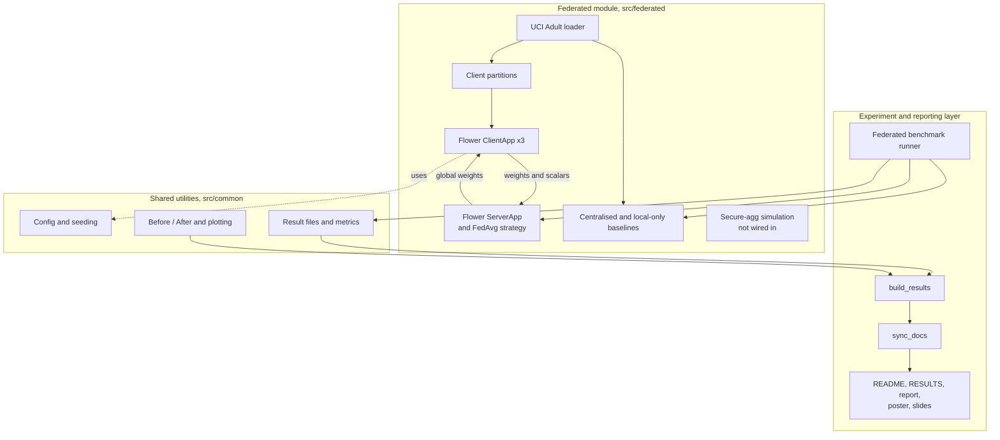
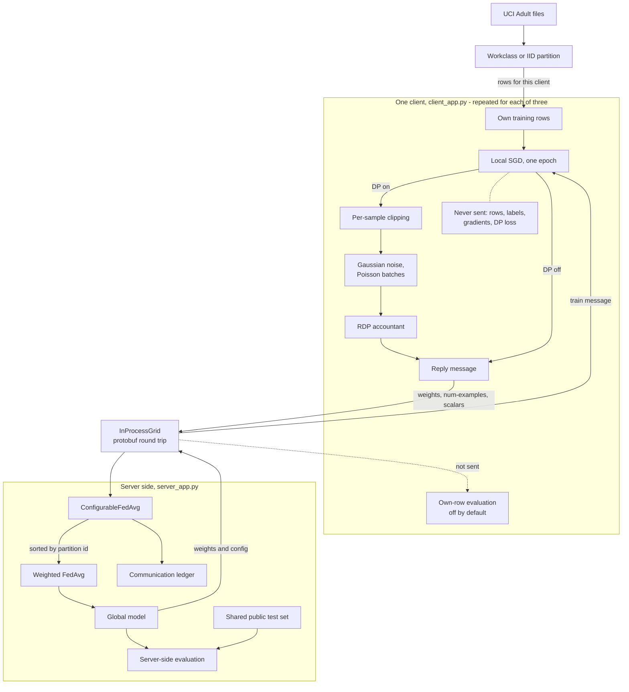
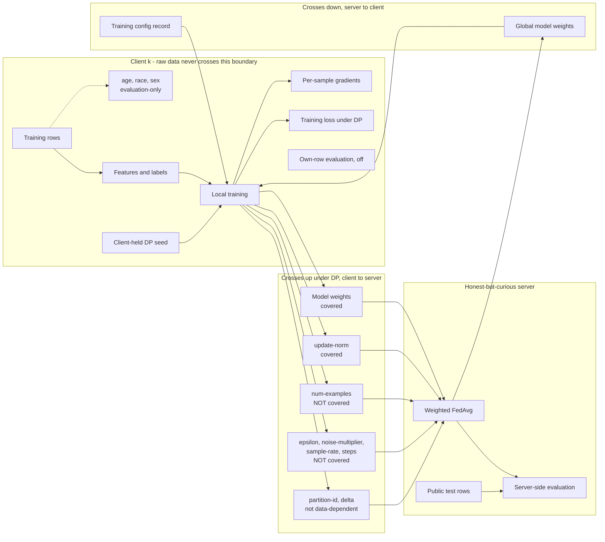
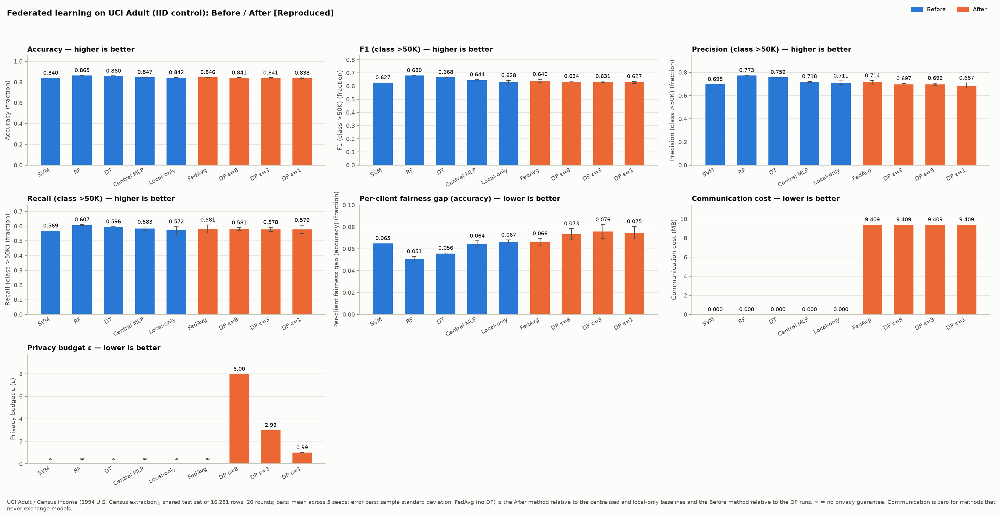
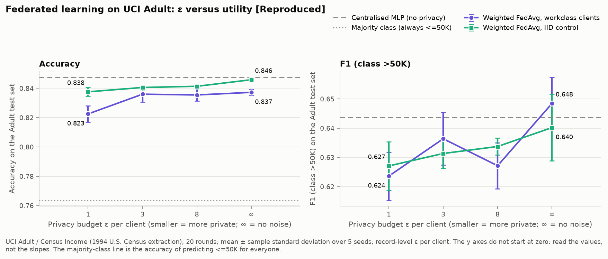
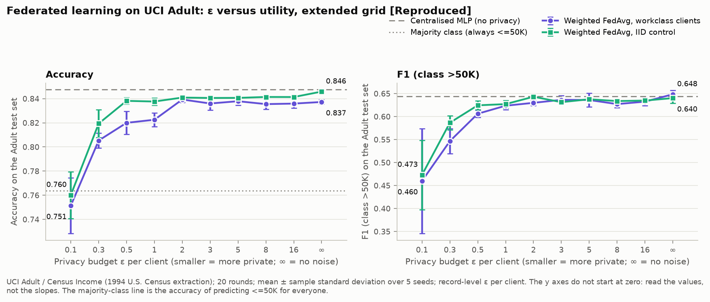
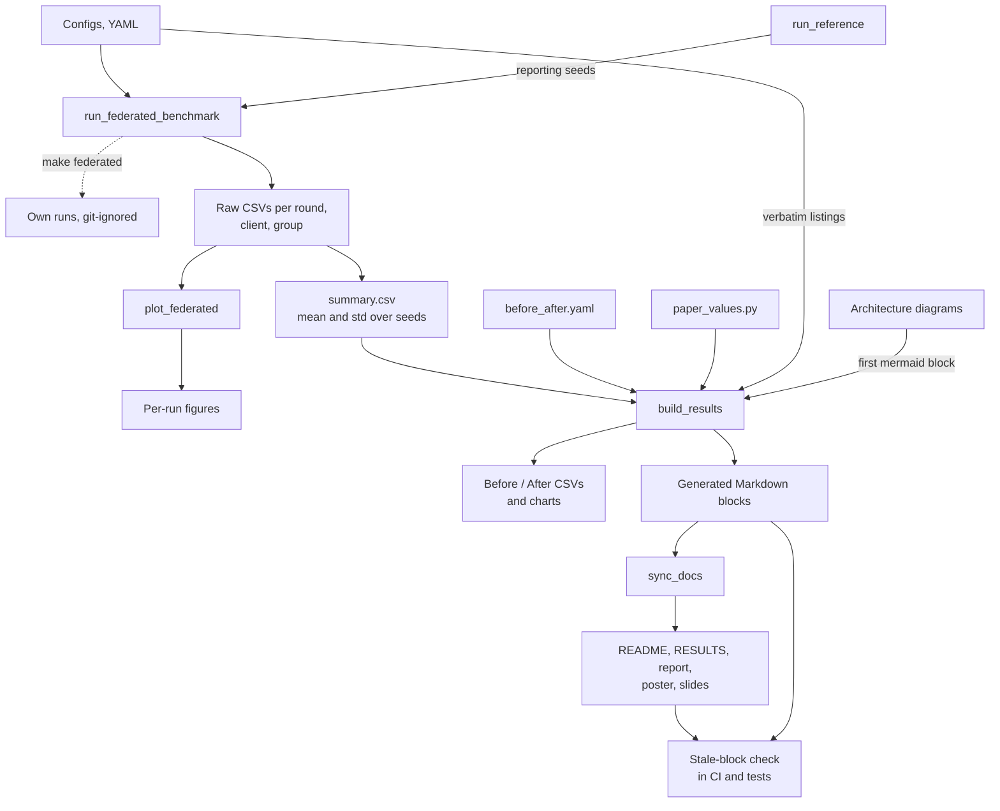

# Presentation — Private federated learning on UCI Adult: a reference implementation with a Before / After comparison

Slide outline for a 20-minute research talk (15 slides). Each slide gives a title, the bullets to
show (full sentences), the figure or diagram to show, and the speaker notes. Every reproduced
number on a slide comes from a generated block; the bullets and the notes describe those tables
in words and never type a reproduced value.

Author: Fan Guo.

Colour rule for every slide: **Before is always blue `#2a78d6`, After is always orange
`#eb6834`, and grey `#898781` is reserved for references** that are neither Before nor After.
The ε trade-off chart is the one exception: its two lines are the two client splits, and its
caption says so.

---

### Slide 1 — Problem: training one model across data owners who cannot pool their rows

- Several data owners want to train one model together, but none of them may hand its raw rows to the others or to a central server.
- Each data owner also needs an explicit privacy budget for its own records, stated as ε and δ and accounted over the whole training run.
- The method follows the federated learning approach with differential privacy described by Zhang et al. (2025).
- This repository is a complete, runnable reference implementation of that method, with every setting written down and a Before / After comparison measured under one documented protocol.

**Figure:** the status line as a full-width strip: "Draft reference implementation — values printed in the source paper are shown for reference only; see RESULTS.md for the values this code produces and the conditions under which it produces them." No chart.

**Speaker notes.** This talk is about a practical problem: several organisations hold related data, they would all benefit from one shared model, and none of them may pool its raw rows. Each of them also wants a privacy promise for its own records that is stated precisely and accounted for. Federated learning with differential privacy is the standard answer, and this repository is a reference implementation of it: one tested codebase, every setting written down, and a Before / After comparison measured with held-out seeds. The companion project `ddqn-os-scheduling` is a separate repository with its own code, data and results, under the same direction and the same reporting conventions.

### Slide 2 — The Proposed Endeavor this work serves

> Design and implement advanced machine learning and large language model architectures for secure, reliable system-level optimization in order to enhance the efficiency, reliability, and security of U.S. digital infrastructure and accelerate the deployment of next-generation artificial intelligence (AI) applications.

- The quotation above is the endeavor this repository is a first, partial step towards.
- This repository addresses machine learning with privacy accounting across data owners: federated training in which each client's rows stay with the client and the privacy budget is stated.
- No large-language-model architecture is implemented in this draft; it is planned work and is listed on the roadmap slide.
- Nothing in the repository is deployed, integrated with a production system, or production-ready.

**Figure:** the quotation set as a single block, with the word "Implemented" over a bracket reaching "machine learning … secure, reliable" and the word "Planned" over a bracket reaching "large language model architectures".

**Speaker notes.** This is the endeavor statement, quoted word for word, because the rest of the talk should be judged against it. I want to separate the part this draft addresses from the parts it does not. It addresses machine learning for secure collaboration: several data owners train one model, their rows never leave them, and the privacy guarantee is stated precisely and accounted for. It does not contain any large-language-model component; that is planned work, and I will not claim it today. It also contains no deployment. Everything you will see runs on a public dataset on one machine, with simulated clients, and the slides say so wherever it matters.

### Slide 3 — Design choices and assumptions

- Client updates are averaged with weights proportional to each client's number of rows, so that a client's influence matches its data, and the unweighted mean is kept as an ablation.
- UCI Adult is the dataset because it is public and tabular and has a natural domain attribute, workclass, and an IID control separates the effect of client heterogeneity.
- Privacy is record-level differential privacy with a stated ε and δ, and inputs are scaled with public constants, so that nothing outside the accounted mechanism is released.
- Positive-class precision, recall and F1 and a majority-class reference are reported next to accuracy, because one class is rare.
- Every one of these settings is chosen by this repository and is tagged [Assumption — not in paper].

**Figure:** a three-column table "Design choice", "What this implementation does", "Why", with rows for the aggregation rule, the dataset and clients, the privacy mechanism, input scaling and the metrics.

**Speaker notes.** Before the results, here are the choices that shape them, each with its engineering reason. Weighting by row count makes every row count equally; the unweighted mean stays available as a switch, and I will show what it does. Adult is public, so anyone can rerun everything, and its workclass attribute gives a natural uneven split; the IID control tells us how much that split matters. The privacy guarantee is stated with its parameters, and scaling uses public constants, so nothing leaks around the accountant. Because positive labels are rare, accuracy alone would mislead, so it always appears next to the positive-class metrics and the majority-class reference.

### Slide 4 — System overview

- The repository has three layers: the federated module, a small shared utility package, and the experiment and reporting layer.
- Three simulated clients train locally, and a Flower server combines their weights; centralised and local-only baselines read the same feature matrix for comparison.
- The secure-aggregation module is an arithmetic masking simulation that is not wired into training, which is why it has no edge in the diagram.
- Every result flows from a configuration file to raw CSV files, summary tables, Before / After tables and charts, and generated blocks in the documents.

**Figure:** the system overview diagram (block `diagram_system_overview`, from `docs/architecture/01-system-overview.md`).

<!-- BEGIN GENERATED: diagram_system_overview -->

<!-- END GENERATED: diagram_system_overview -->

**Speaker notes.** This is the whole system on one slide. At the top is the federated module: the UCI Adult loader, the client partitions, three Flower clients, a Flower server with weighted federated averaging, and the comparison baselines. The secure-aggregation box has no arrow because it is not part of training; I will come back to that under limitations. In the middle are shared utilities for configuration, seeding and result files, which know nothing about federated learning. At the bottom is the reporting pipeline. It is the reason every table in this talk is generated rather than typed, and the reason the documents cannot silently drift away from the results.

### Slide 5 — Method: one federated round

- In every round the server sends the global weights to all three clients, and each client trains locally with SGD for one epoch on its own rows.
- Under differential privacy each client runs DP-SGD through Opacus: per-sample clipping, Gaussian noise and Poisson-sampled batches (Abadi et al., 2016; Yousefpour et al., 2021).
- The server combines the replies with sample-weighted federated averaging, weighting each client by its number of rows (McMahan et al., 2017).
- Clients and server run in one process through an in-process Flower grid that serialises every message, so runs are deterministic and independent of the number of workers.

**Figure:** the federated detail diagram (block `diagram_federated_detail`, from `docs/architecture/02-federated-detail.md`).

<!-- BEGIN GENERATED: diagram_federated_detail -->

<!-- END GENERATED: diagram_federated_detail -->

**Speaker notes.** Here is one round in detail. The server broadcasts the global model. Each client rebuilds its optimiser, trains on its own rows, and replies with exactly one set of weights and a short list of scalars. Under privacy, training is DP-SGD, and the noise multiplier is calibrated per client so that each client spends at most its target budget over all rounds. The server sorts the replies so that arrival order does not matter and averages them, weighted by row count. Evaluation happens only on the server, on the public test rows. The Ray engine exists in the code but has never completed a run, so it is marked as to be done.

### Slide 6 — Method: what the privacy guarantee covers

- The guarantee is record-level (ε, δ)-differential privacy of each client's rows with respect to the updates it sends, against an honest-but-curious server, for one run alone.
- The guarantee does not cover client-level privacy, the row count each client sends in the clear, hyperparameter tuning, or several runs released on the same rows.
- Rows, features, labels, the evaluation-only attributes and per-sample gradients never leave a client, and DP randomness comes from a client-held secret that never appears in a message.
- The table lists every quantity that leaves a client under DP and says whether the guarantee covers it.

**Figure:** the trust-boundary diagram (block `diagram_trust_boundary`, from `docs/architecture/03-trust-boundary.md`) and the table `privacy_released_quantities`.

<!-- BEGIN GENERATED: diagram_trust_boundary -->

<!-- END GENERATED: diagram_trust_boundary -->

<!-- BEGIN GENERATED: privacy_released_quantities -->
| Quantity leaving a DP client | Covered by the (epsilon, delta) guarantee | Note |
|---|---|---|
| `model weights` | covered | the output of DP-SGD; the quantity the (epsilon, delta) bound is about |
| `update-norm` | covered | post-processing of the sent weights and the public global weights |
| `num-examples` | NOT covered | exact count of the client's training rows, sent in the clear for weighted FedAvg |
| `partition-id` | not data-dependent | client index assigned by the simulation; says nothing about any row |
| `epsilon` | NOT covered | computed from the sample rate and step count, so it reveals ceil(n / batch_size) |
| `delta` | not data-dependent | a public setting from YAML |
| `noise-multiplier` | NOT covered | in target_epsilon mode calibrated from the client's sample rate (depends on n) |
| `sample-rate` | NOT covered | 1 / ceil(n / batch_size): depends on the row count n |
| `steps` | NOT covered | local_epochs * ceil(n / batch_size): depends on the row count n |
<!-- END GENERATED: privacy_released_quantities -->

**Speaker notes.** Privacy statements are only useful if they say exactly what is protected. Our guarantee is record-level: one person's row in a client's data has a bounded effect on the updates that client sends. It is not client-level privacy. The table lists every quantity that leaves a client, including the row count, which is sent in the clear for weighted averaging and is not covered. Four privacy defects were found in this code and fixed before publication, among them an un-noised training loss being sent and a noise seed the server could have derived. The benchmark fixes the client's secret seed for reproducibility, which a deployment must never do.

### Slide 7 — Dataset

- UCI Adult / Census Income is a public dataset extracted from the 1994 U.S. Census database, with 48,842 rows, 32,561 for training and 16,281 for testing, and about 24% positive labels (Becker & Kohavi, 1996).
- The three clients are built from the workclass attribute (Private, Government, Self-employed), with an IID control of equal size; both are assumptions chosen by this repository.
- Age, race and sex are evaluation-only attributes and never reach any model, while relationship and marital status remain inputs and act as proxies for sex.
- The data are downloaded by script from the canonical source, checked against committed checksums, and never committed to the repository.

**Figure:** the generated block `adult_partition_stats` (per-client row counts and positive rates), with the source URL [http://archive.ics.uci.edu/ml/datasets/Adult](http://archive.ics.uci.edu/ml/datasets/Adult) printed beneath.

<!-- BEGIN GENERATED: adult_partition_stats -->
Computed from the downloaded `adult.data` (training rows only); source CSV `experiments/results/reference/federated_adult/partition_stats.csv`. [Reproduced]

| Split | Client | Training rows | Positives (>50K) | Positive rate | Share of client rows | Workclass composition |
|---|---|---|---|---|---|---|
| Workclass split (primary, non-IID) | Private | 22,696 | 4,963 | 0.2187 | 0.7392 | Private 22696 |
| Workclass split (primary, non-IID) | Government | 4,351 | 1,341 | 0.3082 | 0.1417 | Federal-gov 960, Local-gov 2093, State-gov 1298 |
| Workclass split (primary, non-IID) | Self-employed | 3,657 | 1,346 | 0.3681 | 0.1191 | Self-emp-inc 1116, Self-emp-not-inc 2541 |
| IID control, seed 0 | iid_0 | 10,235 | 2,619 | 0.2559 | 0.3333 | Federal-gov 338, Local-gov 735, Private 7525, Self-emp-inc 377, Self-emp-not-inc 855, State-gov 405 |
| IID control, seed 0 | iid_1 | 10,235 | 2,500 | 0.2443 | 0.3333 | Federal-gov 322, Local-gov 678, Private 7582, Self-emp-inc 369, Self-emp-not-inc 842, State-gov 442 |
| IID control, seed 0 | iid_2 | 10,234 | 2,531 | 0.2473 | 0.3333 | Federal-gov 300, Local-gov 680, Private 7589, Self-emp-inc 370, Self-emp-not-inc 844, State-gov 451 |

Excluded from every client split: 1,857 training rows (? 1836, Never-worked 7, Without-pay 14; positive rate 0.1029). The workclass split is the same for every seed; the IID control is reshuffled with each run seed, so its per-client positive rates vary slightly between seeds while its client sizes stay fixed.
<!-- END GENERATED: adult_partition_stats -->

**Speaker notes.** The dataset is a choice of this repository, and it is tagged as an assumption. We chose UCI Adult because it is public, licensed for reuse under CC BY 4.0, downloaded by a script and never committed, and it has a natural non-identical split. The workclass attribute gives three clients of very different sizes and positive rates. The IID control, drawn from the same rows, tells us how much of any effect comes from that split. Adult is old and has known problems as a fairness benchmark, which I return to under limitations. The table here is reproduced from the reference run.

### Slide 8 — Results: the Before / After table

- Before is a comparison method (centralised SVM, Random Forest, Decision Tree, a centralised MLP of the same architecture, and local-only training) and After is weighted FedAvg without DP.
- In the rows whose After Method names an ε, FedAvg without DP is Before and FedAvg with DP at that ε is After, so those rows show the cost of privacy.
- Delta is After minus Before in the metric's own unit, and Improvement % is signed so that a positive Improvement % always means better after and a negative value is a regression.
- Every value is the mean ± sample standard deviation over five reporting seeds on the workclass clients, labelled [Reproduced], which means it was obtained by running this repository's code under the documented conditions.

**Figure:** the generated table `before_after_compact`, Before columns tinted blue `#2a78d6`, After columns tinted orange `#eb6834`, with the sign convention printed under the table.

<!-- BEGIN GENERATED: before_after_compact -->
Dataset: UCI Adult / Census Income (1994 U.S. Census extraction; 48,842 rows; workclass clients Private / Government / Self-employed plus IID control)

Source label: [Reproduced]. Clients: workclass clients; ε in {1, 3, 8, no noise}.

| Metric | Before Method | Before Value | After Method | After Value | Delta (absolute) | Improvement % | Source Label |
|---|---|---|---|---|---|---|---|
| Accuracy | SVM (centralised) | 0.8401 ± 0.0000 | Weighted FedAvg (no DP) | 0.8372 ± 0.0018 | -0.0028 | -0.3% | [Reproduced] |
| Accuracy | Random Forest (centralised) | 0.8650 ± 0.0003 | Weighted FedAvg (no DP) | 0.8372 ± 0.0018 | -0.0277 | -3.2% | [Reproduced] |
| Accuracy | Decision Tree (centralised) | 0.8598 ± 0.0001 | Weighted FedAvg (no DP) | 0.8372 ± 0.0018 | -0.0226 | -2.6% | [Reproduced] |
| Accuracy | Centralised MLP (upper bound) | 0.8475 ± 0.0012 | Weighted FedAvg (no DP) | 0.8372 ± 0.0018 | -0.0102 | -1.2% | [Reproduced] |
| Accuracy | Local-only (mean of 3 client models) | 0.8094 ± 0.0117 | Weighted FedAvg (no DP) | 0.8372 ± 0.0018 | +0.0278 | +3.4% | [Reproduced] |
| Accuracy | Weighted FedAvg (no DP) | 0.8372 ± 0.0018 | Weighted FedAvg + DP (ε = 8) | 0.8355 ± 0.0041 | -0.0018 | -0.2% | [Reproduced] |
| Accuracy | Weighted FedAvg (no DP) | 0.8372 ± 0.0018 | Weighted FedAvg + DP (ε = 3) | 0.8360 ± 0.0054 | -0.0013 | -0.1% | [Reproduced] |
| Accuracy | Weighted FedAvg (no DP) | 0.8372 ± 0.0018 | Weighted FedAvg + DP (ε = 1) | 0.8225 ± 0.0056 | -0.0147 | -1.8% | [Reproduced] |
| F1 (class >50K) | SVM (centralised) | 0.6268 ± 0.0000 | Weighted FedAvg (no DP) | 0.6485 ± 0.0089 | +0.0216 | +3.5% | [Reproduced] |
| F1 (class >50K) | Random Forest (centralised) | 0.6800 ± 0.0014 | Weighted FedAvg (no DP) | 0.6485 ± 0.0089 | -0.0315 | -4.6% | [Reproduced] |
| F1 (class >50K) | Decision Tree (centralised) | 0.6678 ± 0.0004 | Weighted FedAvg (no DP) | 0.6485 ± 0.0089 | -0.0193 | -2.9% | [Reproduced] |
| F1 (class >50K) | Centralised MLP (upper bound) | 0.6437 ± 0.0060 | Weighted FedAvg (no DP) | 0.6485 ± 0.0089 | +0.0048 | +0.7% | [Reproduced] |
| F1 (class >50K) | Local-only (mean of 3 client models) | 0.6369 ± 0.0072 | Weighted FedAvg (no DP) | 0.6485 ± 0.0089 | +0.0116 | +1.8% | [Reproduced] |
| F1 (class >50K) | Weighted FedAvg (no DP) | 0.6485 ± 0.0089 | Weighted FedAvg + DP (ε = 8) | 0.6272 ± 0.0079 | -0.0213 | -3.3% | [Reproduced] |
| F1 (class >50K) | Weighted FedAvg (no DP) | 0.6485 ± 0.0089 | Weighted FedAvg + DP (ε = 3) | 0.6364 ± 0.0090 | -0.0121 | -1.9% | [Reproduced] |
| F1 (class >50K) | Weighted FedAvg (no DP) | 0.6485 ± 0.0089 | Weighted FedAvg + DP (ε = 1) | 0.6236 ± 0.0082 | -0.0248 | -3.8% | [Reproduced] |

A positive Improvement % always means better after; a negative value is a regression.
<!-- END GENERATED: before_after_compact -->

A positive Improvement % always means better after; a negative value is a regression.

**Speaker notes.** Every value shown is [Reproduced]: it comes from running this code under the documented conditions. Now the regressions, by name. Federated averaging is less accurate than the SVM, the Random Forest, the Decision Tree and the centralised network of the same shape, and below both tree models on F1. Differential privacy lowers accuracy at every budget, within the seed spread at eight and three and clearly at one, and it lowers F1 at all three budgets. The gains are against local-only training in accuracy and F1, and against the SVM and the centralised network on F1. Each negative sign tells you when to prefer the Before method.

### Slide 9 — Results: the Before / After charts

- In the workclass chart, blue bars are the comparison methods and orange bars are the federated methods, with FedAvg without DP serving as the Before reference for the three DP bars.
- The tree baselines on the left have the tallest accuracy and F1 bars, and federated training does not reach them on this dataset.
- The IID control chart shows the same methods on clients that each hold a representative sample, which separates the effect of the workclass split from the effect of federation.
- Both charts show one public dataset, simulated clients and one machine; they do not show real institutions, real private data or a real network.

**Figure:** `federated_workclass.png` (large) and `federated_iid.png` (small, beside it). Every bar is labelled with its method name.

**Speaker notes.** Every value shown is [Reproduced], so I will point at shapes rather than read numbers. The regressions on the workclass chart: federated training is below every centralised model in accuracy and precision, below both trees in F1, below local-only training in recall, and its fairness gap is wider than every centralised model's; privacy lowers accuracy, F1 and recall at every budget, and lowers precision and widens the gap at a budget of one. On the IID chart it is below the trees and the centralised network on accuracy, F1, precision and recall, its gap is wider than every centralised model's, and privacy worsens all five at every budget.

### Slide 10 — Results: privacy budget ε versus accuracy

- The table and chart show accuracy and F1 at ε ∈ {1, 3, 8} and without noise, for the workclass clients and the IID control, labelled [Reproduced].
- On the workclass clients, accuracy at ε = 8 and ε = 3 is within the seed-to-seed spread of the run without DP and is clearly lower at ε = 1.
- Positive-class F1 is lower than without DP at all three budgets, so a user who needs F1 should expect DP to cost some of it at every ε tested.
- The chart's two lines are the two client splits, not Before and After, and the y axes do not start at zero.

**Figure:** the generated block `epsilon_tradeoff` and `epsilon_tradeoff.png`; `epsilon_extended.png` (finer ε grid) as a backup slide.

<!-- BEGIN GENERATED: epsilon_tradeoff -->
Dataset: UCI Adult / Census Income (1994 U.S. Census extraction; 48,842 rows; workclass clients Private / Government / Self-employed plus IID control)

Source label: [Reproduced]. Weighted FedAvg, 20 rounds, 5 seeds; ε is the record-level budget each client spends over all rounds (largest value over the three clients), at the δ set in `configs/federated_adult.yaml`. The ∞ row is the run with no noise, that is, with no differential privacy at all.

| Clients | Target ε | Achieved ε (max over clients) | Accuracy | F1 (class >50K) | Precision | Recall | Accuracy change vs no noise |
|---|---|---|---|---|---|---|---|
| workclass clients | 1 | 0.997 ± 0.000 | 0.8225 ± 0.0056 | 0.6236 ± 0.0082 | 0.6252 ± 0.0140 | 0.6222 ± 0.0034 | -0.0147 |
| workclass clients | 3 | 2.996 ± 0.000 | 0.8360 ± 0.0054 | 0.6364 ± 0.0090 | 0.6696 ± 0.0247 | 0.6081 ± 0.0326 | -0.0013 |
| workclass clients | 8 | 7.999 ± 0.000 | 0.8355 ± 0.0041 | 0.6272 ± 0.0079 | 0.6751 ± 0.0129 | 0.5857 ± 0.0092 | -0.0018 |
| workclass clients | ∞ | ∞ | 0.8372 ± 0.0018 | 0.6485 ± 0.0089 | 0.6626 ± 0.0154 | 0.6361 ± 0.0300 | reference |
| IID control | 1 | 0.992 ± 0.000 | 0.8376 ± 0.0030 | 0.6271 ± 0.0083 | 0.6865 ± 0.0224 | 0.5785 ± 0.0284 | -0.0082 |
| IID control | 3 | 2.991 ± 0.000 | 0.8406 ± 0.0017 | 0.6314 ± 0.0051 | 0.6960 ± 0.0113 | 0.5781 ± 0.0144 | -0.0053 |
| IID control | 8 | 7.995 ± 0.000 | 0.8414 ± 0.0010 | 0.6337 ± 0.0029 | 0.6973 ± 0.0069 | 0.5809 ± 0.0088 | -0.0045 |
| IID control | ∞ | ∞ | 0.8459 ± 0.0012 | 0.6402 ± 0.0114 | 0.7140 ± 0.0150 | 0.5812 ± 0.0278 | reference |
<!-- END GENERATED: epsilon_tradeoff -->

**Speaker notes.** Every value shown is [Reproduced]; read the axis values, because the axes do not start at zero. The regressions against the run without noise: on the workclass clients, accuracy is lower at every budget, within the spread at eight and three and clearly at one; F1 and recall are lower at all three budgets, and precision at a budget of one. On the IID control, accuracy, F1, precision and recall are all lower at every budget. The backup chart shows a finer grid: on the workclass clients accuracy holds down to about two, then falls below the majority-class rate at the smallest budget. The budget is record-level, per client and per run.

### Slide 11 — Observations from the topic guide

- Federated training is ahead of the clients' local-only models on the workclass split, and on the IID control that advantage is small.
- The workclass split costs accuracy: every other partition in the partition suite, including an IID partition with the same client sizes, reaches a higher accuracy.
- Compared with the sample-weighted FedAvg used here, the unweighted mean, kept as an ablation, has a slightly higher accuracy and a lower F1, so the weighting mainly changes which errors are made.
- A sign-flip attack by two of ten clients had only a small effect in this setting, and differential privacy is not a defence against poisoning.

**Figure:** the generated block `ablations`; the topic guide is [docs/investigations/01-federated-privacy-cross-domain.md](../investigations/01-federated-privacy-cross-domain.md).

<!-- BEGIN GENERATED: ablations -->
Dataset: UCI Adult / Census Income (1994 U.S. Census extraction; 48,842 rows; workclass clients Private / Government / Self-employed plus IID control)

**Aggregation rule** — source label: [Reproduced]. Sample-weighted FedAvg (weights n_k / Σ n, the default) against the unweighted mean (1/N) Σ θ_k, on the workclass clients, whose sizes differ by a factor of about six; no DP, 20 rounds.

| Variant | Accuracy (fraction) | F1 (class >50K) (fraction) | Precision (class >50K) (fraction) | Recall (class >50K) (fraction) | Per-client fairness gap (accuracy) (fraction) |
|---|---|---|---|---|---|
| Weighted FedAvg (default) | 0.8372 ± 0.0018 | 0.6485 ± 0.0089 | 0.6626 ± 0.0154 | 0.6361 ± 0.0300 | 0.1011 ± 0.0088 |
| Unweighted mean (ablation) | 0.8404 ± 0.0017 | 0.6223 ± 0.0268 | 0.7069 ± 0.0272 | 0.5597 ± 0.0580 | 0.0726 ± 0.0105 |

Unweighted relative to weighted — Accuracy: Delta +0.0031 (+0.4%); F1 (class >50K): Delta -0.0262 (-4.0%). A negative value means the unweighted mean is lower. [Reproduced]

**Client partition** — source label: [Reproduced]. Weighted FedAvg without DP on five partitions of the same client rows; partition parameters are in `configs/federated_adult.yaml`.

| Variant | Accuracy (fraction) | F1 (class >50K) (fraction) | Precision (class >50K) (fraction) | Recall (class >50K) (fraction) | Per-client fairness gap (accuracy) (fraction) |
|---|---|---|---|---|---|
| Workclass clients (primary) | 0.8372 ± 0.0018 | 0.6485 ± 0.0089 | 0.6626 ± 0.0154 | 0.6361 ± 0.0300 | 0.1011 ± 0.0088 |
| IID control, equal sizes | 0.8459 ± 0.0012 | 0.6402 ± 0.0114 | 0.7140 ± 0.0150 | 0.5812 ± 0.0278 | 0.0660 ± 0.0033 |
| IID, sizes matched to the workclass clients | 0.8454 ± 0.0028 | 0.6553 ± 0.0077 | 0.6928 ± 0.0182 | 0.6228 ± 0.0263 | 0.0673 ± 0.0019 |
| Label skew (Dirichlet) | 0.8442 ± 0.0023 | 0.6286 ± 0.0230 | 0.7208 ± 0.0245 | 0.5605 ± 0.0528 | 0.0692 ± 0.0015 |
| Quantity skew | 0.8464 ± 0.0014 | 0.6515 ± 0.0134 | 0.7023 ± 0.0152 | 0.6089 ± 0.0334 | 0.0649 ± 0.0030 |

**Robustness to Byzantine clients** — source label: [Reproduced]. IID partition of the client rows into 10 clients of which 2 send poisoned updates; no DP. Differential privacy is not a defence against poisoning.

| Variant | Accuracy (fraction) | F1 (class >50K) (fraction) | Precision (class >50K) (fraction) | Recall (class >50K) (fraction) | Per-client fairness gap (accuracy) (fraction) |
|---|---|---|---|---|---|
| Weighted FedAvg, no attacker | 0.8443 ± 0.0019 | 0.6455 ± 0.0080 | 0.6985 ± 0.0081 | 0.6003 ± 0.0169 | 0.0745 ± 0.0041 |
| Weighted FedAvg under attack (sign flip) | 0.8412 ± 0.0007 | 0.6370 ± 0.0061 | 0.6927 ± 0.0084 | 0.5900 ± 0.0162 | 0.0768 ± 0.0031 |
| Coordinate-wise median under attack (sign flip) | 0.8432 ± 0.0014 | 0.6446 ± 0.0083 | 0.6938 ± 0.0094 | 0.6023 ± 0.0201 | 0.0758 ± 0.0027 |
| Trimmed mean under attack (sign flip) | 0.8430 ± 0.0013 | 0.6441 ± 0.0076 | 0.6935 ± 0.0092 | 0.6017 ± 0.0187 | 0.0747 ± 0.0042 |
<!-- END GENERATED: ablations -->

**Speaker notes.** Every value shown is [Reproduced], and this slide picks four observations from the topic guide. The regressions, by name: the workclass split has the lowest accuracy of all five partitions, so the skewed split costs accuracy; the sample-weighted default has lower accuracy and precision and a wider fairness gap than the unweighted mean, which in turn has lower F1 and recall; and the sign-flip attack lowers weighted FedAvg slightly, with the median and trimmed mean also ending slightly below the no-attack row. The size-matched IID partition does nearly as well as the equal one. One weak attack makes this a starting point, not a defence evaluation.

### Slide 12 — Limitations

- The benchmark uses one public dataset with three simulated clients on one machine, and Adult has well-documented shortcomings as a benchmark (Ding et al., 2021).
- The federated model is a small MLP, and the centralised tree baselines are more accurate on this dataset.
- The privacy guarantee is record-level only, the row count is unprotected, the noise generator is not cryptographically secure, and the benchmark fixes each client's secret seed for reproducibility.
- Secure aggregation is a masking simulation that is not cryptography and is not wired in, and the Ray engine and FEMNIST have not been run.
- Five seeds per condition mean that differences smaller than the seed-to-seed spread are not treated as observations.

**Figure:** the generated block `per_group` (accuracy and predicted-positive rate by sex, race and age band), captioned "descriptive only, not a fairness certification".

<!-- BEGIN GENERATED: per_group -->
Dataset: UCI Adult / Census Income (1994 U.S. Census extraction; 48,842 rows; workclass clients Private / Government / Self-employed plus IID control)

Source label: [Reproduced]. Sex, race and age are evaluation-only attributes: they are never model inputs for any method. Rows are groups of the shared test set; the federated columns use the workclass clients. Mean ± sample standard deviation across seeds. Small groups (a few hundred rows) are noisy. A gap row is the largest minus the smallest group value. Differences between groups reflect, among other things, different base rates of the >50K label in the 1994 data; they are descriptive and are not a fairness certification.

| Attribute | Group | Test rows | Accuracy — Centralised MLP (upper bound) | Predicted >50K rate — Centralised MLP (upper bound) | Accuracy — Weighted FedAvg (no DP) | Predicted >50K rate — Weighted FedAvg (no DP) | Accuracy — Weighted FedAvg + DP (ε = 3) | Predicted >50K rate — Weighted FedAvg + DP (ε = 3) |
|---|---|---|---|---|---|---|---|---|
| sex | Female | 5,421 | 0.9229 ± 0.0012 | 0.0791 ± 0.0077 | 0.9161 ± 0.0016 | 0.0975 ± 0.0067 | 0.9171 ± 0.0046 | 0.0818 ± 0.0150 |
| sex | Male | 10,860 | 0.8098 ± 0.0017 | 0.2482 ± 0.0041 | 0.7979 ± 0.0021 | 0.2918 ± 0.0202 | 0.7955 ± 0.0062 | 0.2816 ± 0.0224 |
| race | Amer-Indian-Eskimo | 159 | 0.9069 ± 0.0103 | 0.0943 ± 0.0160 | 0.8730 ± 0.0136 | 0.1308 ± 0.0233 | 0.8906 ± 0.0084 | 0.1182 ± 0.0157 |
| race | Asian-Pac-Islander | 480 | 0.8404 ± 0.0038 | 0.2375 ± 0.0061 | 0.8183 ± 0.0040 | 0.2821 ± 0.0222 | 0.8108 ± 0.0076 | 0.2787 ± 0.0318 |
| race | Black | 1,561 | 0.9093 ± 0.0015 | 0.0832 ± 0.0027 | 0.8994 ± 0.0024 | 0.1092 ± 0.0087 | 0.9022 ± 0.0045 | 0.0997 ± 0.0129 |
| race | Other | 135 | 0.8800 ± 0.0062 | 0.0978 ± 0.0062 | 0.9052 ± 0.0097 | 0.1348 ± 0.0097 | 0.8844 ± 0.0213 | 0.1170 ± 0.0253 |
| race | White | 13,946 | 0.8398 ± 0.0013 | 0.2045 ± 0.0049 | 0.8299 ± 0.0018 | 0.2404 ± 0.0163 | 0.8284 ± 0.0061 | 0.2278 ± 0.0202 |
| age_band | 17-24 | 2,862 | 0.9815 ± 0.0003 | 0.0153 ± 0.0012 | 0.9796 ± 0.0028 | 0.0175 ± 0.0039 | 0.9811 ± 0.0033 | 0.0150 ± 0.0041 |
| age_band | 25-34 | 4,098 | 0.8664 ± 0.0019 | 0.1495 ± 0.0041 | 0.8574 ± 0.0021 | 0.1711 ± 0.0121 | 0.8571 ± 0.0050 | 0.1573 ± 0.0150 |
| age_band | 35-44 | 4,042 | 0.7997 ± 0.0031 | 0.2749 ± 0.0076 | 0.7868 ± 0.0043 | 0.3148 ± 0.0218 | 0.7869 ± 0.0044 | 0.2962 ± 0.0221 |
| age_band | 45-54 | 2,918 | 0.7863 ± 0.0023 | 0.2959 ± 0.0051 | 0.7761 ± 0.0019 | 0.3491 ± 0.0172 | 0.7733 ± 0.0053 | 0.3273 ± 0.0241 |
| age_band | 55-64 | 1,610 | 0.8007 ± 0.0021 | 0.2345 ± 0.0066 | 0.7872 ± 0.0057 | 0.2968 ± 0.0250 | 0.7842 ± 0.0124 | 0.2925 ± 0.0327 |
| age_band | 65-90 | 751 | 0.8293 ± 0.0033 | 0.1539 ± 0.0040 | 0.8013 ± 0.0105 | 0.2352 ± 0.0264 | 0.7864 ± 0.0279 | 0.2538 ± 0.0496 |
| sex | max − min gap |  | 0.1131 ± 0.0021 | 0.1690 ± 0.0072 | 0.1182 ± 0.0015 | 0.1943 ± 0.0139 | 0.1216 ± 0.0035 | 0.1998 ± 0.0114 |
| race | max − min gap |  | 0.0739 ± 0.0020 | 0.1563 ± 0.0037 | 0.0886 ± 0.0051 | 0.1729 ± 0.0156 | 0.0929 ± 0.0069 | 0.1808 ± 0.0190 |
| age_band | max − min gap |  | 0.1952 ± 0.0023 | 0.2806 ± 0.0047 | 0.2035 ± 0.0022 | 0.3317 ± 0.0143 | 0.2145 ± 0.0135 | 0.3123 ± 0.0201 |
<!-- END GENERATED: per_group -->

**Speaker notes.** I want to put the limitations on a slide of their own rather than in small print. One dataset and three simulated clients is a narrow test, and Adult is a dated benchmark. The federated model is small, and strong centralised trees beat it here. The privacy guarantee is precise but narrow: record-level, one run, with the row count in the clear. Secure aggregation is only a simulation, and it is not connected to training. The per-group table on this slide is descriptive; relationship and marital status act as proxies for sex, so excluding sex as an input does not make the model fair. Five seeds limit what small differences mean.

### Slide 13 — An invitation to collaborate

- Researchers in privacy-preserving computing could replace the masking simulation behind the secure-aggregation interface with a real cryptographic backend and measure its overhead [Target / TBD].
- Researchers in federated-learning security could add inference or backdoor attacks and new robust aggregation rules to the existing robustness suite and report attack success against ε [Target / TBD].
- Researchers in federated systems could run the benchmark across real processes or machines, or add asynchronous and hierarchical variants behind a config switch [Target / TBD].
- Researchers in privacy accounting or distributed optimisation could compare accountants, client-level guarantees, or compressed updates under the same budgets [Target / TBD].

**Figure:** the experiment-flow diagram (block `diagram_experiment_flow`, from `docs/architecture/04-experiment-flow.md`), annotated with the four extension points.

<!-- BEGIN GENERATED: diagram_experiment_flow -->

<!-- END GENERATED: diagram_experiment_flow -->

**Speaker notes.** This codebase is meant to be extended, and this slide describes the kinds of researchers who could pick up a well-defined study from it today. Nobody has agreed to any of these studies, and no collaboration exists; each item is a target, not a result. The experiment flow on the slide shows why extension is cheap: a new aggregation rule, attack or accountant plugs in at the configuration and runner stage, and the same seeds, the same Before / After rules and the same generated tables apply automatically. If you work on secure aggregation, attacks on federated learning, federated systems or privacy accounting, there is a concrete first experiment waiting.

### Slide 14 — Roadmap

- Next for the benchmark: running the Ray simulation engine and the optional FEMNIST benchmark, both currently [Target / TBD].
- Next for privacy: a real secure-aggregation backend that also hides the row counts, and an evaluation of client-level guarantees, both [Target / TBD].
- Next for the evaluation: a second client split of Adult and a newer census dataset, so that observations do not rest on one 1994 extraction [Target / TBD].
- Further out: an integrated demonstration and the large-language-model architectures named in the Proposed Endeavor, which are planned and not implemented.

**Figure:** a three-column roadmap graphic, "Next", "Then" and "Further out", with every item drawn as a dashed box because none of them exists yet.

**Speaker notes.** The roadmap follows directly from the observations and the limitations. The first items are engineering: get the Ray engine to complete a run, and run the optional FEMNIST reader that is already in the code. The privacy items matter most to me. Replacing the masking simulation with a real secure-aggregation backend would hide individual updates and the row counts that are now sent in the clear. A second split and a newer dataset would show whether the observations travel beyond one old census extract. An integrated demo and any large-language-model component are further out; I list them so nobody takes them for things that exist.

### Slide 15 — Closing

- Federated learning with differential privacy is now available as a complete, runnable, tested reference implementation, with every setting written down as a labelled assumption.
- Weighted FedAvg is more accurate than local-only training and less accurate than the centralised tree models on Adult.
- Record-level differential privacy lowers F1 at every ε tested and accuracy clearly at ε = 1, and the guarantee does not cover the row counts.
- Every number in this talk can be regenerated from the repository, and every value is labelled [Reproduced] or [Target / TBD].

**Figure:** the public repository URL and the status line. Repository: https://github.com/fguo10-tech/federated-privacy-adult.

**Speaker notes.** To close, the contribution is not a new state of the art; it is a complete, runnable reference implementation with every setting written down and a Before / After comparison measured under documented conditions. Federated learning on Adult helps the participating clients compared with working alone, but it stays below strong centralised trees; where rows can be pooled, a tree model is the better choice here. Privacy at budgets of three or more costs little accuracy but some F1, and more at a budget of one. The guarantee is record-level and leaves the row counts uncovered. To rerun or extend this work, start from the repository.
