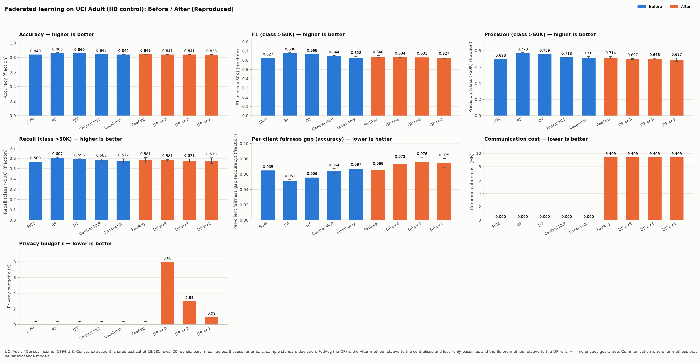
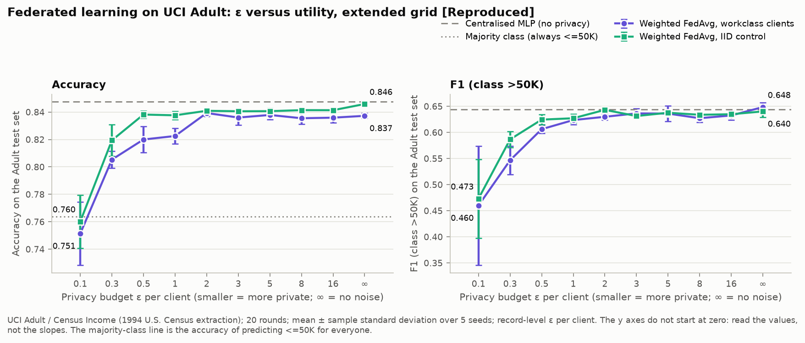
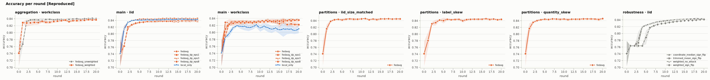
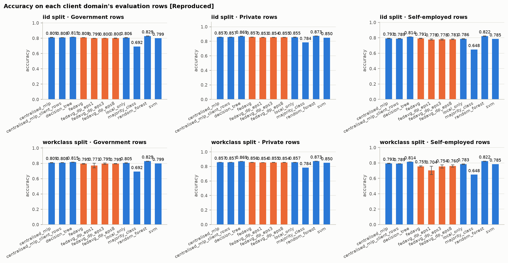
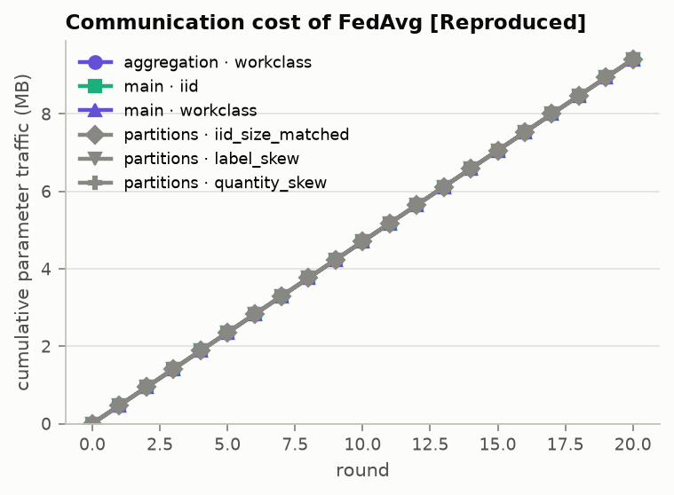
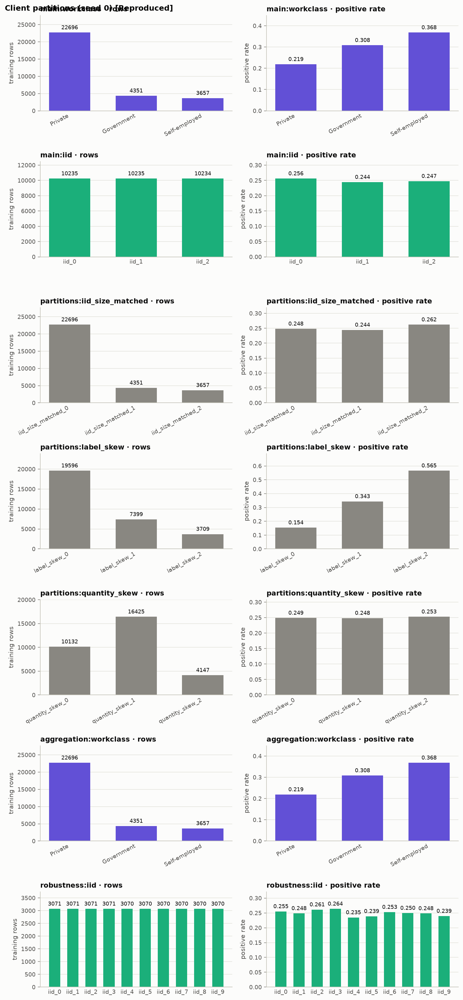
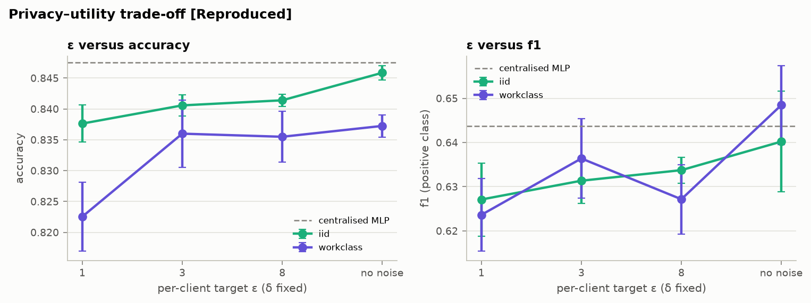

# Results

This file is the single complete record of what this repository has measured. Every
reproduced table that exists is included here, together with the question it answers, the
command that produced it, the configuration and seeds behind it, and the ways in which it can
mislead. The README, the project report, the poster and the slides show shorter versions of the
same tables; because every placement includes the same generated files, a value cannot differ
between them.

This repository is a reference implementation for researchers who need to train one model
across data owners that cannot pool their raw data, under an explicit privacy budget. The method
follows the federated learning approach with differential privacy described by Zhang et al.
(2025). The repository provides a complete, runnable version of sample-weighted federated
averaging with record-level differential privacy, with every setting written down, a set of
centralised and local-only baselines, robust aggregation rules, privacy accounting, and a
Before / After comparison measured under documented conditions; this file is the record of those
measurements.

The companion project `ddqn-os-scheduling` is a separate repository with its own code, data and
results; the two share the same direction and the same reporting conventions.

Nothing in this draft is production-ready. The benchmark runs simulated federated clients on one
public census dataset, UCI Adult, inside one process; the clients are not real organisations,
and the secure-aggregation component is a simulation, not cryptography. Federated training here is
less accurate than the centralised Random Forest and Decision Tree, and differential privacy lowers
F1 at every ε of the locked sweep and accuracy clearly at ε = 1 on the workclass clients
(Section 2.9). The DP randomness is fixed by the benchmark harness for reproducibility, the
Ray-based engine and FEMNIST were not run (Section 4), and the privacy defects found and fixed in
this code are listed in Section 2.13. This draft contains no large-language-model component and
no integrated demo.

The reference run behind every `[Reproduced]` value:

<!-- BEGIN GENERATED: reference_run_info -->
| Reference run | Created (UTC) | Seeds | Environment | Wall-clock time |
|---|---|---|---|---|
| federated_adult | 2024-11-20T05:26:24Z | 0, 1, 2, 3, 4 | Python 3.12.14 on macOS-26.6.2-arm64-arm-64bit; flwr 1.44.0, matplotlib 3.11.2, numpy 2.5.5, opacus 1.6.0, pandas 3.1.1, pyyaml 6.0.3, scikit-learn 1.9.1, torch 2.15.0 | 119 s with 8 worker processes |
| federated_adult_dp | 2024-11-20T05:32:59Z | 0, 1, 2, 3, 4 | Python 3.12.14 on macOS-26.6.2-arm64-arm-64bit; flwr 1.44.0, matplotlib 3.11.2, numpy 2.5.5, opacus 1.6.0, pandas 3.1.1, pyyaml 6.0.3, scikit-learn 1.9.1, torch 2.15.0 | 393 s with 8 worker processes |
<!-- END GENERATED: reference_run_info -->

## Contents

1. [How to read this file](#1-how-to-read-this-file)
2. [The federated benchmark on UCI Adult](#2-the-federated-benchmark-on-uci-adult)
3. [Ablations](#3-ablations)
4. [Experiments specified but not run](#4-experiments-specified-but-not-run)
5. [CSV schemas and templates](#5-csv-schemas-and-templates)
6. [References](#6-references)

## 1. How to read this file

### Labels

Every number in this file carries exactly one of three labels.

| Label | Meaning |
|---|---|
| `[Paper-reported]` | Printed in the source paper (Zhang et al., 2025); shown for reference only. It is not a target for this code and is never compared numerically with a value from this code. |
| `[Reproduced]` | Obtained by running this repository's code under the documented conditions (the config, seeds, dataset and client split named next to it), in the reference run listed above. The label says where a number comes from; it does not say that a number printed in a paper was reproduced. Such values appear only inside generated tables, never typed by hand. |
| `[Target / TBD]` | Specified but not run. The cell shows `TBD`, never an estimate. |

Settings chosen by this repository carry the tag `[Assumption — not in paper]`. That includes the
choice of UCI Adult, the workclass client construction, the IID control, the model, the
20-round / 5-seed protocol and the ε sweep.

### Statistics

Every reproduced value is the mean ± sample standard deviation over the five reporting seeds
0, 1, 2, 3 and 4, taken over per-seed final-round values on the shared test set. A ± of zero
means the method is deterministic given the data (for example the SVM baseline), not that it is
exact.

Five seeds are few. Treat a difference that is smaller than the larger of the two standard
deviations as "no measurable difference". No significance test is reported anywhere in this file.

Settings were chosen on development seeds (100 and above) and on a validation split carved from
the training rows. The reporting seeds 0–4 and the Adult test file were used once, for the
reference run, and nothing was changed afterwards.

### The Before / After sign convention

The Before / After table has the columns Metric, Unit, Direction, Before Method, Before Value,
After Method, After Value, Delta (absolute), Improvement % and Source Label.

**A positive Improvement % always means better after; a negative Improvement % is a
regression.** For a higher-is-better metric Improvement % is (After − Before) / |Before| × 100;
for a lower-is-better metric it is (Before − After) / |Before| × 100. Delta is After − Before in
the metric's own unit, so its sign alone does not say whether the change is good: read the
Direction column. When Before is zero or near zero, or one side is infinite (an ε of a run
without privacy), no percentage is computed and the cell says why.

### Where the raw data is

| What | Where |
|---|---|
| Reference run: main suite and the aggregation, partition and robustness ablation suites | [reference/federated_adult/](reference/federated_adult/) |
| Extended privacy study | [reference/federated_adult_dp/](reference/federated_adult_dp/) |
| Before / After CSVs (`federated.csv`, `epsilon_tradeoff.csv`) and the four comparison charts | [reference/before_after/](reference/before_after/) |
| The Markdown tables included below | [reference/generated/](reference/generated/) |
| Header-only copies of every result CSV | [templates/](templates/) |

Each run folder holds `config_used.yaml` (the fully merged configuration), `metadata.json`
(seeds, package versions, wall-clock time), the result CSV files (`final.csv`, `summary.csv`,
`per_round.csv`, `per_client.csv`, `per_group.csv`, `partition_stats.csv`, `dp_tradeoff.csv`,
`timings.csv`) and a `figures/` folder. The tables are rebuilt from those CSV files with
`make results`; your own runs go to `experiments/results/runs/`, which is git-ignored.

## 2. The federated benchmark on UCI Adult

Dataset: UCI Adult / Census Income (1994 U.S. Census extraction; 48,842 rows; workclass clients Private / Government / Self-employed plus IID control)

UCI Adult (Becker and Kohavi, 1996) was extracted from the 1994 U.S. Census database; it has
48,842 rows, 32,561 for training and 16,281 for testing, and the task is to predict whether a
person's income exceeds $50,000 a year (about 24% positive). The dataset card in
[data/README.md](../../data/README.md) documents the source, licence, preprocessing, client
construction and limitations. The choice of Adult, the three workclass clients (Private, Government, Self-employed), the IID control, the 20-round / 5-seed
protocol and the ε sweep are all `[Assumption — not in paper]`. The clients are simulated domains
derived from one public census dataset, not real organisations.

### 2.1 Research question and hypotheses

Dataset: UCI Adult / Census Income (1994 U.S. Census extraction; 48,842 rows; workclass clients Private / Government / Self-employed plus IID control)

**Question.** When a researcher uses this implementation on a realistic public tabular task, what
does sample-weighted federated averaging (McMahan et al., 2017) with record-level differential
privacy (Abadi et al., 2016) cost and gain, compared with centralised baselines trained on the
pooled rows and with each client training alone?

The expectations of this repository and how each is checked:

| # | Expectation | Met if | Not met if |
|---|---|---|---|
| H2a | Collaboration helps the clients: weighted FedAvg beats local-only training. | FedAvg accuracy and F1 exceed the mean of the three local-only models by more than the spread. | Local-only is as good or better. |
| H2b | Not pooling the data costs little: FedAvg is close to the centralised MLP of the same architecture. | The gap on accuracy and F1 is small (within about one percentage point). | FedAvg is clearly worse. |
| H2c | Moderate privacy is cheap: DP at ε in {1, 3, 8} costs little accuracy compared with FedAvg without noise. | Accuracy loss at those ε is within about one percentage point. | Accuracy falls clearly, or towards the majority-class rate. |
| H2d | The small MLP does not beat strong tabular baselines: the centralised Random Forest and Decision Tree are at least as good as FedAvg. | The trees are better than or equal to FedAvg. | FedAvg is clearly better than the trees. |
| H2e | Non-IID clients cost accuracy: FedAvg on the workclass clients is below FedAvg on the IID control. | Workclass accuracy is lower by more than the spread. | No difference, or the reverse. |

H2d is stated so that the benchmark cannot present federated averaging as an accuracy improvement
over classical baselines unless a table row shows it. The criteria were fixed together with the
protocol, before the reporting seeds were run. This document itself was written after the
reference run, so read the criteria as the yardstick the tables are held against, not as a formal
pre-registration.

### 2.2 Command, configuration and seeds

Dataset: UCI Adult / Census Income (1994 U.S. Census extraction; 48,842 rows; workclass clients Private / Government / Self-employed plus IID control)

First download the dataset (from the canonical UCI host only; checksums verified):

```bash
make data            # same as: python data/download_adult.py
```

Main suite plus the ablation suites, as in the reference run:

```bash
python -m experiments.run_federated_benchmark --config configs/federated_adult.yaml \
    --suite all --workers 8 --out experiments/results/runs/federated_adult
python -m experiments.plot_federated --run-dir experiments/results/runs/federated_adult
```

`make federated` runs the main suite only (`--suite main`). The extended privacy study:

```bash
python -m experiments.run_federated_benchmark --config configs/federated_dp.yaml \
    --suite main --workers 8 --out experiments/results/runs/federated_adult_dp
python -m experiments.plot_federated --run-dir experiments/results/runs/federated_adult_dp
```

Results do not depend on `--workers`. To re-create the committed reference run itself (both run
folders above, including the ablation suites), which overwrites `experiments/results/reference/`:

```bash
make reference       # python -m experiments.run_reference --workers 4, then make results
```

The reference run was made with eight worker processes (see the table at the top of this file).

| Item | Value |
|---|---|
| Locked Adult protocol (data, clients, model, training, DP sweep, baselines, ablation suites) | [configs/federated_adult.yaml](../../configs/federated_adult.yaml) |
| Extended privacy study (inherits the protocol, replaces the DP sweep) | [configs/federated_dp.yaml](../../configs/federated_dp.yaml) |
| Before / After definitions | [configs/before_after.yaml](../../configs/before_after.yaml) |
| Reporting seeds | 0, 1, 2, 3, 4 |
| Rounds | 20 communication rounds; the final round is reported, never the best round |
| Evaluation | all 16,281 rows of `adult.test`, evaluated by the server; client-side evaluation is off |
| ε sweep | {1, 3, 8, no noise}; ε is record-level and per client over all 20 rounds |

The Flower apps (Beutel et al., 2020) run in one process through this repository's
`InProcessGrid`; Flower's own strategy loop runs unmodified. DP-SGD is provided by Opacus
(Yousefpour et al., 2021) with the Rényi DP accountant (Mironov, 2017); the noise multiplier is
calibrated per client so that each client spends the target ε over the 20 rounds, and the
reported ε is the maximum over clients.

The methods in the tables:

| Method | Trained on | Notes |
|---|---|---|
| SVM, Random Forest, Decision Tree (centralised) | all training rows | classical tabular baselines (scikit-learn) |
| Centralised MLP (upper bound) | all training rows | same MLP as the clients; keeps optimiser momentum across epochs |
| Centralised MLP (client rows only) | the rows that belong to some client | control for the rows excluded from the client split |
| Majority class | — | always predicts `<=50K`; the floor for accuracy |
| Local-only | each client's own rows | same number of local passes as FedAvg; reported per client and as the mean of the three models |
| Weighted FedAvg (no DP) | clients | weights proportional to each client's row count, so that a client's influence matches its data; the unweighted mean is kept as an ablation |
| Weighted FedAvg + DP (ε = 8, 3, 1) | clients | per-client DP-SGD |

### 2.3 Paper-reported values, for reference

Dataset: UCI Adult / Census Income (1994 U.S. Census extraction; 48,842 rows; workclass clients Private / Government / Self-employed plus IID control)

The values in the Paper-reported column were printed in the source paper and obtained in a
different setup; they are shown for reference only and are not compared with values from this
code.

<!-- BEGIN GENERATED: paper_vs_reproduced -->
Dataset: UCI Adult / Census Income (1994 U.S. Census extraction; 48,842 rows; workclass clients Private / Government / Self-employed plus IID control)

| Method | Metric | Paper-reported | Reproduced (mean ± std) | Notes |
|---|---|---|---|---|
| SVM (centralised) | Accuracy | 0.3124 [Paper-reported] | 0.8401 ± 0.0000 [Reproduced] | Centralised on pooled Adult training rows. |
| SVM (centralised) | Precision | 0.1032 [Paper-reported] | 0.6983 ± 0.0000 [Reproduced] | Centralised on pooled Adult training rows. |
| SVM (centralised) | Recall | 0.2987 [Paper-reported] | 0.5686 ± 0.0000 [Reproduced] | Centralised on pooled Adult training rows. |
| SVM (centralised) | F1 | 0.1543 [Paper-reported] | 0.6268 ± 0.0000 [Reproduced] | Centralised on pooled Adult training rows. |
| Random Forest (centralised) | Accuracy | 0.3278 [Paper-reported] | 0.8650 ± 0.0003 [Reproduced] | Centralised on pooled Adult training rows. |
| Random Forest (centralised) | Precision | 0.1147 [Paper-reported] | 0.7726 ± 0.0020 [Reproduced] | Centralised on pooled Adult training rows. |
| Random Forest (centralised) | Recall | 0.3156 [Paper-reported] | 0.6072 ± 0.0032 [Reproduced] | Centralised on pooled Adult training rows. |
| Random Forest (centralised) | F1 | 0.1679 [Paper-reported] | 0.6800 ± 0.0014 [Reproduced] | Centralised on pooled Adult training rows. |
| Decision Tree (centralised) | Accuracy | 0.2945 [Paper-reported] | 0.8598 ± 0.0001 [Reproduced] | Centralised on pooled Adult training rows. |
| Decision Tree (centralised) | Precision | 0.0978 [Paper-reported] | 0.7587 ± 0.0003 [Reproduced] | Centralised on pooled Adult training rows. |
| Decision Tree (centralised) | Recall | 0.2764 [Paper-reported] | 0.5964 ± 0.0005 [Reproduced] | Centralised on pooled Adult training rows. |
| Decision Tree (centralised) | F1 | 0.1432 [Paper-reported] | 0.6678 ± 0.0004 [Reproduced] | Centralised on pooled Adult training rows. |
| Weighted FedAvg (no DP) | Accuracy | 0.3500 [Paper-reported] | 0.8372 ± 0.0018 [Reproduced] | Weighted FedAvg, workclass clients, no DP, 20 rounds. |
| Weighted FedAvg (no DP) | Precision | 0.1255 [Paper-reported] | 0.6626 ± 0.0154 [Reproduced] | Weighted FedAvg, workclass clients, no DP, 20 rounds. |
| Weighted FedAvg (no DP) | Recall | 0.3500 [Paper-reported] | 0.6361 ± 0.0300 [Reproduced] | Weighted FedAvg, workclass clients, no DP, 20 rounds. |
| Weighted FedAvg (no DP) | F1 | 0.1815 [Paper-reported] | 0.6485 ± 0.0089 [Reproduced] | Weighted FedAvg, workclass clients, no DP, 20 rounds. |
| Majority class | Accuracy | not reported | 0.7638 ± 0.0000 [Reproduced] | Always predicts <=50K; shown because accuracy alone is misleading. |
| Majority class | Precision | not reported | 0.0000 ± 0.0000 [Reproduced] | Always predicts <=50K; shown because accuracy alone is misleading. |
| Majority class | Recall | not reported | 0.0000 ± 0.0000 [Reproduced] | Always predicts <=50K; shown because accuracy alone is misleading. |
| Majority class | F1 | not reported | 0.0000 ± 0.0000 [Reproduced] | Always predicts <=50K; shown because accuracy alone is misleading. |

The Paper-reported column is shown for reference only: it comes from a different setup, while the Reproduced column is measured on UCI Adult (binary; precision, recall and F1 are those of the >50K class) with the workclass clients. No difference between the two columns is computed anywhere in this repository.
<!-- END GENERATED: paper_vs_reproduced -->

### 2.4 Before / After

Dataset: UCI Adult / Census Income (1994 U.S. Census extraction; 48,842 rows; workclass clients Private / Government / Self-employed plus IID control)

Two kinds of pairs are in this table. Against the centralised and local-only baselines, the After
method is weighted FedAvg without DP. Against FedAvg without DP, the After methods are the three DP
runs, so those rows measure the cost of privacy. Both client splits are listed.

<!-- BEGIN GENERATED: before_after_full -->
Dataset: UCI Adult / Census Income (1994 U.S. Census extraction; 48,842 rows; workclass clients Private / Government / Self-employed plus IID control)

Source label: [Reproduced]. Protocol for every Before and After value: 20 communication rounds, 5 seeds, mean ± sample standard deviation, shared Adult test set (16,281 rows). Values are mean ± sample standard deviation over 5 seeds. Underlying CSV: `experiments/results/reference/before_after/federated.csv`.

**Clients: workclass clients**

| Metric | Unit | Direction | Before Method | Before Value | After Method | After Value | Delta (absolute) | Improvement % | Source Label |
|---|---|---|---|---|---|---|---|---|---|
| Accuracy | fraction | Higher is better | SVM (centralised) | 0.8401 ± 0.0000 | Weighted FedAvg (no DP) | 0.8372 ± 0.0018 | -0.0028 | -0.3% | [Reproduced] |
| Accuracy | fraction | Higher is better | Random Forest (centralised) | 0.8650 ± 0.0003 | Weighted FedAvg (no DP) | 0.8372 ± 0.0018 | -0.0277 | -3.2% | [Reproduced] |
| Accuracy | fraction | Higher is better | Decision Tree (centralised) | 0.8598 ± 0.0001 | Weighted FedAvg (no DP) | 0.8372 ± 0.0018 | -0.0226 | -2.6% | [Reproduced] |
| Accuracy | fraction | Higher is better | Centralised MLP (upper bound) | 0.8475 ± 0.0012 | Weighted FedAvg (no DP) | 0.8372 ± 0.0018 | -0.0102 | -1.2% | [Reproduced] |
| Accuracy | fraction | Higher is better | Local-only (mean of 3 client models) | 0.8094 ± 0.0117 | Weighted FedAvg (no DP) | 0.8372 ± 0.0018 | +0.0278 | +3.4% | [Reproduced] |
| Accuracy | fraction | Higher is better | Weighted FedAvg (no DP) | 0.8372 ± 0.0018 | Weighted FedAvg + DP (ε = 8) | 0.8355 ± 0.0041 | -0.0018 | -0.2% | [Reproduced] |
| Accuracy | fraction | Higher is better | Weighted FedAvg (no DP) | 0.8372 ± 0.0018 | Weighted FedAvg + DP (ε = 3) | 0.8360 ± 0.0054 | -0.0013 | -0.1% | [Reproduced] |
| Accuracy | fraction | Higher is better | Weighted FedAvg (no DP) | 0.8372 ± 0.0018 | Weighted FedAvg + DP (ε = 1) | 0.8225 ± 0.0056 | -0.0147 | -1.8% | [Reproduced] |
| F1 (class >50K) | fraction | Higher is better | SVM (centralised) | 0.6268 ± 0.0000 | Weighted FedAvg (no DP) | 0.6485 ± 0.0089 | +0.0216 | +3.5% | [Reproduced] |
| F1 (class >50K) | fraction | Higher is better | Random Forest (centralised) | 0.6800 ± 0.0014 | Weighted FedAvg (no DP) | 0.6485 ± 0.0089 | -0.0315 | -4.6% | [Reproduced] |
| F1 (class >50K) | fraction | Higher is better | Decision Tree (centralised) | 0.6678 ± 0.0004 | Weighted FedAvg (no DP) | 0.6485 ± 0.0089 | -0.0193 | -2.9% | [Reproduced] |
| F1 (class >50K) | fraction | Higher is better | Centralised MLP (upper bound) | 0.6437 ± 0.0060 | Weighted FedAvg (no DP) | 0.6485 ± 0.0089 | +0.0048 | +0.7% | [Reproduced] |
| F1 (class >50K) | fraction | Higher is better | Local-only (mean of 3 client models) | 0.6369 ± 0.0072 | Weighted FedAvg (no DP) | 0.6485 ± 0.0089 | +0.0116 | +1.8% | [Reproduced] |
| F1 (class >50K) | fraction | Higher is better | Weighted FedAvg (no DP) | 0.6485 ± 0.0089 | Weighted FedAvg + DP (ε = 8) | 0.6272 ± 0.0079 | -0.0213 | -3.3% | [Reproduced] |
| F1 (class >50K) | fraction | Higher is better | Weighted FedAvg (no DP) | 0.6485 ± 0.0089 | Weighted FedAvg + DP (ε = 3) | 0.6364 ± 0.0090 | -0.0121 | -1.9% | [Reproduced] |
| F1 (class >50K) | fraction | Higher is better | Weighted FedAvg (no DP) | 0.6485 ± 0.0089 | Weighted FedAvg + DP (ε = 1) | 0.6236 ± 0.0082 | -0.0248 | -3.8% | [Reproduced] |
| Precision (class >50K) | fraction | Higher is better | SVM (centralised) | 0.6983 ± 0.0000 | Weighted FedAvg (no DP) | 0.6626 ± 0.0154 | -0.0357 | -5.1% | [Reproduced] |
| Precision (class >50K) | fraction | Higher is better | Random Forest (centralised) | 0.7726 ± 0.0020 | Weighted FedAvg (no DP) | 0.6626 ± 0.0154 | -0.1099 | -14.2% | [Reproduced] |
| Precision (class >50K) | fraction | Higher is better | Decision Tree (centralised) | 0.7587 ± 0.0003 | Weighted FedAvg (no DP) | 0.6626 ± 0.0154 | -0.0961 | -12.7% | [Reproduced] |
| Precision (class >50K) | fraction | Higher is better | Centralised MLP (upper bound) | 0.7182 ± 0.0036 | Weighted FedAvg (no DP) | 0.6626 ± 0.0154 | -0.0556 | -7.7% | [Reproduced] |
| Precision (class >50K) | fraction | Higher is better | Local-only (mean of 3 client models) | 0.5859 ± 0.0323 | Weighted FedAvg (no DP) | 0.6626 ± 0.0154 | +0.0767 | +13.1% | [Reproduced] |
| Precision (class >50K) | fraction | Higher is better | Weighted FedAvg (no DP) | 0.6626 ± 0.0154 | Weighted FedAvg + DP (ε = 8) | 0.6751 ± 0.0129 | +0.0125 | +1.9% | [Reproduced] |
| Precision (class >50K) | fraction | Higher is better | Weighted FedAvg (no DP) | 0.6626 ± 0.0154 | Weighted FedAvg + DP (ε = 3) | 0.6696 ± 0.0247 | +0.0070 | +1.1% | [Reproduced] |
| Precision (class >50K) | fraction | Higher is better | Weighted FedAvg (no DP) | 0.6626 ± 0.0154 | Weighted FedAvg + DP (ε = 1) | 0.6252 ± 0.0140 | -0.0375 | -5.7% | [Reproduced] |
| Recall (class >50K) | fraction | Higher is better | SVM (centralised) | 0.5686 ± 0.0000 | Weighted FedAvg (no DP) | 0.6361 ± 0.0300 | +0.0675 | +11.9% | [Reproduced] |
| Recall (class >50K) | fraction | Higher is better | Random Forest (centralised) | 0.6072 ± 0.0032 | Weighted FedAvg (no DP) | 0.6361 ± 0.0300 | +0.0289 | +4.8% | [Reproduced] |
| Recall (class >50K) | fraction | Higher is better | Decision Tree (centralised) | 0.5964 ± 0.0005 | Weighted FedAvg (no DP) | 0.6361 ± 0.0300 | +0.0398 | +6.7% | [Reproduced] |
| Recall (class >50K) | fraction | Higher is better | Centralised MLP (upper bound) | 0.5834 ± 0.0113 | Weighted FedAvg (no DP) | 0.6361 ± 0.0300 | +0.0528 | +9.0% | [Reproduced] |
| Recall (class >50K) | fraction | Higher is better | Local-only (mean of 3 client models) | 0.7075 ± 0.0539 | Weighted FedAvg (no DP) | 0.6361 ± 0.0300 | -0.0714 | -10.1% | [Reproduced] |
| Recall (class >50K) | fraction | Higher is better | Weighted FedAvg (no DP) | 0.6361 ± 0.0300 | Weighted FedAvg + DP (ε = 8) | 0.5857 ± 0.0092 | -0.0504 | -7.9% | [Reproduced] |
| Recall (class >50K) | fraction | Higher is better | Weighted FedAvg (no DP) | 0.6361 ± 0.0300 | Weighted FedAvg + DP (ε = 3) | 0.6081 ± 0.0326 | -0.0281 | -4.4% | [Reproduced] |
| Recall (class >50K) | fraction | Higher is better | Weighted FedAvg (no DP) | 0.6361 ± 0.0300 | Weighted FedAvg + DP (ε = 1) | 0.6222 ± 0.0034 | -0.0139 | -2.2% | [Reproduced] |
| Per-client fairness gap (accuracy) | fraction | Lower is better | SVM (centralised) | 0.0650 ± 0.0000 | Weighted FedAvg (no DP) | 0.1011 ± 0.0088 | +0.0361 | -55.5% | [Reproduced] |
| Per-client fairness gap (accuracy) | fraction | Lower is better | Random Forest (centralised) | 0.0509 ± 0.0021 | Weighted FedAvg (no DP) | 0.1011 ± 0.0088 | +0.0503 | -98.8% | [Reproduced] |
| Per-client fairness gap (accuracy) | fraction | Lower is better | Decision Tree (centralised) | 0.0557 ± 0.0005 | Weighted FedAvg (no DP) | 0.1011 ± 0.0088 | +0.0454 | -81.5% | [Reproduced] |
| Per-client fairness gap (accuracy) | fraction | Lower is better | Centralised MLP (upper bound) | 0.0640 ± 0.0032 | Weighted FedAvg (no DP) | 0.1011 ± 0.0088 | +0.0371 | -57.9% | [Reproduced] |
| Per-client fairness gap (accuracy) | fraction | Lower is better | Local-only (mean of 3 client models) | 0.1442 ± 0.0319 | Weighted FedAvg (no DP) | 0.1011 ± 0.0088 | -0.0430 | +29.9% | [Reproduced] |
| Per-client fairness gap (accuracy) | fraction | Lower is better | Weighted FedAvg (no DP) | 0.1011 ± 0.0088 | Weighted FedAvg + DP (ε = 8) | 0.0941 ± 0.0142 | -0.0070 | +6.9% | [Reproduced] |
| Per-client fairness gap (accuracy) | fraction | Lower is better | Weighted FedAvg (no DP) | 0.1011 ± 0.0088 | Weighted FedAvg + DP (ε = 3) | 0.1010 ± 0.0195 | -0.0001 | +0.1% | [Reproduced] |
| Per-client fairness gap (accuracy) | fraction | Lower is better | Weighted FedAvg (no DP) | 0.1011 ± 0.0088 | Weighted FedAvg + DP (ε = 1) | 0.1541 ± 0.0515 | +0.0530 | -52.4% | [Reproduced] |
| Communication cost | MB | Lower is better | SVM (centralised) | 0.000 ± 0.000 | Weighted FedAvg (no DP) | 9.409 ± 0.000 | +9.409 | N/A — baseline zero / not comparable | [Reproduced] |
| Communication cost | MB | Lower is better | Random Forest (centralised) | 0.000 ± 0.000 | Weighted FedAvg (no DP) | 9.409 ± 0.000 | +9.409 | N/A — baseline zero / not comparable | [Reproduced] |
| Communication cost | MB | Lower is better | Decision Tree (centralised) | 0.000 ± 0.000 | Weighted FedAvg (no DP) | 9.409 ± 0.000 | +9.409 | N/A — baseline zero / not comparable | [Reproduced] |
| Communication cost | MB | Lower is better | Centralised MLP (upper bound) | 0.000 ± 0.000 | Weighted FedAvg (no DP) | 9.409 ± 0.000 | +9.409 | N/A — baseline zero / not comparable | [Reproduced] |
| Communication cost | MB | Lower is better | Local-only (mean of 3 client models) | 0.000 ± 0.000 | Weighted FedAvg (no DP) | 9.409 ± 0.000 | +9.409 | N/A — baseline zero / not comparable | [Reproduced] |
| Communication cost | MB | Lower is better | Weighted FedAvg (no DP) | 9.409 ± 0.000 | Weighted FedAvg + DP (ε = 8) | 9.409 ± 0.000 | +0.000 | +0.0% | [Reproduced] |
| Communication cost | MB | Lower is better | Weighted FedAvg (no DP) | 9.409 ± 0.000 | Weighted FedAvg + DP (ε = 3) | 9.409 ± 0.000 | +0.000 | +0.0% | [Reproduced] |
| Communication cost | MB | Lower is better | Weighted FedAvg (no DP) | 9.409 ± 0.000 | Weighted FedAvg + DP (ε = 1) | 9.409 ± 0.000 | +0.000 | +0.0% | [Reproduced] |
| Privacy budget ε | ε | Lower is better | SVM (centralised) | ∞ | Weighted FedAvg (no DP) | ∞ | N/A — baseline zero / not comparable | N/A — baseline zero / not comparable | [Reproduced] |
| Privacy budget ε | ε | Lower is better | Random Forest (centralised) | ∞ | Weighted FedAvg (no DP) | ∞ | N/A — baseline zero / not comparable | N/A — baseline zero / not comparable | [Reproduced] |
| Privacy budget ε | ε | Lower is better | Decision Tree (centralised) | ∞ | Weighted FedAvg (no DP) | ∞ | N/A — baseline zero / not comparable | N/A — baseline zero / not comparable | [Reproduced] |
| Privacy budget ε | ε | Lower is better | Centralised MLP (upper bound) | ∞ | Weighted FedAvg (no DP) | ∞ | N/A — baseline zero / not comparable | N/A — baseline zero / not comparable | [Reproduced] |
| Privacy budget ε | ε | Lower is better | Local-only (mean of 3 client models) | ∞ | Weighted FedAvg (no DP) | ∞ | N/A — baseline zero / not comparable | N/A — baseline zero / not comparable | [Reproduced] |
| Privacy budget ε | ε | Lower is better | Weighted FedAvg (no DP) | ∞ | Weighted FedAvg + DP (ε = 8) | 8.00 ± 0.00 | N/A — baseline zero / not comparable | N/A — baseline zero / not comparable | [Reproduced] |
| Privacy budget ε | ε | Lower is better | Weighted FedAvg (no DP) | ∞ | Weighted FedAvg + DP (ε = 3) | 3.00 ± 0.00 | N/A — baseline zero / not comparable | N/A — baseline zero / not comparable | [Reproduced] |
| Privacy budget ε | ε | Lower is better | Weighted FedAvg (no DP) | ∞ | Weighted FedAvg + DP (ε = 1) | 1.00 ± 0.00 | N/A — baseline zero / not comparable | N/A — baseline zero / not comparable | [Reproduced] |

- Communication cost, SVM (centralised) → Weighted FedAvg (no DP): Before is zero or near zero (|Before| <= 1e-06 MB), so a percentage would be meaningless.
- Communication cost, Random Forest (centralised) → Weighted FedAvg (no DP): Before is zero or near zero (|Before| <= 1e-06 MB), so a percentage would be meaningless.
- Communication cost, Decision Tree (centralised) → Weighted FedAvg (no DP): Before is zero or near zero (|Before| <= 1e-06 MB), so a percentage would be meaningless.
- Communication cost, Centralised MLP (upper bound) → Weighted FedAvg (no DP): Before is zero or near zero (|Before| <= 1e-06 MB), so a percentage would be meaningless.
- Communication cost, Local-only (mean of 3 client models) → Weighted FedAvg (no DP): Before is zero or near zero (|Before| <= 1e-06 MB), so a percentage would be meaningless.
- Privacy budget ε, SVM (centralised) → Weighted FedAvg (no DP): One side is infinite, so a difference or ratio is not meaningful.
- Privacy budget ε, Random Forest (centralised) → Weighted FedAvg (no DP): One side is infinite, so a difference or ratio is not meaningful.
- Privacy budget ε, Decision Tree (centralised) → Weighted FedAvg (no DP): One side is infinite, so a difference or ratio is not meaningful.
- Privacy budget ε, Centralised MLP (upper bound) → Weighted FedAvg (no DP): One side is infinite, so a difference or ratio is not meaningful.
- Privacy budget ε, Local-only (mean of 3 client models) → Weighted FedAvg (no DP): One side is infinite, so a difference or ratio is not meaningful.
- Privacy budget ε, Weighted FedAvg (no DP) → Weighted FedAvg + DP (ε = 8): One side is infinite, so a difference or ratio is not meaningful.
- Privacy budget ε, Weighted FedAvg (no DP) → Weighted FedAvg + DP (ε = 3): One side is infinite, so a difference or ratio is not meaningful.
- Privacy budget ε, Weighted FedAvg (no DP) → Weighted FedAvg + DP (ε = 1): One side is infinite, so a difference or ratio is not meaningful.

**Clients: IID control**

| Metric | Unit | Direction | Before Method | Before Value | After Method | After Value | Delta (absolute) | Improvement % | Source Label |
|---|---|---|---|---|---|---|---|---|---|
| Accuracy | fraction | Higher is better | SVM (centralised) | 0.8401 ± 0.0000 | Weighted FedAvg (no DP) | 0.8459 ± 0.0012 | +0.0058 | +0.7% | [Reproduced] |
| Accuracy | fraction | Higher is better | Random Forest (centralised) | 0.8650 ± 0.0003 | Weighted FedAvg (no DP) | 0.8459 ± 0.0012 | -0.0191 | -2.2% | [Reproduced] |
| Accuracy | fraction | Higher is better | Decision Tree (centralised) | 0.8598 ± 0.0001 | Weighted FedAvg (no DP) | 0.8459 ± 0.0012 | -0.0140 | -1.6% | [Reproduced] |
| Accuracy | fraction | Higher is better | Centralised MLP (upper bound) | 0.8475 ± 0.0012 | Weighted FedAvg (no DP) | 0.8459 ± 0.0012 | -0.0016 | -0.2% | [Reproduced] |
| Accuracy | fraction | Higher is better | Local-only (mean of 3 client models) | 0.8422 ± 0.0027 | Weighted FedAvg (no DP) | 0.8459 ± 0.0012 | +0.0036 | +0.4% | [Reproduced] |
| Accuracy | fraction | Higher is better | Weighted FedAvg (no DP) | 0.8459 ± 0.0012 | Weighted FedAvg + DP (ε = 8) | 0.8414 ± 0.0010 | -0.0045 | -0.5% | [Reproduced] |
| Accuracy | fraction | Higher is better | Weighted FedAvg (no DP) | 0.8459 ± 0.0012 | Weighted FedAvg + DP (ε = 3) | 0.8406 ± 0.0017 | -0.0053 | -0.6% | [Reproduced] |
| Accuracy | fraction | Higher is better | Weighted FedAvg (no DP) | 0.8459 ± 0.0012 | Weighted FedAvg + DP (ε = 1) | 0.8376 ± 0.0030 | -0.0082 | -1.0% | [Reproduced] |
| F1 (class >50K) | fraction | Higher is better | SVM (centralised) | 0.6268 ± 0.0000 | Weighted FedAvg (no DP) | 0.6402 ± 0.0114 | +0.0134 | +2.1% | [Reproduced] |
| F1 (class >50K) | fraction | Higher is better | Random Forest (centralised) | 0.6800 ± 0.0014 | Weighted FedAvg (no DP) | 0.6402 ± 0.0114 | -0.0398 | -5.8% | [Reproduced] |
| F1 (class >50K) | fraction | Higher is better | Decision Tree (centralised) | 0.6678 ± 0.0004 | Weighted FedAvg (no DP) | 0.6402 ± 0.0114 | -0.0276 | -4.1% | [Reproduced] |
| F1 (class >50K) | fraction | Higher is better | Centralised MLP (upper bound) | 0.6437 ± 0.0060 | Weighted FedAvg (no DP) | 0.6402 ± 0.0114 | -0.0035 | -0.5% | [Reproduced] |
| F1 (class >50K) | fraction | Higher is better | Local-only (mean of 3 client models) | 0.6285 ± 0.0144 | Weighted FedAvg (no DP) | 0.6402 ± 0.0114 | +0.0117 | +1.9% | [Reproduced] |
| F1 (class >50K) | fraction | Higher is better | Weighted FedAvg (no DP) | 0.6402 ± 0.0114 | Weighted FedAvg + DP (ε = 8) | 0.6337 ± 0.0029 | -0.0065 | -1.0% | [Reproduced] |
| F1 (class >50K) | fraction | Higher is better | Weighted FedAvg (no DP) | 0.6402 ± 0.0114 | Weighted FedAvg + DP (ε = 3) | 0.6314 ± 0.0051 | -0.0089 | -1.4% | [Reproduced] |
| F1 (class >50K) | fraction | Higher is better | Weighted FedAvg (no DP) | 0.6402 ± 0.0114 | Weighted FedAvg + DP (ε = 1) | 0.6271 ± 0.0083 | -0.0131 | -2.0% | [Reproduced] |
| Precision (class >50K) | fraction | Higher is better | SVM (centralised) | 0.6983 ± 0.0000 | Weighted FedAvg (no DP) | 0.7140 ± 0.0150 | +0.0157 | +2.2% | [Reproduced] |
| Precision (class >50K) | fraction | Higher is better | Random Forest (centralised) | 0.7726 ± 0.0020 | Weighted FedAvg (no DP) | 0.7140 ± 0.0150 | -0.0586 | -7.6% | [Reproduced] |
| Precision (class >50K) | fraction | Higher is better | Decision Tree (centralised) | 0.7587 ± 0.0003 | Weighted FedAvg (no DP) | 0.7140 ± 0.0150 | -0.0447 | -5.9% | [Reproduced] |
| Precision (class >50K) | fraction | Higher is better | Centralised MLP (upper bound) | 0.7182 ± 0.0036 | Weighted FedAvg (no DP) | 0.7140 ± 0.0150 | -0.0042 | -0.6% | [Reproduced] |
| Precision (class >50K) | fraction | Higher is better | Local-only (mean of 3 client models) | 0.7113 ± 0.0160 | Weighted FedAvg (no DP) | 0.7140 ± 0.0150 | +0.0027 | +0.4% | [Reproduced] |
| Precision (class >50K) | fraction | Higher is better | Weighted FedAvg (no DP) | 0.7140 ± 0.0150 | Weighted FedAvg + DP (ε = 8) | 0.6973 ± 0.0069 | -0.0167 | -2.3% | [Reproduced] |
| Precision (class >50K) | fraction | Higher is better | Weighted FedAvg (no DP) | 0.7140 ± 0.0150 | Weighted FedAvg + DP (ε = 3) | 0.6960 ± 0.0113 | -0.0180 | -2.5% | [Reproduced] |
| Precision (class >50K) | fraction | Higher is better | Weighted FedAvg (no DP) | 0.7140 ± 0.0150 | Weighted FedAvg + DP (ε = 1) | 0.6865 ± 0.0224 | -0.0274 | -3.8% | [Reproduced] |
| Recall (class >50K) | fraction | Higher is better | SVM (centralised) | 0.5686 ± 0.0000 | Weighted FedAvg (no DP) | 0.5812 ± 0.0278 | +0.0126 | +2.2% | [Reproduced] |
| Recall (class >50K) | fraction | Higher is better | Random Forest (centralised) | 0.6072 ± 0.0032 | Weighted FedAvg (no DP) | 0.5812 ± 0.0278 | -0.0260 | -4.3% | [Reproduced] |
| Recall (class >50K) | fraction | Higher is better | Decision Tree (centralised) | 0.5964 ± 0.0005 | Weighted FedAvg (no DP) | 0.5812 ± 0.0278 | -0.0151 | -2.5% | [Reproduced] |
| Recall (class >50K) | fraction | Higher is better | Centralised MLP (upper bound) | 0.5834 ± 0.0113 | Weighted FedAvg (no DP) | 0.5812 ± 0.0278 | -0.0021 | -0.4% | [Reproduced] |
| Recall (class >50K) | fraction | Higher is better | Local-only (mean of 3 client models) | 0.5716 ± 0.0254 | Weighted FedAvg (no DP) | 0.5812 ± 0.0278 | +0.0097 | +1.7% | [Reproduced] |
| Recall (class >50K) | fraction | Higher is better | Weighted FedAvg (no DP) | 0.5812 ± 0.0278 | Weighted FedAvg + DP (ε = 8) | 0.5809 ± 0.0088 | -0.0003 | -0.1% | [Reproduced] |
| Recall (class >50K) | fraction | Higher is better | Weighted FedAvg (no DP) | 0.5812 ± 0.0278 | Weighted FedAvg + DP (ε = 3) | 0.5781 ± 0.0144 | -0.0032 | -0.5% | [Reproduced] |
| Recall (class >50K) | fraction | Higher is better | Weighted FedAvg (no DP) | 0.5812 ± 0.0278 | Weighted FedAvg + DP (ε = 1) | 0.5785 ± 0.0284 | -0.0027 | -0.5% | [Reproduced] |
| Per-client fairness gap (accuracy) | fraction | Lower is better | SVM (centralised) | 0.0650 ± 0.0000 | Weighted FedAvg (no DP) | 0.0660 ± 0.0033 | +0.0010 | -1.5% | [Reproduced] |
| Per-client fairness gap (accuracy) | fraction | Lower is better | Random Forest (centralised) | 0.0509 ± 0.0021 | Weighted FedAvg (no DP) | 0.0660 ± 0.0033 | +0.0152 | -29.8% | [Reproduced] |
| Per-client fairness gap (accuracy) | fraction | Lower is better | Decision Tree (centralised) | 0.0557 ± 0.0005 | Weighted FedAvg (no DP) | 0.0660 ± 0.0033 | +0.0103 | -18.5% | [Reproduced] |
| Per-client fairness gap (accuracy) | fraction | Lower is better | Centralised MLP (upper bound) | 0.0640 ± 0.0032 | Weighted FedAvg (no DP) | 0.0660 ± 0.0033 | +0.0020 | -3.1% | [Reproduced] |
| Per-client fairness gap (accuracy) | fraction | Lower is better | Local-only (mean of 3 client models) | 0.0666 ± 0.0015 | Weighted FedAvg (no DP) | 0.0660 ± 0.0033 | -0.0006 | +0.9% | [Reproduced] |
| Per-client fairness gap (accuracy) | fraction | Lower is better | Weighted FedAvg (no DP) | 0.0660 ± 0.0033 | Weighted FedAvg + DP (ε = 8) | 0.0734 ± 0.0051 | +0.0074 | -11.1% | [Reproduced] |
| Per-client fairness gap (accuracy) | fraction | Lower is better | Weighted FedAvg (no DP) | 0.0660 ± 0.0033 | Weighted FedAvg + DP (ε = 3) | 0.0758 ± 0.0063 | +0.0098 | -14.8% | [Reproduced] |
| Per-client fairness gap (accuracy) | fraction | Lower is better | Weighted FedAvg (no DP) | 0.0660 ± 0.0033 | Weighted FedAvg + DP (ε = 1) | 0.0746 ± 0.0057 | +0.0086 | -13.1% | [Reproduced] |
| Communication cost | MB | Lower is better | SVM (centralised) | 0.000 ± 0.000 | Weighted FedAvg (no DP) | 9.409 ± 0.000 | +9.409 | N/A — baseline zero / not comparable | [Reproduced] |
| Communication cost | MB | Lower is better | Random Forest (centralised) | 0.000 ± 0.000 | Weighted FedAvg (no DP) | 9.409 ± 0.000 | +9.409 | N/A — baseline zero / not comparable | [Reproduced] |
| Communication cost | MB | Lower is better | Decision Tree (centralised) | 0.000 ± 0.000 | Weighted FedAvg (no DP) | 9.409 ± 0.000 | +9.409 | N/A — baseline zero / not comparable | [Reproduced] |
| Communication cost | MB | Lower is better | Centralised MLP (upper bound) | 0.000 ± 0.000 | Weighted FedAvg (no DP) | 9.409 ± 0.000 | +9.409 | N/A — baseline zero / not comparable | [Reproduced] |
| Communication cost | MB | Lower is better | Local-only (mean of 3 client models) | 0.000 ± 0.000 | Weighted FedAvg (no DP) | 9.409 ± 0.000 | +9.409 | N/A — baseline zero / not comparable | [Reproduced] |
| Communication cost | MB | Lower is better | Weighted FedAvg (no DP) | 9.409 ± 0.000 | Weighted FedAvg + DP (ε = 8) | 9.409 ± 0.000 | +0.000 | +0.0% | [Reproduced] |
| Communication cost | MB | Lower is better | Weighted FedAvg (no DP) | 9.409 ± 0.000 | Weighted FedAvg + DP (ε = 3) | 9.409 ± 0.000 | +0.000 | +0.0% | [Reproduced] |
| Communication cost | MB | Lower is better | Weighted FedAvg (no DP) | 9.409 ± 0.000 | Weighted FedAvg + DP (ε = 1) | 9.409 ± 0.000 | +0.000 | +0.0% | [Reproduced] |
| Privacy budget ε | ε | Lower is better | SVM (centralised) | ∞ | Weighted FedAvg (no DP) | ∞ | N/A — baseline zero / not comparable | N/A — baseline zero / not comparable | [Reproduced] |
| Privacy budget ε | ε | Lower is better | Random Forest (centralised) | ∞ | Weighted FedAvg (no DP) | ∞ | N/A — baseline zero / not comparable | N/A — baseline zero / not comparable | [Reproduced] |
| Privacy budget ε | ε | Lower is better | Decision Tree (centralised) | ∞ | Weighted FedAvg (no DP) | ∞ | N/A — baseline zero / not comparable | N/A — baseline zero / not comparable | [Reproduced] |
| Privacy budget ε | ε | Lower is better | Centralised MLP (upper bound) | ∞ | Weighted FedAvg (no DP) | ∞ | N/A — baseline zero / not comparable | N/A — baseline zero / not comparable | [Reproduced] |
| Privacy budget ε | ε | Lower is better | Local-only (mean of 3 client models) | ∞ | Weighted FedAvg (no DP) | ∞ | N/A — baseline zero / not comparable | N/A — baseline zero / not comparable | [Reproduced] |
| Privacy budget ε | ε | Lower is better | Weighted FedAvg (no DP) | ∞ | Weighted FedAvg + DP (ε = 8) | 8.00 ± 0.00 | N/A — baseline zero / not comparable | N/A — baseline zero / not comparable | [Reproduced] |
| Privacy budget ε | ε | Lower is better | Weighted FedAvg (no DP) | ∞ | Weighted FedAvg + DP (ε = 3) | 2.99 ± 0.00 | N/A — baseline zero / not comparable | N/A — baseline zero / not comparable | [Reproduced] |
| Privacy budget ε | ε | Lower is better | Weighted FedAvg (no DP) | ∞ | Weighted FedAvg + DP (ε = 1) | 0.99 ± 0.00 | N/A — baseline zero / not comparable | N/A — baseline zero / not comparable | [Reproduced] |

- Communication cost, SVM (centralised) → Weighted FedAvg (no DP): Before is zero or near zero (|Before| <= 1e-06 MB), so a percentage would be meaningless.
- Communication cost, Random Forest (centralised) → Weighted FedAvg (no DP): Before is zero or near zero (|Before| <= 1e-06 MB), so a percentage would be meaningless.
- Communication cost, Decision Tree (centralised) → Weighted FedAvg (no DP): Before is zero or near zero (|Before| <= 1e-06 MB), so a percentage would be meaningless.
- Communication cost, Centralised MLP (upper bound) → Weighted FedAvg (no DP): Before is zero or near zero (|Before| <= 1e-06 MB), so a percentage would be meaningless.
- Communication cost, Local-only (mean of 3 client models) → Weighted FedAvg (no DP): Before is zero or near zero (|Before| <= 1e-06 MB), so a percentage would be meaningless.
- Privacy budget ε, SVM (centralised) → Weighted FedAvg (no DP): One side is infinite, so a difference or ratio is not meaningful.
- Privacy budget ε, Random Forest (centralised) → Weighted FedAvg (no DP): One side is infinite, so a difference or ratio is not meaningful.
- Privacy budget ε, Decision Tree (centralised) → Weighted FedAvg (no DP): One side is infinite, so a difference or ratio is not meaningful.
- Privacy budget ε, Centralised MLP (upper bound) → Weighted FedAvg (no DP): One side is infinite, so a difference or ratio is not meaningful.
- Privacy budget ε, Local-only (mean of 3 client models) → Weighted FedAvg (no DP): One side is infinite, so a difference or ratio is not meaningful.
- Privacy budget ε, Weighted FedAvg (no DP) → Weighted FedAvg + DP (ε = 8): One side is infinite, so a difference or ratio is not meaningful.
- Privacy budget ε, Weighted FedAvg (no DP) → Weighted FedAvg + DP (ε = 3): One side is infinite, so a difference or ratio is not meaningful.
- Privacy budget ε, Weighted FedAvg (no DP) → Weighted FedAvg + DP (ε = 1): One side is infinite, so a difference or ratio is not meaningful.

Improvement % convention: a positive value always means better after. For higher-is-better metrics, Improvement % = (After − Before) / |Before| × 100; for lower-is-better metrics, Improvement % = (Before − After) / |Before| × 100. Delta = After − Before in the metric's own unit. Both are computed from unrounded means measured under the same config, dataset, workload and seeds; a regression shows as a negative Improvement %.
<!-- END GENERATED: before_after_full -->


*Figure 1 — Before / After on the workclass clients `[Reproduced]`.* Seven panels:
accuracy, F1, precision and recall of the `>50K` class, the per-client fairness gap, communication
cost and the privacy budget ε, for the centralised baselines and local-only training (blue) and
for FedAvg with and without DP (orange). Bars are means over five seeds; error bars are sample
standard deviations. What it does not show: the majority-class floor (see the tables), anything
about a dataset other than Adult, or real organisations — the three clients are simulated domains
of one 1994 census extraction. Communication is zero for methods that never exchange a model, and
counts training traffic only. ∞ marks a run without a privacy guarantee.



*Figure 2 — The same on the IID control `[Reproduced]`.* The same client rows, shuffled and dealt
into three equal clients. It shows what the federated methods achieve when the clients'
distributions do not differ. It does not show any natural client structure; it is a control, not
a second benchmark.

### 2.5 Privacy–utility trade-off (ε sweep)

Dataset: UCI Adult / Census Income (1994 U.S. Census extraction; 48,842 rows; workclass clients Private / Government / Self-employed plus IID control)

<!-- BEGIN GENERATED: epsilon_tradeoff -->
Dataset: UCI Adult / Census Income (1994 U.S. Census extraction; 48,842 rows; workclass clients Private / Government / Self-employed plus IID control)

Source label: [Reproduced]. Weighted FedAvg, 20 rounds, 5 seeds; ε is the record-level budget each client spends over all rounds (largest value over the three clients), at the δ set in `configs/federated_adult.yaml`. The ∞ row is the run with no noise, that is, with no differential privacy at all.

| Clients | Target ε | Achieved ε (max over clients) | Accuracy | F1 (class >50K) | Precision | Recall | Accuracy change vs no noise |
|---|---|---|---|---|---|---|---|
| workclass clients | 1 | 0.997 ± 0.000 | 0.8225 ± 0.0056 | 0.6236 ± 0.0082 | 0.6252 ± 0.0140 | 0.6222 ± 0.0034 | -0.0147 |
| workclass clients | 3 | 2.996 ± 0.000 | 0.8360 ± 0.0054 | 0.6364 ± 0.0090 | 0.6696 ± 0.0247 | 0.6081 ± 0.0326 | -0.0013 |
| workclass clients | 8 | 7.999 ± 0.000 | 0.8355 ± 0.0041 | 0.6272 ± 0.0079 | 0.6751 ± 0.0129 | 0.5857 ± 0.0092 | -0.0018 |
| workclass clients | ∞ | ∞ | 0.8372 ± 0.0018 | 0.6485 ± 0.0089 | 0.6626 ± 0.0154 | 0.6361 ± 0.0300 | reference |
| IID control | 1 | 0.992 ± 0.000 | 0.8376 ± 0.0030 | 0.6271 ± 0.0083 | 0.6865 ± 0.0224 | 0.5785 ± 0.0284 | -0.0082 |
| IID control | 3 | 2.991 ± 0.000 | 0.8406 ± 0.0017 | 0.6314 ± 0.0051 | 0.6960 ± 0.0113 | 0.5781 ± 0.0144 | -0.0053 |
| IID control | 8 | 7.995 ± 0.000 | 0.8414 ± 0.0010 | 0.6337 ± 0.0029 | 0.6973 ± 0.0069 | 0.5809 ± 0.0088 | -0.0045 |
| IID control | ∞ | ∞ | 0.8459 ± 0.0012 | 0.6402 ± 0.0114 | 0.7140 ± 0.0150 | 0.5812 ± 0.0278 | reference |
<!-- END GENERATED: epsilon_tradeoff -->


*Figure 3 — ε versus accuracy and F1 `[Reproduced]`.* One line per client split, mean ± sample
standard deviation over five seeds; the dashed line is the centralised MLP without privacy and the
dotted line the majority-class accuracy. The y axes do not start at zero, so small differences
look large: read the values, not the slopes. On the IID control the differences between
neighbouring points in ε in {1, 3, 8} are of the order of the seed-to-seed spread; on the
workclass clients the accuracy at ε = 1 is clearly below the other points, while ε = 3 and ε = 8
are within the spread of the run without DP. What it does not show: privacy
below ε = 1 (see Section 2.6), client-level privacy, or the combined budget of publishing several
runs on the same rows — each point's ε is for that run alone.

### 2.6 Extended privacy study

Dataset: UCI Adult / Census Income (1994 U.S. Census extraction; 48,842 rows; workclass clients Private / Government / Self-employed plus IID control)

The locked sweep stops at ε = 1, where accuracy has started to fall on the workclass clients and,
by less, on the IID control. This study, run on the same
seeds and protocol from `configs/federated_dp.yaml`, adds targets below 1 and above 8, three
alternative clipping norms at ε = 3, and three fixed noise multipliers (where ε is whatever
results). It was run and is reported here; it is not a target.

<!-- BEGIN GENERATED: dp_extended -->
Dataset: UCI Adult / Census Income (1994 U.S. Census extraction; 48,842 rows; workclass clients Private / Government / Self-employed plus IID control)

Source label: [Reproduced]. Extended privacy study from `configs/federated_dp.yaml` (it inherits the locked Adult protocol and adds settings); mean ± sample standard deviation across seeds on the shared test set; source `experiments/results/reference/federated_adult_dp/summary.csv`. The locked sweep ε in {1, 3, 8, no noise}} is reported separately; this table shows where utility actually starts to fall.

**Target ε grid**

| Clients | Setting | Achieved ε (max over clients) | Accuracy | F1 (class >50K) | Precision | Recall |
|---|---|---|---|---|---|---|
| workclass clients | target ε = 0.1 | 0.094 ± 0.000 | 0.7514 ± 0.0229 | 0.4600 ± 0.1138 | 0.4674 ± 0.0595 | 0.4746 ± 0.1968 |
| workclass clients | target ε = 0.3 | 0.298 ± 0.000 | 0.8053 ± 0.0062 | 0.5466 ± 0.0272 | 0.6103 ± 0.0280 | 0.5000 ± 0.0658 |
| workclass clients | target ε = 0.5 | 0.496 ± 0.000 | 0.8200 ± 0.0094 | 0.6062 ± 0.0077 | 0.6296 ± 0.0328 | 0.5863 ± 0.0248 |
| workclass clients | target ε = 1 | 0.997 ± 0.000 | 0.8225 ± 0.0056 | 0.6236 ± 0.0082 | 0.6252 ± 0.0140 | 0.6222 ± 0.0034 |
| workclass clients | target ε = 2 | 1.999 ± 0.000 | 0.8393 ± 0.0023 | 0.6299 ± 0.0063 | 0.6908 ± 0.0069 | 0.5789 ± 0.0098 |
| workclass clients | target ε = 3 | 2.996 ± 0.000 | 0.8360 ± 0.0054 | 0.6364 ± 0.0090 | 0.6696 ± 0.0247 | 0.6081 ± 0.0326 |
| workclass clients | target ε = 5 | 5.000 ± 0.000 | 0.8379 ± 0.0034 | 0.6361 ± 0.0147 | 0.6769 ± 0.0025 | 0.6003 ± 0.0251 |
| workclass clients | target ε = 8 | 7.999 ± 0.000 | 0.8355 ± 0.0041 | 0.6272 ± 0.0079 | 0.6751 ± 0.0129 | 0.5857 ± 0.0092 |
| workclass clients | target ε = 16 | 16.000 ± 0.000 | 0.8359 ± 0.0038 | 0.6325 ± 0.0086 | 0.6723 ± 0.0185 | 0.5981 ± 0.0238 |
| workclass clients | no noise (ε = ∞) | ∞ | 0.8372 ± 0.0018 | 0.6485 ± 0.0089 | 0.6626 ± 0.0154 | 0.6361 ± 0.0300 |
| IID control | target ε = 0.1 | 0.096 ± 0.000 | 0.7602 ± 0.0194 | 0.4731 ± 0.0755 | 0.4973 ± 0.0524 | 0.4713 ± 0.1482 |
| IID control | target ε = 0.3 | 0.293 ± 0.000 | 0.8194 ± 0.0116 | 0.5867 ± 0.0151 | 0.6416 ± 0.0383 | 0.5425 ± 0.0299 |
| IID control | target ε = 0.5 | 0.496 ± 0.000 | 0.8382 ± 0.0026 | 0.6245 ± 0.0098 | 0.6910 ± 0.0058 | 0.5698 ± 0.0159 |
| IID control | target ε = 1 | 0.992 ± 0.000 | 0.8376 ± 0.0030 | 0.6271 ± 0.0083 | 0.6865 ± 0.0224 | 0.5785 ± 0.0284 |
| IID control | target ε = 2 | 1.994 ± 0.000 | 0.8409 ± 0.0015 | 0.6432 ± 0.0045 | 0.6842 ± 0.0093 | 0.6070 ± 0.0140 |
| IID control | target ε = 3 | 2.991 ± 0.000 | 0.8406 ± 0.0017 | 0.6314 ± 0.0051 | 0.6960 ± 0.0113 | 0.5781 ± 0.0144 |
| IID control | target ε = 5 | 4.992 ± 0.000 | 0.8406 ± 0.0021 | 0.6377 ± 0.0015 | 0.6890 ± 0.0091 | 0.5936 ± 0.0055 |
| IID control | target ε = 8 | 7.995 ± 0.000 | 0.8414 ± 0.0010 | 0.6337 ± 0.0029 | 0.6973 ± 0.0069 | 0.5809 ± 0.0088 |
| IID control | target ε = 16 | 15.998 ± 0.000 | 0.8413 ± 0.0016 | 0.6348 ± 0.0036 | 0.6958 ± 0.0082 | 0.5838 ± 0.0094 |
| IID control | no noise (ε = ∞) | ∞ | 0.8459 ± 0.0012 | 0.6402 ± 0.0114 | 0.7140 ± 0.0150 | 0.5812 ± 0.0278 |

**Clipping norm at a fixed target ε** (the default clipping norm is in the config)

| Clients | Setting | Achieved ε (max over clients) | Accuracy | F1 (class >50K) | Precision | Recall |
|---|---|---|---|---|---|---|
| workclass clients | target ε = 3, clipping norm 0.5 | 2.996 ± 0.000 | 0.8330 ± 0.0014 | 0.6136 ± 0.0045 | 0.6765 ± 0.0087 | 0.5617 ± 0.0120 |
| workclass clients | target ε = 3, clipping norm 1 | 2.996 ± 0.000 | 0.8338 ± 0.0018 | 0.6245 ± 0.0049 | 0.6697 ± 0.0076 | 0.5852 ± 0.0112 |
| workclass clients | target ε = 3, clipping norm 4 | 2.996 ± 0.000 | 0.8337 ± 0.0067 | 0.6284 ± 0.0074 | 0.6670 ± 0.0285 | 0.5954 ± 0.0234 |
| IID control | target ε = 3, clipping norm 0.5 | 2.991 ± 0.000 | 0.8338 ± 0.0015 | 0.5974 ± 0.0089 | 0.6982 ± 0.0062 | 0.5223 ± 0.0157 |
| IID control | target ε = 3, clipping norm 1 | 2.991 ± 0.000 | 0.8370 ± 0.0007 | 0.6268 ± 0.0056 | 0.6827 ± 0.0045 | 0.5796 ± 0.0122 |
| IID control | target ε = 3, clipping norm 4 | 2.991 ± 0.000 | 0.8401 ± 0.0042 | 0.6391 ± 0.0109 | 0.6858 ± 0.0245 | 0.6003 ± 0.0357 |

**Fixed noise multiplier** (ε is whatever results)

| Clients | Setting | Achieved ε (max over clients) | Accuracy | F1 (class >50K) | Precision | Recall |
|---|---|---|---|---|---|---|
| workclass clients | noise multiplier 0.5 | 25.753 ± 0.000 | 0.8357 ± 0.0030 | 0.6251 ± 0.0094 | 0.6790 ± 0.0201 | 0.5803 ± 0.0290 |
| workclass clients | noise multiplier 1 | 3.959 ± 0.000 | 0.8339 ± 0.0046 | 0.6276 ± 0.0111 | 0.6696 ± 0.0308 | 0.5934 ± 0.0410 |
| workclass clients | noise multiplier 2 | 1.341 ± 0.000 | 0.8122 ± 0.0133 | 0.5914 ± 0.0280 | 0.6104 ± 0.0368 | 0.5762 ± 0.0465 |
| IID control | noise multiplier 0.5 | 16.819 ± 0.000 | 0.8412 ± 0.0014 | 0.6369 ± 0.0046 | 0.6929 ± 0.0092 | 0.5894 ± 0.0131 |
| IID control | noise multiplier 1 | 2.179 ± 0.000 | 0.8390 ± 0.0019 | 0.6311 ± 0.0015 | 0.6880 ± 0.0107 | 0.5831 ± 0.0097 |
| IID control | noise multiplier 2 | 0.761 ± 0.000 | 0.8367 ± 0.0043 | 0.6301 ± 0.0042 | 0.6785 ± 0.0175 | 0.5887 ± 0.0121 |
<!-- END GENERATED: dp_extended -->



*Figure 4 — Extended ε grid `[Reproduced]`.* The same layout as Figure 3 over a finer grid of
target ε. On the workclass clients accuracy is flat from the top of the grid down to about
ε = 2, lower at ε = 1 and ε = 0.5, clearly lower at ε = 0.3, and below the majority-class rate at
ε = 0.1. On the IID control it is flat down to ε = 0.5, clearly lower at ε = 0.3, and at about the
majority-class rate at ε = 0.1. At the smallest target the seed-to-seed spread is large. What it does not show: the clipping-norm and fixed-noise rows of the
table, client-level privacy, or the joint budget of all these runs (they are separate releases on
the same rows and their budgets would add up). The per-run figures of this study are in
[reference/federated_adult_dp/figures/](reference/federated_adult_dp/figures/).

**Reading.** Where privacy starts to cost accuracy depends on the split: on the workclass clients
the cost appears inside the locked sweep, at ε = 1 (with ε = 2 still flat), while on the IID
control accuracy is slightly below the run without DP at every ε but stays roughly level down to
ε = 0.5 and falls clearly only below it. F1 of the >50K class on
the workclass clients is already lower than without DP at every ε of the locked sweep. For H2c the
locked sweep shows a small accuracy cost at ε = 8 and ε = 3 and a clear one at ε = 1 on the
workclass clients; for anyone choosing ε, the knee is between ε = 2 and ε = 0.3 depending on the
split. The noise is real: at target ε = 0.1 accuracy on the workclass clients falls below the
majority-class rate (table above).

### 2.7 All methods, all metrics

Dataset: UCI Adult / Census Income (1994 U.S. Census extraction; 48,842 rows; workclass clients Private / Government / Self-employed plus IID control)

This reproduced-only table adds macro F1, the per-client models of local-only training, the
centralised MLP trained on client rows only, communication cost and ε, for both splits.

<!-- BEGIN GENERATED: all_methods -->
Dataset: UCI Adult / Census Income (1994 U.S. Census extraction; 48,842 rows; workclass clients Private / Government / Self-employed plus IID control)

Source label: [Reproduced]. Every cell is mean ± sample standard deviation across seeds on the shared Adult test set (16,281 rows).

| Clients | Method | Accuracy (fraction) | F1 (class >50K) (fraction) | Precision (class >50K) (fraction) | Recall (class >50K) (fraction) | F1 (macro) (fraction) | Per-client fairness gap (accuracy) (fraction) | Communication cost (MB) | Privacy budget ε (ε) |
|---|---|---|---|---|---|---|---|---|---|
| workclass clients | SVM (centralised) | 0.8401 ± 0.0000 | 0.6268 ± 0.0000 | 0.6983 ± 0.0000 | 0.5686 ± 0.0000 | 0.7625 ± 0.0000 | 0.0650 ± 0.0000 | 0.000 ± 0.000 | ∞ |
| workclass clients | Random Forest (centralised) | 0.8650 ± 0.0003 | 0.6800 ± 0.0014 | 0.7726 ± 0.0020 | 0.6072 ± 0.0032 | 0.7972 ± 0.0007 | 0.0509 ± 0.0021 | 0.000 ± 0.000 | ∞ |
| workclass clients | Decision Tree (centralised) | 0.8598 ± 0.0001 | 0.6678 ± 0.0004 | 0.7587 ± 0.0003 | 0.5964 ± 0.0005 | 0.7895 ± 0.0002 | 0.0557 ± 0.0005 | 0.000 ± 0.000 | ∞ |
| workclass clients | Centralised MLP (upper bound) | 0.8475 ± 0.0012 | 0.6437 ± 0.0060 | 0.7182 ± 0.0036 | 0.5834 ± 0.0113 | 0.7733 ± 0.0032 | 0.0640 ± 0.0032 | 0.000 ± 0.000 | ∞ |
| workclass clients | Centralised MLP (client rows only) | 0.8445 ± 0.0015 | 0.6512 ± 0.0194 | 0.6941 ± 0.0287 | 0.6170 ± 0.0514 | 0.7755 ± 0.0088 | 0.0679 ± 0.0017 | 0.000 ± 0.000 | ∞ |
| workclass clients | Majority class | 0.7638 ± 0.0000 | 0.0000 ± 0.0000 | 0.0000 ± 0.0000 | 0.0000 ± 0.0000 | 0.4330 ± 0.0000 | 0.1359 ± 0.0000 | 0.000 ± 0.000 | ∞ |
| workclass clients | Local-only (mean of 3 client models) | 0.8094 ± 0.0117 | 0.6369 ± 0.0072 | 0.5859 ± 0.0323 | 0.7075 ± 0.0539 | 0.7536 ± 0.0055 | 0.1442 ± 0.0319 | 0.000 ± 0.000 | ∞ |
| workclass clients | Weighted FedAvg (no DP) | 0.8372 ± 0.0018 | 0.6485 ± 0.0089 | 0.6626 ± 0.0154 | 0.6361 ± 0.0300 | 0.7713 ± 0.0036 | 0.1011 ± 0.0088 | 9.409 ± 0.000 | ∞ |
| workclass clients | Weighted FedAvg + DP (ε = 8) | 0.8355 ± 0.0041 | 0.6272 ± 0.0079 | 0.6751 ± 0.0129 | 0.5857 ± 0.0092 | 0.7608 ± 0.0052 | 0.0941 ± 0.0142 | 9.409 ± 0.000 | 8.00 ± 0.00 |
| workclass clients | Weighted FedAvg + DP (ε = 3) | 0.8360 ± 0.0054 | 0.6364 ± 0.0090 | 0.6696 ± 0.0247 | 0.6081 ± 0.0326 | 0.7652 ± 0.0046 | 0.1010 ± 0.0195 | 9.409 ± 0.000 | 3.00 ± 0.00 |
| workclass clients | Weighted FedAvg + DP (ε = 1) | 0.8225 ± 0.0056 | 0.6236 ± 0.0082 | 0.6252 ± 0.0140 | 0.6222 ± 0.0034 | 0.7538 ± 0.0061 | 0.1541 ± 0.0515 | 9.409 ± 0.000 | 1.00 ± 0.00 |
| workclass clients | Local-only model of client Government | 0.8160 ± 0.0164 | 0.6468 ± 0.0062 | 0.5979 ± 0.0458 | 0.7139 ± 0.0700 | 0.7610 ± 0.0073 | 0.1107 ± 0.0490 | 0.000 ± 0.000 | ∞ |
| workclass clients | Local-only model of client Private | 0.7990 ± 0.0079 | 0.6285 ± 0.0087 | 0.5583 ± 0.0154 | 0.7195 ± 0.0178 | 0.7454 ± 0.0071 | 0.2550 ± 0.0285 | 0.000 ± 0.000 | ∞ |
| workclass clients | Local-only model of client Self-employed | 0.8132 ± 0.0255 | 0.6353 ± 0.0146 | 0.6016 ± 0.0628 | 0.6891 ± 0.0908 | 0.7545 ± 0.0148 | 0.0667 ± 0.0245 | 0.000 ± 0.000 | ∞ |
| IID control | SVM (centralised) | 0.8401 ± 0.0000 | 0.6268 ± 0.0000 | 0.6983 ± 0.0000 | 0.5686 ± 0.0000 | 0.7625 ± 0.0000 | 0.0650 ± 0.0000 | 0.000 ± 0.000 | ∞ |
| IID control | Random Forest (centralised) | 0.8650 ± 0.0003 | 0.6800 ± 0.0014 | 0.7726 ± 0.0020 | 0.6072 ± 0.0032 | 0.7972 ± 0.0007 | 0.0509 ± 0.0021 | 0.000 ± 0.000 | ∞ |
| IID control | Decision Tree (centralised) | 0.8598 ± 0.0001 | 0.6678 ± 0.0004 | 0.7587 ± 0.0003 | 0.5964 ± 0.0005 | 0.7895 ± 0.0002 | 0.0557 ± 0.0005 | 0.000 ± 0.000 | ∞ |
| IID control | Centralised MLP (upper bound) | 0.8475 ± 0.0012 | 0.6437 ± 0.0060 | 0.7182 ± 0.0036 | 0.5834 ± 0.0113 | 0.7733 ± 0.0032 | 0.0640 ± 0.0032 | 0.000 ± 0.000 | ∞ |
| IID control | Centralised MLP (client rows only) | 0.8445 ± 0.0015 | 0.6512 ± 0.0194 | 0.6941 ± 0.0287 | 0.6170 ± 0.0514 | 0.7755 ± 0.0088 | 0.0679 ± 0.0017 | 0.000 ± 0.000 | ∞ |
| IID control | Majority class | 0.7638 ± 0.0000 | 0.0000 ± 0.0000 | 0.0000 ± 0.0000 | 0.0000 ± 0.0000 | 0.4330 ± 0.0000 | 0.1359 ± 0.0000 | 0.000 ± 0.000 | ∞ |
| IID control | Local-only (mean of 3 client models) | 0.8422 ± 0.0027 | 0.6285 ± 0.0144 | 0.7113 ± 0.0160 | 0.5716 ± 0.0254 | 0.7640 ± 0.0075 | 0.0666 ± 0.0015 | 0.000 ± 0.000 | ∞ |
| IID control | Weighted FedAvg (no DP) | 0.8459 ± 0.0012 | 0.6402 ± 0.0114 | 0.7140 ± 0.0150 | 0.5812 ± 0.0278 | 0.7711 ± 0.0054 | 0.0660 ± 0.0033 | 9.409 ± 0.000 | ∞ |
| IID control | Weighted FedAvg + DP (ε = 8) | 0.8414 ± 0.0010 | 0.6337 ± 0.0029 | 0.6973 ± 0.0069 | 0.5809 ± 0.0088 | 0.7663 ± 0.0013 | 0.0734 ± 0.0051 | 9.409 ± 0.000 | 8.00 ± 0.00 |
| IID control | Weighted FedAvg + DP (ε = 3) | 0.8406 ± 0.0017 | 0.6314 ± 0.0051 | 0.6960 ± 0.0113 | 0.5781 ± 0.0144 | 0.7648 ± 0.0024 | 0.0758 ± 0.0063 | 9.409 ± 0.000 | 2.99 ± 0.00 |
| IID control | Weighted FedAvg + DP (ε = 1) | 0.8376 ± 0.0030 | 0.6271 ± 0.0083 | 0.6865 ± 0.0224 | 0.5785 ± 0.0284 | 0.7616 ± 0.0032 | 0.0746 ± 0.0057 | 9.409 ± 0.000 | 0.99 ± 0.00 |
| IID control | Local-only model of client iid_0 | 0.8434 ± 0.0022 | 0.6283 ± 0.0330 | 0.7186 ± 0.0430 | 0.5659 ± 0.0776 | 0.7644 ± 0.0155 | 0.0662 ± 0.0040 | 0.000 ± 0.000 | ∞ |
| IID control | Local-only model of client iid_1 | 0.8428 ± 0.0028 | 0.6563 ± 0.0101 | 0.6794 ± 0.0158 | 0.6359 ± 0.0303 | 0.7772 ± 0.0049 | 0.0667 ± 0.0041 | 0.000 ± 0.000 | ∞ |
| IID control | Local-only model of client iid_2 | 0.8405 ± 0.0041 | 0.6008 ± 0.0394 | 0.7359 ± 0.0321 | 0.5128 ± 0.0686 | 0.7505 ± 0.0200 | 0.0669 ± 0.0021 | 0.000 ± 0.000 | ∞ |
<!-- END GENERATED: all_methods -->

### 2.8 Per-group breakdown (evaluation-only attributes)

Dataset: UCI Adult / Census Income (1994 U.S. Census extraction; 48,842 rows; workclass clients Private / Government / Self-employed plus IID control)

Sex, race and age are never model inputs for any method. They are kept as group labels for this
table only. `relationship` and `marital-status` remain inputs and are proxies for sex, so the
models are not sex-blind.

<!-- BEGIN GENERATED: per_group -->
Dataset: UCI Adult / Census Income (1994 U.S. Census extraction; 48,842 rows; workclass clients Private / Government / Self-employed plus IID control)

Source label: [Reproduced]. Sex, race and age are evaluation-only attributes: they are never model inputs for any method. Rows are groups of the shared test set; the federated columns use the workclass clients. Mean ± sample standard deviation across seeds. Small groups (a few hundred rows) are noisy. A gap row is the largest minus the smallest group value. Differences between groups reflect, among other things, different base rates of the >50K label in the 1994 data; they are descriptive and are not a fairness certification.

| Attribute | Group | Test rows | Accuracy — Centralised MLP (upper bound) | Predicted >50K rate — Centralised MLP (upper bound) | Accuracy — Weighted FedAvg (no DP) | Predicted >50K rate — Weighted FedAvg (no DP) | Accuracy — Weighted FedAvg + DP (ε = 3) | Predicted >50K rate — Weighted FedAvg + DP (ε = 3) |
|---|---|---|---|---|---|---|---|---|
| sex | Female | 5,421 | 0.9229 ± 0.0012 | 0.0791 ± 0.0077 | 0.9161 ± 0.0016 | 0.0975 ± 0.0067 | 0.9171 ± 0.0046 | 0.0818 ± 0.0150 |
| sex | Male | 10,860 | 0.8098 ± 0.0017 | 0.2482 ± 0.0041 | 0.7979 ± 0.0021 | 0.2918 ± 0.0202 | 0.7955 ± 0.0062 | 0.2816 ± 0.0224 |
| race | Amer-Indian-Eskimo | 159 | 0.9069 ± 0.0103 | 0.0943 ± 0.0160 | 0.8730 ± 0.0136 | 0.1308 ± 0.0233 | 0.8906 ± 0.0084 | 0.1182 ± 0.0157 |
| race | Asian-Pac-Islander | 480 | 0.8404 ± 0.0038 | 0.2375 ± 0.0061 | 0.8183 ± 0.0040 | 0.2821 ± 0.0222 | 0.8108 ± 0.0076 | 0.2787 ± 0.0318 |
| race | Black | 1,561 | 0.9093 ± 0.0015 | 0.0832 ± 0.0027 | 0.8994 ± 0.0024 | 0.1092 ± 0.0087 | 0.9022 ± 0.0045 | 0.0997 ± 0.0129 |
| race | Other | 135 | 0.8800 ± 0.0062 | 0.0978 ± 0.0062 | 0.9052 ± 0.0097 | 0.1348 ± 0.0097 | 0.8844 ± 0.0213 | 0.1170 ± 0.0253 |
| race | White | 13,946 | 0.8398 ± 0.0013 | 0.2045 ± 0.0049 | 0.8299 ± 0.0018 | 0.2404 ± 0.0163 | 0.8284 ± 0.0061 | 0.2278 ± 0.0202 |
| age_band | 17-24 | 2,862 | 0.9815 ± 0.0003 | 0.0153 ± 0.0012 | 0.9796 ± 0.0028 | 0.0175 ± 0.0039 | 0.9811 ± 0.0033 | 0.0150 ± 0.0041 |
| age_band | 25-34 | 4,098 | 0.8664 ± 0.0019 | 0.1495 ± 0.0041 | 0.8574 ± 0.0021 | 0.1711 ± 0.0121 | 0.8571 ± 0.0050 | 0.1573 ± 0.0150 |
| age_band | 35-44 | 4,042 | 0.7997 ± 0.0031 | 0.2749 ± 0.0076 | 0.7868 ± 0.0043 | 0.3148 ± 0.0218 | 0.7869 ± 0.0044 | 0.2962 ± 0.0221 |
| age_band | 45-54 | 2,918 | 0.7863 ± 0.0023 | 0.2959 ± 0.0051 | 0.7761 ± 0.0019 | 0.3491 ± 0.0172 | 0.7733 ± 0.0053 | 0.3273 ± 0.0241 |
| age_band | 55-64 | 1,610 | 0.8007 ± 0.0021 | 0.2345 ± 0.0066 | 0.7872 ± 0.0057 | 0.2968 ± 0.0250 | 0.7842 ± 0.0124 | 0.2925 ± 0.0327 |
| age_band | 65-90 | 751 | 0.8293 ± 0.0033 | 0.1539 ± 0.0040 | 0.8013 ± 0.0105 | 0.2352 ± 0.0264 | 0.7864 ± 0.0279 | 0.2538 ± 0.0496 |
| sex | max − min gap |  | 0.1131 ± 0.0021 | 0.1690 ± 0.0072 | 0.1182 ± 0.0015 | 0.1943 ± 0.0139 | 0.1216 ± 0.0035 | 0.1998 ± 0.0114 |
| race | max − min gap |  | 0.0739 ± 0.0020 | 0.1563 ± 0.0037 | 0.0886 ± 0.0051 | 0.1729 ± 0.0156 | 0.0929 ± 0.0069 | 0.1808 ± 0.0190 |
| age_band | max − min gap |  | 0.1952 ± 0.0023 | 0.2806 ± 0.0047 | 0.2035 ± 0.0022 | 0.3317 ± 0.0143 | 0.2145 ± 0.0135 | 0.3123 ± 0.0201 |
<!-- END GENERATED: per_group -->

**Reading.** Accuracy and the predicted `>50K` rate differ substantially between groups for every
method, centralised or federated, with or without DP. Neither federation nor DP closes those gaps.
Part of the difference reflects different base rates of the label in the 1994 data. Several groups
have only a few hundred test rows, so their values are noisy. This table is descriptive; it is not
a fairness certification and no fairness intervention was applied.

### 2.9 Observations

Dataset: UCI Adult / Census Income (1994 U.S. Census extraction; 48,842 rows; workclass clients Private / Government / Self-employed plus IID control)

<!-- BEGIN GENERATED: findings -->
Dataset: UCI Adult / Census Income (1994 U.S. Census extraction; 48,842 rows; workclass clients Private / Government / Self-employed plus IID control)

- Weighted FedAvg without DP on the workclass clients: accuracy 0.8372 ± 0.0018, F1 0.6485 ± 0.0089. [Reproduced]
- Accuracy: Centralised MLP (upper bound) 0.8475 ± 0.0012 → Weighted FedAvg (no DP) 0.8372 ± 0.0018 (Delta -0.0102, Improvement -1.2%); F1 (class >50K): Centralised MLP (upper bound) 0.6437 ± 0.0060 → Weighted FedAvg (no DP) 0.6485 ± 0.0089 (Delta +0.0048, Improvement +0.7%). [Reproduced]
- Accuracy: Local-only (mean of 3 client models) 0.8094 ± 0.0117 → Weighted FedAvg (no DP) 0.8372 ± 0.0018 (Delta +0.0278, Improvement +3.4%); F1 (class >50K): Local-only (mean of 3 client models) 0.6369 ± 0.0072 → Weighted FedAvg (no DP) 0.6485 ± 0.0089 (Delta +0.0116, Improvement +1.8%). [Reproduced]
- Accuracy: SVM (centralised) 0.8401 ± 0.0000 → Weighted FedAvg (no DP) 0.8372 ± 0.0018 (Delta -0.0028, Improvement -0.3%); F1 (class >50K): SVM (centralised) 0.6268 ± 0.0000 → Weighted FedAvg (no DP) 0.6485 ± 0.0089 (Delta +0.0216, Improvement +3.5%). [Reproduced]
- Accuracy: Random Forest (centralised) 0.8650 ± 0.0003 → Weighted FedAvg (no DP) 0.8372 ± 0.0018 (Delta -0.0277, Improvement -3.2%); F1 (class >50K): Random Forest (centralised) 0.6800 ± 0.0014 → Weighted FedAvg (no DP) 0.6485 ± 0.0089 (Delta -0.0315, Improvement -4.6%). [Reproduced]
- Accuracy: Decision Tree (centralised) 0.8598 ± 0.0001 → Weighted FedAvg (no DP) 0.8372 ± 0.0018 (Delta -0.0226, Improvement -2.6%); F1 (class >50K): Decision Tree (centralised) 0.6678 ± 0.0004 → Weighted FedAvg (no DP) 0.6485 ± 0.0089 (Delta -0.0193, Improvement -2.9%). [Reproduced]
- Privacy cost — Accuracy: Weighted FedAvg (no DP) 0.8372 ± 0.0018 → Weighted FedAvg + DP (ε = 8) 0.8355 ± 0.0041 (Delta -0.0018, Improvement -0.2%); F1 (class >50K): Weighted FedAvg (no DP) 0.6485 ± 0.0089 → Weighted FedAvg + DP (ε = 8) 0.6272 ± 0.0079 (Delta -0.0213, Improvement -3.3%); achieved ε 8.00 ± 0.00. [Reproduced]
- Privacy cost — Accuracy: Weighted FedAvg (no DP) 0.8372 ± 0.0018 → Weighted FedAvg + DP (ε = 3) 0.8360 ± 0.0054 (Delta -0.0013, Improvement -0.1%); F1 (class >50K): Weighted FedAvg (no DP) 0.6485 ± 0.0089 → Weighted FedAvg + DP (ε = 3) 0.6364 ± 0.0090 (Delta -0.0121, Improvement -1.9%); achieved ε 3.00 ± 0.00. [Reproduced]
- Privacy cost — Accuracy: Weighted FedAvg (no DP) 0.8372 ± 0.0018 → Weighted FedAvg + DP (ε = 1) 0.8225 ± 0.0056 (Delta -0.0147, Improvement -1.8%); F1 (class >50K): Weighted FedAvg (no DP) 0.6485 ± 0.0089 → Weighted FedAvg + DP (ε = 1) 0.6236 ± 0.0082 (Delta -0.0248, Improvement -3.8%); achieved ε 1.00 ± 0.00. [Reproduced]
- Non-IID effect — weighted FedAvg without DP: accuracy 0.8372 ± 0.0018 on the workclass clients versus 0.8459 ± 0.0012 on the IID control (difference -0.0086). [Reproduced]
- Majority-class reference: accuracy 0.7638 ± 0.0000, F1 0.0000 ± 0.0000 — the floor any accuracy figure must be read against. [Reproduced]
- Per-client fairness gap (accuracy, max − min over the three workclass domains): centralised MLP 0.0640 ± 0.0032, weighted FedAvg 0.1011 ± 0.0088, FedAvg + DP (ε = 3) 0.1010 ± 0.0195. [Reproduced]
<!-- END GENERATED: findings -->

**What this means, in words.**

On the workclass clients, weighted FedAvg is more accurate than the clients' own local-only models
and less accurate than the centralised Random Forest and Decision Tree. With differential privacy,
accuracy changes little at ε = 8 and ε = 3 and drops more at ε = 1, and F1 is lower at all three
budgets. The tables above give the values; the expectations of Section 2.1 read as follows.

- **H2a is met.** Weighted FedAvg has a higher accuracy and F1 than the mean of the three
  local-only models: collaborating helps the simulated clients, most clearly in accuracy.
- **H2b is partly met.** FedAvg is level with the centralised MLP of the same
  architecture in F1, but below it in accuracy by more than the seed-to-seed spread, by an amount
  at the boundary of the criterion stated above. Whether that cost is "small" is a judgement the
  reader can make from the table.
- **H2c is partly met.** On the workclass clients the accuracy cost relative to FedAvg
  without noise is within the seed-to-seed spread at ε = 8 and ε = 3, but at ε = 1 accuracy is
  clearly lower, by a little more than the one-percentage-point criterion; F1 of the >50K class is
  lower than without DP at all three ε. On the IID control accuracy is slightly lower at all three
  ε, within the criterion, and F1 is slightly lower by about the seed-to-seed spread. Section 2.6
  shows where the cost becomes large.
- **H2d is met: the trees are better.** The centralised Random Forest and Decision Tree are more
  accurate than FedAvg and have a higher F1, and these rows are regressions with negative
  Improvement %. The SVM has a marginally higher accuracy than FedAvg and a lower F1. Federated
  averaging of this small MLP is not an accuracy improvement over the classical baselines; a user
  who can pool the data and needs the highest accuracy on this kind of table should prefer the
  centralised tree models.
- **H2e is met.** FedAvg on the workclass clients is less accurate than FedAvg on the IID
  control.
- **The per-client fairness gap is larger under federation.** The difference between the best and
  worst accuracy over the three client domains is larger for FedAvg than for the centralised MLP,
  and largest for local-only training among the runs without DP; the FedAvg run at ε = 1 has a gap
  of similar size, with a wide spread. The two smaller domains have only about two thousand test
  rows each, so the gap is noisy.
- **Accuracy alone is misleading.** The majority-class predictor, which never predicts
  `>50K`, reaches a substantial accuracy with an F1 of zero; every accuracy in this benchmark must be read against that floor.

### 2.10 Further figures

Dataset: UCI Adult / Census Income (1994 U.S. Census extraction; 48,842 rows; workclass clients Private / Government / Self-employed plus IID control)



*Figure 5 — Accuracy per round `[Reproduced]`.* Test accuracy after each of the 20 rounds, one
panel per suite and split (main, aggregation, partitions, robustness), mean and spread over seeds.
On the workclass split the local-only curve peaks early and then drifts down; the tables report
the final round, never the best one, so this drift is part of the reported result rather than
hidden by test-set selection. It does not show F1 or per-client accuracy.



*Figure 6 — Accuracy on each client domain's rows `[Reproduced]`.* Final accuracy of each method
on the Private, Government and Self-employed rows of the shared test set; the fairness gap in the
tables is the largest minus the smallest of these. It does not show group-level (sex, race, age)
results; those are in Section 2.8.



*Figure 7 — Communication cost of FedAvg `[Reproduced]`.* Cumulative bytes of model parameters
sent down to and up from the clients over the rounds. DP does not change the message size, so all
FedAvg conditions coincide. It counts training traffic only, with no compression, encryption or
protocol overhead, and says nothing about wall-clock time on a real network.



*Figure 8 — Client partitions `[Reproduced]`.* Training rows and positive rate of each client in
each split of the run, for the first seed. It shows that the workclass clients differ in both size and label rate,
while the IID control does not. It does not show feature distributions; Section 2.11 has the
numbers.



*Figure 9 — Privacy–utility trade-off, per-run figure `[Reproduced]`.* The same data as Figure 3,
drawn by `plot_federated` directly from the run folder. Same limits as Figure 3.

### 2.11 Partition statistics

Dataset: UCI Adult / Census Income (1994 U.S. Census extraction; 48,842 rows; workclass clients Private / Government / Self-employed plus IID control)

<!-- BEGIN GENERATED: adult_partition_stats -->
Computed from the downloaded `adult.data` (training rows only); source CSV `experiments/results/reference/federated_adult/partition_stats.csv`. [Reproduced]

| Split | Client | Training rows | Positives (>50K) | Positive rate | Share of client rows | Workclass composition |
|---|---|---|---|---|---|---|
| Workclass split (primary, non-IID) | Private | 22,696 | 4,963 | 0.2187 | 0.7392 | Private 22696 |
| Workclass split (primary, non-IID) | Government | 4,351 | 1,341 | 0.3082 | 0.1417 | Federal-gov 960, Local-gov 2093, State-gov 1298 |
| Workclass split (primary, non-IID) | Self-employed | 3,657 | 1,346 | 0.3681 | 0.1191 | Self-emp-inc 1116, Self-emp-not-inc 2541 |
| IID control, seed 0 | iid_0 | 10,235 | 2,619 | 0.2559 | 0.3333 | Federal-gov 338, Local-gov 735, Private 7525, Self-emp-inc 377, Self-emp-not-inc 855, State-gov 405 |
| IID control, seed 0 | iid_1 | 10,235 | 2,500 | 0.2443 | 0.3333 | Federal-gov 322, Local-gov 678, Private 7582, Self-emp-inc 369, Self-emp-not-inc 842, State-gov 442 |
| IID control, seed 0 | iid_2 | 10,234 | 2,531 | 0.2473 | 0.3333 | Federal-gov 300, Local-gov 680, Private 7589, Self-emp-inc 370, Self-emp-not-inc 844, State-gov 451 |

Excluded from every client split: 1,857 training rows (? 1836, Never-worked 7, Without-pay 14; positive rate 0.1029). The workclass split is the same for every seed; the IID control is reshuffled with each run seed, so its per-client positive rates vary slightly between seeds while its client sizes stay fixed.
<!-- END GENERATED: adult_partition_stats -->

The workclass split assigns `Private` to the Private client, `Federal-gov`, `State-gov` and
`Local-gov` to the Government client, and `Self-emp-inc` and `Self-emp-not-inc` to the
Self-employed client. Rows whose workclass is missing (`?`), `Without-pay` or `Never-worked` belong
to no client; they stay in the shared test set and in the training rows of the centralised
baselines. Only training rows are partitioned. The table lists the two partitions of the main
benchmark: the workclass split, which is the same for every seed, and the three-client IID control
for the first reporting seed. It does not list the ablation partitions.

### 2.12 Released quantities under DP

Dataset: UCI Adult / Census Income (1994 U.S. Census extraction; 48,842 rows; workclass clients Private / Government / Self-employed plus IID control)

Every quantity that leaves a DP client, and whether the (ε, δ) guarantee covers it:

<!-- BEGIN GENERATED: privacy_released_quantities -->
| Quantity leaving a DP client | Covered by the (epsilon, delta) guarantee | Note |
|---|---|---|
| `model weights` | covered | the output of DP-SGD; the quantity the (epsilon, delta) bound is about |
| `update-norm` | covered | post-processing of the sent weights and the public global weights |
| `num-examples` | NOT covered | exact count of the client's training rows, sent in the clear for weighted FedAvg |
| `partition-id` | not data-dependent | client index assigned by the simulation; says nothing about any row |
| `epsilon` | NOT covered | computed from the sample rate and step count, so it reveals ceil(n / batch_size) |
| `delta` | not data-dependent | a public setting from YAML |
| `noise-multiplier` | NOT covered | in target_epsilon mode calibrated from the client's sample rate (depends on n) |
| `sample-rate` | NOT covered | 1 / ceil(n / batch_size): depends on the row count n |
| `steps` | NOT covered | local_epochs * ceil(n / batch_size): depends on the row count n |
<!-- END GENERATED: privacy_released_quantities -->

The guarantee is record-level (ε, δ)-DP for each client's training rows with respect to the
sequence of model updates that client sends, against an honest-but-curious server, for that run
alone. It is not client-level privacy. The exact row count each client reports (`num-examples`,
needed for weighted averaging) is sent in the clear, and the quantities derived from it are not
covered either.

### 2.13 Threats to validity and failure cases

Dataset: UCI Adult / Census Income (1994 U.S. Census extraction; 48,842 rows; workclass clients Private / Government / Self-employed plus IID control)

- **One dataset, simulated clients.** Every number in this file comes from UCI Adult, a 1994 U.S. census
  extraction. The three clients are simulated domains derived from that one public dataset, not
  real employers, hospitals or banks, and three clients is a very small federation. The results
  describe the federated method on a public census benchmark, not any present-day
  organisation (Ding et al., 2021).
- **A small MLP.** The federated model is a small MLP tuned only on a small grid; the grid
  differences were within noise, so a better MLP probably exists. The tree baselines are strong on
  this kind of data, and they are more accurate than FedAvg here.
- **Extra rows for the centralised baselines.** The centralised baselines train on all training
  rows, including those that belong to no client; the "client rows only" control shows how much
  that matters. The centralised MLP keeps its optimiser momentum across epochs, while clients
  rebuild their optimiser every round.
- **DP results are noisy.** Apart from the drop in accuracy at ε = 1 on the workclass clients and
  the lower F1 of every DP run there relative to the run without noise, differences between
  neighbouring ε values in the locked sweep are of the order of the
  seed-to-seed spread; read patterns, not single cells.
- **What the privacy guarantee does not cover.** Client-level privacy; the reported row counts and
  their derived quantities; hyperparameter tuning; scaling statistics in the non-default
  `train_fitted` mode; and the joint release of several runs on the same rows. The benchmark
  publishes many DP runs on the same rows, which is acceptable for a public dataset and would not
  be for private data.
- **Simulation-grade randomness.** DP noise and Poisson sampling come from a client-held secret
  seed that never appears in any message. The benchmark fixes that secret for reproducibility, which
  is acceptable for research on public data and must not be done in a deployment. Opacus
  `secure_mode` is off.
- **Privacy defects found and fixed before publication.** A separate internal review pass (not
  a review by an outside party) found that DP noise was shared across ε settings of one seed, that DP clients released an un-noised training
  loss and training-set accuracy, and that empty Poisson batches were skipped; these three were
  fixed before the reporting seeds were run. A fourth defect was found while the trust-boundary
  diagram was drawn: the DP randomness had been derived from the run seed carried in the server's
  train message, so the server could have regenerated a client's noise. It now comes from the
  client-held secret described above. All four were fixed before publication.
- **Secure aggregation is a simulation.** The `SecureAggregator` component is an arithmetic masking
  simulation with a shared seed. It is not cryptography and is not wired into the training loop
  (Bonawitz et al., 2017 describes a real protocol).
- **One engine.** All runs use the in-process engine; the Ray-based engine has never completed a run
  (Section 4).
- **Communication cost** counts training traffic only.

## 3. Ablations

Dataset: UCI Adult / Census Income (1994 U.S. Census extraction; 48,842 rows; workclass clients Private / Government / Self-employed plus IID control)

**Questions.** (1) When client sizes differ, does the choice of aggregation rule change the model?
This implementation uses the sample-weighted mean and keeps the unweighted mean
(1/N) Σ θ_i as an ablation. (2) How does the partition affect FedAvg on the same client rows?
(3) Do coordinate-wise median and trimmed mean (Yin et al., 2018) protect against Byzantine
clients that flip the sign of their updates?

**Hypotheses (expectations of this repository).** (1) On the workclass clients, whose sizes differ
by a factor of about six, the two rules give measurably different models; not met if the
difference is within the spread. (2) The natural workclass split is the hardest partition; not
met if another partition is clearly worse. (3) Under the sign-flip attack, weighted FedAvg loses
accuracy and the robust rules recover it; not met if the attack does no measurable damage, which
would make the test uninformative.

**Command.** The reference run used `--suite all`; one suite at a time:

```bash
python -m experiments.run_federated_benchmark --config configs/federated_adult.yaml \
    --suite aggregation --out experiments/results/runs/federated_adult_aggregation
python -m experiments.run_federated_benchmark --config configs/federated_adult.yaml \
    --suite partitions --out experiments/results/runs/federated_adult_partitions
python -m experiments.run_federated_benchmark --config configs/federated_adult.yaml \
    --suite robustness --out experiments/results/runs/federated_adult_robustness
```

Configuration: the `aggregation_suite:`, `partitions:` and `robustness:` sections of
[configs/federated_adult.yaml](../../configs/federated_adult.yaml); seeds 0–4; no DP in any
ablation.

<!-- BEGIN GENERATED: ablations -->
Dataset: UCI Adult / Census Income (1994 U.S. Census extraction; 48,842 rows; workclass clients Private / Government / Self-employed plus IID control)

**Aggregation rule** — source label: [Reproduced]. Sample-weighted FedAvg (weights n_k / Σ n, the default) against the unweighted mean (1/N) Σ θ_k, on the workclass clients, whose sizes differ by a factor of about six; no DP, 20 rounds.

| Variant | Accuracy (fraction) | F1 (class >50K) (fraction) | Precision (class >50K) (fraction) | Recall (class >50K) (fraction) | Per-client fairness gap (accuracy) (fraction) |
|---|---|---|---|---|---|
| Weighted FedAvg (default) | 0.8372 ± 0.0018 | 0.6485 ± 0.0089 | 0.6626 ± 0.0154 | 0.6361 ± 0.0300 | 0.1011 ± 0.0088 |
| Unweighted mean (ablation) | 0.8404 ± 0.0017 | 0.6223 ± 0.0268 | 0.7069 ± 0.0272 | 0.5597 ± 0.0580 | 0.0726 ± 0.0105 |

Unweighted relative to weighted — Accuracy: Delta +0.0031 (+0.4%); F1 (class >50K): Delta -0.0262 (-4.0%). A negative value means the unweighted mean is lower. [Reproduced]

**Client partition** — source label: [Reproduced]. Weighted FedAvg without DP on five partitions of the same client rows; partition parameters are in `configs/federated_adult.yaml`.

| Variant | Accuracy (fraction) | F1 (class >50K) (fraction) | Precision (class >50K) (fraction) | Recall (class >50K) (fraction) | Per-client fairness gap (accuracy) (fraction) |
|---|---|---|---|---|---|
| Workclass clients (primary) | 0.8372 ± 0.0018 | 0.6485 ± 0.0089 | 0.6626 ± 0.0154 | 0.6361 ± 0.0300 | 0.1011 ± 0.0088 |
| IID control, equal sizes | 0.8459 ± 0.0012 | 0.6402 ± 0.0114 | 0.7140 ± 0.0150 | 0.5812 ± 0.0278 | 0.0660 ± 0.0033 |
| IID, sizes matched to the workclass clients | 0.8454 ± 0.0028 | 0.6553 ± 0.0077 | 0.6928 ± 0.0182 | 0.6228 ± 0.0263 | 0.0673 ± 0.0019 |
| Label skew (Dirichlet) | 0.8442 ± 0.0023 | 0.6286 ± 0.0230 | 0.7208 ± 0.0245 | 0.5605 ± 0.0528 | 0.0692 ± 0.0015 |
| Quantity skew | 0.8464 ± 0.0014 | 0.6515 ± 0.0134 | 0.7023 ± 0.0152 | 0.6089 ± 0.0334 | 0.0649 ± 0.0030 |

**Robustness to Byzantine clients** — source label: [Reproduced]. IID partition of the client rows into 10 clients of which 2 send poisoned updates; no DP. Differential privacy is not a defence against poisoning.

| Variant | Accuracy (fraction) | F1 (class >50K) (fraction) | Precision (class >50K) (fraction) | Recall (class >50K) (fraction) | Per-client fairness gap (accuracy) (fraction) |
|---|---|---|---|---|---|
| Weighted FedAvg, no attacker | 0.8443 ± 0.0019 | 0.6455 ± 0.0080 | 0.6985 ± 0.0081 | 0.6003 ± 0.0169 | 0.0745 ± 0.0041 |
| Weighted FedAvg under attack (sign flip) | 0.8412 ± 0.0007 | 0.6370 ± 0.0061 | 0.6927 ± 0.0084 | 0.5900 ± 0.0162 | 0.0768 ± 0.0031 |
| Coordinate-wise median under attack (sign flip) | 0.8432 ± 0.0014 | 0.6446 ± 0.0083 | 0.6938 ± 0.0094 | 0.6023 ± 0.0201 | 0.0758 ± 0.0027 |
| Trimmed mean under attack (sign flip) | 0.8430 ± 0.0013 | 0.6441 ± 0.0076 | 0.6935 ± 0.0092 | 0.6017 ± 0.0187 | 0.0747 ± 0.0042 |
<!-- END GENERATED: ablations -->

**Reading.**

- **Aggregation.** The two rules do differ, so the first expectation is met. Compared with the
  sample-weighted mean used here, the unweighted mean has a slightly higher accuracy and a lower
  F1 and recall; it also has a smaller per-client fairness gap, because it gives the small
  clients more weight. The F1 difference is about the size of the unweighted rule's seed-to-seed
  spread; accuracy, precision, recall and the gap differ by more than the spread. Sample
  weighting is therefore not an accuracy improvement on this split; it changes which errors the
  model makes. A user who cares most about a small per-client accuracy gap between clients of
  very different sizes may prefer the unweighted mean, available as the ablation.
- **Partitions.** The natural workclass split gives the lowest accuracy of the five partitions, so
  the second expectation is met for accuracy; the IID partitions and the synthetic skews of the same rows are all more accurate. F1 does not follow
  the same order, and label skew has the lowest F1.
- **Robustness.** With two of ten clients flipping the sign of their updates, weighted FedAvg loses
  only a little accuracy, and the two robust rules end close to the no-attack run. The attack is
  weak against this setting, so this ablation shows that the robust rules do no harm here, not that
  they defend against a strong attacker. Differential privacy is not a defence against poisoning.

**Threats to validity.** Ablations run without DP; their interaction with DP is not measured. The
robustness suite uses a ten-client IID partition, not the workclass clients, and one attack type.
Stronger attacks (Section 4) are not run.

## 4. Experiments specified but not run

Everything in this section is `[Target / TBD]`. The cells say `TBD` because nothing was run; no
cell holds an estimate. The extended privacy study of `configs/federated_dp.yaml` is not in this
list: it was run and is reported in Section 2.6.

| Method | Metric | Reproduced (mean ± std) | Notes |
|---|---|---|---|
| FedAvg, FEMNIST / LEAF writer clients | Accuracy, macro F1 | TBD [Target / TBD] | Optional secondary image benchmark; reader exists, nothing downloaded. |
| FedAvg + DP, FEMNIST / LEAF writer clients | Accuracy at each ε | TBD [Target / TBD] | Same; the classical baselines are not planned on FEMNIST. |
| Weighted FedAvg, Ray-based Flower engine | Agreement with the in-process engine | TBD [Target / TBD] | The engine has never completed a run; Ray workers failed to register. |
| Robust aggregation under the implemented attacks `scale`, `gaussian_noise`, `label_flip` | Accuracy, F1 | TBD [Target / TBD] | Implemented and unit-tested, not run at reporting scale. |
| Robust aggregation under stronger attacks (backdoor, adaptive, inference) | Attack success, accuracy | TBD [Target / TBD] | Not implemented. |
| FedAvg with a real secure-aggregation backend | Bytes, wall-clock overhead | TBD [Target / TBD] | Only a masking simulation exists behind `SecureAggregator`. |
| FedAvg with client-level DP | Accuracy at each client-level ε | TBD [Target / TBD] | Only record-level DP is implemented. |
| Large-language-model architectures | — | TBD [Target / TBD] | Named in the project's goals; none is implemented in this draft. |

How each item would be run, where a command exists:

| Item | Command or starting point |
|---|---|
| FEMNIST / LEAF (Caldas et al., 2018) | Prepare LEAF-format JSON shards yourself with the LEAF scripts (https://github.com/TalwalkarLab/leaf), place them in `data/femnist/train/` (git-ignored), then run the command below. The config uses development seed 100 only; no reporting run is planned. |
| Ray-based Flower engine | Install the optional extra with `pip install -e ".[flower-sim]"` (it pulls in `flwr[simulation]`), then run the opt-in test and the benchmark with the engine switched (commands below). |
| Implemented attacks other than sign flip | Robustness suite with `--set robustness.attack.kind=label_flip` (or `scale`, `gaussian_noise`), command below. |
| Stronger poisoning attacks | No command. New attack kinds would go in `src/federated/attacks.py`. |
| Real secure-aggregation backend | No command. A backend would implement the `SecureAggregator` interface in `src/federated/secure_agg.py`. |
| Client-level privacy | No command. It would replace the per-client record-level DP-SGD in `src/federated/privacy.py` with noise added to client updates at the server and a matching accountant. |

```bash
# FEMNIST / LEAF (after preparing data/femnist/train/)
python -m experiments.run_federated_benchmark --config configs/optional/federated_femnist.yaml \
    --suite main --out experiments/results/runs/federated_femnist

# Ray-based Flower engine
FEDERATED_RUN_RAY_TEST=1 python -m pytest tests/test_federated_flower.py -m flower_sim
python -m experiments.run_federated_benchmark --config configs/federated_adult.yaml \
    --suite main --set federation.engine=ray --out experiments/results/runs/federated_adult_ray

# Another implemented attack in the robustness suite
python -m experiments.run_federated_benchmark --config configs/federated_adult.yaml \
    --suite robustness --set robustness.attack.kind=label_flip \
    --out experiments/results/runs/federated_adult_label_flip
```

## 5. CSV schemas and templates

The columns of every result CSV in the reference run:

<!-- BEGIN GENERATED: csv_schemas -->
Column lists are read from the header line of each CSV in `experiments/results/reference/`; header-only copies are in `experiments/results/templates/`.

| File | Columns |
|---|---|
| `before_after/epsilon_tradeoff.csv` | `split`, `target_epsilon`, `method`, `epsilon_max_mean`, `epsilon_max_std`, `accuracy_mean`, `accuracy_std`, `f1_mean`, `f1_std`, `precision_mean`, `precision_std`, `recall_mean`, `recall_std`, `n_seeds` |
| `before_after/federated.csv` | `track`, `metric_key`, `metric`, `unit`, `direction`, `before_method`, `before_mean`, `before_std`, `before_n`, `after_method`, `after_mean`, `after_std`, `after_n`, `delta`, `improvement_pct`, `status`, `source_label`, `note` |
| `federated_adult/dp_tradeoff.csv` | `split`, `condition`, `mode`, `target_epsilon`, `max_grad_norm`, `delta`, `achieved_epsilon_mean`, `achieved_epsilon_max`, `noise_multiplier_per_client`, `accuracy_mean`, `accuracy_std`, `f1_mean`, `f1_std`, `n_seeds` |
| `federated_adult/final.csv` | `suite`, `split`, `method`, `seed`, `accuracy`, `precision`, `recall`, `f1`, `f1_macro`, `train_loss`, `fairness_gap_accuracy`, `fairness_gap_f1`, `rounds`, `bytes_total`, `bytes_up`, `bytes_down`, `epsilon_max`, `delta`, `train_rows`, `num_clients`, `shared_across_splits` |
| `federated_adult/partition_stats.csv` | `split`, `seed`, `client`, `rows`, `positives`, `positive_rate`, `share_of_client_rows`, `composition` |
| `federated_adult/per_client.csv` | `suite`, `split`, `condition`, `seed`, `round`, `client`, `domain`, `n_train`, `sample_rate`, `noise_multiplier`, `epsilon`, `update_norm`, `train_loss`, `local_eval_accuracy`, `domain_n`, `domain_accuracy`, `domain_precision`, `domain_recall`, `domain_f1`, `shared_across_splits` |
| `federated_adult/per_group.csv` | `suite`, `split`, `method`, `seed`, `attribute`, `group`, `n`, `accuracy`, `positive_prediction_rate`, `true_positive_rate`, `shared_across_splits` |
| `federated_adult/per_round.csv` | `suite`, `split`, `condition`, `seed`, `round`, `accuracy`, `precision`, `recall`, `f1`, `f1_macro`, `train_loss`, `bytes_up_cum`, `bytes_down_cum`, `epsilon_max`, `delta` |
| `federated_adult/summary.csv` | `suite`, `split`, `method`, `shared_across_splits`, `n_seeds`, `accuracy_mean`, `accuracy_std`, `precision_mean`, `precision_std`, `recall_mean`, `recall_std`, `f1_mean`, `f1_std`, `f1_macro_mean`, `f1_macro_std`, `train_loss_mean`, `train_loss_std`, `fairness_gap_accuracy_mean`, `fairness_gap_accuracy_std`, `fairness_gap_f1_mean`, `fairness_gap_f1_std`, `bytes_total_mean`, `bytes_total_std`, `epsilon_max_mean`, `epsilon_max_std`, `train_rows_mean`, `train_rows_std` |
| `federated_adult/timings.csv` | `suite`, `split`, `condition`, `seed`, `wall_time_s`, `shared_across_splits` |
| `federated_adult_dp/dp_tradeoff.csv` | `split`, `condition`, `mode`, `target_epsilon`, `max_grad_norm`, `delta`, `achieved_epsilon_mean`, `achieved_epsilon_max`, `noise_multiplier_per_client`, `accuracy_mean`, `accuracy_std`, `f1_mean`, `f1_std`, `n_seeds` |
| `federated_adult_dp/final.csv` | `suite`, `split`, `method`, `seed`, `accuracy`, `precision`, `recall`, `f1`, `f1_macro`, `train_loss`, `fairness_gap_accuracy`, `fairness_gap_f1`, `rounds`, `bytes_total`, `bytes_up`, `bytes_down`, `epsilon_max`, `delta`, `train_rows`, `num_clients`, `shared_across_splits` |
| `federated_adult_dp/partition_stats.csv` | `split`, `seed`, `client`, `rows`, `positives`, `positive_rate`, `share_of_client_rows`, `composition` |
| `federated_adult_dp/per_client.csv` | `suite`, `split`, `condition`, `seed`, `round`, `client`, `domain`, `n_train`, `sample_rate`, `noise_multiplier`, `epsilon`, `update_norm`, `train_loss`, `local_eval_accuracy`, `domain_n`, `domain_accuracy`, `domain_precision`, `domain_recall`, `domain_f1`, `shared_across_splits` |
| `federated_adult_dp/per_group.csv` | `suite`, `split`, `method`, `seed`, `attribute`, `group`, `n`, `accuracy`, `positive_prediction_rate`, `true_positive_rate`, `shared_across_splits` |
| `federated_adult_dp/per_round.csv` | `suite`, `split`, `condition`, `seed`, `round`, `accuracy`, `precision`, `recall`, `f1`, `f1_macro`, `train_loss`, `bytes_up_cum`, `bytes_down_cum`, `epsilon_max`, `delta` |
| `federated_adult_dp/summary.csv` | `suite`, `split`, `method`, `shared_across_splits`, `n_seeds`, `accuracy_mean`, `accuracy_std`, `precision_mean`, `precision_std`, `recall_mean`, `recall_std`, `f1_mean`, `f1_std`, `f1_macro_mean`, `f1_macro_std`, `train_loss_mean`, `train_loss_std`, `fairness_gap_accuracy_mean`, `fairness_gap_accuracy_std`, `fairness_gap_f1_mean`, `fairness_gap_f1_std`, `bytes_total_mean`, `bytes_total_std`, `epsilon_max_mean`, `epsilon_max_std`, `train_rows_mean`, `train_rows_std` |
| `federated_adult_dp/timings.csv` | `suite`, `split`, `condition`, `seed`, `wall_time_s`, `shared_across_splits` |
<!-- END GENERATED: csv_schemas -->

Header-only copies of the same files are in [templates/](templates/), named
`<run folder>__<file>.csv`. Use them to check that a new run, a replication or a benchmark
submission writes the same columns before comparing it with the reference run.

## 6. References

- Abadi, M., Chu, A., Goodfellow, I., McMahan, H. B., Mironov, I., Talwar, K., and Zhang, L.
  (2016). Deep Learning with Differential Privacy. *Proceedings of the 2016 ACM SIGSAC Conference
  on Computer and Communications Security (CCS)*, 308–318. https://doi.org/10.1145/2976749.2978318
- Becker, B., and Kohavi, R. (1996). Adult [Dataset]. UCI Machine Learning Repository.
  https://doi.org/10.24432/C5XW20
- Beutel, D. J., et al. (2020). Flower: A Friendly Federated Learning Research Framework.
  arXiv:2007.14390.
- Bonawitz, K., Ivanov, V., Kreuter, B., Marcedone, A., McMahan, H. B., Patel, S., Ramage, D.,
  Segal, A., and Seth, K. (2017). Practical Secure Aggregation for Privacy-Preserving Machine
  Learning. *Proceedings of the 2017 ACM SIGSAC Conference on Computer and Communications Security
  (CCS)*, 1175–1191.
- Caldas, S., Duddu, S. M. K., Wu, P., Li, T., Konečný, J., McMahan, H. B., Smith, V., and
  Talwalkar, A. (2018). LEAF: A Benchmark for Federated Settings. arXiv:1812.01097.
- Ding, F., Hardt, M., Miller, J., and Schmidt, L. (2021). Retiring Adult: New Datasets for Fair
  Machine Learning. *Advances in Neural Information Processing Systems 34 (NeurIPS)*.
- McMahan, H. B., Moore, E., Ramage, D., Hampson, S., and Agüera y Arcas, B. (2017).
  Communication-Efficient Learning of Deep Networks from Decentralized Data. *Proceedings of the
  20th International Conference on Artificial Intelligence and Statistics (AISTATS)*, PMLR 54.
- Mironov, I. (2017). Rényi Differential Privacy. *2017 IEEE 30th Computer Security Foundations
  Symposium (CSF)*, 263–275. https://doi.org/10.1109/CSF.2017.11
- Yin, D., Chen, Y., Ramchandran, K., and Bartlett, P. (2018). Byzantine-Robust Distributed
  Learning: Towards Optimal Statistical Rates. *Proceedings of the 35th International Conference
  on Machine Learning (ICML)*, PMLR 80, 5650–5659.
- Yousefpour, A., et al. (2021). Opacus: User-Friendly Differential Privacy Library in PyTorch.
  arXiv:2109.12298.
- Zhang, Y., Liu, J., Wang, J., Dai, L., Guo, F., and Cai, G. (2025). Federated Learning for
  Cross-Domain Data Privacy: A Distributed Approach to Secure Collaboration. *2025 8th
  International Symposium on Big Data and Applied Statistics (ISBDAS)*, 824–828.
  https://doi.org/10.1109/ISBDAS64762.2025.11116917
